<div align="center">

<p align="center">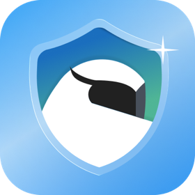</p>

<h1 align="center">Shoo</h1>

<p align="center"><b>Together, we shoo the scams.</b></p>

<p align="center">A Safari Web Extension and iPhone app that scores every page you open, warns you on risky ones, and blocks scam sites. A blocked site opens again only after a family Guardian checks it.</p>

<p align="center">

[](#quick-start) [](#tech-stack) [](#how-a-page-is-scored) [](chrome/README.md) [](#architecture) [](#architecture) [](#what-shoo-does)

</p>

<p align="center">

[**Contracts**](contracts/README.md) · [**API reference**](backend/API.md) · [**Detector**](detector/README.md) · [**AI service**](ai/README.md) · [**Chrome version**](chrome/README.md) · [**Docs**](docs/README.md)

</p>

<br />

<table align="center">
<tr>
<td>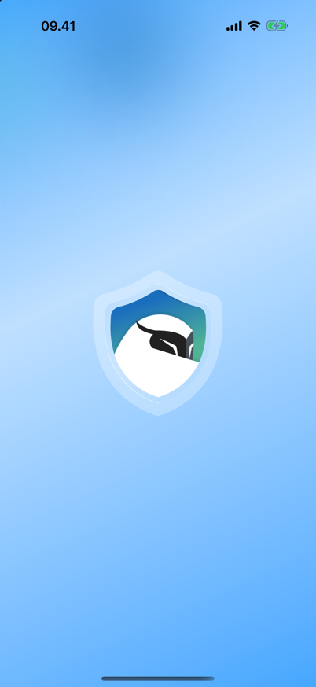</td>
<td>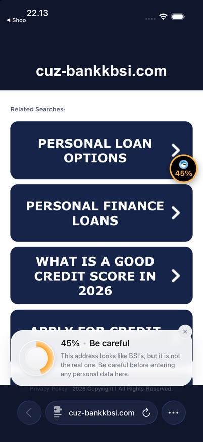</td>
<td>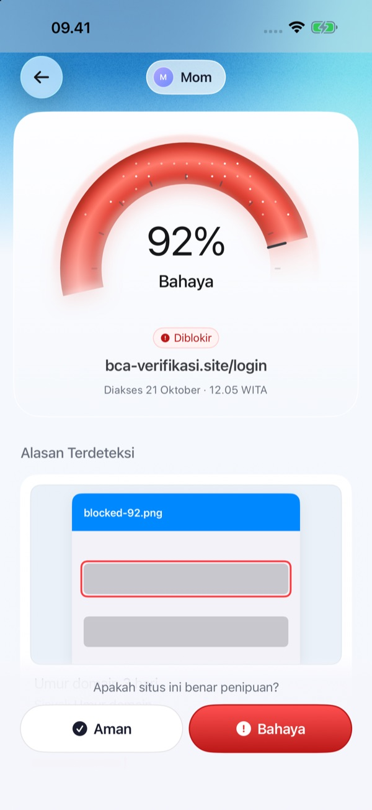</td>
<td>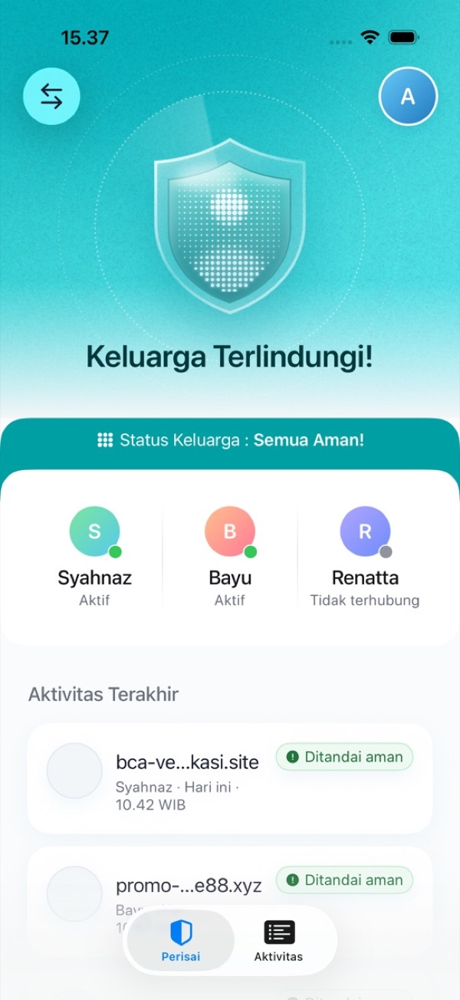</td>
<td>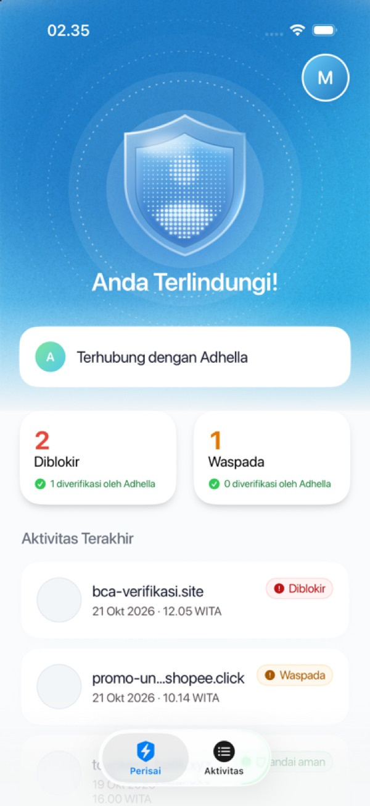</td>
</tr>
</table>

<p align="center"><sub>Shoo opens on its shield. Safari warns on a look-alike bank page, the Guardian sees the blocked page in the app and decides, and the Protected person sees what was stopped.</sub></p>

</div>

---

| Where | Link |
|---|---|
| **Source** | This repository (`ios/` is the Xcode project, generated by XcodeGen) |
| **Platforms** | iPhone (iOS 17.0+) with the Safari Web Extension; a Chrome (MV3) build for desktop runs layers 1–2 only |
| **API** | Cloudflare Worker `shoo-api`, see [`backend/API.md`](backend/API.md) |
| **Languages** | English and Bahasa Indonesia, in the app, the extension and every reason text |
| **Status** | Team project, shipped to testers through TestFlight ([workflow](.github/workflows/testflight.yml)) |

> Team project. Detection weights are still being tuned, so some scam pages score low and some real pages score high. See [Limits](#limits).

## Contents

- [The problem](#the-problem)
- [What Shoo does](#what-shoo-does)
- [See it work](#see-it-work)
- [How a page is scored](#how-a-page-is-scored)
- [How a block is lifted](#how-a-block-is-lifted)
- [Architecture](#architecture)
- [Quick start](#quick-start)
- [Run each part locally](#run-each-part-locally)
- [Repository map](#repository-map)
- [Tech stack](#tech-stack)
- [Privacy and safety](#privacy-and-safety)
- [Limits](#limits)
- [Working rules](#working-rules)
- [Team](#team)

## The problem

Scam pages copy the look of banks, e-wallets, marketplaces and government services. They sit on look-alike addresses (`bca-verifikasi.site`, `cuz-bankkbsi.com`) or on free hosting, and they ask for a PIN, an OTP, a card number or a KTP number.

- **The person who gets the link is often the one least able to judge it.** A parent or grandparent taps a link from a chat and sees a page that looks right.
- **The person who could judge it is not there.** A child or relative who would spot the fake only hears about it after the money is gone.
- **Browsers only stop known pages.** A new scam domain is live for hours or days before any list has it.

Shoo puts a check on every page, on the phone itself, and links the person at risk to someone they trust.

## What Shoo does

Every user picks one mode once: **Guardian** (checks for the family) or **Protected** (browses with Shoo on). A Guardian can have up to 3 Protected people.

| Feature | How |
|---|---|
| **A live score on every page** | The extension scores the page as you browse. A small bubble shows the score and its colour in the corner of the page. |
| **Warnings that match the risk** | At 30% a card says "Be careful" with the top reason. At 50% a sheet covers the page and sensitive form fields are struck through. |
| **A block with no bypass** | At 80% the tab moves to Shoo's own block page. Websites cannot script that page, so the block cannot be removed from the page. |
| **The Guardian decides** | A blocked page is sent to the Guardian with a push. The Guardian sees the score, the reasons and a copy of the page, then taps **Safe** or **Danger**. |
| **Safe opens the page again** | When the Guardian marks a page Safe, the block page opens it for the Protected person by itself. |
| **Join with a code or a link** | The Guardian shares a 6-digit code, a QR code or an invite link (WhatsApp, Messages). If the app is not installed, the link opens an install page first. |
| **Activity for the whole family** | The Guardian sees every member's warned and blocked pages, filtered by person and by status. |
| **Delete means gone** | Delete my data removes the device and its history right away. Scans auto-delete after 14 days. |

| Score | Status | What the person sees |
|---|---|---|
| 0–29 | `normal` | Only the score bubble. Nothing leaves the phone. |
| 30–49 | `warning` | First card plus highlights on the risky parts |
| 50–79 | `warning` | Second card, sensitive forms struck through |
| ≥ 80 | `blocked` | Block page until a Guardian marks it Safe |

## See it work

<table>
<tr>
<td width="50%">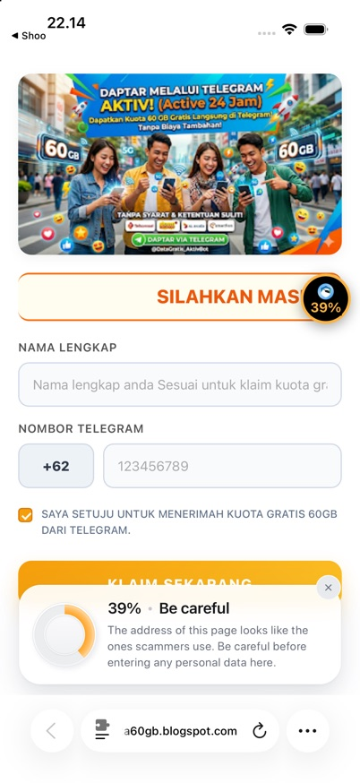</td>
<td width="50%">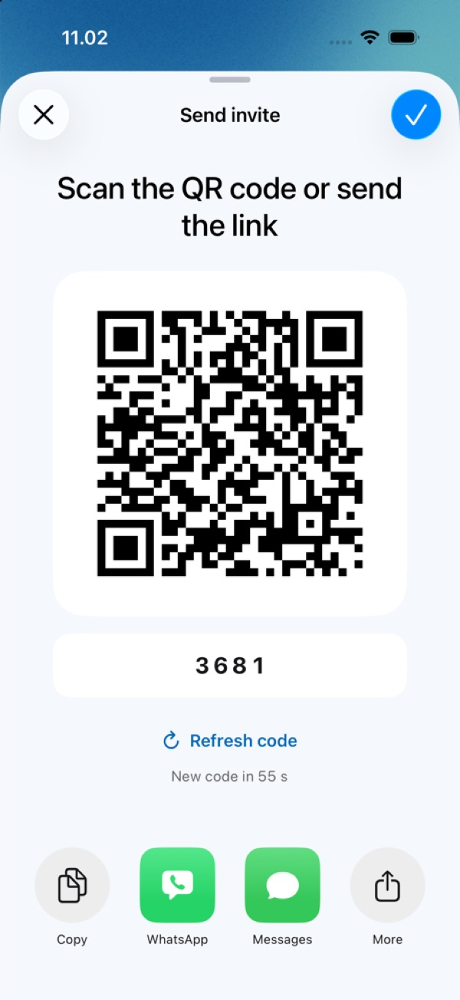</td>
</tr>
<tr>
<td><b>Warning in Safari.</b> A fake "free 60 GB" page on free hosting asks for a phone number. Shoo scores it 39% and explains why in one line.</td>
<td><b>Inviting family.</b> The Guardian shares a QR code, a code or a link. The code refreshes on its own.</td>
</tr>
</table>

More captures, before and after each UI change, are in [`plan/alief/qa/img/`](plan/alief/qa/img/).

## How a page is scored

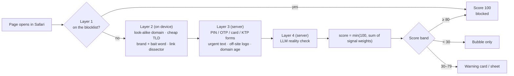

- **Layers 1–2 run on the phone** ([`detector/`](detector/README.md)), in under 50 ms, with no network call. If the server is down, they still run.
- **Layers 3–4 run on the server** ([`ai/`](ai/README.md), `POST /analyze`). The page content sent there is never stored.
- The score is recomputed every time a layer returns, so it can rise while the page loads. A blocklist match ends the scan at 100.

Rules and weights: [`contracts/detector-interface.md`](contracts/detector-interface.md). Blocklist design: [`docs/design/blocklist.md`](docs/design/blocklist.md).

## How a block is lifted

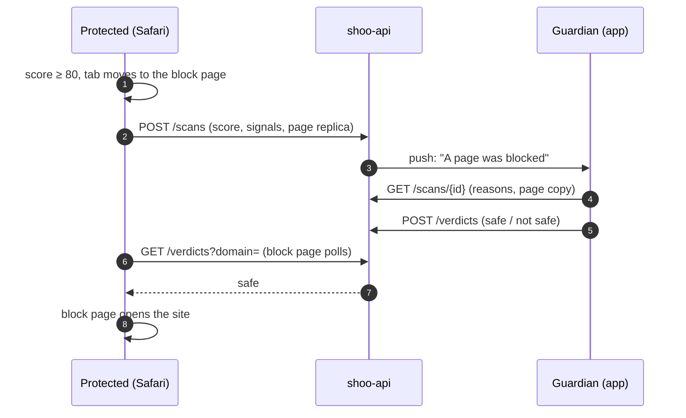

Only pages that reach 30 are ever sent to the backend. The verdict lookup also starts only at 30, so ordinary browsing never reaches the server.

## Architecture

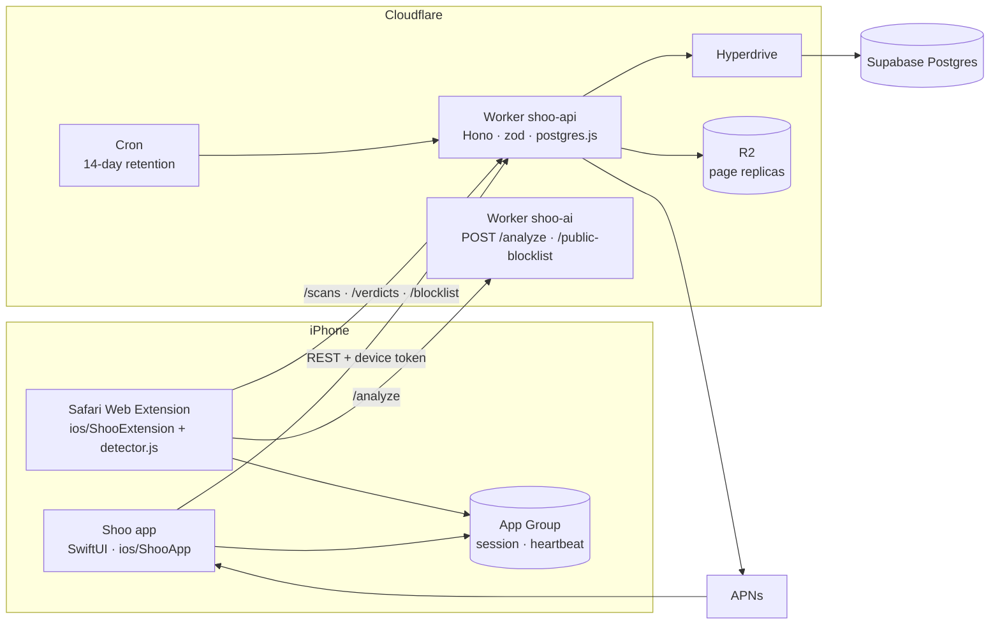

- **No login.** Each phone registers once and gets a device token, kept in the Keychain. Family links are made with a join code.
- **The app and the extension talk through the App Group**: the app writes the session, the extension writes a heartbeat so the app can tell whether it is on.
- **Every JSON shape is fixed in [`contracts/`](contracts/README.md).** Teams use [`contracts/fixtures/`](contracts/fixtures/) as mock data instead of waiting on each other.

More detail: [`plan/alief/ARCHITECTURE.md`](plan/alief/ARCHITECTURE.md) (app + backend, Bahasa Indonesia) and [`backend/API.md`](backend/API.md).

## Quick start

You need a Mac with Xcode 26 (the app uses iOS 26 SDK APIs, and still runs on iOS 17) and [XcodeGen](https://github.com/yonaskolb/XcodeGen).

1. **Clone** the repository.

   ```bash
   git clone https://github.com/umarmuhdhor/Final-CH7.git
   ```

2. **Generate and open the project.**

   ```bash
   brew install xcodegen
   ```

   ```bash
   cd Final-CH7/ios && xcodegen && open Shoo.xcodeproj
   ```

3. **Run.** Pick the `Shoo` scheme and an iPhone Simulator, then press **⌘R**.

Run `xcodegen` again after every `git pull` that changes `ios/project.yml`, or after adding files in a new folder. `Shoo.xcodeproj` is generated and gitignored; never commit it.

<details>
<summary>Running on your own iPhone</summary>

Each developer signs with their own Apple account. Do not touch `project.yml`; use a local override:

```bash
cp ios/Config/Local.xcconfig.example ios/Config/Local.xcconfig
```

Fill in your Team ID, a bundle ID and an App Group unique to your account, then run `cd ios && xcodegen`. `Local.xcconfig` is gitignored. Without it, the defaults in `ios/Config/Shoo.xcconfig` are used (`com.shoo.app`, no team), which builds for the Simulator only.

Then turn the extension on: **Settings → Apps → Safari → Extensions → Shoo**, and allow it on all websites.

</details>

## Run each part locally

| Part | Command | What it runs |
|---|---|---|
| Backend | see [`backend/README.md`](backend/README.md#local-setup) | Local Supabase, pgTAP tests, the Worker on `http://localhost:8787` |
| Backend tests | `pnpm -C backend/api typecheck && pnpm -C backend/api test` | vitest inside workerd, against local Postgres |
| AI service | `cd ai && npm ci && npm run dev` | `POST /analyze` on `http://127.0.0.1:8787` |
| AI tests | `cd ai && npm test` | `node --test` |
| AI eval | `node ai/eval/run.mjs --analyze-url http://localhost:8787` | Scores the eval set through the running service |
| Detector tests | `node --test detector/test` | Layer 1–2 rules |
| Detector build | `node detector/scripts/build.mjs && sh detector/scripts/sync-to-extension.sh` | Builds `detector.js` and copies it into the extension |
| Chrome tests | `node --test chrome/test/*.test.mjs` | Chrome extension logic; load `chrome/extension/` unpacked to try it |

CI runs the matching checks on every pull request ([`.github/workflows/`](.github/workflows/)).

## Repository map

| Path | What is inside | Owner |
|---|---|---|
| [`contracts/`](contracts/README.md) | Shared JSON shapes, API spec, App Group keys, fixtures | Lead |
| [`ios/project.yml`](ios/project.yml) | XcodeGen targets, capabilities, build settings | Lead |
| [`ios/ShooShared/`](ios/ShooShared) | Swift models used by the app and the extension | Lead |
| [`ios/ShooExtension/`](ios/ShooExtension) | Safari Web Extension: scan pipeline, warnings, block page | Lead |
| [`ios/ShooLiveActivity/`](ios/ShooLiveActivity) | Live Activity target (EX-03) | Lead |
| [`ios/ShooApp/`](ios/ShooApp) | App screens: onboarding, Shield, Activity, Detail, Pairing, Profile | Team App |
| [`backend/`](backend/README.md) | API Worker, Postgres migrations, pgTAP tests | Team App |
| [`detector/`](detector/README.md) | On-device detection, layers 1–2 | Lead |
| [`ai/`](ai/README.md) | Server detection, layers 3–4 (LLM), eval set | Team AI |
| [`chrome/`](chrome/README.md) | Chrome (MV3) version of the extension | Lead |
| [`docs/`](docs/README.md) | PRD link, decisions, mandates, spikes, design notes | Lead |
| [`plan/`](plan/) | Each member's work plan, QA reports and screenshots | Each member |

## Tech stack

| Layer | Stack |
|---|---|
| App | Swift 5 mode, SwiftUI, iOS 17+, String Catalog (EN + ID), Keychain, App Group |
| Extension | Safari Web Extension (plain JavaScript content scripts), native messaging to the app |
| Detection on device | Plain JavaScript, built into one script, data in JSON |
| Detection on server | Cloudflare Worker, Hono, plain JavaScript (ESM + JSDoc), RDAP, LLM reality check |
| Backend | Cloudflare Worker (Hono, zod, postgres.js), Hyperdrive, R2, Cron Triggers, APNs |
| Database | Supabase Postgres, pgTAP |
| Chrome | Manifest V3, same pipeline and UI as Safari |
| CI / release | GitHub Actions, gitleaks, TestFlight upload |

## Privacy and safety

- **Low-score browsing stays on the phone.** Nothing is sent below a score of 30.
- **Page content sent for analysis is never stored.** `POST /analyze` reads it and forgets it.
- **What you type never leaves the page.** The page copy kept as evidence is the page's own HTML, never the values in its fields.
- **The full URL never leaves the browser.** Only a shareable form of it is sent.
- **No account, no email, no phone number.** A device token identifies the phone.
- **Delete is immediate.** Delete my data removes the device and its scans at once. Everything else is deleted after 14 days.
- **Secrets stay out of git.** Keys live in `.env` / `.dev.vars` (gitignored) and in GitHub environments; every pull request runs gitleaks.

Threat model and secret rules: [`plan/alief/SECURITY.md`](plan/alief/SECURITY.md).

## Limits

- **Weights are estimates.** Signal weights are tuned against an eval set, not real traffic. Some scam pages score under 30, and some real pages score above it.
- **No Dynamic Island.** A Safari extension cannot start a Live Activity, so the live score is an in-page bubble ([spike](docs/spikes/dynamic-island.md)).
- **Chrome runs layers 1–2 only**, with no pairing and no Guardian.
- **If the AI service is down,** layers 3–4 are skipped and the score comes from layers 1–2 alone.
- **Hoax detection is Phase 2**, not part of this version.

## Working rules

See [CLAUDE.md](CLAUDE.md). Short version:

1. Stay in your team's folder.
2. Never edit `contracts/`, `ios/project.yml` or `ios/ShooShared/` without the lead. Ask in a GitHub issue.
3. Every JSON matches `contracts/`.
4. One branch per PRD ID (`feat/EX-04-popup-warning`), every change through a pull request.
5. Never commit secrets.

## Team

| Person | Role | GitHub |
|---|---|---|
| Umar | Lead: extension, detector, contracts | [umarmuhdhor](https://github.com/umarmuhdhor) |
| Imelda | Team AI: server detection, eval | [imeldamayanti](https://github.com/imeldamayanti) |
| Alief | Team App: iOS app, backend | [aliefauzan](https://github.com/aliefauzan) |
| Richard | Product manager (PRD) | — |
