# Hasil v1: tes live L2-L4 di simulator iPhone

## Ringkasan

| Yang diukur | Hasil |
|---|---|
| Scam diblokir | **10 dari 21** halaman yang terbuka (48%). Target 70%: **gagal** |
| Scam skor ≥ 50 | **10 dari 21** (48%). Target 90%: **gagal** |
| Scam diberi peringatan saja | 2 dari 21 |
| Scam tanpa tanda | 9 dari 21 |
| Legit kena tanda | **0 dari 23**. Target 0: lulus |
| Waktu LLM | Median 1,4 detik, paling lama 4,5 detik |
| Error server | 0 |

## Pengaturan

- **Tanggal:** 3 Nov 2026, satu putaran, tiap link satu kunjungan.
- **Kode:** branch `feat/AI-M4-thinking-off-asks-otp-boxes`, commit `2c51aee` (PR #232 belum merge).
- **Simulator:** `Shoo QA L1-4`, iPhone 17 Pro, iOS 26.5, Safari dengan ekstensi build Debug.
- **Layer:** L1 mati. L2 `detector.js` apa adanya, termasuk batas 25 per bagian URL. L3 dan RDAP live dengan batas 1 detik. L4 `deepseek-v4-flash`, prompt `reality-check.v4`, thinking off.
- **Sampel:** 25 scam dan 23 legit dari `ai/test-layer2`.
- **Tunggu:** 20 detik per halaman, lalu screenshot.

### Beda dari plan

- **Port:** server tes memakai 8790, bukan 8788, karena 8788 dan 8789 dipakai proxy lama dari sesi lain.
- **Sesi palsu:** ditulis dengan `simctl spawn ... defaults write` saat simulator menyala. Tulisan dari Mac saat simulator mati hilang setelah simulator menyala lagi.
- **`page_type`:** tidak tercatat di v1 karena salah nama field di `server.mjs`. Sudah diperbaiki untuk versi berikutnya. Tidak memengaruhi skor.
- **Link asli:** plan K9 memakai domain yang disamarkan. Atas permintaan Imelda, tabel memakai URL asli yang bisa diklik, satu kolom.
- **`scam-19`:** dialog JavaScript menahan halaman. Tetap dihitung sebagai halaman terbuka tanpa tanda, karena pengguna asli juga melihat halaman itu tanpa peringatan.

### Batasan

- L1 mati, jadi skor scam yang biasanya kena daftar bisa lebih rendah daripada di produksi. `mit.edu` tidak diblokir di tes ini, tapi masalah daftarnya **belum** terbukti selesai.
- Tidak ada halaman legit yang mencapai 30, jadi jalur LLM baru **tidak teruji** di halaman legit.
- Sesi palsu, jadi alur Guardian, kirim scan, verdict, dan push tidak dites.
- LLM dan RDAP dipanggil dari Mac, bukan dari Cloudflare, jadi waktunya bisa beda dari produksi.
- Simulator, bukan iPhone asli.
- Hanya pemuatan halaman. Scam yang menampilkan form setelah diketuk tidak terlihat.
- Satu putaran. Situs juga bisa berubah sejak 31 Okt.

## Batas lulus

Hanya dari halaman yang terbuka. Situs mati: 4 (scam-01, scam-02, scam-04, scam-07). Tidak terbuka atau diadang: scam -; legit -.

| Cek | Target | Hasil | |
|---|---|---|---|
| Scam diblokir (≥ 80) | minimal 70% | 10 dari 21 = 48% | **gagal** |
| Scam skor ≥ 50 | minimal 90% | 10 dari 21 = 48% | **gagal** |
| Legit kena tanda (≥ 30) | 0 | 0 dari 23 | lulus |
| Error server | 0 | 0 | lulus |

## Scam (25)

| Link | Harus | L2 | L3 | L4 | Total | Tampil di HP | LLM ms | /analyze ms | 31 Okt | SS |
|---|---|---:|---:|---|---:|---|---:|---:|---|---|
| scam-01 [https://bni-diirect.com/](https://bni-diirect.com/) | ≥ 80 | - | - | - | - | site gone | - | - | - | - |
| scam-02 [https://bni-directbni.com/](https://bni-directbni.com/) | ≥ 80 | - | - | - | - | site gone | - | - | - | - |
| scam-03 [https://qlolla-bybri.com/](https://qlolla-bybri.com/) | ≥ 80 | 14 | 60 | +30 flag | 100 | Blokir 100% | 2.019 | 2.766 | Blokir 100 | <a href="ss/scam-03.jpg">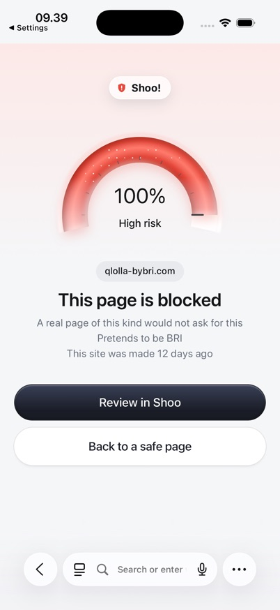</a> |
| scam-04 [https://cusbsi.com/](https://cusbsi.com/) | ≥ 80 | - | - | - | - | site gone | - | - | - | - |
| scam-05 [https://kodepembatalanbybni.pages.dev/](https://kodepembatalanbybni.pages.dev/) | ≥ 80 | 33 | 25 | +30 flag | 88 | Blokir 88% | 2.176 | 2.890 | Blokir 88 | <a href="ss/scam-05.jpg">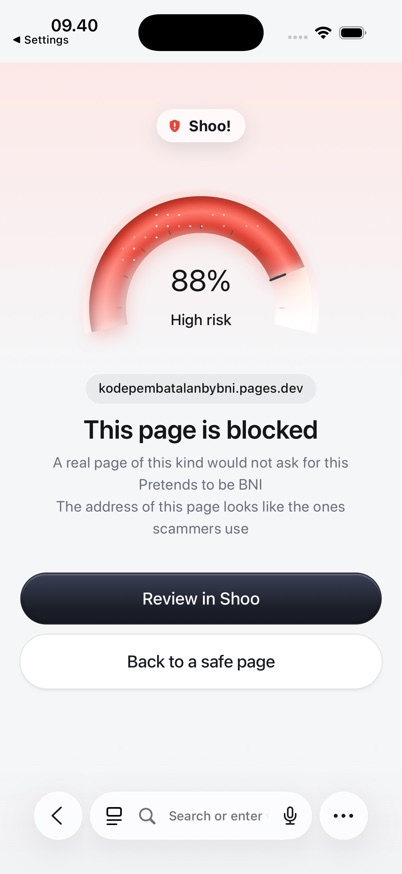</a> |
| scam-06 [https://sites.google.com/view/pengembalian-request/halaman-muka](https://sites.google.com/view/pengembalian-request/halaman-muka) | ≥ 80 | 0 | 0 | - | 0 | Tanpa tanda | - | 712 | 0 | <a href="ss/scam-06.jpg">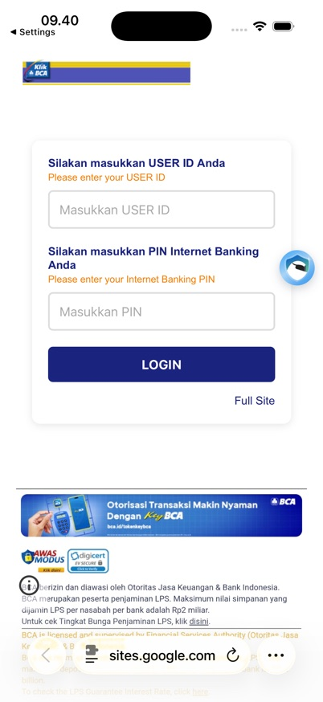</a> |
| scam-07 [https://yaigsjv.1238bll.my.id/ca/bin/2c.html](https://yaigsjv.1238bll.my.id/ca/bin/2c.html) | ≥ 80 | - | - | - | - | site gone | - | - | - | - |
| scam-08 [https://m-pajak.top/](https://m-pajak.top/) | ≥ 80 | 5 | 35 | +40 flag | 80 | Blokir 80% | 964 | 1.507 | Kosong | <a href="ss/scam-08.jpg">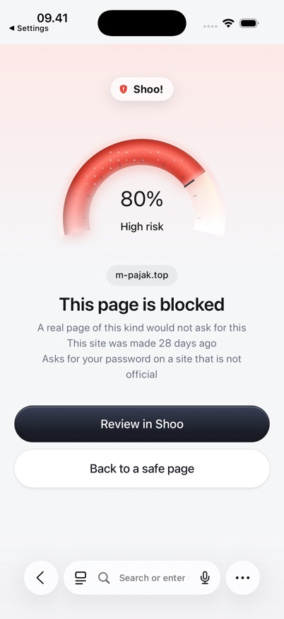</a> |
| scam-09 [https://storee-dp9hsk1cxr2y.edgeone.dev/](https://storee-dp9hsk1cxr2y.edgeone.dev/) | ≥ 80 | 11 | 25 | +44 flag | 80 | Blokir 80% | 1.382 | 1.747 | Blokir 100 ᴸ¹ |  |
| scam-10 [https://storee-dp8iiud7biuu.edgeone.dev/](https://storee-dp8iiud7biuu.edgeone.dev/) | ≥ 80 | 0 | 12 | - | 12 | Tanpa tanda | - | 1 | Blokir 100 ᴸ¹ | <a href="ss/scam-10.jpg">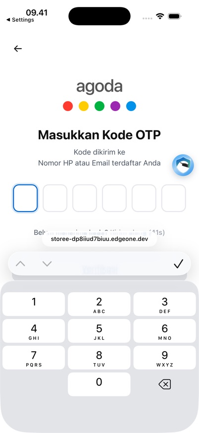</a> |
| scam-11 [https://deddydanchika.blogspot.com/](https://deddydanchika.blogspot.com/) | ≥ 80 | 0 | 0 | - | 0 | Tanpa tanda | - | 634 | 0 | <a href="ss/scam-11.jpg">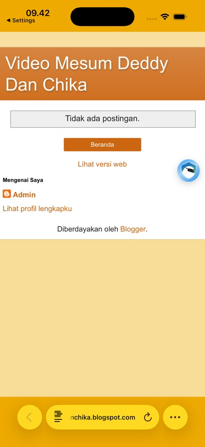</a> |
| scam-12 [https://registers-app15.fkregs-on.com/code.php](https://registers-app15.fkregs-on.com/code.php) | ≥ 80 | 21 | 35 | +30 flag | 86 | Blokir 86% | 1.433 | 2.072 | Blokir 86 |  |
| scam-13 [https://regs-apps14.regnows-dfg.com/code.php](https://regs-apps14.regnows-dfg.com/code.php) | ≥ 80 | 21 | 25 | +34 flag | 80 | Blokir 80% | 1.404 | 2.170 | 76 |  |
| scam-14 [https://pendaftaran-umum04.thems.blog/code](https://pendaftaran-umum04.thems.blog/code) | ≥ 80 | 12 | 25 | +43 flag | 80 | Blokir 80% | 4.542 | 5.343 | 67 | <a href="ss/scam-14.jpg">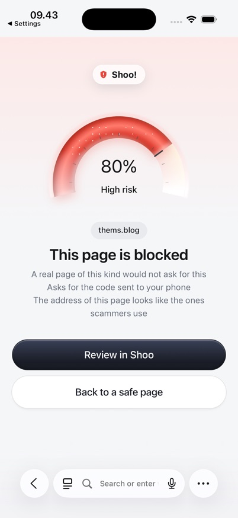</a> |
| scam-15 [https://apply.wozspace.site/info](https://apply.wozspace.site/info) | ≥ 80 | 5 | 25 | tidak flag | 30 | Peringatan 30% | 1.227 | 2.234 | Kosong | <a href="ss/scam-15.jpg">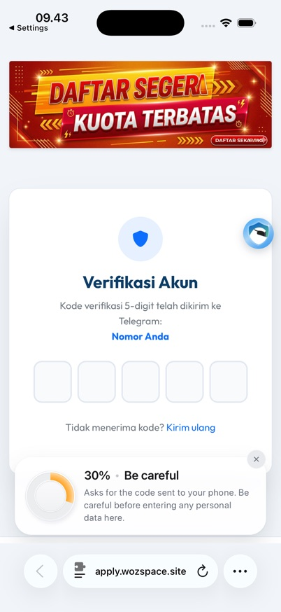</a> |
| scam-16 [https://registersw-app17.fkregs-on.com/code.php](https://registersw-app17.fkregs-on.com/code.php) | ≥ 80 | 21 | 35 | +30 flag | 86 | Blokir 86% | 1.214 | 1.225 | Blokir 86 | <a href="ss/scam-16.jpg">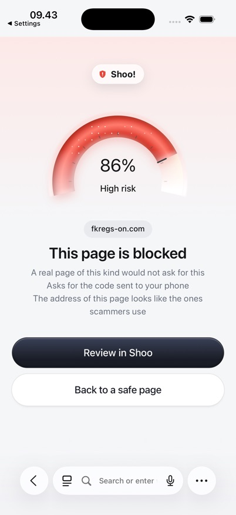</a> |
| scam-17 [https://login-mybca-bisnis.ibcbank-aceh.com/](https://login-mybca-bisnis.ibcbank-aceh.com/) | ≥ 80 | 14 | 10 | - | 24 | Tanpa tanda | - | 600 | 24 | <a href="ss/scam-17.jpg">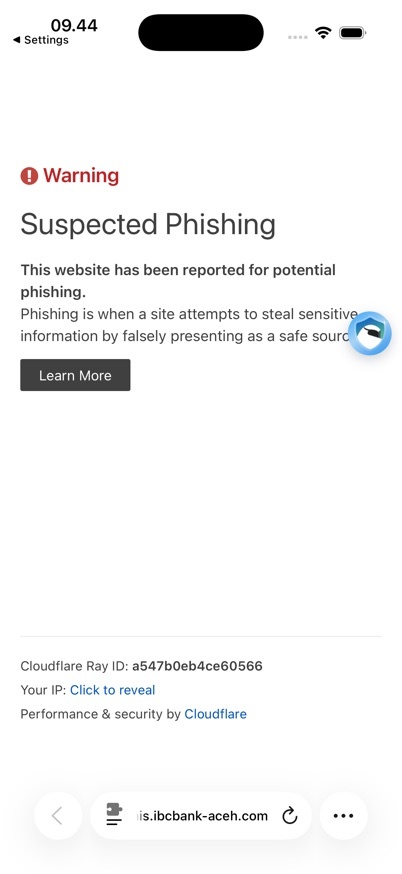</a> |
| scam-18 [https://www.cuz-bankkbsi.com/](https://www.cuz-bankkbsi.com/) | ≥ 80 | 25 | 0 | - | 25 | Tanpa tanda | - | 1.003 | 45 | <a href="ss/scam-18.jpg">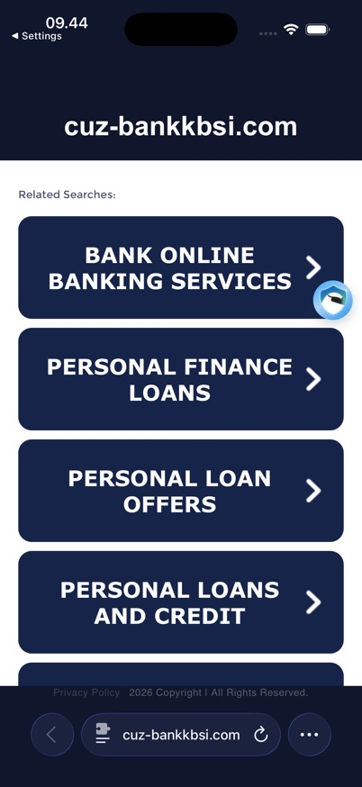</a> |
| scam-19 [https://shopeeofficial-refund.vercel.app/otp.html](https://shopeeofficial-refund.vercel.app/otp.html) | ≥ 80 | - | - | - | - | Tanpa tanda | - | - | Diadang Safari | <a href="ss/scam-19.jpg">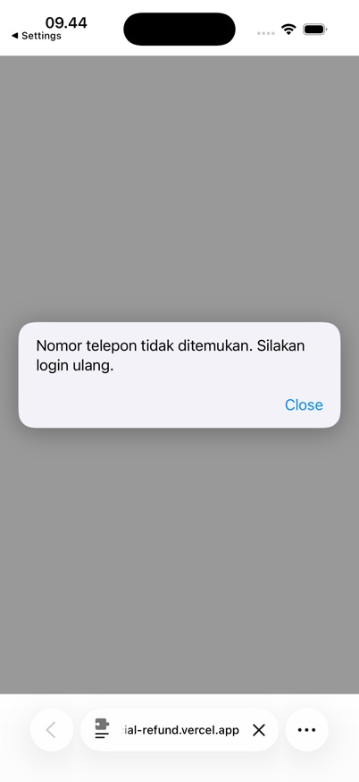</a> |
| scam-20 [https://viinwkwk-dot.github.io/instagram./](https://viinwkwk-dot.github.io/instagram./) | ≥ 80 | 0 | 15 | - | 15 | Tanpa tanda | - | 4 | 45 | <a href="ss/scam-20.jpg">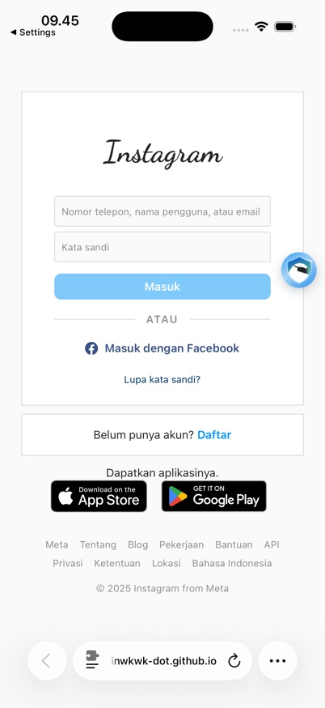</a> |
| scam-21 [https://helpnets.info/0442827f6o7cfb43933ba59e2881cc906b7c.html/](https://helpnets.info/0442827f6o7cfb43933ba59e2881cc906b7c.html/) | ≥ 80 | 34 | 40 | +30 flag | 100 | Blokir 100% | 868 | 1.270 | Blokir 100 ᴸ¹ | <a href="ss/scam-21.jpg">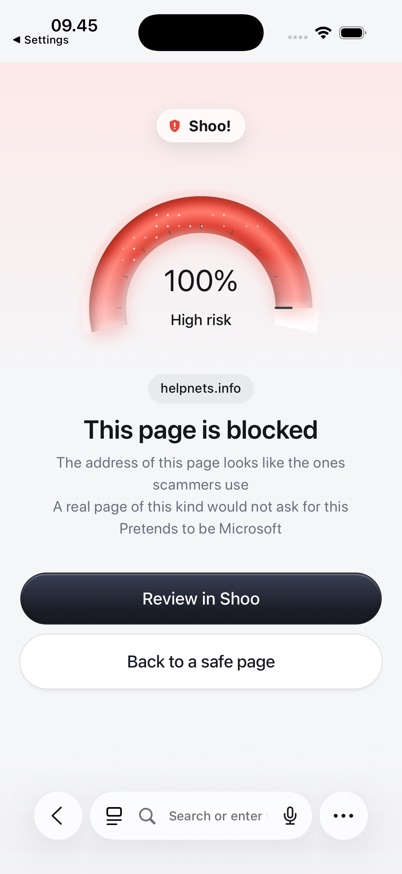</a> |
| scam-22 [https://d33wubrfki0l68.cloudfront.net/a24ce9fe-3a25-440e-923c-70c96b668dc8/dhl123.html](https://d33wubrfki0l68.cloudfront.net/a24ce9fe-3a25-440e-923c-70c96b668dc8/dhl123.html) | ≥ 80 | 18 | 15 | +47 flag | 80 | Blokir 80% | 969 | 1.629 | 63 | <a href="ss/scam-22.jpg">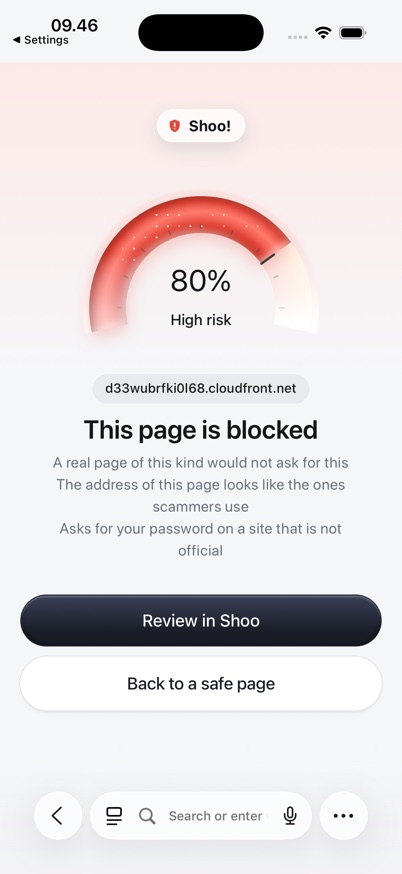</a> |
| scam-23 [https://simgratisonine.blogspot.com/](https://simgratisonine.blogspot.com/) | ≥ 80 | 13 | 0 | - | 13 | Tanpa tanda | - | 1 | 13 | <a href="ss/scam-23.jpg">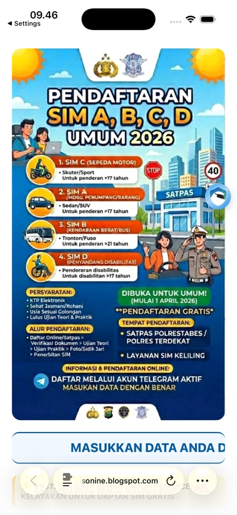</a> |
| scam-24 [https://bantuannbansos2026.blogspot.com/](https://bantuannbansos2026.blogspot.com/) | ≥ 80 | 24 | 0 | - | 24 | Tanpa tanda | - | 1 | 24 | <a href="ss/scam-24.jpg">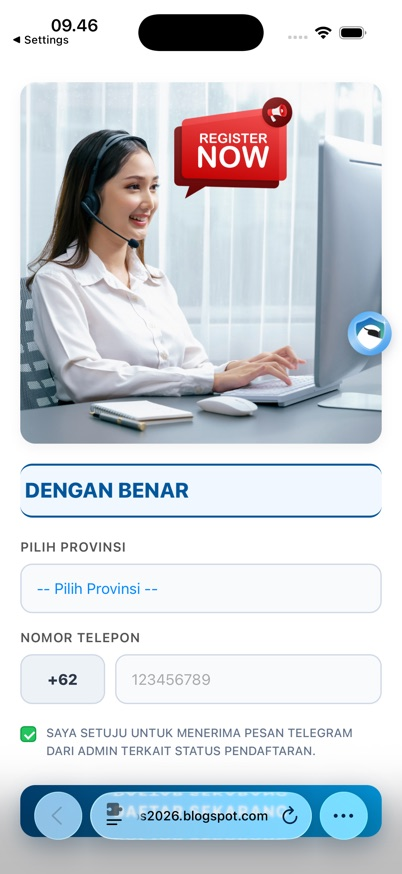</a> |
| scam-25 [https://gratiskuota60gb.blogspot.com/](https://gratiskuota60gb.blogspot.com/) | ≥ 80 | 24 | 15 | tidak flag | 39 | Peringatan 39% | 2.194 | 2.195 | 39 | <a href="ss/scam-25.jpg">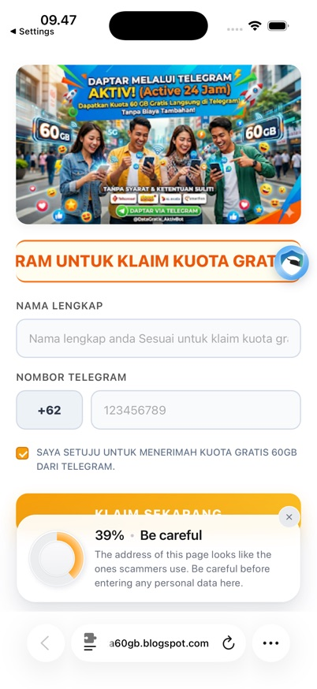</a> |

## Legit (23)

| Link | Harus | L2 | L3 | L4 | Total | Tampil di HP | LLM ms | /analyze ms | 31 Okt | SS |
|---|---|---:|---:|---|---:|---|---:|---:|---|---|
| legit-01 [https://github.com/](https://github.com/) | < 30 | 0 | 0 | - | 0 | Tanpa tanda | - | 5 | 0 | <a href="ss/legit-01.jpg">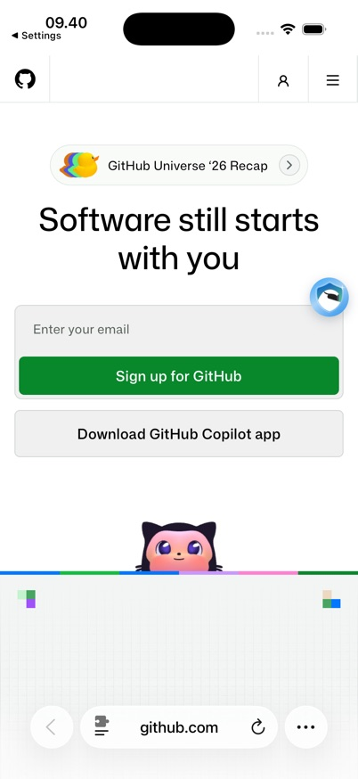</a> |
| legit-02 [https://www.wikipedia.org/](https://www.wikipedia.org/) | < 30 | 0 | 0 | - | 0 | Tanpa tanda | - | 3 | 0 | <a href="ss/legit-02.jpg">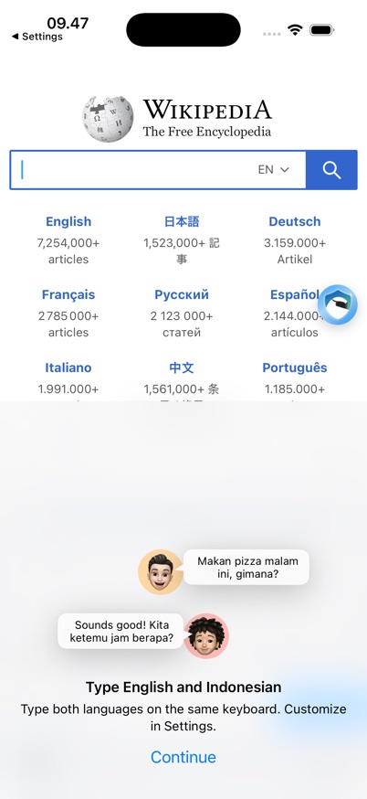</a> |
| legit-03 [https://www.rfc-editor.org/](https://www.rfc-editor.org/) | < 30 | 0 | 0 | - | 0 | Tanpa tanda | - | 419 | 0 | <a href="ss/legit-03.jpg">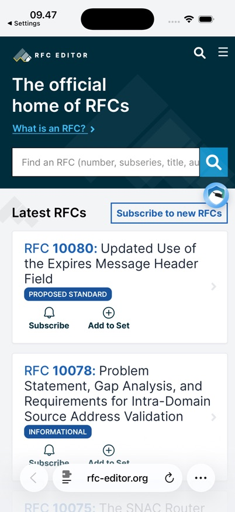</a> |
| legit-04 [https://www.python.org/](https://www.python.org/) | < 30 | 0 | 0 | - | 0 | Tanpa tanda | - | 334 | 0 | <a href="ss/legit-04.jpg">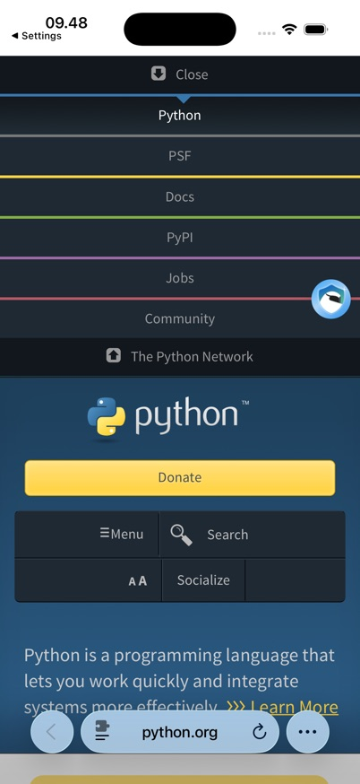</a> |
| legit-05 [https://www.debian.org/](https://www.debian.org/) | < 30 | 0 | 0 | - | 0 | Tanpa tanda | - | 282 | 0 | <a href="ss/legit-05.jpg">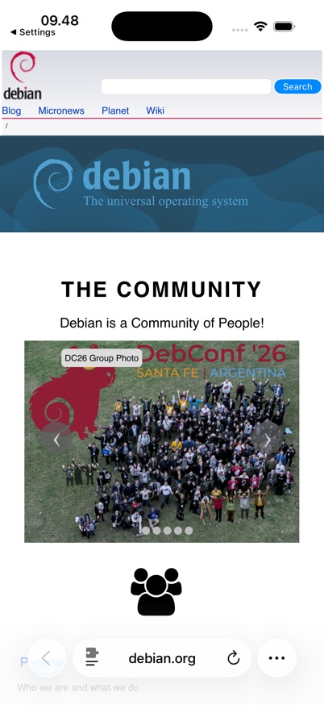</a> |
| legit-06 [https://www.kernel.org/](https://www.kernel.org/) | < 30 | 0 | 0 | - | 0 | Tanpa tanda | - | 291 | 0 | <a href="ss/legit-06.jpg">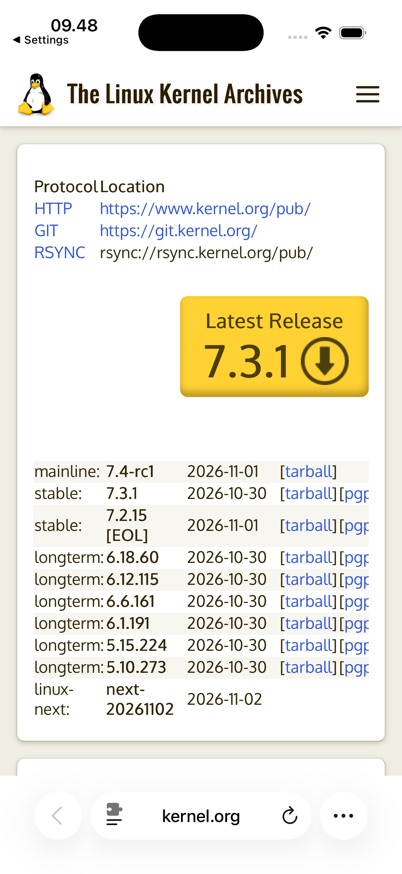</a> |
| legit-07 [https://www.mozilla.org/](https://www.mozilla.org/) | < 30 | 0 | 0 | - | 0 | Tanpa tanda | - | 6 | 0 | <a href="ss/legit-07.jpg">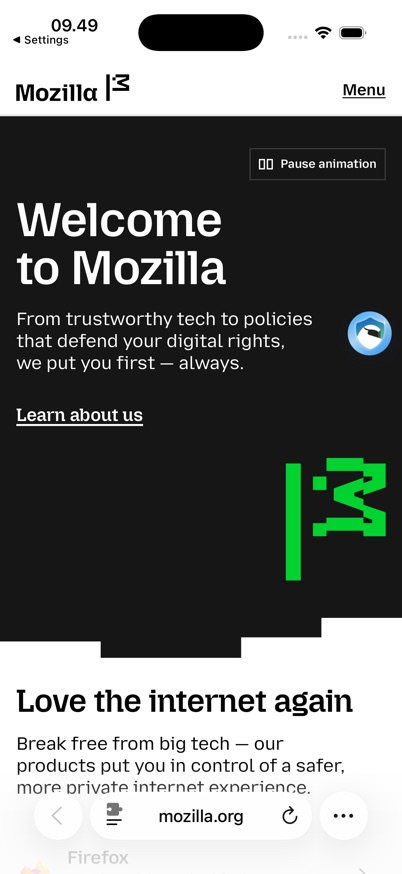</a> |
| legit-08 [https://www.eff.org/](https://www.eff.org/) | < 30 | 0 | 0 | - | 0 | Tanpa tanda | - | 387 | 0 | <a href="ss/legit-08.jpg">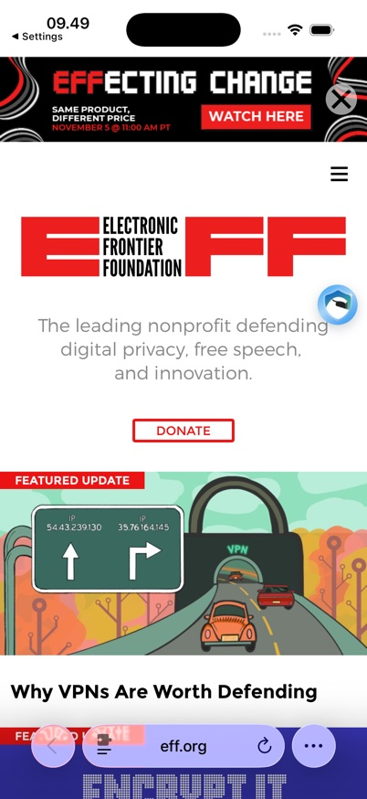</a> |
| legit-09 [https://www.archive.org/](https://www.archive.org/) | < 30 | 0 | 0 | - | 0 | Tanpa tanda | - | 294 | 0 | <a href="ss/legit-09.jpg">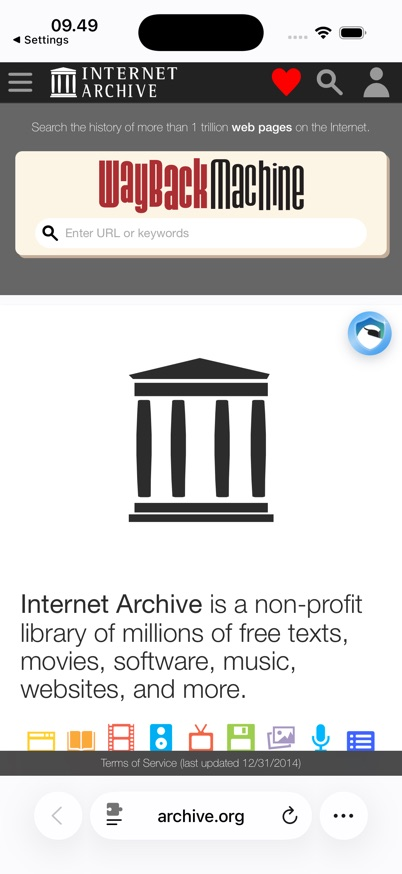</a> |
| legit-10 [https://www.nasa.gov/](https://www.nasa.gov/) | < 30 | 0 | 0 | - | 0 | Tanpa tanda | - | 855 | 0 | <a href="ss/legit-10.jpg">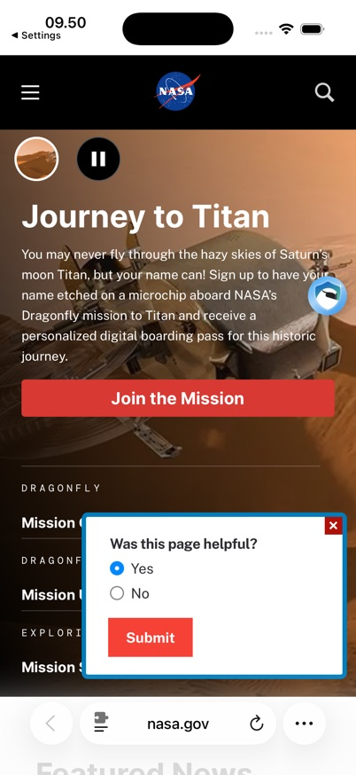</a> |
| legit-11 [https://www.loc.gov/](https://www.loc.gov/) | < 30 | 0 | 0 | - | 0 | Tanpa tanda | - | 478 | 0 | <a href="ss/legit-11.jpg">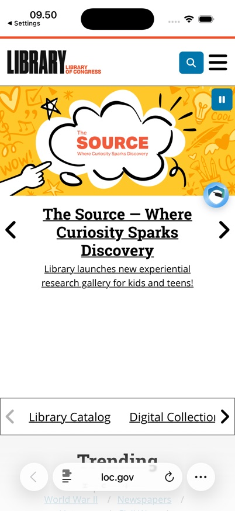</a> |
| legit-12 [https://www.mit.edu/](https://www.mit.edu/) | < 30 | 0 | 0 | - | 0 | Tanpa tanda | - | 4 | Blokir 100 ᴸ¹ | <a href="ss/legit-12.jpg">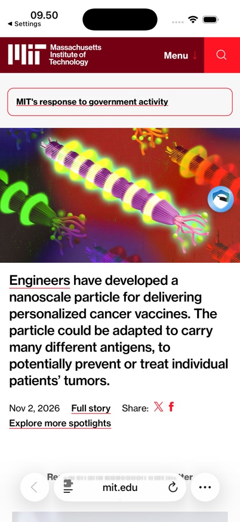</a> |
| legit-13 [https://www.berkeley.edu/](https://www.berkeley.edu/) | < 30 | 0 | 0 | - | 0 | Tanpa tanda | - | 3 | 0 |  |
| legit-14 [https://www.cloudflare.com/](https://www.cloudflare.com/) | < 30 | 0 | 0 | - | 0 | Tanpa tanda | - | 5 | 0 | <a href="ss/legit-14.jpg">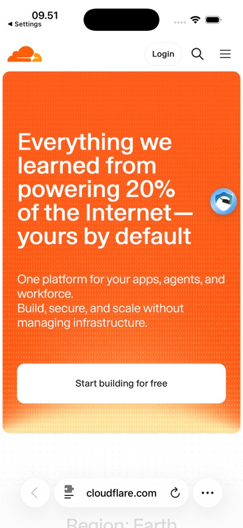</a> |
| legit-15 [https://developer.apple.com/documentation/swift](https://developer.apple.com/documentation/swift) | < 30 | 0 | 0 | - | 0 | Tanpa tanda | - | 3 | 0 | <a href="ss/legit-15.jpg">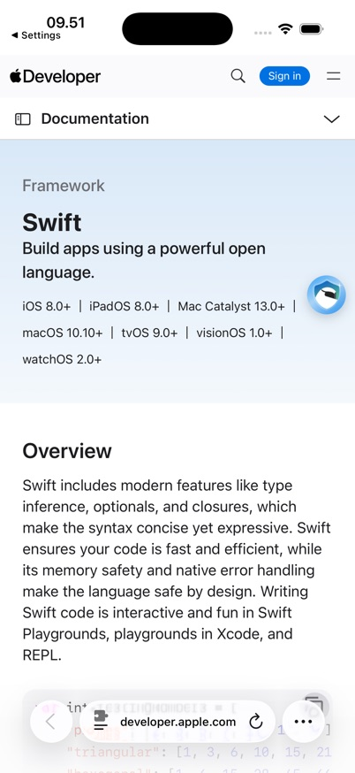</a> |
| legit-16 [https://docs.python.org/3/library/](https://docs.python.org/3/library/) | < 30 | 0 | 0 | - | 0 | Tanpa tanda | - | 9 | 0 | <a href="ss/legit-16.jpg">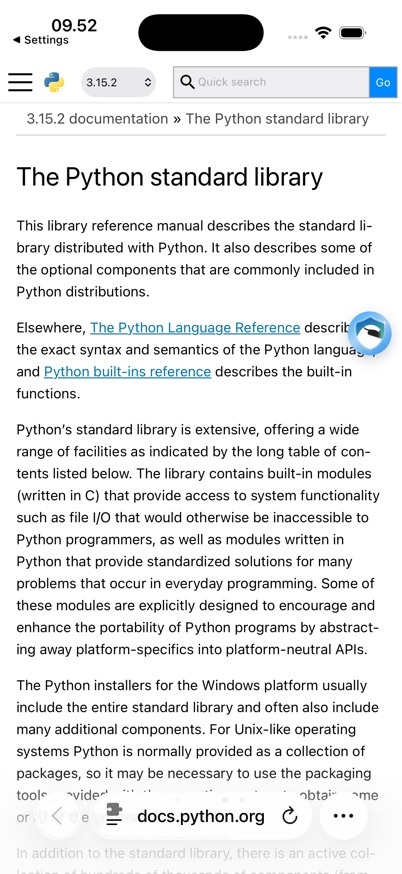</a> |
| legit-17 [https://medium.com/tag/cybersecurity](https://medium.com/tag/cybersecurity) | < 30 | 0 | 0 | - | 0 | Tanpa tanda | - | 2 | 0 | <a href="ss/legit-17.jpg">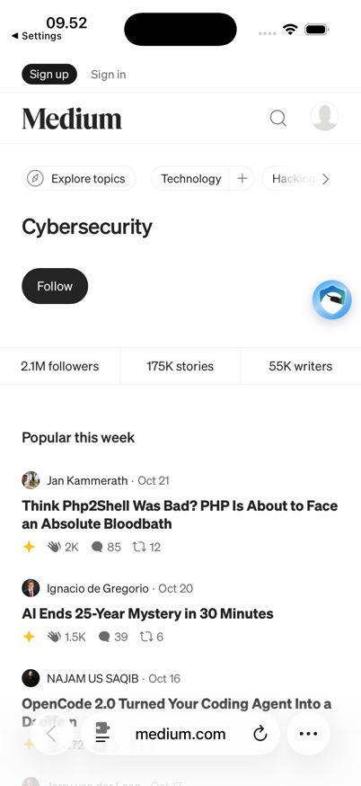</a> |
| legit-18 [https://blog.google/](https://blog.google/) | < 30 | 0 | 0 | - | 0 | Tanpa tanda | - | 523 | 0 | <a href="ss/legit-18.jpg">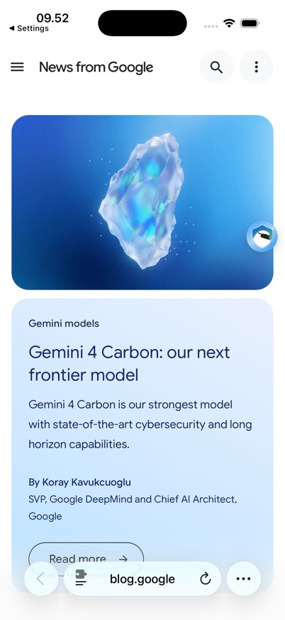</a> |
| legit-19 [https://vercel.com/](https://vercel.com/) | < 30 | 0 | 0 | - | 0 | Tanpa tanda | - | 1.003 | 0 | <a href="ss/legit-19.jpg">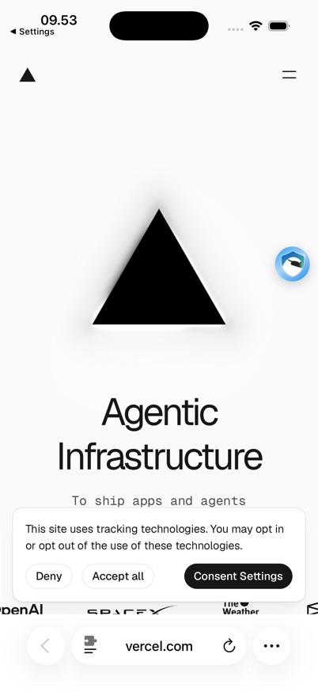</a> |
| legit-20 [https://deno.com/](https://deno.com/) | < 30 | 0 | 0 | - | 0 | Tanpa tanda | - | 602 | 0 | <a href="ss/legit-20.jpg">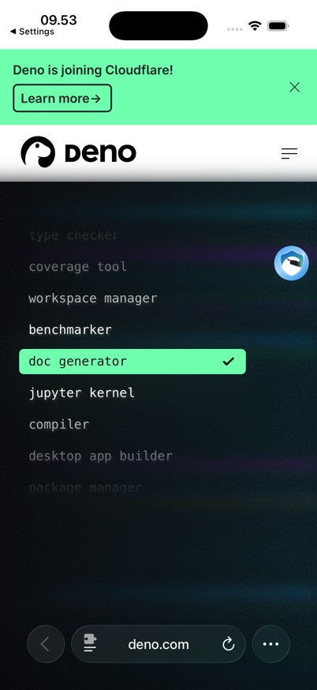</a> |
| legit-21 [https://developer.apple.com/documentation/swiftui/view](https://developer.apple.com/documentation/swiftui/view) | < 30 | 0 | 0 | - | 0 | Tanpa tanda | - | 5 | 0 | <a href="ss/legit-21.jpg">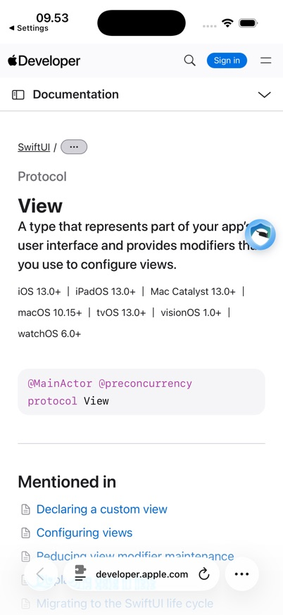</a> |
| legit-22 [https://docs.github.com/en/get-started/using-github-docs](https://docs.github.com/en/get-started/using-github-docs) | < 30 | 0 | 0 | - | 0 | Tanpa tanda | - | 1 | 0 | <a href="ss/legit-22.jpg">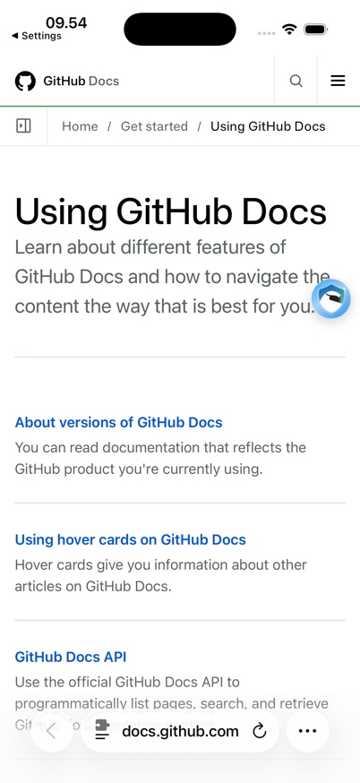</a> |
| legit-23 [https://developer.mozilla.org/en-US/docs/Web/HTTP/Reference/Status/404](https://developer.mozilla.org/en-US/docs/Web/HTTP/Reference/Status/404) | < 30 | 0 | 0 | - | 0 | Tanpa tanda | - | 2 | 0 | <a href="ss/legit-23.jpg">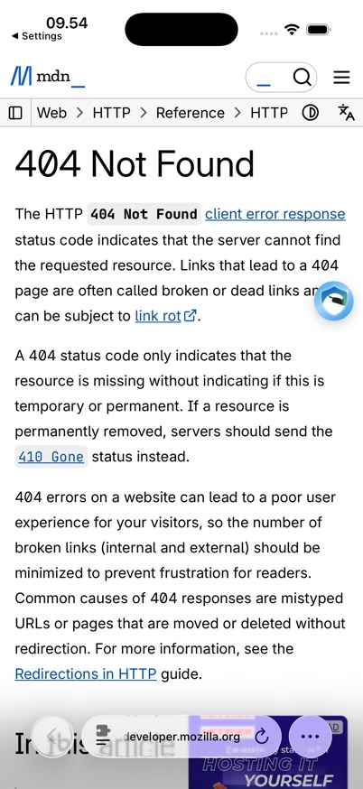</a> |

Cara baca: **Link** adalah URL persis yang dibuka saat tes dan bisa diklik. Baris scam masih bisa aktif, jadi jangan dibuka di perangkat pribadi. **L4** `-` tidak ditanya, `tidak flag`, `+N flag`, atau `gagal`. **Total** dihitung dari log dengan `pipeline.js`. `beda` berarti tidak sama dengan persen di layar. **LLM ms** dan **/analyze ms** dari panggilan LLM terakhir pada halaman itu, atau dari `/analyze` paling lama kalau LLM tidak dipanggil. **ᴸ¹** berarti tes 31 Okt mengenai link itu lewat daftar L1, jadi tidak sebanding langsung.

## Waktu

Median / p95 / maksimum, dalam milidetik.

| Yang diukur | Hasil |
|---|---|
| LLM | 1.382 / 4.542 / 4.542 (12 panggilan) |
| /analyze, panggilan dengan LLM | 2.072 / 5.343 / 5.343 (12 panggilan) |
| /analyze, semua | 282 / 2.766 / 5.343 (53 panggilan) |
| RDAP, panggilan yang benar-benar lookup | 597 / 1.002 / 1.005 (25 panggilan) |

Panggilan LLM: 12. Token: 27.191 (masuk 20.642, keluar 6.549).

## Detail per link

scam-03

- **L2:** brand_plus_keyword 14
- **L3:** brand_logo_offsite 25, new_domain 20, asks_password 15
- **L4:** unreasonable_request 30; asks password, reasonable false, confidence 0.9
- **Waktu:** RDAP 738 ms, LLM 2.019 ms, /analyze 2.766 ms
- **Panggilan:** /analyze 1, LLM 1, 2.315 token

scam-05

- **L2:** suspicious_link 19, brand_plus_keyword 14
- **L3:** brand_logo_offsite 25
- **L4:** unreasonable_request 30; asks other, reasonable false, confidence 0.75
- **Waktu:** RDAP 710 ms, LLM 2.176 ms, /analyze 2.890 ms
- **Panggilan:** /analyze 1, LLM 1, 2.283 token

scam-06

- **L2:** -
- **L3:** -
- **L4:** tidak ditanya
- **Waktu:** RDAP 711 ms, LLM - ms, /analyze 712 ms
- **Panggilan:** /analyze 1, LLM 0
- **Catatan:** Login KlikBCA palsu (User ID + PIN) terbuka tanpa peringatan.

scam-08

- **L2:** cheap_tld 5
- **L3:** new_domain 20, asks_password 15
- **L4:** unreasonable_request 40; asks password+personal_data, reasonable false, confidence 0.85
- **Waktu:** RDAP 539 ms, LLM 964 ms, /analyze 1.507 ms
- **Panggilan:** /analyze 1, LLM 1, 2.267 token

scam-09

- **L2:** suspicious_link 11
- **L3:** brand_logo_offsite 25
- **L4:** unreasonable_request 44; asks pin, reasonable false, confidence 0.85
- **Waktu:** RDAP 360 ms, LLM 1.382 ms, /analyze 1.747 ms
- **Panggilan:** /analyze 1, LLM 1, 2.233 token

scam-10

- **L2:** -
- **L3:** brand_logo_offsite 12
- **L4:** tidak ditanya
- **Waktu:** RDAP 0 ms, LLM - ms, /analyze 1 ms
- **Panggilan:** /analyze 1, LLM 0
- **Catatan:** Halaman meminta kode OTP lewat 6 kotak dan keyboard angka sudah terbuka, tapi asks_otp tidak menyala.

scam-11

- **L2:** -
- **L3:** -
- **L4:** tidak ditanya
- **Waktu:** RDAP 633 ms, LLM - ms, /analyze 634 ms
- **Panggilan:** /analyze 1, LLM 0
- **Catatan:** Halaman Blogger tanpa postingan.

scam-12

- **L2:** suspicious_link 21
- **L3:** asks_otp 25, new_domain 10
- **L4:** unreasonable_request 30; asks otp, reasonable false, confidence 0.7
- **Waktu:** RDAP 635 ms, LLM 1.433 ms, /analyze 2.072 ms
- **Panggilan:** /analyze 1, LLM 1, 2.267 token

scam-13

- **L2:** suspicious_link 21
- **L3:** asks_otp 25
- **L4:** unreasonable_request 34; asks otp, reasonable false, confidence 0.8
- **Waktu:** RDAP 760 ms, LLM 1.404 ms, /analyze 2.170 ms
- **Panggilan:** /analyze 1, LLM 1, 2.265 token

scam-14

- **L2:** suspicious_link 12
- **L3:** asks_otp 25
- **L4:** unreasonable_request 43; asks otp, reasonable false, confidence 0.85
- **Waktu:** RDAP 793 ms, LLM 4.542 ms, /analyze 5.343 ms
- **Panggilan:** /analyze 1, LLM 1, 2.275 token

scam-15

- **L2:** cheap_tld 5
- **L3:** asks_otp 25
- **L4:** asks otp, reasonable false, confidence 0.6
- **Waktu:** RDAP 1.005 ms, LLM 1.227 ms, /analyze 2.234 ms
- **Panggilan:** /analyze 1, LLM 1, 2.276 token
- **Catatan:** Form OTP 5 digit. LLM menjawab tidak wajar, tapi confidence 0,6 di bawah batas 0,7.

scam-16

- **L2:** suspicious_link 21
- **L3:** asks_otp 25, new_domain 10
- **L4:** unreasonable_request 30; asks otp, reasonable false, confidence 0.7
- **Waktu:** RDAP 0 ms, LLM 1.214 ms, /analyze 1.225 ms
- **Panggilan:** /analyze 1, LLM 1, 2.264 token

scam-17

- **L2:** brand_plus_keyword 14
- **L3:** new_domain 10
- **L4:** tidak ditanya
- **Waktu:** RDAP 597 ms, LLM - ms, /analyze 600 ms
- **Panggilan:** /analyze 1, LLM 0
- **Catatan:** Halaman peringatan phishing dari Cloudflare menutupi situsnya. Shoo tidak menandai.

scam-18

- **L2:** lookalike_domain 25
- **L3:** -
- **L4:** tidak ditanya
- **Waktu:** RDAP 1.001 ms, LLM - ms, /analyze 1.003 ms
- **Panggilan:** /analyze 1, LLM 0
- **Catatan:** Halaman parkir berisi iklan pinjaman.

scam-19

- **L2:** -
- **L3:** -
- **L4:** tidak ditanya
- **Waktu:** RDAP 0 ms, LLM - ms, /analyze - ms
- **Panggilan:** /analyze 0, LLM 0
- **Catatan:** Dialog JavaScript menahan halaman dan tidak ada panggilan /analyze. Dialog tidak diketuk, sesuai aturan tes.

scam-20

- **L2:** -
- **L3:** asks_password 15
- **L4:** tidak ditanya
- **Waktu:** RDAP 0 ms, LLM - ms, /analyze 4 ms
- **Panggilan:** /analyze 1, LLM 0
- **Catatan:** Login Instagram palsu di github.io. Total 15, jadi LLM tidak ditanya.

scam-21

- **L2:** suspicious_link 34
- **L3:** brand_logo_offsite 25, asks_password 15
- **L4:** unreasonable_request 30; asks password+personal_data, reasonable false, confidence 0.9
- **Waktu:** RDAP 383 ms, LLM 868 ms, /analyze 1.270 ms
- **Panggilan:** /analyze 1, LLM 1, 2.265 token

scam-22

- **L2:** suspicious_link 18
- **L3:** asks_password 15
- **L4:** unreasonable_request 47; asks password+personal_data, reasonable false, confidence 0.9
- **Waktu:** RDAP 658 ms, LLM 969 ms, /analyze 1.629 ms
- **Panggilan:** /analyze 1, LLM 1, 2.252 token

scam-23

- **L2:** suspicious_link 13
- **L3:** -
- **L4:** tidak ditanya
- **Waktu:** RDAP 0 ms, LLM - ms, /analyze 1 ms
- **Panggilan:** /analyze 1, LLM 0
- **Catatan:** Pendaftaran SIM palsu lewat Telegram.

scam-24

- **L2:** suspicious_link 24
- **L3:** -
- **L4:** tidak ditanya
- **Waktu:** RDAP 0 ms, LLM - ms, /analyze 1 ms
- **Panggilan:** /analyze 1, LLM 0
- **Catatan:** Form nama, provinsi, dan telepon untuk Telegram.

scam-25

- **L2:** suspicious_link 24
- **L3:** urgent_language 15
- **L4:** asks -, reasonable true, confidence 0.3
- **Waktu:** RDAP 0 ms, LLM 2.194 ms, /analyze 2.195 ms
- **Panggilan:** /analyze 1, LLM 1, 2.229 token
- **Catatan:** Form kuota gratis. LLM menjawab wajar dengan confidence 0,3.

legit-01

- **L2:** -
- **L3:** -
- **L4:** tidak ditanya
- **Waktu:** RDAP 0 ms, LLM - ms, /analyze 5 ms
- **Panggilan:** /analyze 2, LLM 0

legit-02

- **L2:** -
- **L3:** -
- **L4:** tidak ditanya
- **Waktu:** RDAP 0 ms, LLM - ms, /analyze 3 ms
- **Panggilan:** /analyze 1, LLM 0

legit-03

- **L2:** -
- **L3:** -
- **L4:** tidak ditanya
- **Waktu:** RDAP 417 ms, LLM - ms, /analyze 419 ms
- **Panggilan:** /analyze 1, LLM 0

legit-04

- **L2:** -
- **L3:** -
- **L4:** tidak ditanya
- **Waktu:** RDAP 320 ms, LLM - ms, /analyze 334 ms
- **Panggilan:** /analyze 1, LLM 0

legit-05

- **L2:** -
- **L3:** -
- **L4:** tidak ditanya
- **Waktu:** RDAP 280 ms, LLM - ms, /analyze 282 ms
- **Panggilan:** /analyze 1, LLM 0

legit-06

- **L2:** -
- **L3:** -
- **L4:** tidak ditanya
- **Waktu:** RDAP 289 ms, LLM - ms, /analyze 291 ms
- **Panggilan:** /analyze 1, LLM 0

legit-07

- **L2:** -
- **L3:** -
- **L4:** tidak ditanya
- **Waktu:** RDAP 0 ms, LLM - ms, /analyze 6 ms
- **Panggilan:** /analyze 1, LLM 0

legit-08

- **L2:** -
- **L3:** -
- **L4:** tidak ditanya
- **Waktu:** RDAP 382 ms, LLM - ms, /analyze 387 ms
- **Panggilan:** /analyze 1, LLM 0

legit-09

- **L2:** -
- **L3:** -
- **L4:** tidak ditanya
- **Waktu:** RDAP 292 ms, LLM - ms, /analyze 294 ms
- **Panggilan:** /analyze 1, LLM 0

legit-10

- **L2:** -
- **L3:** -
- **L4:** tidak ditanya
- **Waktu:** RDAP 847 ms, LLM - ms, /analyze 855 ms
- **Panggilan:** /analyze 2, LLM 0

legit-11

- **L2:** -
- **L3:** -
- **L4:** tidak ditanya
- **Waktu:** RDAP 459 ms, LLM - ms, /analyze 478 ms
- **Panggilan:** /analyze 1, LLM 0

legit-12

- **L2:** -
- **L3:** -
- **L4:** tidak ditanya
- **Waktu:** RDAP 0 ms, LLM - ms, /analyze 4 ms
- **Panggilan:** /analyze 2, LLM 0
- **Catatan:** mit.edu tidak diblokir karena L1 mati. Masalah daftar publiknya belum terbukti selesai.

legit-13

- **L2:** -
- **L3:** -
- **L4:** tidak ditanya
- **Waktu:** RDAP 0 ms, LLM - ms, /analyze 3 ms
- **Panggilan:** /analyze 1, LLM 0

legit-14

- **L2:** -
- **L3:** -
- **L4:** tidak ditanya
- **Waktu:** RDAP 0 ms, LLM - ms, /analyze 5 ms
- **Panggilan:** /analyze 2, LLM 0

legit-15

- **L2:** -
- **L3:** -
- **L4:** tidak ditanya
- **Waktu:** RDAP 0 ms, LLM - ms, /analyze 3 ms
- **Panggilan:** /analyze 2, LLM 0

legit-16

- **L2:** -
- **L3:** -
- **L4:** tidak ditanya
- **Waktu:** RDAP 0 ms, LLM - ms, /analyze 9 ms
- **Panggilan:** /analyze 1, LLM 0

legit-17

- **L2:** -
- **L3:** -
- **L4:** tidak ditanya
- **Waktu:** RDAP 0 ms, LLM - ms, /analyze 2 ms
- **Panggilan:** /analyze 2, LLM 0

legit-18

- **L2:** -
- **L3:** -
- **L4:** tidak ditanya
- **Waktu:** RDAP 520 ms, LLM - ms, /analyze 523 ms
- **Panggilan:** /analyze 2, LLM 0

legit-19

- **L2:** -
- **L3:** -
- **L4:** tidak ditanya
- **Waktu:** RDAP 1.002 ms, LLM - ms, /analyze 1.003 ms
- **Panggilan:** /analyze 2, LLM 0

legit-20

- **L2:** -
- **L3:** -
- **L4:** tidak ditanya
- **Waktu:** RDAP 597 ms, LLM - ms, /analyze 602 ms
- **Panggilan:** /analyze 1, LLM 0

legit-21

- **L2:** -
- **L3:** -
- **L4:** tidak ditanya
- **Waktu:** RDAP 0 ms, LLM - ms, /analyze 5 ms
- **Panggilan:** /analyze 2, LLM 0

legit-22

- **L2:** -
- **L3:** -
- **L4:** tidak ditanya
- **Waktu:** RDAP 0 ms, LLM - ms, /analyze 1 ms
- **Panggilan:** /analyze 1, LLM 0

legit-23

- **L2:** -
- **L3:** -
- **L4:** tidak ditanya
- **Waktu:** RDAP 0 ms, LLM - ms, /analyze 2 ms
- **Panggilan:** /analyze 2, LLM 0
- **Catatan:** Halaman MDN tentang kode 404 terbuka.

## Analisis

**Terbukti** = terukur di log atau screenshot tes ini. **Dugaan** = penjelasan saya, belum diuji.

### Kesimpulan

Arsitektur baru menaikkan blokir scam dari 7 menjadi 10 dari 21 walau L1 dimatikan, tanpa salah tanda di legit. Target 70% belum tercapai. Sisa masalah terbesar ada di halaman yang totalnya di bawah 30, karena LLM tidak pernah ditanya di sana.

### Terbukti

**1. Semua blokir bergantung pada LLM.** Tanpa flag L4, total tertinggi hanya 74 (`scam-03` dan `scam-21`), jadi tidak ada yang mencapai 80. Kalau LLM mati atau timeout, 10 blokir ini turun menjadi peringatan.

**2. Aturan "flag selalu memblokir" menentukan 5 halaman.** `scam-08`, `scam-09`, `scam-13`, `scam-14`, dan `scam-22` berhenti tepat di 80. Dengan bobot flag tetap 30, skornya 70, 66, 76, 67, dan 63, jadi hanya peringatan.

**3. Dibanding 31 Okt.**

| Perubahan | Link |
|---|---|
| Naik ke blokir | `scam-08` (dulu kosong), `scam-13` (76), `scam-14` (67), `scam-22` (63) |
| Tetap blokir, sekarang tanpa L1 | `scam-09`, `scam-21` |
| Tetap blokir | `scam-03`, `scam-05`, `scam-12`, `scam-16` |
| Turun | `scam-10` (blokir L1 menjadi 12), `scam-18` (45 menjadi 25), `scam-20` (45 menjadi 15) |

`scam-15` juga baru terbaca sebagai peringatan 30, karena dulu kosong. `scam-19` dulu diadang Safari, sekarang dialog JavaScript menahan halamannya.

**4. Gate 30 membuat `scam-20` lolos.** Login Instagram palsu ini mendapat total 15, jadi LLM tidak ditanya. Pada 31 Okt, gate lama bertanya karena ada form, dan flag +30 membawanya ke 45. Ini kasus yang sama dengan temuan tes perbandingan.

**5. Enam halaman scam punya sinyal, tapi total di bawah 30.** Totalnya: `scam-10` 12, `scam-20` 15, `scam-23` 13, `scam-24` 24, `scam-17` 24, `scam-18` 25. LLM tidak ditanya di semuanya. `scam-06` dan `scam-11` malah bertotal 0.

**6. Batas confidence 0,7 melewatkan satu halaman.** `scam-15` (form OTP) dijawab tidak wajar dengan confidence 0,6, jadi tetap 30. Dua halaman lain lolos tepat di 0,7 (`scam-12` dan `scam-16`).

**7. RDAP 1 detik habis di 3 dari 25 lookup.** `scam-15`, `scam-18`, dan `legit-19`. `scam-18` tidak mendapat `new_domain`, padahal pada 31 Okt mendapat +20.

**8. Waktu aman.** LLM paling lama 4.542 ms dan `/analyze` paling lama 5.343 ms, di bawah batas server 6,5 detik. Biaya: 12 panggilan LLM, 27.191 token, rata-rata 2.266 token per panggilan.

**9. Skor di layar cocok dengan log.** Semua halaman yang menampilkan persen sama dengan total hitungan `pipeline.js`.

### Dugaan

- **`scam-10`:** halaman jelas meminta OTP lewat 6 kotak, tapi `asks_otp` tidak menyala. Mungkin kotaknya muncul setelah snapshot, atau bentuk field-nya tidak dikenali. Perlu dicek dengan membaca snapshot halaman ini.
- **`scam-18`:** penurunan ke 25 kemungkinan besar karena RDAP timeout, bukan karena umur domainnya berubah. Satu putaran belum cukup untuk memastikan.
- **`scam-23` dan `scam-24`:** form nama dan telepon untuk Telegram kemungkinan tidak punya sinyal L3 yang cocok.

Penyebab total 0 di `scam-06` (login KlikBCA di `sites[.]google[.]com`) belum diselidiki.

### Pilihan untuk v2

Belum diterapkan. Ini keputusan Imelda.

1. **Tanya LLM di bawah 30 kalau ada form sensitif**, supaya `scam-20` tertangkap lagi. Risikonya biaya naik, dan perlu dites ke legit.
2. **Perbaiki deteksi OTP** untuk `scam-10`, sesudah penyebabnya dicek.
3. **Tinjau batas 0,7 dan RDAP 1 detik** dengan lebih banyak data. Satu putaran ini belum cukup untuk mengubah angkanya.
4. **Rencanakan saat LLM mati**, karena semua blokir sekarang bergantung padanya.
5. **Tambah halaman legit yang punya form** ke sampel, karena jalur LLM belum teruji di legit.
