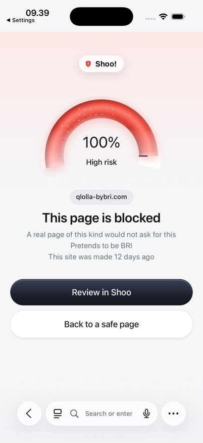

# Plan v1: tes live L2-L4 di simulator iPhone

Status: **sudah dijalankan** 3 Nov 2026. Hasil dan perubahan dari rencana ada di [HASIL.md](HASIL.md).
Pemilik: **Imelda** (`ai/`). Semua file baru di `ai/test-layer-live/`. `ai/src/`, `ai/prompts/`, `contracts/`, `detector/`, dan `ios/` tidak diubah.
Jalankan dari branch `feat/AI-M4-thinking-off-asks-otp-boxes` (PR #232, commit `2c51aee` atau sesudahnya).

## Pertanyaan yang dijawab

Di Safari dengan ekstensi sungguhan, apa skor tiap layer, apa hasil akhirnya, dan berapa lama LLM menjawab, untuk tiap link yang masih hidup?

## Keputusan (tanya-jawab 3 Nov 2026)

| # | Keputusan |
|---|---|
| K1 | Semua link dites di **simulator iPhone**. iPhone asli tidak dipakai di versi ini |
| K2 | Sampel `ai/test-layer2`: 25 scam (`dataset.md`) + 23 legit (`dataset-legit.md`). Tiap link satu kali kunjungan |
| K3 | Situs scam sungguhan boleh dibuka, **hanya memuat halaman**. Tanpa mengetik, mengetuk isi halaman, atau mengunduh |
| K4 | Tidak ada data Imelda yang dikirim: simulator baru, tanpa akun, tanpa nama asli |
| K5 | **L1 mati**: blocklist tidak dipakai. L2 `detector.js` apa adanya, termasuk batas 25 (#231 belum dijawab). L3, L4, dan RDAP jalan penuh dengan angka produksi |
| K6 | Satu simulator, tanpa Guardian. Sesi tes diisi langsung ke App Group (lihat Penyiapan) |
| K7 | Waktu dicatat di server tes: LLM, RDAP, dan total `/analyze`. Semua panggilan dicatat. Waktu sampai layar muncul tidak diukur |
| K8 | Tabel ringkas berisi angka, detail per link di `<details>`, thumbnail screenshot lebar 56 px |
| K9 | Domain di `HASIL.md` disamarkan (`bni-diirect[.]com`). VPN di Mac tidak wajib |

### Kenapa sesi diisi langsung (K6)

Ekstensi melewati `/analyze` kalau aplikasi belum onboarding (`not_onboarded` di `SafariWebExtensionHandler.swift`). Pairing butuh backend lokal, dan backend lokal butuh Docker dan Supabase, yang tidak terpasang di Mac ini. Jadi aplikasi tidak melakukan pairing. Ekstensi cukup membaca kunci sesi dari App Group, dan kuncinya diisi nilai palsu.

`api.baseURL` sengaja tidak diisi, supaya daftar `shoo`, kirim scan, dan cek verdict tidak dikirim ke backend mana pun. Cara ini belum pernah dicoba, jadi diuji dulu di tahap 2 dan 5 Penyiapan.

## Alur

```text
Safari simulator
  └─ ekstensi: L2, skor akhir, tampilan
       └─ POST http://localhost:8788/analyze  (snapshot halaman, URL tanpa query, sinyal L2)
            └─ scripts/server.mjs  (createApp dari ai/src, tanpa perubahan)
                 ├─ L3: aturan + RDAP live, batas 1 detik
                 └─ L4: LLM, hanya kalau total 30-79
```

## Data yang keluar dari Mac

| Ke mana | Isi |
|---|---|
| Situs yang dikunjungi | Kunjungan biasa dari Safari simulator. Situs melihat IP publik Mac |
| Server RDAP | Nama domain |
| Provider LLM (`bandelbanget.xyz`) | Domain, judul, label field, nama brand, kode cek. Bukan isi teks halaman dan bukan umur domain |

Snapshot halaman hanya sampai ke server tes di Mac dan tidak disimpan. Tidak ada yang dikirim ke `shoo-api` atau `shoo-ai` yang sudah deploy.

## Skrip yang ditulis (`ai/test-layer-live/scripts/`)

| Skrip | Tugas |
|---|---|
| `links.mjs` | Baca kedua dataset, cek DNS tiap host (tanpa membuka situs), tulis `v1/links.json`. Harus 25 + 23 |
| `server.mjs` | Pola `ai/src/dev-server.mjs` di port 8788: `llmFetch` dan `fetch` RDAP dibungkus pengukur waktu, blocklist kosong (bawaan `createApp`), batas per IP mati. Pakai `AsyncLocalStorage` supaya tiap ukuran masuk ke panggilan `/analyze` yang benar. `POST /_test/mark` menandai id link yang sedang dibuka |
| `visit.sh` | Tiap link: tandai id, `simctl openurl`, tunggu 20 detik, screenshot ke `v1/ss/<id>.jpg` (874 px). Link yang screenshot-nya sudah ada dilewati, jadi bisa dilanjutkan kalau berhenti |
| `report.mjs` | Gabungkan log, `v1/observed.json`, dan hasil 31 Okt menjadi `v1/data.json` dan `v1/HASIL.md` |

Skrip QA milik Alief tidak diedit. Hasil 31 Okt hanya dibaca dari `plan/alief/qa/img/figma-parity/live-l2/live-results.json`.

### Yang dicatat per panggilan `/analyze` (`v1/.raw/calls.jsonl`)

`id`, waktu, host, `localSignals` (id + bobot), sinyal balasan (id + bobot), `analyzeMs`, `rdapMs`, dan untuk LLM: `llmMs`, status, `usage`, `page_type`, `asks`, `reasonable`, `confidence`.

**Tidak dicatat:** teks halaman, `evidence`, header Authorization, isi `ai/.env`.

### Cara menghitung total

Pakai `mergeSignals` dan `scoreFrom` dari `pipeline.js`, atas semua panggilan pada halaman itu, karena ekstensi juga menyimpan sinyal dari panggilan sebelumnya. Total ini dibandingkan dengan persen di screenshot. Kalau beda, ditulis `beda`, dan yang dianggap benar adalah yang tampil di layar.

## Penyiapan

1. **Simulator baru.** Buat `Shoo QA L1-4` (iPhone 17 Pro, iOS 26.3 atau lebih baru). Simulator yang sudah ada tidak disentuh.
2. **Build dan sesi.**
   - Build Debug `ios/Shoo.xcodeproj`, skema `Shoo`, lalu install. Bundle id dan App Group dibaca dari `Info.plist` hasil build.
   - Luncurkan sekali dengan `-debug.aiBaseURL http://localhost:8788`, lalu tutup.
   - Matikan simulator, lalu isi plist App Group: `device.id` = `qa-sim`, `device.token` = `qa-token`, `device.mode` = `protected`, `ai.baseURL` = `http://localhost:8788`. Hapus `api.baseURL`.
   - Nyalakan lagi. **Jangan buka aplikasinya lagi**, karena aplikasi menulis ulang kunci-kunci itu.
3. **Nyalakan ekstensi.** Pengaturan Safari, Extensions, Shoo: On, All Websites: Allow.
4. **Jalankan server.** `node ai/test-layer-live/scripts/server.mjs` dengan `SHOO_RDAP=1`. Cek `GET /public-blocklist` kosong.
5. **Uji asap.** Buka `https://example.com`. Harus ada satu baris di `calls.jsonl` dan sesi tidak ditolak.

Kalau tahap 2 atau 5 gagal, **berhenti dan lapor**. Pilihan berikutnya memasang Docker dan Supabase, dan itu keputusan Imelda.

## Urutan tes

1. `links.mjs`
2. Satu scam dan satu legit yang masih hidup. Cek L2-L4 dan `usage` tercatat, dan jawaban LLM lolos `parseVerdict`
3. Semua link, satu per satu, tidak paralel. Sekitar 15 menit
4. Baca tiap screenshot, tulis `v1/observed.json`:
   - Status: `blokir`, `peringatan-kuat`, `peringatan`, `tanpa-tanda`, `kosong`, atau `diadang-safari`
   - Persen yang terlihat di layar
5. `report.mjs`, lalu tulis bagian Analisis. Perbarui `ai/test-layer-live/README.md`

## Isi HASIL.md

1. **Pengaturan:** tanggal, commit, model, prompt, L1 mati, simulator, dan batasan
2. **Batas lulus:** tabel di bawah
3. **Scam** dan **Legit:** dua tabel ringkas
4. **Waktu:** median, p95, dan maksimum LLM dan `/analyze`, jumlah panggilan LLM, token
5. **Detail per link:** satu `<details>` per link
6. **Analisis:** bedakan yang terbukti dan dugaan

### Tabel ringkas

Supaya tabel tidak renggang: tiap sel berisi angka atau beberapa kata, tanpa nama sinyal dan tanpa jawaban LLM.

```markdown
| Link | Harus | L2 | L3 | L4 | Total | Tampil di HP | LLM ms | /analyze ms | 31 Okt | SS |
|---|---|---:|---:|---|---:|---|---:|---:|---|---|
| scam-03 `qlolla-bybri[.]com` | ≥ 80 | 14 | 45 | +30 flag | 89 | Blokir 89% | 1.243 | 2.310 | Blokir 100 ᴸ¹ | <a href="ss/scam-03.jpg"></a> |
```

Angka di contoh ini hanya ilustrasi format, bukan hasil tes.

- **L4:** `-` tidak ditanya, `tidak flag`, `+N flag`, atau `gagal` (timeout atau error).
- **Link yang tidak bisa diuji:** `site gone`, dengan sel lain `-`.
- **ᴸ¹:** hasil 31 Okt yang diblokir karena L1. Tes itu memakai L1, jadi tidak sebanding langsung.

### Detail per link

```markdown
<details><summary>scam-03</summary>

- **L2:** brand_plus_keyword 14
- **L3:** asks_pin 35, new_domain 10
- **L4:** page_type bank, asks pin, reasonable false, confidence 0,9
- **Waktu:** RDAP 412 ms, LLM 1.243 ms, /analyze 2.310 ms
- **Panggilan:** /analyze 2, LLM 1

</details>
```

## Batas lulus

Hanya dari halaman yang terbuka. Halaman kosong, diadang Safari, dan situs mati dihitung terpisah.

| Cek | Target |
|---|---|
| Scam diblokir (≥ 80) | minimal 70% |
| Scam skor ≥ 50 | minimal 90% |
| Legit kena tanda (≥ 30) | 0 |
| Error server | 0 |

## Batasan

- L1 mati, jadi skor scam yang biasanya kena daftar bisa lebih rendah daripada di produksi. `mit.edu` juga tidak akan muncul sebagai salah blokir, dan masalah itu **belum** terbukti selesai.
- Sesi palsu, jadi alur Guardian, kirim scan, verdict, dan push tidak dites.
- LLM dan RDAP dipanggil dari Mac, bukan dari Cloudflare, jadi waktunya bisa beda dari produksi.
- Simulator, bukan iPhone asli. iPhone Imelda tidak dipakai untuk tes ini, atas permintaan Imelda.
- Hanya pemuatan halaman. Scam yang menampilkan form setelah diketuk tidak terlihat.
- Satu putaran. Selisih kecil antar versi belum tentu berarti.

## Aturan berhenti

- Jumlah sampel bukan 25 + 23.
- Ada alamat selain `localhost:8788` di `ai.baseURL`, atau ada panggilan ke server yang sudah deploy.
- 10 kegagalan LLM berturut-turut: simpan hasil sebagian, lalu lapor.
- Halaman meminta unduhan atau izin: tolak, catat, lanjut ke link berikutnya.
