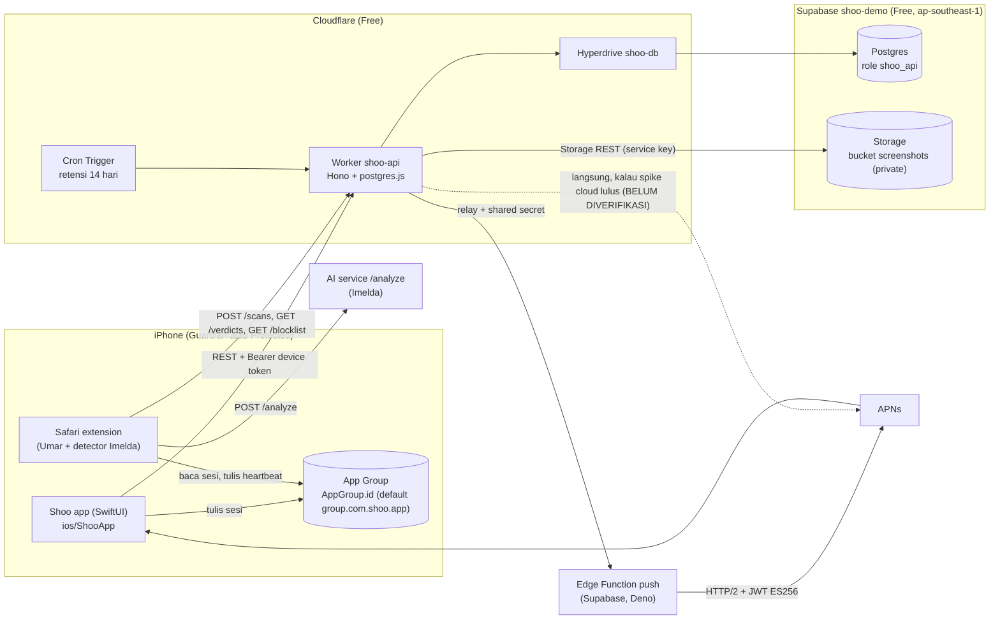

# Shoo · Team App + Backend — Arsitektur teknis (1 halaman)

> Cakupan: `ios/ShooApp/` dan `backend/` (milik Alief). Extension Safari, Live Activity (Umar), dan detector/AI (Imelda) hanya digambar sebagai tetangga.
> Kontrak: `contracts/api.md`, `contracts/app-group-keys.md`, `contracts/scan-result.schema.json`. Detail implementasi: `ref/R1`–`R4`.

## 1. Gambaran besar



Satu-satunya pintu ke data adalah Worker. Postgres tidak diekspos lewat PostgREST (grant `anon`/`authenticated` dicabut). App dan extension tidak pernah memegang kunci Supabase.

## 2. Komponen & tech stack

| Komponen | Stack | Folder | Catatan |
|---|---|---|---|
| App iOS | SwiftUI, iOS 17, Observation (`@Observable`), Swift Concurrency, String Catalog EN/ID | `ios/ShooApp/` | Data lewat protocol `ShooRepository`: `MockRepository` (fixtures, fase 01–06) → `ApiRepository` (fase 13) |
| Test iOS | Swift Testing (`ShooAppTests`), XCUITest (`ShooAppUITests`) | `ios/ShooApp/Tests/`, `ios/ShooApp/UITests/` | Target ditambah lewat PR `chore/APP-test-targets` (D-alief-02) |
| API | Cloudflare Worker, TypeScript, Hono, zod, postgres.js | `backend/api/` | Runtime-agnostic: hanya Web API (`fetch`, `crypto.subtle`) |
| Koneksi DB | Cloudflare Hyperdrive (**cache dimatikan**, `--caching-disabled`) → Direct connection Supabase (fallback: session pooler 5432) | `backend/api/wrangler.jsonc` | Lokal: `localConnectionString` / env `CLOUDFLARE_HYPERDRIVE_LOCAL_CONNECTION_STRING_DB` ke `supabase start` (port 54322). Cache Hyperdrive aktif secara default (60 s + 15 s) dan akan membuat verdict/otorisasi basi di cloud, jadi wajib dimatikan (D-alief-17) |
| DB | Supabase Postgres 15+, migrasi SQL, pgTAP | `backend/db/supabase/` | Role `shoo_api` least-privilege (R2 §3) |
| Screenshot | Supabase Storage, bucket private `screenshots`, signed URL 1 jam | lewat `ScreenshotStore` di `backend/api/src/services/screenshots.ts` | Adapter: ganti ke R2 = satu file (E1) |
| Push | APNs HTTP/2, token-based (JWT ES256 dari `.p8`) | `backend/api/src/services/push/`, `backend/db/supabase/functions/push/` | **Jalur utama yang direncanakan: relay** Worker → Edge Function Supabase `push` (Deno) dengan shared secret, karena tidak ada dokumen resmi bahwa `fetch()` Worker bisa HTTP/2 ke origin. Jalur langsung Worker → APNs hanya dipakai kalau spike di Worker **yang sudah di-deploy** lulus (fase 07, D-alief-16) |
| Retensi | Worker Cron Trigger harian | `backend/api/src/cron/retention.ts` | Hapus scan > 14 hari + objek Storage-nya (lewat Storage API, bukan SQL) |
| CI (draf) | GitHub Actions | `backend/ci/backend.yml`, `ios/ShooApp/ci/ios-app.yml` | Inert sampai Umar memindahkannya ke `.github/workflows/` (C2) |

## 3. Hosting, kuota & biaya

| Layanan | Plan | Kuota yang relevan | Penjaga |
|---|---|---|---|
| Cloudflare Workers | Free | 100k request/hari, CPU 10 ms per request **dan per Cron Trigger**, 50 subrequest/request, 5 Cron Trigger/akun | Tidak ada kerja berat di Worker; satu signed URL per `GET /scans/{id}`; polling verdict 5 s hanya saat layar blokir terbuka |
| Hyperdrive | Free | 100.000 query/hari, 10 konfigurasi, ±20 koneksi origin per konfigurasi, query maks 60 s | Cache dimatikan; satu request = sedikit query. Fallback: postgres.js langsung ke pooler via `connect()` TCP |
| Edge Functions (relay push) | Supabase Free | 500.000 invocation/bulan | Satu invocation per push |
| Supabase DB | Free | 500 MB, 2 proyek aktif, pause setelah 7 hari tanpa aktivitas database | Retensi 14 hari; Cron retensi harian **menulis** ke DB; monitor uptime (B9) memanggil `/healthz/db` yang menulis `ops_heartbeat` (bukan `select 1`) |
| Supabase Storage | Free | 1 GB file, 5 GB egress/bulan | ≤ 150 KB/screenshot, 1 per pemilik+domain per 24 jam, maks 50/device/hari, hanya dimuat di Detail, cache di app, retensi 14 hari. Ambang pindah ke R2: 700 MB atau 3,5 GB egress |
| APNs | Termasuk Apple Developer Program | – | Sandbox dulu, production saat TestFlight |
| TestFlight | Apple Developer Program | – | Butuh tim berbayar + record App Store Connect (B8), kunci APNs Production (B7) |

Perkiraan kasar: 150 KB × 50/hari × 14 hari = ±105 MB per device paling sibuk. Rata-rata jauh di bawah itu karena dedupe per domain.

## 4. Alur utama

1. **Onboarding (ON-02, ON-03, fase 13).** App → `POST /devices {name, mode, apnsToken?}` → `{deviceId, token, avatarId}`. App menulis `device.id`, `device.token`, `device.mode`, `device.name`, `api.baseURL`, `ai.baseURL` ke App Group (kontrak) + menyimpan token di Keychain untuk app sendiri. Kalau bahasa app = ID, app langsung memanggil `PATCH /devices/me {language: "id"}`.
2. **Pairing (GD-04, PR-01..03, fase 08 + 14).** Guardian → `POST /family/code` (tiap 60 s, app menghitung mundur) → QR + kode + `inviteUrl` https. Protected → `POST /family/join {code}` (scan QR, ketik kode, atau buka `shoo://join?code=`) → `{guardian}`. Server menolak kalau kode salah/kedaluwarsa, keluarga penuh (3), atau percobaan berlebih.
3. **Scan → push (EX-07, GD-06, fase 09 + 11 + 15).** Extension → `POST /scans` (skor ≥ 30, + `screenshotBase64?`) → Worker menyimpan scan, mengunggah screenshot (kalau lolos kuota) → kalau pemiliknya Protected: kirim push (relay Edge Function → APNs) ke Guardian dengan teks sesuai bahasa Guardian dan `scanId` → tap → app membuka Detail (`GET /scans/{id}`).
4. **Verdict → buka blokir (GD-07, EX-06, fase 10 + 15).** Guardian menekan It's safe / Not safe di Detail → `POST /verdicts {scanId, value}` (langsung, tanpa konfirmasi) → verdict berlaku untuk domain itu milik pemilik scan → extension Protected yang polling `GET /verdicts?domain=` tiap 5 s melihat `safe` → layar blokir terbuka. Target: `GET /verdicts` mencerminkan keputusan ≤ 1 s setelah `POST /verdicts`; layar blokir terbuka ≤ 10 s ujung ke ujung (polling 5 s). `not_safe` → domain masuk antrean `blocklist_entries` dan baru muncul di `GET /blocklist` setelah review manual (D-alief-25, R4 §4).
5. **Retensi (fase 12).** Cron harian menghapus scan > 14 hari + objek Storage-nya, kode keluarga kedaluwarsa, dan catatan percobaan join lama. Verdict tidak dihapus (dipakai blocklist, D-alief-14).

## 5. Di Mac Alief (lokal)

```bash
# dari root repo, tiap baris di terminal sendiri
(cd backend/db && supabase start)                  # Postgres :54322, Storage, Studio :54323 (Docker)
pnpm -C backend/api install && pnpm -C backend/api dev   # wrangler dev :8787, Hyperdrive lokal → :54322
(cd ios && xcodegen && open Shoo.xcodeproj)        # app di simulator, AppConfig Debug = http://localhost:8787
```

Simulator iOS menjangkau `localhost` Mac tanpa port forwarding.

## 6. Keamanan singkat

- Auth tanpa login: token device acak 32 byte, disimpan sebagai hash SHA-256. Setiap request lewat middleware `auth` → `principal {deviceId, mode}`.
- Otorisasi di setiap query: Guardian hanya membaca scan miliknya sendiri atau milik Protected yang `family_links`-nya aktif ke dia. Test IDOR wajib di fase 09–10.
- Kode keluarga 4 digit: 60 s, multi-pakai selama berlaku, batas 3 Protected, 5 gagal/10 menit per device dan per IP.
- Secret hanya di `wrangler secret` dan password manager. Detail: [`SECURITY.md`](SECURITY.md).

## 7. Baca lebih dalam

`ref/R1` struktur folder · `ref/R2` skema SQL · `ref/R3` catatan API · `ref/R4` state machine · `log/DECISIONS.md`.
