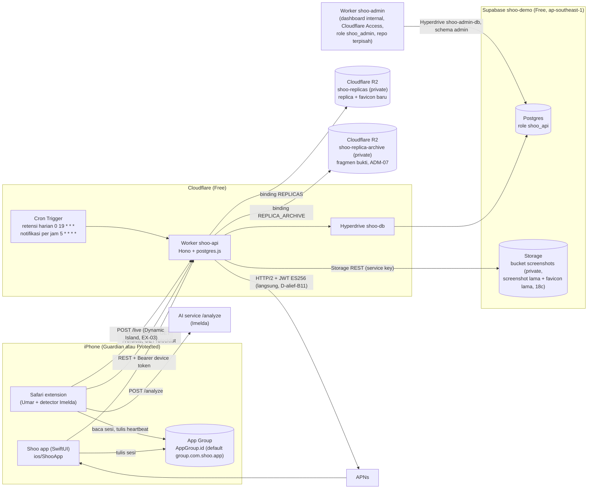

# Shoo · Team App + Backend — Arsitektur teknis (1 halaman)

> Cakupan: `ios/ShooApp/` dan `backend/` (milik Alief). Extension Safari, Live Activity (Umar), dan detector/AI (Imelda) hanya digambar sebagai tetangga.
> Kontrak: `contracts/api.md`, `contracts/app-group-keys.md`, `contracts/scan-result.schema.json`. Detail implementasi: `ref/R1`–`R4`.

## 1. Gambaran besar



Satu-satunya pintu ke data adalah Worker. Postgres tidak diekspos lewat PostgREST (grant `anon`/`authenticated` dicabut). App dan extension tidak pernah memegang kunci Supabase.

## 2. Komponen & tech stack

| Komponen | Stack | Folder | Catatan |
|---|---|---|---|
| App iOS | SwiftUI, iOS 17, Observation (`@Observable`), Swift Concurrency, String Catalog EN/ID | `ios/ShooApp/` | Data lewat protocol `ShooRepository`: `MockRepository` (fixtures, fase 01–06) → `ApiRepository` (fase 13) |
| Test iOS | Swift Testing (`ShooAppTests`), XCUITest (`ShooAppUITests`) | `ios/ShooApp/Tests/`, `ios/ShooApp/UITests/` | Target ditambah lewat PR `chore/APP-test-targets` (D-alief-02) |
| API | Cloudflare Worker, TypeScript, Hono, zod, postgres.js | `backend/api/` | Runtime-agnostic: hanya Web API (`fetch`, `crypto.subtle`) |
| Koneksi DB | Cloudflare Hyperdrive (**cache dimatikan**, `--caching-disabled`) → Direct connection Supabase (fallback: session pooler 5432) | `backend/api/wrangler.jsonc` | Lokal: `localConnectionString` / env `CLOUDFLARE_HYPERDRIVE_LOCAL_CONNECTION_STRING_DB` ke `supabase start` (port 54322). Cache Hyperdrive aktif secara default (60 s + 15 s) dan akan membuat verdict/otorisasi basi di cloud, jadi wajib dimatikan (D-alief-17) |
| DB | Supabase Postgres 15+, migrasi SQL, pgTAP | `backend/db/supabase/` | Role `shoo_api` least-privilege (R2 §3) |
| Screenshot (usang) | Supabase Storage, bucket private `screenshots`, disajikan hanya lewat Worker `/screenshots/{scanId}` (link HMAC 1 jam, cek akses tiap request, `no-store`, D-alief-B08) | lewat `ScreenshotStore` di `backend/api/src/services/screenshots.ts` | Sejak fase 20a (8 Nov 2026) `POST /scans` mengabaikan `screenshotBase64`; hanya scan lama yang masih punya screenshot sampai retensi menghapusnya. Kolom dan kunci service_role dicabut di 20b–20d (menunggu ≥ deploy 20a + 15 hari, issue #347). Favicon baru di R2 sejak 18a (`-icon.<ext>`, D-alief-C27) |
| Salinan halaman (fase 18, aktif setelah 18a ter-deploy) | Cloudflare R2, bucket privat `shoo-replicas` (binding `REPLICAS`, tanpa `r2.dev`/domain/CORS, lifecycle 17 hari), disajikan hanya lewat Worker `/replicas/{scanId}` (link HMAC 1 jam, cek akses tiap request) | `R2ReplicaStore` di `backend/api/src/services/replicaStore.ts`; store dipilih dari path (`storeFor`, `services/screenshots.ts`): `-replica.html.gz` + `-icon.<ext>` → R2, sisanya Supabase | D-alief-C23, C26, C27. Juga menyimpan favicon baru. Kill-switch `REPLICAS_ENABLED` hanya menutup tulis/baca replica |
| Push | APNs HTTP/2, token-based (JWT ES256 dari `.p8`), langsung dari Worker (`ApnsSender`, D-alief-B11; spike cloud fase 07 lulus, relay Edge Function tidak dibuat) | `backend/api/src/services/push/` (`apns.ts`, `notify.ts`, `live.ts`, `quiet.ts`) | Push scan ke Guardian (GD-06), push terjadwal per jam (protection off, ringkasan mingguan), Live Activity push-to-start + update untuk Dynamic Island (`POST /live`, EX-03, issue #49). `push_log` tanpa teks notifikasi |
| Retensi | Worker Cron Trigger harian (`0 19 * * *`) | `backend/api/src/cron/retention.ts` | Hapus scan > 14 hari + objeknya per store (Supabase Storage API ≤ 10 batch/run, R2 binding ≤ 40 batch/run), catatan verdict > 14 hari, device tidak aktif (fase 24a, mode `INACTIVE_DEVICES`) |
| Notifikasi terjadwal | Worker Cron Trigger per jam (`5 * * * *`) | `backend/api/src/cron/notifications.ts` | Protection off (24 jam tanpa heartbeat) + ringkasan mingguan, ≤ 40 push per run, quiet hours; juga gauge kuota replica |
| Monitoring | `GET /ops/status` + workflow `ops-watch` (tiap 15 menit, harian) | `backend/api/src/routes/ops.ts`, `.github/workflows/ops-watch.yml` | Fase 21: alert jadi issue `ops-alert` ke Alief (backend/README §Monitoring) |
| CI | GitHub Actions | `.github/workflows/backend.yml`, `.github/workflows/ios-app.yml` (draf asal: `backend/ci/`, `ios/ShooApp/ci/`) | Aktif sejak #48 (C2). `backend.yml`: test, lalu `supabase db push` + `wrangler deploy` di setiap push ke `main` yang menyentuh `backend/**`. `ios-app.yml`: build sekali, unit dan UI berdampingan, retry UI saja (#405, issue #348). TestFlight lewat `testflight.yml` |

## 3. Hosting, kuota & biaya

| Layanan | Plan | Kuota yang relevan | Penjaga |
|---|---|---|---|
| Cloudflare Workers | Free | 100k request/hari, CPU 10 ms per request **dan per Cron Trigger**, 50 subrequest/request, 5 Cron Trigger/akun (dipakai 2) | Tidak ada kerja berat di Worker; satu signed URL per `GET /scans/{id}`; polling verdict hanya saat layar blokir terbuka, adaptif (2 s selama 2 menit, 5 s sampai 10 menit, lalu 15 s; #414, issue #350) dan lewat Rate Limiting binding, tanpa baris DB |
| Hyperdrive | Free | 100.000 query/hari, 10 konfigurasi, ±20 koneksi origin per konfigurasi, query maks 60 s | Cache dimatikan; satu request = sedikit query. Fallback: postgres.js langsung ke pooler via `connect()` TCP |
| Supabase DB | Free | 500 MB, 2 proyek aktif, pause setelah 7 hari tanpa aktivitas database | Retensi 14 hari; Cron retensi harian **menulis** ke DB; monitor uptime (B9) memanggil `/healthz/db` yang menulis `ops_heartbeat` (bukan `select 1`) |
| Supabase Storage | Free | 1 GB file, 5 GB egress/bulan | Sejak 20a tidak ada screenshot baru. Aturan lama: ≤ 150 KB/screenshot, 1 per pemilik+domain per 24 jam, maks 50/device/hari, global 300/hari, hanya dimuat di Detail, tanpa cache di app, retensi 14 hari. Batas waspada (D11): 700 MB atau 3,5 GB egress. Diukur 29 Okt 2026: 7 objek, 287 634 byte (hanya `screenshots`). Favicon baru ke R2 sejak 18a; setelah 18c Storage kosong dan kunci service_role dicabut (D-alief-C27) |
| Cloudflare R2 (fase 18) | Free (langganan $0, kartu terdaftar) | 10 GB-bulan, 1 juta Class A + 10 juta Class B/bulan, egress gratis; binding dihitung di 1000 subrequest layanan Cloudflare, bukan 50 | Replica ≤ 307 200 byte; global 3000 upload + 500 MB/hari (terburuk 8 GB), 50/device, 300/IP; tampilan 10/menit + 500/hari per viewer; hapus cron ≤ 4000 objek/run; lifecycle 17 hari (D-alief-C26). Favicon baru ≤ 64 KB, 1000 unduhan/hari global (±1 GB terburuk). Arsip `shoo-replica-archive` (ADM-07): fragmen bukti disimpan selamanya, ≤ 100 MB/hari global; dashboard memberi peringatan di `archive_warn_mb` |
| APNs | Termasuk Apple Developer Program | – | Sandbox dulu, production saat TestFlight |
| TestFlight | Apple Developer Program | – | Butuh tim berbayar + record App Store Connect (B8), kunci APNs Production (B7) |

Angka kapasitas DB yang terukur ada di `backend/README.md` §Quota; fase 28 (H5-01, OPT-04) menemukan angka itu terlalu rendah per scan (≈ 3,3 KB per scan hidup dengan arsip) dan memperbaikinya di sub-fase 28m `fix/BE-readme-db-capacity` (belum dikerjakan).

## 4. Alur utama

1. **Onboarding (ON-02, ON-03, fase 13).** App → `POST /devices {name, mode, apnsToken?}` → `{deviceId, token, avatarId}`. App menulis `device.id`, `device.token`, `device.mode`, `device.name`, `api.baseURL`, `ai.baseURL` ke App Group (kontrak) + menyimpan token di Keychain untuk app sendiri. Kalau bahasa app = ID, app langsung memanggil `PATCH /devices/me {language: "id"}`.
2. **Pairing (GD-04, PR-01..03, fase 08 + 14).** Guardian → `POST /family/code` (kode 6 digit, 30 menit, dipakai ulang selama sisa > 5 menit; `refresh: true` membuat yang baru; issue #128) → QR + kode + `inviteUrl` https `/j/<kode>` (Universal Link, issue #129; tanpa app: halaman undangan). Protected → `POST /family/join {code}` (scan QR, ketik kode, atau buka link) → `{guardian}`. Server menolak kalau kode salah/kedaluwarsa, keluarga penuh (3), atau percobaan berlebih.
3. **Scan → push (EX-07, GD-06, fase 09 + 11 + 15 + 18).** Extension → `POST /scans` (skor ≥ 30, + `pageReplicaBase64?`, body ≤ 512 KB; build lama: `screenshotBase64?`) → Worker menyimpan scan, mengunggah screenshot lama (kalau lolos kuota) → kalau pemiliknya Protected: kirim push ke Guardian dengan teks sesuai bahasa Guardian dan `scanId` → 201 → **setelah push terkirim**, di `waitUntil`, replica divalidasi (inflate per 4 KB ≤ 3 MB) dan disimpan ke R2 (kalau ada relasi keluarga dan lolos kuota) → tap → app membuka Detail (`GET /scans/{id}`, `pageReplicaUrl` link Worker 1 jam → `GET /replicas/{id}` gzip apa adanya).
4. **Verdict → buka blokir (GD-07, EX-06, fase 10 + 15).** Guardian menekan It's safe / Not safe di Detail → `POST /verdicts {scanId, value}` (langsung, tanpa konfirmasi) → verdict berlaku per link (origin + path, #241) milik pemilik scan: `safe` membuka link itu saja, `not_safe` menutup domainnya kecuali di host bersama; `safe` terkunci sampai review AI mingguan membacanya (#476) → extension Protected yang polling `GET /verdicts?url=&domain=` (adaptif: 2 s selama 2 menit, 5 s sampai 10 menit, lalu 15 s; #414) melihat `safe` → layar blokir terbuka. Target: `GET /verdicts` mencerminkan keputusan ≤ 1 s setelah `POST /verdicts`. `not_safe` → domain masuk antrean `blocklist_entries` dan baru muncul di `GET /blocklist` setelah review manual (D-alief-25, R4 §4).
5. **Retensi (fase 12, 18, 24).** Cron harian menghapus scan > 14 hari + objeknya (Supabase Storage atau R2, dipilih dari path), kode keluarga kedaluwarsa, catatan percobaan join lama, dan device tidak aktif (fase 24a). Verdict tidak dihapus (dipakai blocklist, D-alief-14), tetapi catatannya dikosongkan setelah 14 hari (#241).
6. **Live score di Dynamic Island (EX-03, fase 17).** App mengirim token push-to-start dan token update Live Activity lewat `PATCH /devices/me`; extension memanggil `POST /live` saat halaman dibuka, skor berubah, dan halaman ditutup; Worker meneruskan domain + skor ke APNs tanpa menyimpannya (issue #49).

## 5. Di Mac Alief (lokal)

```bash
# dari root repo, tiap baris di terminal sendiri
(cd backend/db && supabase start)                  # Postgres :54322, Storage, Studio :54323 (Docker)
pnpm -C backend/api install && pnpm -C backend/api dev   # wrangler dev :8787, Hyperdrive lokal → :54322
(cd ios && xcodegen && open Shoo.xcodeproj)        # app di simulator, AppConfig Debug = http://localhost:8787
```

Simulator iOS menjangkau `localhost` Mac tanpa port forwarding.

## 6. Keamanan singkat

- Auth tanpa login: token device acak 32 byte, disimpan sebagai hash SHA-256. Setiap request lewat middleware `auth` → `principal {deviceId, mode}`.
- Otorisasi di setiap query: Guardian hanya membaca scan miliknya sendiri atau milik Protected yang `family_links`-nya aktif ke dia. Test IDOR wajib di fase 09–10.
- Kode keluarga 6 digit: 30 menit, multi-pakai selama berlaku, batas 3 Protected, 5 gagal/10 menit per device dan 20 gagal/10 menit per IP (issue #128).
- Secret hanya di `wrangler secret` dan password manager. Detail: [`SECURITY.md`](SECURITY.md).

## 7. Baca lebih dalam

`ref/R1` struktur folder · `ref/R2` skema SQL · `ref/R3` catatan API · `ref/R4` state machine · `log/DECISIONS.md`.
