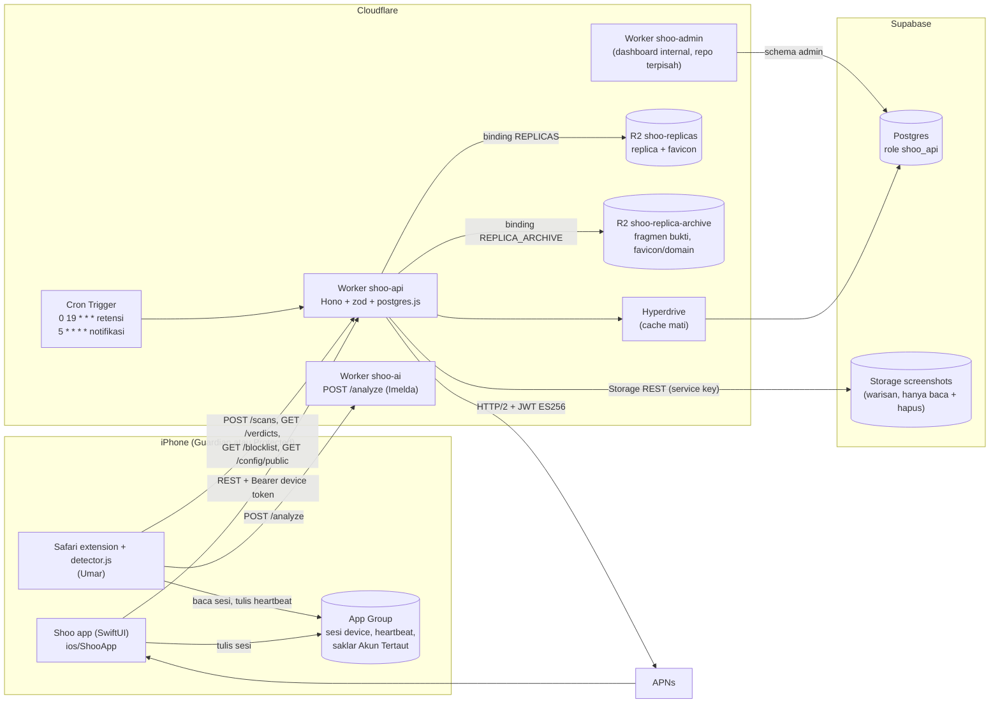
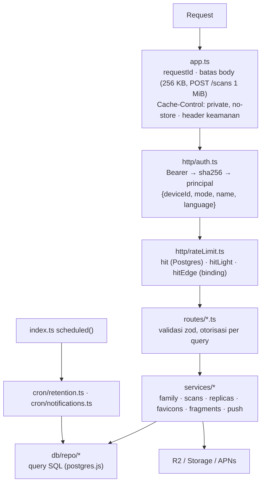
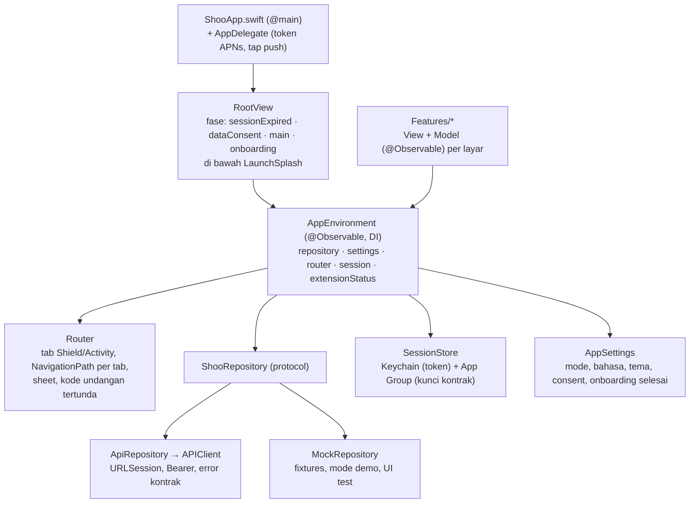
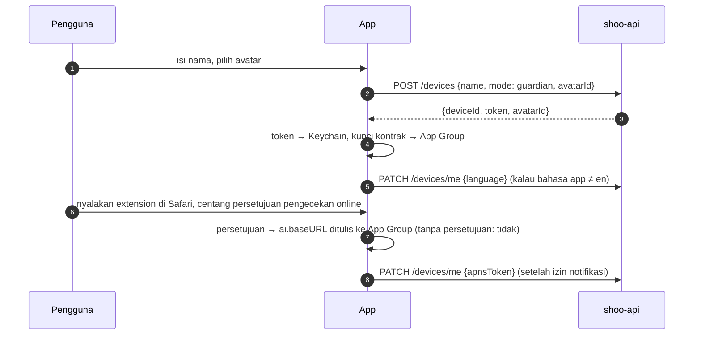
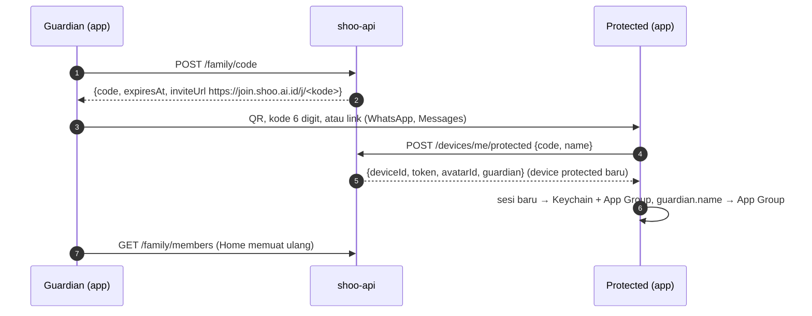
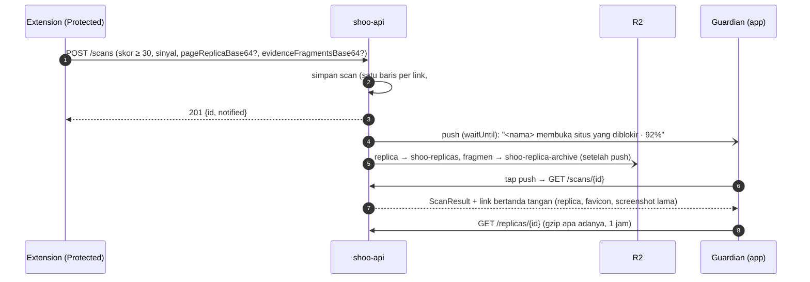
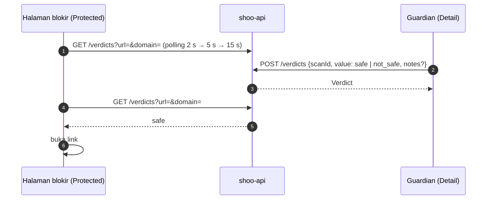

# Shoo · Team App + Backend — Arsitektur teknis

> Cakupan: `backend/` dan `ios/ShooApp/` (milik Alief). Extension Safari dan detector (Umar) serta AI service (Imelda) hanya digambar sebagai tetangga.
> Kontrak: `contracts/api.md`, `contracts/app-group-keys.md`, `contracts/scan-result.schema.json`. Detail: `ref/R1` (folder), `ref/R2` (skema), `ref/R3` (API), `ref/R4` (state machine).
> Diperbarui 19 Nov 2026 terhadap `main` `b68957b8`. Dynamic Island / Live Activity (`POST /live`, EX-03) sudah dihapus di #555 (17 Nov 2026) dan tidak ada lagi di app maupun backend.

Urutan dokumen: §1 gambaran besar → §2 backend → §3 app → §4 alur → §5 hosting dan kuota → §6 lokal → §7 keamanan.

## 1. Gambaran besar



- **Satu pintu data: Worker `shoo-api`.** PostgREST tidak dipakai (grant `anon`/`authenticated` dicabut). App dan extension tidak pernah memegang kunci Supabase.
- **Tanpa login.** `POST /devices` memberi token device acak; app menyimpannya di Keychain dan menyalinnya ke App Group untuk extension.
- **Bentuk JSON hanya dari `contracts/`.** Field tambahan backend selalu aditif dan tercatat di `backend/API.md`.

## 2. Backend (`backend/`)

### 2.1 Komponen

| Komponen | Stack | Lokasi | Catatan |
|---|---|---|---|
| API | Cloudflare Worker `shoo-api`, TypeScript, Hono, zod, postgres.js | `backend/api/src/` | Hanya Web API (`fetch`, `crypto.subtle`). `placement: smart`, `minify`, source map diunggah, invocation log mati |
| Koneksi DB | Hyperdrive `DB` (**cache dimatikan**, D-alief-17) → Supabase Postgres | `backend/api/wrangler.jsonc` | Lokal: `localConnectionString` ke `supabase start` (:54322) |
| DB | Supabase Postgres, 44 migrasi SQL, pgTAP | `backend/db/supabase/` | Role `shoo_api` least-privilege. Schema `admin` untuk dashboard `shoo-admin` |
| Salinan halaman (EX-07) | R2 `shoo-replicas` (binding `REPLICAS`), privat, lifecycle 17 hari | `services/replicas.ts`, `services/replicaStore.ts` | Disajikan hanya lewat `GET /replicas/{id}` (link HMAC 1 jam). Kill-switch `REPLICAS_ENABLED` |
| Favicon (PR-05) | R2 `shoo-replicas`, `-icon.<ext>` | `services/favicons.ts`, `services/faviconFetch.ts` | Diunduh Worker, ≤ 64 KB, disajikan lewat `GET /favicons/{id}` |
| Arsip bukti (ADM-07) | R2 `shoo-replica-archive` (binding `REPLICA_ARCHIVE`) | `services/fragments.ts` | `<scanId>.fragments.html.gz` + `favicon/<domain>`, tidak dihapus retensi (disimpan bersama `admin.scan_archive`); hanya `DELETE /devices/me` menghapus fragmen domain yang tidak terbukti penipuan |
| Screenshot (warisan) | Supabase Storage bucket `screenshots` | `services/screenshots.ts` (`ScreenshotStore`) | Sejak fase 20a `POST /scans` mengabaikan `screenshotBase64`. Scan lama masih dibaca lewat `GET /screenshots/{id}` sampai retensi menghapusnya. Kode Storage dan `SUPABASE_SERVICE_ROLE_KEY` masih ada; pencabutan (20b–20d) belum dikerjakan |
| Push | APNs HTTP/2, JWT ES256 dari `.p8`, langsung dari Worker (D-alief-B11) | `services/push/` (`apns`, `jwt`, `sender`, `deliver`, `notify`, `messages`, `quiet`) | Hanya push alert. `push_log` tanpa teks notifikasi |
| Cron | Worker Cron Trigger | `cron/retention.ts`, `cron/notifications.ts` | `0 19 * * *` retensi harian; `5 * * * *` notifikasi per jam + gauge kuota replica |
| Monitoring | `GET /ops/status` + workflow `ops-watch.yml` | `routes/ops.ts` | Alert jadi issue `ops-alert` ke Alief |
| CI/CD | GitHub Actions `backend.yml` | `.github/workflows/`, `backend/ci/` | Test + typecheck + gitleaks + cek ukuran bundle; push ke `main` yang menyentuh `backend/**` menjalankan `supabase db push` lalu `wrangler deploy` |

### 2.2 Lapisan di dalam Worker



### 2.3 Route

| Kelompok | Route | Siapa |
|---|---|---|
| Device | `POST /devices` · `GET/PATCH/DELETE /devices/me` · `POST /devices/me/protected` | tanpa token · device · device · Guardian |
| Keluarga | `POST /family/code` · `POST /family/join` · `GET /family/members` · `PATCH/DELETE /family/members/{id}` · `POST /family/members/{id}/remind` · `DELETE /family/guardian` | Guardian · Protected · Guardian · Guardian · Guardian · Protected |
| Scan | `POST /scans` · `GET /scans` · `GET /scans/{id}` · `GET /scams/latest` | device |
| Verdict | `POST /verdicts` · `GET /verdicts?url=&domain=` | Guardian · device |
| Data extension | `GET /blocklist` · `GET /config/public` (ambang skor dari dashboard) | device |
| Link bertanda tangan | `GET /replicas/{id}` · `GET /favicons/{id}` · `GET /screenshots/{id}` | link HMAC 1 jam, akses dicek ulang tiap request |
| Publik | `/j/{code}` (halaman undangan) · `/og/*` · `/.well-known/apple-app-site-association` · `/privacy` · `/support` · `/terms` · `/get` · ikon situs | tanpa token |
| Ops | `/healthz` · `/healthz/db` · `/ops/status` (`OPS_STATUS_TOKEN`, selain itu 404) | tanpa token / token ops |

Bentuk JSON, error, dan batas per route: `backend/API.md`.

### 2.4 Binding, var, secret

- **Binding:** Hyperdrive `DB`; R2 `REPLICAS`, `REPLICA_ARCHIVE`; Rate Limiting `VERDICTS_GET_LIMITER` (30/10 s), `SCREENSHOTS_VIEW_LIMITER` (120/60 s), `FAVICONS_VIEW_LIMITER` (600/60 s), `REPLICAS_VIEW_LIMITER` (10/60 s).
- **Var:** `INVITE_BASE_URL` (`https://join.shoo.ai.id`), `API_BASE_URL`, `APP_STORE_URL`, `APPLINKS_APP_IDS`, `APNS_TOPIC` (`com.umarmuhdhor.shoo`), `APNS_ENV`, `SUPABASE_URL`, `SCREENSHOT_MAX_BYTES` (hanya dibaca kode mati), `REPLICAS_ENABLED`, `INACTIVE_DEVICES` (`dry_run`).
- **Secret** (`wrangler secret`, lokal `.dev.vars`): `APNS_KEY_P8_B64`, `APNS_KEY_ID`, `APNS_TEAM_ID`, `SUPABASE_SERVICE_ROLE_KEY`, `RATE_KEY_SECRET`, `SCREENSHOT_URL_SECRET`, `OPS_STATUS_TOKEN`.

### 2.5 Push yang dikirim

| Pemicu | Penerima | Teks (`services/push/messages.ts`) |
|---|---|---|
| Scan Protected ≥ 30 (link pertama per situs, atau blokir pertama) | Guardian-nya, kalau "Kabari saya" untuk anggota itu (`family_links.notify`) dan "Aktivitas orang dilindungi" (`notify_family`) aktif; jam tenang hanya menahan peringatan, blokir tetap dikirim; ≤ 10 / 10 menit | "`<nama>` membuka situs yang diblokir / mencurigakan · skor%" |
| Scan milik Guardian sendiri | Guardian itu sendiri, kalau saklar `notify_blocked` / `notify_warning` aktif | "Shoo memblokir situs berbahaya / memperingatkanmu" (PF-01: Protected **tidak** mendapat push untuk scan sendiri) |
| `POST /family/members/{id}/remind` | Protected | "`<Guardian>` mengingatkan: nyalakan Shoo di Safari" |
| Guardian memutus Protected (`DELETE /family/members/{id}`), atau Guardian menghapus akun | Protected | "`<Guardian>` berhenti melindungimu" |
| Protected menghapus akun | Guardian | "`<nama>` menghapus akun Shoo-nya" |
| Cron per jam: 24 jam tanpa heartbeat | Guardian | "Perlindungan `<nama>` mati" |
| Cron per jam: ringkasan mingguan (Senin 08:00 waktu lokal) | Guardian yang mengaktifkannya | jumlah blokir + peringatan minggu itu, dirinya + anggotanya |

Bahasa teks mengikuti `language` penerima. Token yang dijawab APNs 410 langsung dikosongkan (`deliver.ts`).

## 3. App (`ios/ShooApp/`)

### 3.1 Lapisan



| Folder | Isi |
|---|---|
| `App/` | `AppEnvironment` (siklus sesi, sinkron saat foreground, buka link/push), `Router` (`Route`, `ProfilePage`, `AppTab`), `DeepLink`, `AppConfig` (base URL), `AppSettings`, `AppDelegate`, `RootView` |
| `Data/` | `ShooRepository` + `ApiRepository`/`APIClient` + `MockRepository`/`MockScenarios`; `SessionStore`, `Keychain`; `ExtensionStatus`; `LinkedAccountSettings` + `CheckStats` (App Group, dibaca/ditulis extension); `Models`, `LossyList` |
| `Features/Onboarding` | ON-01..05: splash, nama, nyalakan extension (+ checkbox consent), Safari default, tutorial video/PiP, `DataConsentView` untuk device lama |
| `Features/Main` | `MainTabView` (tab Shield + Activity, Profil di-push dari Home), `SessionExpiredView` |
| `Features/Shield` | Home: `ProtectedShieldView` (PR-04) dan `GuardianHomeView` (GD-01/03), kartu "Penipuan terbaru" (`GET /scams/latest`), sheet nyalakan/matikan extension |
| `Features/Activity` | PR-05, GD-05: daftar scan, filter per orang dan status, paginasi cursor |
| `Features/Detail` | DT-01..06, GD-07: hero skor, kartu ringkasan, bukti (alamat, sinyal, salinan halaman `ReplicaWebView`), tombol Aman / Bahaya, `VerdictLock`, `SafeReasonSheet` |
| `Features/Pairing` | GD-04, PR-01..03: `FamilyCodeView`, `InviteSheet` (QR, kode, link), `ConnectView`, `QRScannerView` |
| `Features/Profile` | PF-01: profil, mode, koneksi, notifikasi, bahasa, tema, aksesibilitas, tentang, lisensi, `MemberDetailView` |
| `Components/`, `Support/` | Komponen UI bersama (ScoreRing, HalftoneShield, SiteIcon, …); `L10n`, `AppLanguage`, `Formatters`, `Log`, `NotificationRouter`, `NotificationPermission` |
| `Tests/`, `UITests/` | Swift Testing (unit) dan XCUITest (termasuk `Live*UITests` ke backend lokal) |

### 3.2 Aturan app

- **Repository:** semua data lewat `ShooRepository`. Build biasa memakai `ApiRepository`; `-UITestMock YES` atau mode demo memakai `MockRepository` (fixtures dari `contracts/fixtures/`).
- **Base URL** (`AppConfig`): Debug → `http://localhost:8787`, Release → `https://shoo-api.afindo-mi01.workers.dev`. AI: Debug `nil` (bisa diganti `-debug.aiBaseURL`), Release `https://shoo-ai.afindo-mi01.workers.dev`. Link undangan publik: `https://join.shoo.ai.id`.
- **Sesi:** token hanya di Keychain (`AfterFirstUnlockThisDeviceOnly`). Kunci kontrak (`device.id`, `device.token`, `device.mode`, `device.name`, `guardian.name`, `api.baseURL`, `ai.baseURL`) disalin ke App Group untuk extension. 401 dengan token yang sama → layar "Sesi berakhir".
- **Status extension (`ExtensionStatus`, #40):** iOS 26.2+ menanyakan Safari dulu (`SFSafariExtensionManager`); sebelumnya, atau tanpa jawaban, `extension.lastSeenAt` yang baru. `extension.allSites == false` selalu Off. Heartbeat hanya dikirim ke server kalau statusnya bukan "sebagian situs" / "dimatikan".
- **Bahasa:** EN + ID di `Localizable.xcstrings`; instal baru mulai dalam Bahasa Indonesia (`AppLanguage.defaultLanguage`).
- **Privasi:** `os.Logger` dengan `privacy: .private`, tanpa SDK pihak ketiga, data server hanya di memori (cache favicon dikosongkan saat sesi berganti), notifikasi yang sudah tampil dihapus saat datanya dihapus.

## 4. Alur utama

### 4.0 Halaman dibuka → skor → peringatan atau blokir (extension, milik Umar)

Alur ini milik extension, tetapi semua alur app dan backend di bawah berawal dari sini. Kode: `ios/ShooExtension/Resources/` (`content.js` → `pipeline.js` `runScan`, jaringan hanya lewat `background.js`), `detector/` (layer 1–2), `ai/src/analyze.js` (layer 3–4).

```mermaid
sequenceDiagram
  autonumber
  participant P as Halaman (content script)
  participant B as background.js
  participant N as Native handler (App Group)
  participant AI as shoo-ai
  participant API as shoo-api
  P->>B: recallBlock(url) (memori blokir 14 hari, #231)
  alt pernah diblokir di iPhone ini
    B->>API: GET /verdicts?url=&domain= (fresh)
    API-->>B: safe → buka · lainnya → blokir lagi tanpa layer
  end
  P->>P: layer 1 (blocklist lokal) + layer 2 (detector.js: domain, link, asks_*)
  B->>N: getSession (token, mode, base URL, saklar Akun Tertaut; cache 30 s)
  P->>B: analyze(snapshot, localSignals)
  B->>AI: POST /analyze (URL = origin + path; tidak untuk host privat; hanya kalau ai.baseURL ada)
  AI-->>B: signals layer 3 (+ layer 4 LLM hanya kalau total 30–79), rdapRegisteredAt
  P->>P: skor = jumlah bobot (maks 100), status dari ambang /config/public (default 30/50/80)
  opt skor ≥ 30
    B->>API: GET /verdicts?url=&domain=
    API-->>B: safe → skor 0 · not_safe → blokir 100
  end
  P->>B: report (warning selesai, atau blocked) + replica + fragmen
  B->>API: POST /scans
  P->>P: ≥ 80: location.replace(blocked.html#…) · 30–79: kartu peringatan + sorotan
```

- **Skor** naik setiap layer selesai (`publish` per layer); blocklist cocok (`db_match`) langsung 100 dan menghentikan scan. Halaman yang berubah dicek ulang (maks 6 per halaman); skor hanya bisa naik.
- **Layer 3–4 butuh persetujuan.** App hanya menulis `ai.baseURL` ke App Group kalau pengguna menyetujui pengecekan online (`SessionStore.writeBaseURLsLocked`, `DataConsent`). Tanpa itu extension hanya memakai layer 1–2. Dengan persetujuan, teks halaman dan bentuk form (tanpa isian) setiap halaman publik dikirim ke `shoo-ai`, berapa pun skornya, dan tidak disimpan di sana. `shoo-api` hanya menerima halaman dengan skor ≥ 30.
- **Yang dilaporkan** (`report.js` `shouldReport`, `share-settings.js`): `blocked` selalu; `warning` hanya setelah semua layer selesai dan kalau saklar "Kirim link otomatis" + "Bagikan peringatan" aktif. Halaman yang diblokir karena verdict `not_safe` atau dari memori (yang sudah punya scan) tidak dilaporkan lagi.
- **Verdict juga berlaku saat peringatan:** kartu peringatan yang terbuka ikut polling `GET /verdicts` (#370, jadwal sama dengan layar blokir); `not_safe` memindahkan tab ke layar blokir, `safe` menutup peringatan.
- **Layar blokir** `blocked.html` adalah halaman extension (tidak bisa disentuh skrip situs). Protected: tanpa tombol, terbuka sendiri saat `safe`. Guardian (blokir di iPhone-nya sendiri): tombol "Tinjau di Shoo" membuka `shoo://scan/<id>` → Detail di app.
- **Heartbeat:** extension mengirim `heartbeat {allSites}` ke native handler (App Group `extension.lastSeenAt`, `extension.allSites`) dan `PATCH /devices/me {extensionLastSeenAt}` maks 1×/jam. Native handler juga menambah penghitung "Situs diperiksa" (`pageChecked`).

### 4.1 Onboarding dan registrasi (ON-01..05)



Semua instalasi baru terdaftar sebagai `guardian` dengan Mode Keluarga mati ("Pribadi": melindungi dirinya sendiri). Mode Keluarga (`settings.familyModeOn`) dinyalakan di app untuk mengundang anggota; menjadi Protected hanya lewat kode undangan (§4.2).

Setiap kali app ke foreground (`sceneBecameActive`): `PATCH /devices/me` dengan `extensionLastSeenAt` (+ model, iOS, zona waktu sekali per peluncuran), lalu `GET /devices/me`, lalu daftar ulang push kalau diizinkan.

### 4.2 Pairing keluarga (GD-04, PR-01..03)



- Kode 6 digit berlaku 30 menit dan dipakai ulang selama sisa > 5 menit (`refresh: true` membuat yang baru; #128). Maks 3 Protected per Guardian.
- Pihak yang bergabung adalah device `guardian` tanpa anggota (semua instalasi mulai begitu). `POST /devices/me/protected` mengganti device itu dengan device `protected` baru dalam satu transaksi (fase 27a); token lama mati, app langsung memakai sesi baru. Guardian yang masih punya anggota ditolak `409 has_members`.
- `POST /family/join` hanya dipakai device yang sudah `protected` tetapi belum punya Guardian (misalnya setelah Guardian-nya memutus).
- Link `/j/<kode>` adalah Universal Link (`applinks:join.shoo.ai.id`, juga host `workers.dev` untuk link lama). Tanpa app, halaman undangan ditampilkan. Kode dari link disimpan di memori (`Router.pendingJoinCode`) sampai 30 menit sejak link dibuka, melewati onboarding; hilang kalau app ditutup paksa.

### 4.3 Scan, push, Detail (EX-07, GD-06, DT-*)



- Di bawah skor 30 tidak ada yang dikirim ke backend. Kunjungan ulang ke link yang sama memakai baris yang sama; push hanya untuk kunjungan pertama ke situs atau blokir pertama.
- Replica divalidasi (inflate per 8 KB, ≤ 3 MB) dan disimpan kalau kuota masih ada, dengan atau tanpa keluarga (device Pribadi melihat buktinya sendiri di Detail; kuota keluarganya = device itu). Kegagalan push tidak pernah menggagalkan scan.

### 4.4 Verdict membuka blokir (GD-07, EX-06)



- Verdict berlaku per link (origin + path, #241): `safe` membuka link itu saja; `not_safe` menutup domainnya kecuali di host bersama.
- `safe` terkunci (`VerdictLock`) sampai review AI mingguan membacanya (#476).
- `not_safe` masuk antrean `blocklist_entries` dan baru muncul di `GET /blocklist` setelah review manual (D-alief-25).
- Target: `GET /verdicts` mencerminkan keputusan ≤ 1 s setelah `POST /verdicts` (Hyperdrive tanpa cache).

### 4.5 Putus, hapus, retensi

- **Guardian memutus Protected** (`DELETE /family/members/{id}`) atau **Protected keluar** (`DELETE /family/guardian`): link keluarga langsung hilang. Push hanya saat Guardian memutus (ke Protected).
- **Hapus data saya** (`DELETE /devices/me`): dalam satu transaksi device, scan, dan verdict (miliknya dan yang ia buat) dihapus, dan objek R2/Storage-nya di-tombstone; objek dihapus di `waitUntil` setelah commit, sisanya diulang cron. Baris arsip ADM-07 dilepas dari device; fragmen buktinya dihapus kecuali domainnya terbukti penipuan (blocklist disetujui, label scam, atau verdict `not_safe`). App mengosongkan Keychain, App Group, notifikasi yang tampil, dan kembali ke onboarding.
- **Cron retensi harian** (`0 19 * * *`): scan > 14 hari + objeknya, kode keluarga kedaluwarsa, catatan percobaan join lama, catatan verdict > 14 hari (verdict sendiri tetap untuk blocklist), device tidak aktif (mode `INACTIVE_DEVICES`). Arsip ADM-07 tidak dihapus.
- **Cron notifikasi per jam** (`5 * * * *`): "Perlindungan mati" (24 jam tanpa heartbeat), ringkasan mingguan, ≤ 40 push per run, jam tenang per zona waktu; juga gauge kuota replica.

## 5. Hosting, kuota, biaya

| Layanan | Plan | Kuota yang relevan | Penjaga |
|---|---|---|---|
| Cloudflare Workers | Free | 100k request/hari, CPU 10 ms per request dan per Cron Trigger, 50 subrequest/request, 5 Cron Trigger/akun (dipakai 2) | Kerja berat (replica, fragmen) di `waitUntil` setelah respons; polling verdict lewat binding Rate Limiting, tanpa baris DB |
| Hyperdrive | Free | 100.000 query/hari, ±20 koneksi origin | Cache dimatikan; satu request = sedikit query |
| Supabase DB | Free | 500 MB, pause setelah 7 hari tanpa aktivitas | Retensi 14 hari; `/healthz/db` menulis `ops_heartbeat`. Kapasitas terukur: `backend/README.md` §Quota |
| Supabase Storage | Free | 1 GB, 5 GB egress/bulan | Tidak ada screenshot baru sejak 20a; isinya habis oleh retensi |
| Cloudflare R2 | Free | 10 GB-bulan, 1 juta Class A + 10 juta Class B/bulan, egress gratis | Replica ≤ 307 200 byte; global 3000 upload + 500 MB/hari, 50/device, 300/IP; tampilan 10/menit + 500/hari per viewer; lifecycle 17 hari. Favicon ≤ 64 KB, 1000 unduhan/hari. Arsip ≤ 100 MB/hari global |
| APNs | Apple Developer Program | – | `APNS_ENV=production` (TestFlight) |

## 6. Di Mac (lokal)

```bash
# dari root repo, tiap baris di terminal sendiri
(cd backend/db && supabase start)                        # Postgres :54322, Studio :54323 (Docker)
pnpm -C backend/api install && pnpm -C backend/api dev   # wrangler dev :8787, Hyperdrive lokal → :54322
(cd ios && xcodegen && open Shoo.xcodeproj)              # app Debug → http://localhost:8787
```

Simulator iOS menjangkau `localhost` Mac tanpa port forwarding. **Awas:** `pnpm -C backend/api test` mengosongkan DB di `SHOO_TEST_DB_URL`; pakai DB terpisah dari yang dipakai `wrangler dev`.

## 7. Keamanan singkat

- Token device acak 32 byte, disimpan sebagai hash SHA-256. Middleware `auth` → `principal {deviceId, mode, name, language}`.
- Otorisasi di setiap query: Guardian hanya membaca scan miliknya atau milik Protected yang `family_links`-nya aktif ke dia. Test IDOR di `backend/api/test/`.
- Kode keluarga: 5 gagal/10 menit per device dan 20 gagal/10 menit per IP; halaman `/j/` juga mencatat gagal per IP dan dibatasi 600/10 menit global.
- Semua respons data `Cache-Control: private, no-store`. Pengecualian, semuanya tanpa data pengguna: cache privat di device untuk `/blocklist` (300 s), `/scams/latest` (600 s), `/config/public` (3600 s); cache publik hanya untuk AASA, `/og/*`, dan ikon situs.
- Secret hanya di `wrangler secret`, GitHub environment, dan Keychain Mac. Detail: [`SECURITY.md`](SECURITY.md).
