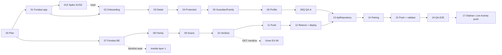

# Plan detail per fase — Shoo · Team App + Backend (Alief)

> Rencana kerja teknis Alief untuk Shoo: semua layar app (`ios/ShooApp/`) dan backend (`backend/`).
> Produk: PRD v1.5 (link di [`../../docs/README.md`](../../docs/README.md)). Tugas resmi: [`../../docs/mandates/alief.md`](../../docs/mandates/alief.md).
> Kontrak bersama (read-only untuk kita): [`../../contracts/`](../../contracts/). Arsitektur: [`ARCHITECTURE.md`](ARCHITECTURE.md). Keamanan: [`SECURITY.md`](SECURITY.md).
> Struktur plan ini meniru `umarmuhdhor/IBM/plan` (progress, prompt, verify, todo, ref, log), disesuaikan dengan aturan repo `Final-CH7`.

---

## 1. Cara pakai

1. Pertama kali: jalankan [`VERIFY_PROMPT.md`](VERIFY_PROMPT.md) (read-only) supaya AI memahami plan dan menandai celah.
2. Buka [`PROMPT.md`](PROMPT.md), salin kalimat pembuka sesuai track:
   - `Saya Alief, track app. Kerjakan otomatis sesuai plan/alief/PROMPT.md (mode auto).`
   - `Saya Alief, track be. Kerjakan otomatis sesuai plan/alief/PROMPT.md (mode auto).`
   - `Saya Alief, track c. Kerjakan otomatis sesuai plan/alief/PROMPT.md (mode auto).` (setelah track app + be selesai)
   - `Saya Alief, track spike. Kerjakan otomatis sesuai plan/alief/PROMPT.md (mode auto).` (fase 01S, kapan saja setelah fase 01 kalau iPhone + signing siap; berhenti di uji perangkat)
3. Tempel di Claude Code (plugin **ECC** + **Superpowers** terpasang) di worktree track itu (§4). Model per fase ada di §3 dan [`ref/R6-model-skill.md`](ref/R6-model-skill.md).
4. Agent berhenti hanya untuk **LANGKAH MANUAL** (akun, secret, deploy cloud, TestFlight; status fase `[m]`), blocker P0, atau konteks hampir habis. Jalankan LANGKAH MANUAL, centang butirnya di `log/fase-XX.md`, lalu ketik kalimat yang sama: agent melanjutkan fase `[m]` itu (sisa Langkah kerja, lalu review, verifikasi, PR) sebelum pindah ke fase berikutnya.

Agent mengisi `PROGRESS.md` (baris fasenya saja) dan `log/fase-XX.md`, commit, push branch fase, membuka PR ke `main` dengan reviewer @umarmuhdhor, lalu lanjut ke fase berikutnya.

---

## 2. Struktur folder

```text
plan/alief/
├── README.md            ← file ini
├── PROMPT.md            ← satu prompt (ubah TRACK + FASE)
├── VERIFY_PROMPT.md     ← review independen seluruh plan (read-only)
├── PROGRESS.md          ← status fase, requirement P0, gate
├── TODO.md              ← keputusan, akses, secret, langkah manual, koordinasi ke Umar/Imelda
├── ARCHITECTURE.md      ← arsitektur 1 halaman (app, Worker API, Supabase DB/Storage, APNs)
├── SECURITY.md          ← aturan secret + threat model backend & app
├── fixbug.md            ← tracker perbaikan dari QA (satu bug = satu test gagal = satu commit)
├── ref/                 ← kontrak internal kita (tidak boleh bertentangan dengan contracts/)
│   ├── R1-struktur-repo.md     ← layout backend/ + ios/ShooApp/
│   ├── R2-skema-db.md          ← SQL Postgres + grant + invariant
│   ├── R3-catatan-api.md       ← detail implementasi contracts/api.md (error, rate limit, cursor, auth)
│   ├── R4-state-machine.md     ← family code, join, verdict → unblock, retensi
│   ├── R5-konvensi.md          ← gaya kode, test, env, nama file terlarang, commit
│   ├── R6-model-skill.md       ← model + skill ECC/Superpowers per fase
│   └── R7-protokol-qa.md       ← format laporan QA, prioritas P0–P3, bukti, retest
├── fase-00 … fase-17 (+ fase-01S spike, fase-06Q QA-A)
├── qa/                  ← laporan QA (README = template) + img/ bukti
└── log/
    ├── DECISIONS.md     ← keputusan (plan: D-alief-NN; per track: D-alief-A/B/C/S…), append-only
    ├── fase-XX.md       ← laporan per fase
    └── fase-XX-plan.md  ← output superpowers:writing-plans per fase
```

---

## 3. Peta fase

Track **app** dan **be** jalan paralel di worktree terpisah. Track **c** (sambung app ke backend) mulai setelah keduanya selesai.

| No | Fase | Track | Branch | Output utama | PRD / mandat | Model |
|---|---|---|---|---|---|---|
| 00 | Plan + tooling | – | `docs/alief-plan` | folder `plan/alief/` | – | Opus 5.5 |
| 01 | Fondasi app | app | `chore/APP-test-targets` → `feat/APP-foundation` | tab Shield/Activity, `ShooRepository` + `MockRepository`, String Catalog EN/ID, 12 avatar, target test, draf CI iOS | Fase A "Fondasi" | Sonnet 5.5 |
| 01S | Spike S1/S2 | spike | `spike/S1-S2-extension` | hasil `docs/spikes/extension-status.md` + `open-extension-settings.md` di iPhone Alief, usulan window Active | Spike S1, S2 | Sonnet 5.5 |
| 02 | Onboarding | app | `feat/ON-01-05-onboarding` | splash 3 slide, nama, mode, Turn on extension (fallback PRD §10), izin notifikasi | ON-01, 02, 03, 04, 05 | Sonnet 5.5 |
| 03 | Detail | app | `feat/DT-detail` | ring skor, label, link, bukti, tombol validasi, catatan verifikasi | DT-01..06 | Sonnet 5.5 |
| 04 | Protected | app | `feat/PR-04-05-shield-activity` | Shield + Activity Protected | PR-04, PR-05 | Sonnet 5.5 |
| 05 | Guardian & Family | app | `feat/GD-family-mode` | Shield Guardian, toggle Family, Shield Family, Activity Family | GD-01, 02, 03, 05 | Sonnet 5.5 |
| 06 | Profile | app | `feat/PF-01-profile` | profile, bahasa, status extension | PF-01 | Sonnet 5.5 |
| 06Q | QA-A (UI fixtures) | app | `fix/QA-A-*` per bug | `qa/QA-A-<tanggal>.md` | semua layar Fase A | Sonnet 5.5 |
| 07 | Fondasi backend | be | `feat/BE-devices` | Supabase lokal, skema, Worker Hono, auth device, `GET /blocklist` awal, spike APNs, draf CI backend | Devices, Blocklist | Opus 5.5 |
| 08 | Family | be | `feat/BE-family` | kode 4 digit 60 s, join + rate limit, maks 3, members, disconnect, halaman undangan https | Family | Opus 5.5 |
| 09 | Scans + screenshot | be | `feat/BE-scans` | `POST/GET /scans`, Storage, kuota screenshot, cursor | Scans | Opus 5.5 |
| 10 | Verdicts + blocklist | be | `feat/BE-verdicts` | verdict per domain, blocklist dari verdict | Verdicts, Blocklist | Opus 5.5 |
| 11 | Push APNs | be | `feat/BE-push` | APNs (atau fallback Edge Function), push lokal EN/ID, mock sender | Push | Opus 5.5 |
| 12 | Retensi + hardening + deploy | be | `feat/BE-retention-hardening` | Cron 14 hari, rate limit, review keamanan, deploy cloud, workflow final | Retensi, Keamanan | Opus 5.5 |
| 13 | ApiRepository + sesi | c | `feat/APP-api-repository` | `ApiRepository`, `POST /devices` di onboarding, key App Group | Fase C butir 1–2 | Opus 5.5 |
| 14 | Pairing | c | `feat/GD-04-PR-01-03-pairing` | Family code, Connect, Protected by, deep link | GD-04, PR-01, 02, 03 | Opus 5.5 |
| 15 | Push + validasi live | c | `feat/GD-06-07-push-validation` | tap push → Detail, It's safe / Not safe live | GD-06, GD-07 | Opus 5.5 |
| 16 | QA-E2E | c | `fix/QA-*` per bug | `qa/QA-E2E-<tanggal>.md`, retest | semua P0 | Sonnet 5.5 (Opus untuk fix keamanan) |
| 17 | Ditahan | – | nanti | Live Activity lewat push | EX-03 | – |
| 18 | Page replica | c | `feat/EX-07-replica-backend` (dari `main`, sekarang) → `fix/EX-07-app-fixtures` (ke #177, setelah #175) → `feat/DT-04-page-replica` (D-alief-C24) | `pageReplicaBase64` di `POST /scans`, R2 `shoo-replicas`, `GET /replicas/{id}`, Detail merender salinan halaman (issue #176) | EX-07, DT-04 | Opus 5.5 |
| 19 | Kuota salinan halaman per keluarga + log alert | be | `feat/EX-07-replica-family-quota` | kuota 24 jam per keluarga (Guardian + Protected), cadangan global, gauge `replica_quota_usage` | TODO E8, SECURITY P13 | Opus 5.5 |
| 20 | Sunset screenshot (18c) + cabut service_role | c | `fix/EX-07-ignore-screenshot-upload` → `feat/EX-07-screenshot-sunset` → `feat/EX-07-drop-screenshot-columns` + `feat/DT-04-screenshot-sunset` | backend berhenti menerima/menyimpan screenshot, kolom + bucket dihapus, kunci `SUPABASE_SERVICE_ROLE_KEY` dicabut | TODO E1, D-alief-C23/C27 | Opus 5.5 |
| 21 | Monitoring, alert, ops | be | `feat/B9-ops-status` → `feat/EX-07-ops-replica` → `feat/B9-ops-watch` | `GET /ops/status` (token), workflow terjadwal `ops-watch`, issue `ops-alert`, runbook | TODO B9, D9, D10, D11 | Opus 5.5 |
| 22 | Performa Worker + snapshot Detail | c | `fix/BE-worker-cpu`, `fix/EX-07-replica-inflate`, `fix/DT-04-snapshot-perf` | bundle zod lebih kecil, cache kunci HMAC, inflate lebih murah, snapshot tajam + hemat memori | log/fase-18.md:92 (CPU cloud) | Opus 5.5 |
| 23 | Keandalan CI + UI test live salinan | app | `fix/C2-test-flakes`, `test/DT-04-live-replica-ui` | helper UITest, reduce motion, suite WebKit serial, usulan CI iOS ke Umar, UI test live opt-in | TODO C2, fase 18 DoD | Sonnet 5.5 (Opus untuk review) |
| 24 | Privasi & siklus data | c | `feat/E7-inactive-devices`(`-on`), `feat/C22-shared-keychain`, sisa 24c | hapus device tidak aktif (dry-run dulu), token di Keychain bersama, kontak + App Privacy | TODO E6, E7, C22 | Opus 5.5 |
| 25 | Verdict realtime | be | `feat/EX-06-verdict-latency-log` → spike DO | polling adaptif (Umar) + spike WebSocket Durable Object di balik flag | TODO E3 | Opus 5.5 |
| 26 | Undangan setelah install | c | `feat/PR-03-deferred-invite-app`, `feat/PR-03-deferred-invite-page` | tombol Tempel undangan di splash + Connect, parser link ketat | TODO E4, PR-03 | Opus 5.5 |

**Gate:** Fondasi app (01) dan fondasi backend (07) boleh mulai bersamaan · Track c mulai setelah semua PR 01–06Q dan 07–12 **di-merge** (`[x]` = merged, PROGRESS legenda) · Deploy cloud pertama di akhir fase 07 supaya Imelda bisa memakai `GET /blocklist` · QA-E2E butuh TestFlight (TODO B6–B8). · Fase 19–26 (ditulis + diverifikasi 31 Okt–1 Nov 2026): urutan dan issue ke Umar di [`ref/R8-fase-19-26-lintas.md`](ref/R8-fase-19-26-lintas.md); jalur kritis G2 → 20a → 15 hari → 20b (±16 Nov) → 20c.

---

## 4. Worktree & sesi

Satu worktree + satu sesi Claude per track (`superpowers:using-git-worktrees`):

| Track | Worktree | Folder yang boleh diubah |
|---|---|---|
| app | `../Final-CH7-app` | `ios/ShooApp/`, `plan/alief/` (baris fase app saja, keputusan `D-alief-A…`) |
| be | `../Final-CH7-be` | `backend/`, `plan/alief/` (baris fase be saja, keputusan `D-alief-B…`) |
| c | repo utama `Final-CH7` | `ios/ShooApp/`, `backend/`, `plan/alief/` (keputusan `D-alief-C…`) |
| spike | `../Final-CH7-spike` | `ios/ShooApp/` (debug + ON-04), `docs/spikes/extension-status.md`, `docs/spikes/open-extension-settings.md`, `plan/alief/` (baris 01S saja, keputusan `D-alief-S…`) |

Pengecualian: (1) PR `chore/APP-test-targets` (fase 01) menyentuh `ios/project.yml` hanya dengan diff yang tertulis di D-alief-02; (2) `plan/alief/` sendiri berada di luar folder Team App (D-alief-20); (3) checkbox `docs/mandates/alief.md` (diizinkan CODEOWNERS); (4) dua file spike S1/S2 di `docs/spikes/` (mandat, D-alief-29). Build ke iPhone sendiri memakai L0: `ios/Config/Local.xcconfig` (gitignored); `ios/project.yml` tidak diubah, bundle ID / App Group tidak di-hardcode.

---

## 5. Grafik dependensi



Garis putus-putus = endpoint yang dipakai tim lain sebelum app kita tersambung.

---

## 6. Aturan emas

1. **Kontrak dulu.** `contracts/` milik Umar. Kita tidak mengubahnya. Usulan perubahan → entri DECISIONS + deskripsi PR + TODO §C.
2. **Satu fase per sesi.** Agent tidak mengerjakan fase lain "sekalian".
3. **Folder = track.** Hanya `ios/ShooApp/`, `backend/`, `plan/alief/` (dan satu PR `project.yml` di fase 01).
4. **P0 sebelum P1.** Nice to have hanya kalau file fase memintanya.
5. **Test adalah bukti.** TDD (`superpowers:test-driven-development` + `ecc:tdd-guide`), lalu `ecc:verification-loop` + `superpowers:verification-before-completion`.
6. **Tanpa secret di repo.** `.env`/`.dev.vars` di-ignore, hanya `*.example` yang di-commit (R5 §6, SECURITY).
7. **EN default + Bahasa Indonesia** untuk semua teks. Teks sinyal deteksi dari Imelda dipakai apa adanya, tidak diterjemahkan.
8. **Desain sementara.** Belum ada Figma: layar mengikuti wireframe PRD §7 + skill `apple-design`, dan setiap log fase UI mencatat "re-skin saat desain final datang".
9. **Cloud = manusia.** Agent bebas di Supabase lokal + `wrangler dev`. Setiap aksi cloud (deploy, secret, migrasi produksi) = LANGKAH MANUAL yang dikonfirmasi Alief.
10. **Keamanan & privasi Apple untuk semuanya.** Setiap perubahan app, backend, plan, dan langkah manual mengikuti SECURITY §3 (P1–P13). Kalau ragu, pilih opsi paling menjaga privasi dan catat di DECISIONS (D-alief-40, PROMPT 6l).

---

## 7. Definisi selesai (MVP Alief)

Diambil dari mandat:
1. Semua requirement P0 di PRD 8.1–8.4 dan 8.6 lolos "Selesai kalau", dengan bukti di log fase, termasuk ON-04 (fase 02, fallback PRD §10 + hasil spike 01S). Spike S1 dan S2 selesai (fase 01S).
2. Keluarga terhubung lewat kode 4 digit atau QR, dan Guardian menerima push saat orang tuanya membuka situs berbahaya.
3. Guardian menekan **It's safe** → layar blokir di HP orang tua terbuka (EX-06) tanpa layar konfirmasi.
4. Semua teks tersedia EN + ID.
5. QA-E2E tanpa temuan P0/P1 terbuka (retest LULUS).
