# Proposal: pairing and role changes must show a result right away (20 Nov 2026)

Status: **proposal only, nothing built.** Owner: Alief (Team App). Areas: `ios/ShooApp/` (PR-*, GD-*, PF-01).

## Why

Usability test, 20 Nov 2026. The tester:

- tapped connect / chose to be Guardian, then saw nothing change: *"aku bingung harus ngapain, apa yang berubah… ternyata berubahnya pas aku balik ke halaman home"*;
- added a family member: *"aku nambahin guardian terus kayak gak ada apa-apa, ah ngapain nih?"*;
- did not know the Guardian feature existed until told.

Goal: the simplest change after which **something visibly changes right after every pairing or role tap**.

## How this was checked

- `main` at `5a62eb94`. Two iPhone 17 simulators (iOS 26.5), app in Bahasa Indonesia, local backend (`pnpm -C backend/api dev` + local Supabase).
- A throwaway XCUITest (not committed) drove both phones at once, the same way `LivePairingUITests` does. Guardian "Ayah" invites, Protected "Ibu" joins with the code. Screenshots were taken right after each tap and again ~2 s later.
- The Profile routes (Guardian card, Account mode) ran on the mock backend (`-UITestMock YES -mock.scenario empty`).
- Haptics and animations do not show in still screenshots. Those parts come from reading the code (file:line below).

## Current flows

### A. Guardian side: Pribadi → Guardian from Home ⇆, then invite, then a member joins

| g01 Home (Pribadi) | g02 tap ⇆ → intro | g04 "Mulai" → Home | g05 Profile | g06 "Undang Keluarga" sheet |
|---|---|---|---|---|
| 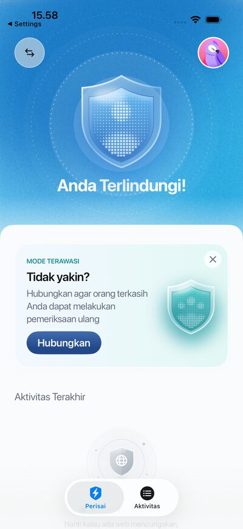 | 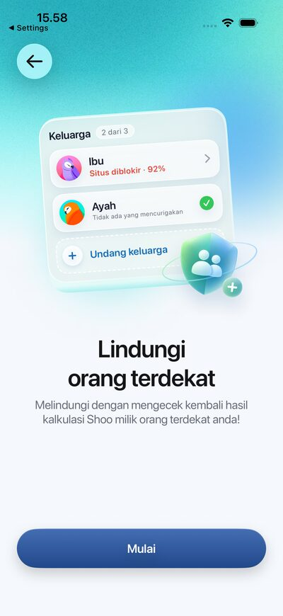 | 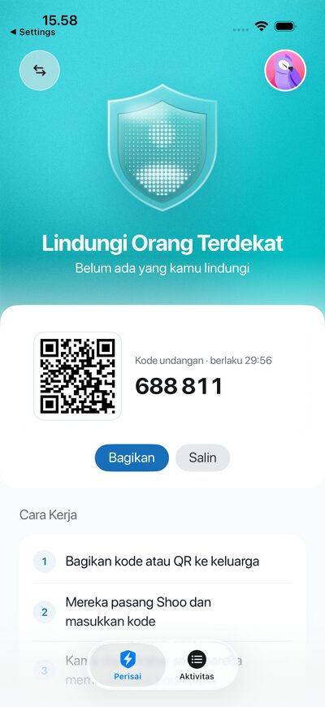 | 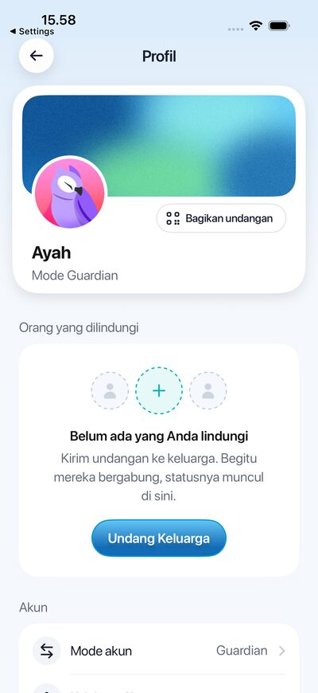 |  |

| g07 Ibu joined, +1 s | g08 Ibu joined, +8 s | g09 close sheet → Profile | g10 Back → Home |
|---|---|---|---|
|  | 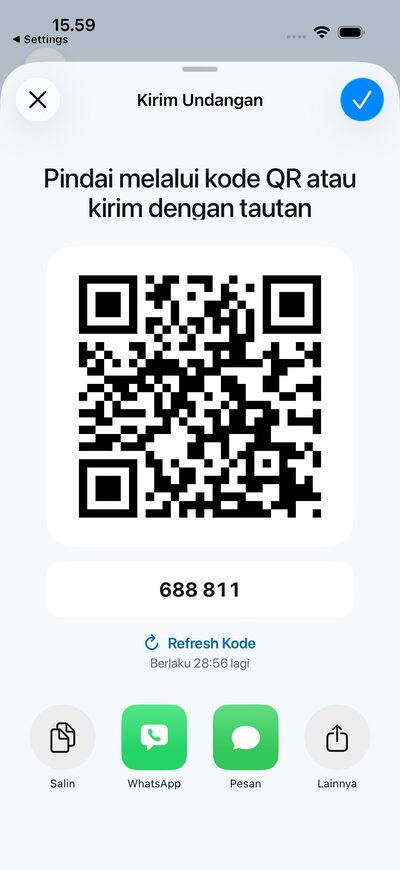 | 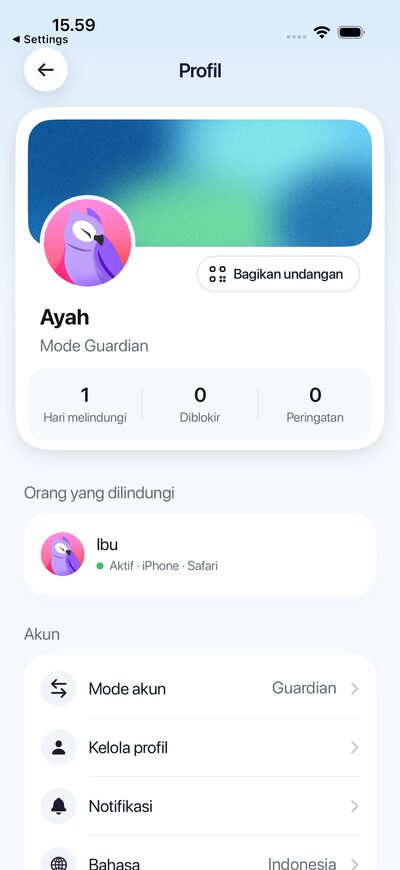 | 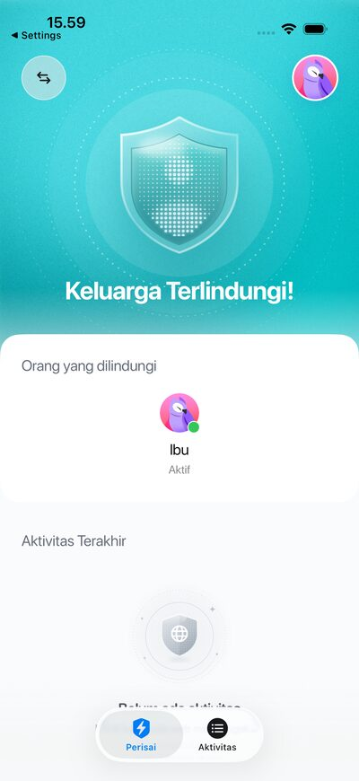 |

- g02 → g04 works: Home swaps to the teal "Lindungi Orang Terdekat" Home with the code card. The swap has no transition and no haptic. The ⇆ icon has no text label.
- g06 → g08: **Ibu joined while the sheet was open, and the sheet did not change.** Only the countdown moved. `FamilyCodeModel.run` already re-reads the members every 5 s (`Features/Pairing/FamilyCodeModel.swift:90-97`), but `InviteSheet` never shows them.
- g09: Ibu appears on Profile only after the sheet is closed, with no message.
- g10: "Keluarga Terlindungi!" + Ibu shows only after Back to Home.

### B. Guardian side: Pribadi → Guardian from Profile (Guardian card and Account mode)

| m02 Profile (Pribadi) | m03 "Menjadi Guardian" → intro | m04 "Mulai", +0.3 s | m05 "Mulai", +2 s |
|---|---|---|---|
| 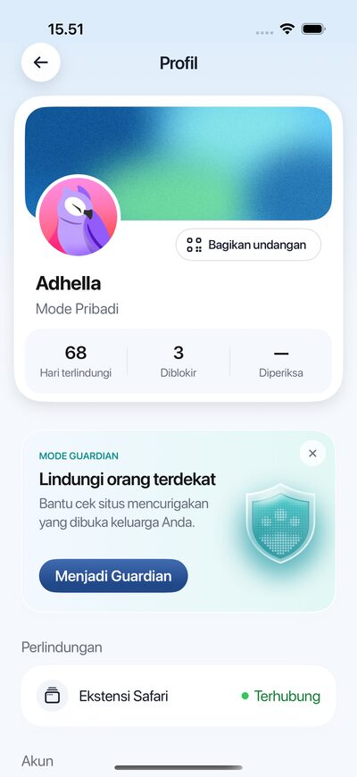 | 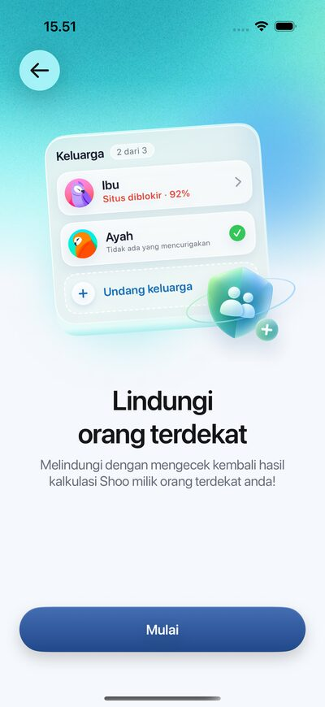 | 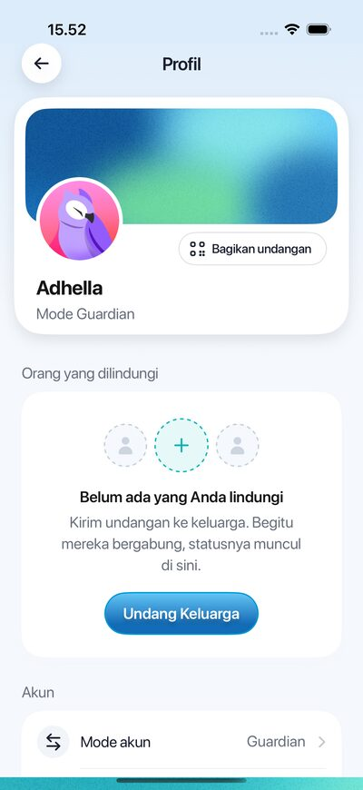 | 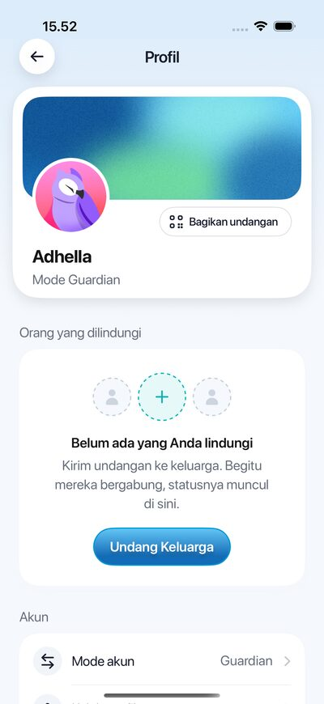 |

| m06 Mode akun (Guardian) | m07 pick Pribadi | m08 "Ganti ke Pribadi", +0.3 s | m09 +2 s | m10 back to Guardian |
|---|---|---|---|---|
|  | 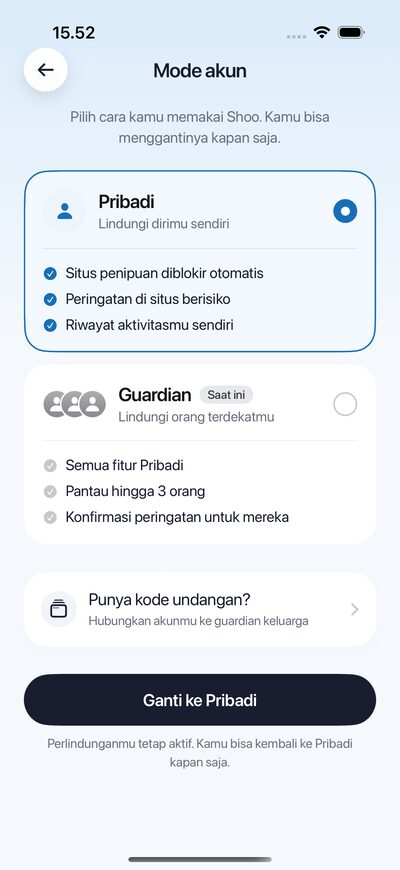 | 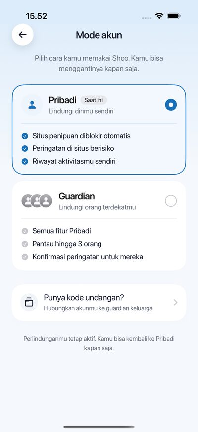 |  | 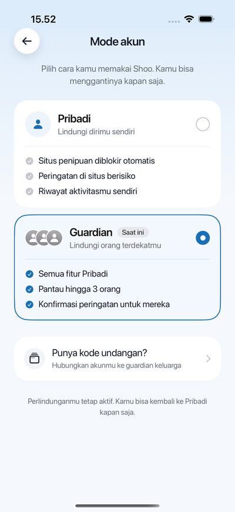 |

- m04: after "Mulai" the user is back on Profile. The page re-lays itself out with no animation: the card goes, the label says "Mode Guardian", and the stats row is replaced by "Orang yang dilindungi". **The real change (the Guardian Home) is two Backs away.** This matches the first quote.
- m08: "Ganti ke Pribadi" only moves the small "Saat ini" chip and removes the button. Nothing is said on screen. VoiceOver alone hears "Switched to Personal" (`Features/Profile/ProfilePages.swift:270-279`).
- The first switch to Guardian from Account mode opens the intro, then returns to Account mode, where the picker has already snapped back (`selected = nil`, `ProfilePages.swift:272`).

### C. Protected side: Pribadi joins a guardian ("Hubungkan" on Home)

| p01 Home (Pribadi) | p02 "Hubungkan" → Mode akun | p03 "Punya kode undangan?" | p04 code typed |
|---|---|---|---|
| 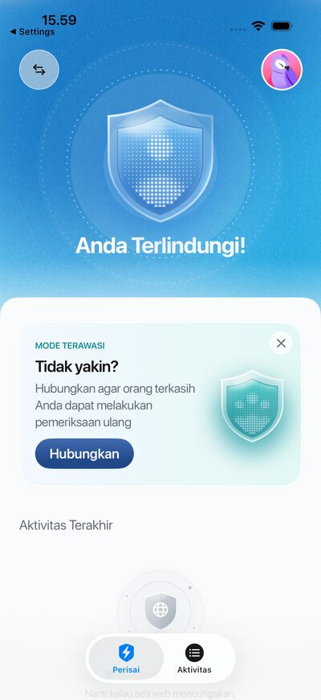 | 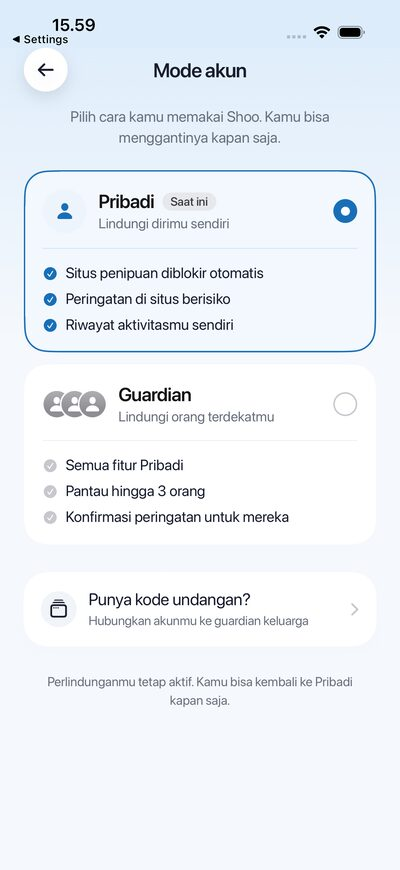 | 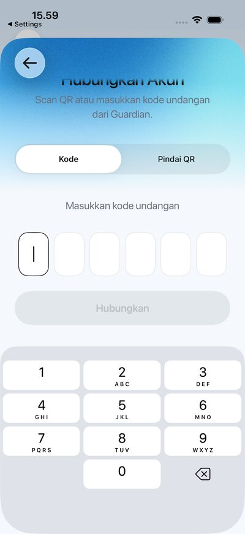 | 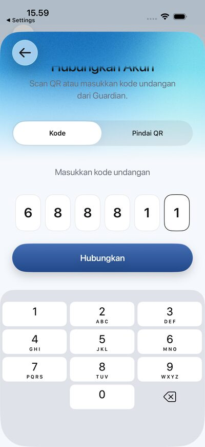 |

| p05 "Hubungkan" → success | p06 "Selanjutnya", +0.4 s | p07 +2 s | p08 settled |
|---|---|---|---|
| 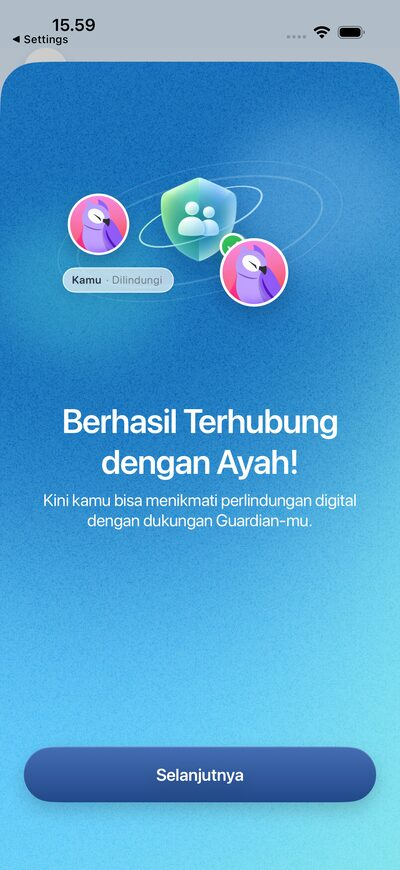 | 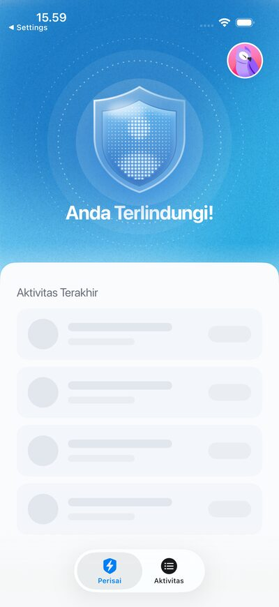 | 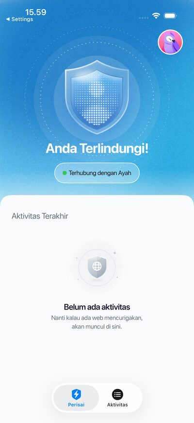 | 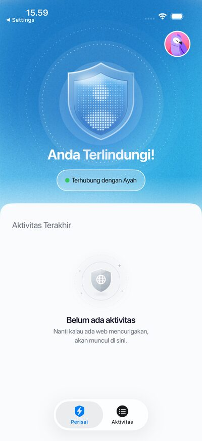 |

- This side is the best one today: a full success page "Berhasil Terhubung dengan Ayah!" with a success haptic (`Features/Pairing/ConnectView.swift:42`). "Selanjutnya" goes straight to Home (`router.reset()`, `ProfilePages.swift:400-403`).
- p06 → p07: Home loads with a skeleton. The "Terhubung dengan Ayah" pill then pops in with no animation or haptic. It is small and easy to miss.
- "Hubungkan" on Home first opens **Mode akun** (p02), not the code entry. That is one extra, puzzling step.

## Every point where the user acts and nothing visible happens

| # | Action | What the user sees | Where the change really is | Proof |
|---|---|---|---|---|
| 1 | Profile › "Menjadi Guardian" › intro "Mulai" | Back on Profile, re-laid out silently | Home (2× Back) | m03 → m05 |
| 2 | Profile › Mode akun › "Ganti ke Guardian / Pribadi" | "Saat ini" chip moves, button disappears | Home (2× Back) | m07 → m09, m10 |
| 3 | First Guardian switch from Mode akun | Intro, then Mode akun with the picker snapped back | Home (2× Back) | code, `ProfilePages.swift:270-279` |
| 4 | Guardian's invite sheet open, member joins | **Nothing** (only the timer moves) | Profile after closing, Home after Back | g06 → g08 |
| 5 | Invite sheet closed | Member row fades in on Profile, no message or haptic | Home | g09 |
| 6 | Guardian not on the sheet (other screen, app closed) | Nothing. The backend sends no push on join (`backend/api/src/routes/family.ts:34-40`) | next refresh of Home | code |
| 7 | **Pribadi** invites from Profile "Bagikan undangan" (Family mode off), member joins | Personal Home only loses the "Mode Terawasi" card. Family mode stays off, so the new member is not on Home at all | Family Home, after ⇆ | code, `ProfileView.swift:129-136` |
| 8 | Home ⇆ → "Mulai" | Home swaps instantly, no transition or haptic; ⇆ off has no confirmation | (visible, just abrupt) | g01 → g04 |
| 9 | Protected "Selanjutnya" after joining | Home skeleton, then a small pill pops in | (visible, easy to miss) | p06 → p08 |
| 10 | Guardian disconnects a member (MemberDetail) | Screen pops back, no message | Home / Profile reload | code, `MemberDetailView.swift`, `MemberDetailModel.swift:157-174` |

One flow already gets it right. The **invite card on the empty Family Home** polls, animates the family in, and plays a success haptic when someone joins (`Features/Shield/GuardianHomeView.swift:68, 96-104, 276-279`). The problem is that the Profile routes (#1–#5) never reach it.

## Options (simplest first)

### Option A · Always land on Home and say what changed (recommended) · S

Right after the tap:
- the app closes Profile / the sheet and goes to the **Shield Home**, where the change is already drawn (teal Family Home, the member, the "Terhubung dengan …" pill);
- a **toast** slides in at the top for ~3 s: a check icon, a title and one line;
- the new element gets a **one-time highlight**: a ring pulse, plus a "Baru terhubung" chip on a new member;
- a **success haptic** plays and VoiceOver reads the toast text.

| Action | Toast (ID / EN) | Highlight |
|---|---|---|
| Intro "Mulai" / "Ganti ke Guardian" (#1–#3, #8) | "Mode Guardian aktif · Bagikan kode ini ke keluarga" / "Guardian mode on · Share this code with your family" | the code card |
| "Ganti ke Pribadi" (#2, #8) | "Mode Pribadi aktif · Perlindunganmu tetap menyala" / "Personal mode on · Your protection stays on" | none |
| Member joins while the invite sheet is open (#4, #5) | "Ibu sudah terhubung · Kamu sekarang ikut menjaga Ibu" / "Ibu is connected · You now help protect Ibu" | Ibu's avatar + "Baru terhubung" |
| Pribadi inviter, member joins (#7) | same, and Home switches to Family (see decision 1) | the member |
| Protected "Selanjutnya" (#9) | "Terhubung dengan Ayah · Ayah akan dikabari saat ada situs berbahaya" / "Connected with Ayah · Ayah will hear about dangerous sites" | the pill |
| Member disconnected (#10) | "Ibu tidak lagi terhubung" / "Ibu is no longer connected" | none |

What changes (all inside `ios/ShooApp/`):
- `App/Router.swift`: add `homeNotice: HomeNotice?` (a small enum), set together with `reset()`.
- New `Components/HomeNotice.swift`: the toast, shown as an overlay in `Features/Main/MainTabView.swift` next to `InviteNoticeBanner`. It plays `.sensoryFeedback(.success)`, posts an `AccessibilityNotification.Announcement`, hides after ~3 s, and respects Reduce Motion.
- `App/AppEnvironment.swift` `startGuardian()` and `Features/Profile/ProfilePages.swift` mode switch: call `router.reset()` + set the notice.
- `Features/Pairing/InviteSheet.swift`: `FamilyCodeModel` already polls the members. When the count goes up, dismiss the sheet, reset, and set `memberJoined(name)`.
- `Features/Shield/GuardianHomeView.swift`: reuse the existing join hand-over animation (`joinAnimates`) and add the member ring + chip. `Features/Shield/ProtectedShieldView.swift`: animate the pill in.
- `Features/Profile/MemberDetailView.swift`: set the notice after a disconnect.
- `Resources/Localizable.xcstrings`: ~6 strings, EN + ID.
- UI tests: `LivePairingUITests`, `PairingUITests`, and `GuardianUITests` now expect Profile to close.

Backend: none. `contracts/`: none.
Limit: the guardian still learns of a join only while the app is open (#6). Option C covers that.

### Option B · A success page after each action · M

Reuse `OnboardingSuccessPage`, the page the Protected side already shows ("Berhasil Terhubung dengan Ayah!", p05):
- invite sheet: when someone joins, the sheet turns into "Ibu sudah terhubung!" with one button, "Lihat di Beranda";
- after "Mulai" / "Ganti ke Guardian": "Kamu sekarang Guardian" with "Undang keluarga" (opens the invite) and "Nanti";
- "Ganti ke Pribadi": "Kembali ke mode Pribadi" with "OK".

This is unmissable and fits the existing celebration style. The costs:
- one extra tap every time;
- 3 new pages that need Figma frames and copy from the designer;
- it still needs Option A's "go to Home" step after the button.

Screens: `InviteSheet`, `GuardianIntroView` / `MainTabView`, `ProfilePages`. Backend and `contracts/`: none.

### Option C · Tell the guardian wherever they are · M–L, needs a contract change

When `POST /family/join` succeeds, the backend sends the guardian a family push (the same mechanism as `memberLeft`, `backend/api/src/services/push/messages.ts:18`), e.g. "Ibu sudah terhubung dengan Shoo".
- App open: the push already triggers a reload (`pushesWhileOpen`, `GuardianHomeView.swift:106-108`) and would show Option A's toast.
- App closed: a lock-screen notification.

This fixes #6, the only case A and B cannot reach. It needs a new push kind in `contracts/api.md`, so it needs a GitHub issue to the lead (rule 7). **Not opened.** Suggested title:
**`GD-04: add a "memberJoined" family push to the guardian`**. It would also be a chance to write down the other family pushes (`remind`, `disconnected`, `memberLeft`), which `messages.ts` still marks as a "proposed contract addition".

This is a follow-up to A, not a replacement for it.

## Recommendation: Option A

It is the smallest change that answers both quotes. Every role or pairing tap ends on Home, the screen that actually changed, with a toast that names the change. No backend, no contract, no new pages from the designer. Most of the logic already exists: `router.reset()`, the 5 s member poll, Home's join animation and haptic.

Rough mock, drawn over the real screenshots. ① is the new toast, ② the one-time highlight.

| After a member joins (Guardian) | After "Mulai" / "Ganti ke Guardian" | After "Selanjutnya" (Protected) |
|---|---|---|
| 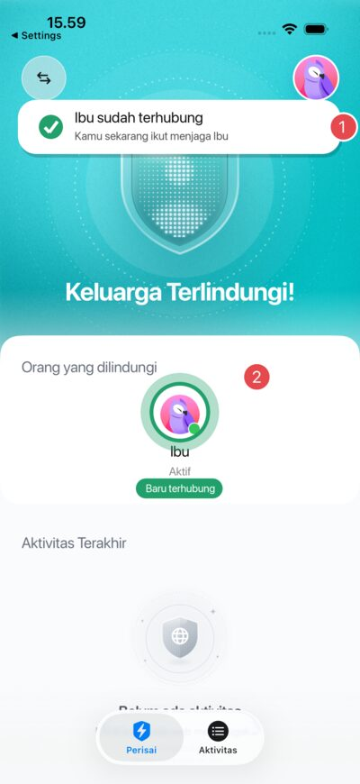 | 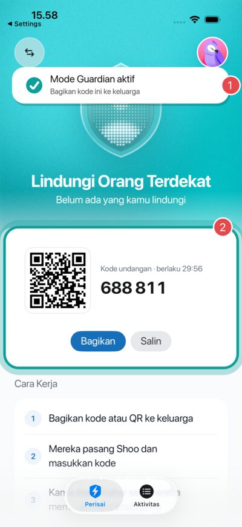 | 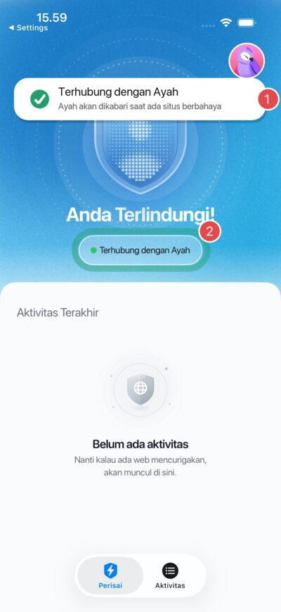 |
| Sheet closes by itself, Home shows Ibu with a green ring + "Baru terhubung" chip, toast "Ibu sudah terhubung", success haptic. | Profile / Mode akun closes, Home shows the teal Family Home, the code card glows once, toast "Mode Guardian aktif". | Home settles, the pill pulses once, toast "Terhubung dengan Ayah". |

Toast details for whoever builds it: white card, 12 pt below the top bar, check icon in the mode colour (green for a connection, teal for Guardian). It slides down with the app's `StateMotion` and fades out after 3 s. VoiceOver reads the title and line once.

### Decisions for Alief before building

1. **#7 Pribadi inviter.** When someone joins a Pribadi user who invited from Profile, should Family mode turn on by itself, so the member shows on Home? The proposal assumes **yes**: inviting someone already means "I want to protect them". The alternative is a toast with a "Lihat keluarga" button that flips ⇆.
2. **Home "Hubungkan" (p02).** Should it open the code entry directly, not Mode akun first? Today it goes through Mode akun on purpose: that page checks first that nobody is looked after (comment at `GuardianHomeView.swift:252-253`). A direct route (`router.showJoinFamily()`) would have to keep that check. The server's `has_members` answer already arrives in the join sheet. This is optional and not needed for A.

## Side note: how a first-time user can learn that Guardian exists

Today:
- onboarding registers everyone as Pribadi and never mentions Guardian (`Features/Onboarding/OnboardingModel.swift:155-156`);
- Pribadi Home has only the **unlabelled ⇆ icon**, plus a "Mode Terawasi · Tidak yakin?" card that points the other way (become Protected, p01);
- the only explainer is the "Mode Guardian · Lindungi orang terdekat" card on **Profile** (m02), which one tap on X hides for good.

### Decided (Alief, 20 Nov 2026): the first ⇆ tap opens the choice page

Alief: *"pas pertama kali dia klik ⇆, arahin dlu ke page yang nampilin pilihan pribadi ama guardian"*.

The **first** time a user taps ⇆ on Home, the mode does not flip. Instead, a page opens that shows the two choices, Pribadi and Guardian, each with a short line on what it means, and the user picks one. Every later ⇆ tap works as it does today (instant switch). This replaces the earlier idea of a "Keluarga" text label on ⇆.

**The page: the existing Mode akun page (m06), reused almost as-is.** It already has the two cards, each with a subtitle and three feature lines ("Lindungi dirimu sendiri" / "Lindungi orang terdekatmu"), the current mode marked "Saat ini", and a "Ganti ke …" button once the other card is picked (`ModePage`, `Features/Profile/ProfilePages.swift:182-300`). Home's "Hubungkan" card already opens it the same way (`router.show(.profilePage(.mode))`, `GuardianHomeView.swift:254`). It opens on the Shield stack, so Back returns to Home.

| Today: Mode akun, Pribadi current (c01) | Mock: first ⇆ tap, Guardian picked |
|---|---|
| 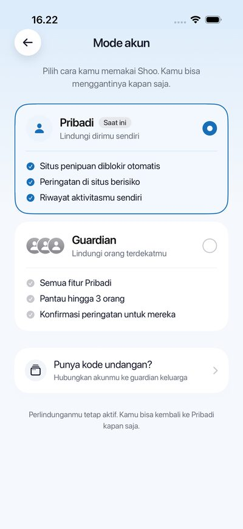 | 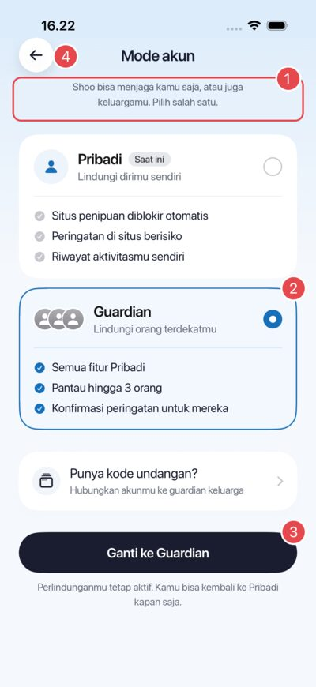 |

What changes, numbered as in the mock:
1. **Copy (optional, 1 string EN + ID).** When the page is opened from ⇆, the line under the title becomes "Shoo bisa menjaga kamu saja, atau juga keluargamu. Pilih salah satu." / "Shoo can protect just you, or your family too. Pick one." From Profile it keeps today's "Pilih cara kamu memakai Shoo. Kamu bisa menggantinya kapan saja." The page title stays "Mode akun". Nothing changes in the layout.
2. **The cards: no change.** Pribadi is marked "Saat ini", and tapping Guardian selects it, as today. "Punya kode undangan?" stays: being protected is a valid third answer to "who is this for?".
3. **"Ganti ke Guardian" must end on Home.** Today the user stays on Mode akun and only the "Saat ini" chip moves (m07 → m08, row #2 above). On this route that would repeat the test problem on the very first tap. Two behaviour changes:
   - Opened from ⇆, the button switches at once and goes back to Home. With Option A, it also shows the "Mode Guardian aktif" toast and the code-card highlight (mock 2). Without Option A, it is at least a pop back to Home, where the teal Family Home is the visible change.
   - The "To be guardian" intro is skipped on this route: the choice page has just explained Guardian, so a second explainer page before anything happens is one too many. This sets `guardianIntroSeen` too. **Recommendation, not yet confirmed by Alief.**
4. **Back, or "Ganti ke Pribadi" / staying on Pribadi:** nothing changes and the user is back on Home. This still counts as the first time, so the next ⇆ tap flips as today.

**How "first time" is stored:**
- A new `AppSettings` Bool, e.g. `modeChoiceSeen` (key `settings.modeChoiceSeen`). It lives in UserDefaults on the device, like `guardianIntroSeen` (`App/AppSettings.swift:144-147`). Nothing goes to the server and nothing changes in `contracts/`.
- It is set to `true` when the page opens from ⇆, whatever the user picks.
- It is also set whenever the mode is switched any other way (Profile's "Menjadi Guardian" card, Mode akun from Profile). Someone who already chose is never asked again.
- Existing installs with `guardianIntroSeen == true` count as seen, so a user who already became Guardian is not interrupted.
- It is cleared in `reset()` (fresh start / delete account) like the other card flags (`AppSettings.swift:290-292`). It is saved and restored with the demo (`DemoReturn`, `AppSettings.swift:190-233`), the same way as `guardianIntroSeen`.
- Where: `requestFamilyMode()` (`App/AppEnvironment.swift:505`) gets a branch: Pribadi, flag not set, call from ⇆ → set the flag and `router.show(.profilePage(.mode))` with a "from ⇆" note for the copy and the pop-to-Home. Other callers (Profile card, Mode akun) keep today's path.
- The Activity tab's "Family: Off" toggle (`Features/Main/MainTabView.swift:129-157`) is the same switch in text form. It should follow the same first-time rule, on the Activity stack.

Effort: S. Files: `App/AppSettings.swift`, `App/AppEnvironment.swift`, `Features/Profile/ProfilePages.swift` (`ModePage`: copy + end-on-Home), `Features/Shield/GuardianHomeView.swift` and `Features/Main/MainTabView.swift` (toggle callers), `Resources/Localizable.xcstrings`. The UI tests that flip ⇆ on a fresh install (`becomeGuardian()` in `UITests/UITestSupport.swift:155-161`, used by `LivePairingUITests` and others) need the extra page step.

### Still open (smaller)

Show the existing `GuardianModeCard` ("Lindungi orang terdekat" + "Menjadi Guardian") on **Pribadi Home** as well, under the Mode Terawasi card, with the same dismiss rule. People see Home first, not Profile. Its button could open the same choice page. A bigger alternative is a last onboarding question, "Mau jaga keluarga juga?". It costs one more onboarding step, so it is better tested after the ⇆ change.

## Not covered

- Haptics, animations and VoiceOver were read from code, not felt or heard. Screenshots cannot show them.
- Rows #6, #7 and #10 come from the code. They were not run on the simulators.
- Only iPhone 17 (iOS 26.5) and Bahasa Indonesia were run. English and the iPhone SE size were not checked.
