# QA — Figma parity, iOS app (2026-10-31)

Every iOS frame marked **Ready for dev** on the Figma page *High Fidelity*, plus HOME and *AI vs Guardian — Eksplorasi* (not marked, shown as they are), next to the app as it is on `main` today. Safari extension and web frames are out of scope.

| | |
|---|---|
| Device | iPhone 17 simulator, iOS 26.3, Bahasa Indonesia, light, `TZ=Asia/Jakarta` (WIB) |
| App | `main` @ 2720b13 + this branch's QA additions (no screen changed) |
| Test 1 | `MockRepository` scenarios `figma`, `mixedVerdicts`, `heavy`, `edge`, `allSafe`, `allBlocked` (`Data/MockScenarios.swift`) |
| Test 2a | Imelda's eval corpus (`ai/eval/data`, 108 samples, holdout included) through layers 1–4 on a local `shoo-ai` Worker → scenario `corpus` |
| Test 2b/2c | Two paired simulators on a local stack built like prod; the Protected Safari opens every corpus URL that still resolves |
| Figma | [High Fidelity](https://www.figma.com/design/6PgxbrY0LSkcdaJ5u4YBJP/-CH7--Shoo-Scam-App?node-id=18-2), exported at 1x through the TalkToFigma plugin |

Result: **73 frames** — ✅ match 28 · 🟡 minor 19 · 🟠 gap 12 · 🔴 missing 2 · ⚪ not shot 12.

Figma frames are full height; the app shot is one screen (later screens of the same state are in `img/figma-parity/app/<shot>-2.jpg`, `-3.jpg`).

## Findings

Bugs and gaps the run found outside the frame-by-frame view:

1. 🔴 **Emoji in a name shows as ⍰ boxes** (scenario `edge`, `Bayu 🧑‍💻`) on Guardian Home and Profile: the custom font has no emoji fallback for ZWJ sequences. `edge-home-guardian`, `edge-pf-guardian`.
2. 🟠 **Code expired shows the generic error**: joining with the mock's `code_expired` code shows "Ada yang salah. Coba lagi." (`on-connect-expired`), not Figma's "Kode kadaluarsa…" (205:1182).
3. 🟡 **"Notifikasi mati" popup on every Home / Activity launch** in the mock run although `-UITestNotifications granted` is passed; the popup covers the hero in the Home shots.
4. 🟡 **Gauge label for 30–49**: a 39% warning (`corpus-dt-real-lphone`) reads "Risiko Tinggi", the same as 72%.
5. 🟡 **Counters** do not cap: Guardian Profile shows "3.000 Situs diblokir" in `heavy` (no "999+"); fits, but wider than Figma's tile.
6. 🟠 **Live: Guardian sees nothing after pairing** until Family mode is switched on by hand on Home (`live/guardian-activity.jpg` vs `guardian-activity-family.jpg`). Figma's Guardian Home/Activity always show the family.
7. 🟠 **Live: push cannot be tested on the local stack**: `wrangler dev` has no HTTP/2, APNs answers nothing (`push_log` `failed:network`). Prod path is the deployed Worker; a local relay or a cloud staging Worker is needed for an end-to-end push test.
8. 🟡 **Live: same page twice = two scans** in Activity (`regnows-dfg.com` 22.40 and 22.41).
9. 🟡 **Live: the extension banner is English** ("46% · Be careful") while the app is set to Bahasa Indonesia; the extension follows the system language (extension is out of scope for this report, noted for the lead).
10. 🟡 **Live: Detail "Salinan halaman" stays grey** for the live scan (no page copy drawn) and the favicon circle is empty.
11. ⚪ **Detector, 2a**: 4 legit pages ≥ 30 (target 0) and 20 scam pages < 30; 62 % of scams ≥ 50 (target 90 %). Details in Test 2a.

Per frame (most severe first):

| | Frame | Note |
|---|---|---|
| 🔴 missing | [Guardian/Home · Keluarga butuh konfirmasi](https://www.figma.com/design/6PgxbrY0LSkcdaJ5u4YBJP/-CH7--Shoo-Scam-App?node-id=435-20899) | No "Keluarga Butuh Konfirmasi" hero with the 72% gauge, page summary and Bahaya / Aman buttons on Home (mixedVerdicts has an unanswered warning). |
| 🔴 missing | [Guardian/Detail Aktivitas, sebelum di cek](https://www.figma.com/design/6PgxbrY0LSkcdaJ5u4YBJP/-CH7--Shoo-Scam-App?node-id=487-4221) | No "Virellia belum melihat link ini" banner on the Detail header (no "seen" field in contracts/). |
| 🟠 gap | [Pribadi/Home](https://www.figma.com/design/6PgxbrY0LSkcdaJ5u4YBJP/-CH7--Shoo-Scam-App?node-id=435-20058) | Home Pribadi is the old layout: dim shield + last-blocked card. Figma: shield hero "Anda Terlindungi!", "Status Keamanan: Bagus!" bar, 4 stat tiles (Ancaman diblokir, Resiko keamanan, Host mencurigakan, Scan terakhir), Aktivitas Terakhir list. HOME is not marked Ready for dev. |
| 🟠 gap | [Guardian/Home](https://www.figma.com/design/6PgxbrY0LSkcdaJ5u4YBJP/-CH7--Shoo-Scam-App?node-id=435-20373) | Guardian Home is the old "Keluarga" card list. Figma: "Keluarga Terlindungi!" hero, "Status Keluarga: Semua Aman!" bar, member avatar row with Aktif, Aktivitas Terakhir with owner name. |
| 🟠 gap | [Guardian/Home · Belum ada orang](https://www.figma.com/design/6PgxbrY0LSkcdaJ5u4YBJP/-CH7--Shoo-Scam-App?node-id=435-20630) | Empty Guardian Home shows "Belum ada yang kamu jaga" + Undang keluargamu. Figma: "Lindungi Orang Terdekat" hero, inline invite code + QR with Bagikan / Salin, and the 3-step "Cara Kerja". |
| 🟠 gap | [protected/Home](https://www.figma.com/design/6PgxbrY0LSkcdaJ5u4YBJP/-CH7--Shoo-Scam-App?node-id=441-2736) | Protected Home is "Perisai" (Perlindungan aktif, Dilindungi oleh Virellia, Terakhir diblokir). Figma: "Anda Terlindungi!" hero, "Terhubung dengan Virellia" pill, stat tiles, Aktivitas Terakhir. |
| 🟠 gap | [protected/Home · Lihat semua di atas](https://www.figma.com/design/6PgxbrY0LSkcdaJ5u4YBJP/-CH7--Shoo-Scam-App?node-id=441-3063) | Same as 441:2736; Figma adds Diblokir 4 / Waspada 7 tiles with "3 diverifikasi oleh Virellia". |
| 🟠 gap | [protected/Home · Kartu diblokir 92%](https://www.figma.com/design/6PgxbrY0LSkcdaJ5u4YBJP/-CH7--Shoo-Scam-App?node-id=441-3800) | No blocked card with gauge and "Virellia akan mengecek kembali" note on Protected Home. |
| 🟠 gap | [protected/Home · Kartu diblokir 92% (bawah)](https://www.figma.com/design/6PgxbrY0LSkcdaJ5u4YBJP/-CH7--Shoo-Scam-App?node-id=441-4414) | Same as 441:3800 (scrolled). |
| 🟠 gap | [Kode Kadaluarsa · Kode](https://www.figma.com/design/6PgxbrY0LSkcdaJ5u4YBJP/-CH7--Shoo-Scam-App?node-id=205-1182) | Code 999999 (mock code_expired) shows the generic "Ada yang salah. Coba lagi." instead of "Kode kadaluarsa, minta kode baru dan coba lagi.". |
| 🟠 gap | [Profile/Pribadi](https://www.figma.com/design/6PgxbrY0LSkcdaJ5u4YBJP/-CH7--Shoo-Scam-App?node-id=416-10338) | Perlindungan shows "Ekstensi Safari · Aktif" as text; Figma has two switches: Ekstensi Safari and "Blokir situs berbahaya". |
| 🟠 gap | [Pengaturan/Kelola profil](https://www.figma.com/design/6PgxbrY0LSkcdaJ5u4YBJP/-CH7--Shoo-Scam-App?node-id=416-12854) | Missing "Akun · Perangkat terhubung (2 perangkat)" row. |
| 🟠 gap | [Protected/Detail · Dibuka Guardian · Opsi 1](https://www.figma.com/design/6PgxbrY0LSkcdaJ5u4YBJP/-CH7--Shoo-Scam-App?node-id=487-7897) | Exploration Opsi 1 (Protected sees "Virellia menandai situs ini aman · Blokir dibuka", AI first score 92, "Tetap hati-hati"). The app shows the gauge with "Ditandai aman oleh Virellia" and the verified card. |
| 🟠 gap | [Protected/Detail · Dibuka Guardian · Opsi 2](https://www.figma.com/design/6PgxbrY0LSkcdaJ5u4YBJP/-CH7--Shoo-Scam-App?node-id=487-8620) | Exploration Opsi 2: same as 487:7897. |
| 🟡 minor | [Splash Screen](https://www.figma.com/design/6PgxbrY0LSkcdaJ5u4YBJP/-CH7--Shoo-Scam-App?node-id=110-3585) | App opens straight on slide 1; the Figma splash frame is a plain gradient with the logo (the launch screen covers it). |
| 🟡 minor | [Choose Mode](https://www.figma.com/design/6PgxbrY0LSkcdaJ5u4YBJP/-CH7--Shoo-Scam-App?node-id=110-4345) | App adds "Pilihan ini tidak bisa diganti nanti." under the cards; Guardian is preselected in the screenshot mode. |
| 🟡 minor | [Connect with Guardian · Pindai QR](https://www.figma.com/design/6PgxbrY0LSkcdaJ5u4YBJP/-CH7--Shoo-Scam-App?node-id=140-5762) | App opens on the Kode tab; Figma opens on Pindai QR. |
| 🟡 minor | [Connect with Guardian · Kode](https://www.figma.com/design/6PgxbrY0LSkcdaJ5u4YBJP/-CH7--Shoo-Scam-App?node-id=141-5887) | App has 6 code boxes (contract) + a privacy note + Nanti saja; Figma draws 5 boxes. |
| 🟡 minor | [Aktivitas - Profil Pribadi](https://www.figma.com/design/6PgxbrY0LSkcdaJ5u4YBJP/-CH7--Shoo-Scam-App?node-id=416-8541) | Matches; status pills are filled red in the app, outlined in Figma. |
| 🟡 minor | [Aktivitas - Profil Pribadi : Filtered (v2)](https://www.figma.com/design/6PgxbrY0LSkcdaJ5u4YBJP/-CH7--Shoo-Scam-App?node-id=450-8657) | Figma greys the Diblokir pill once the Guardian decided; the app keeps it red. |
| 🟡 minor | [Guardian/Detail Aktivitas (Bahaya)](https://www.figma.com/design/6PgxbrY0LSkcdaJ5u4YBJP/-CH7--Shoo-Scam-App?node-id=416-9255) | Matches the gauge, chip, link and evidence cards. The verdict footer floats over the cards in the app; in Figma it sits after them. |
| 🟡 minor | [Profile/Pribadi (v2, terhubung Virellia)](https://www.figma.com/design/6PgxbrY0LSkcdaJ5u4YBJP/-CH7--Shoo-Scam-App?node-id=455-10275) | Matches. "Ekstensi Safari · Aktif" is green without a chevron (Figma: grey with chevron). |
| 🟡 minor | [Profile/Pribadi (v2, layar pertama)](https://www.figma.com/design/6PgxbrY0LSkcdaJ5u4YBJP/-CH7--Shoo-Scam-App?node-id=455-10571) | Same as 455:10275. |
| 🟡 minor | [Guardian/Detail Orang Dilindungi](https://www.figma.com/design/6PgxbrY0LSkcdaJ5u4YBJP/-CH7--Shoo-Scam-App?node-id=416-10574) | Matches. Copy: "Aktivitas Terakhir · Lihat Semua" vs Figma "Aktivitas terbaru · Lihat semua". |
| 🟡 minor | [Pengaturan/Notifikasi](https://www.figma.com/design/6PgxbrY0LSkcdaJ5u4YBJP/-CH7--Shoo-Scam-App?node-id=416-12916) | Matches, plus a "Notifikasi mati · Nyalakan" banner on top while the system permission is off. |
| 🟡 minor | [Pengaturan/Bahasa (v2)](https://www.figma.com/design/6PgxbrY0LSkcdaJ5u4YBJP/-CH7--Shoo-Scam-App?node-id=455-9697) | Same options; the app lists English first, Figma lists Bahasa Indonesia first. |
| 🟡 minor | [Pengaturan/Bahasa](https://www.figma.com/design/6PgxbrY0LSkcdaJ5u4YBJP/-CH7--Shoo-Scam-App?node-id=416-12986) | Same as 455:9697. |
| 🟡 minor | [Pengaturan/Tema (v2)](https://www.figma.com/design/6PgxbrY0LSkcdaJ5u4YBJP/-CH7--Shoo-Scam-App?node-id=455-9718) | Matches. "Kurangi efek kaca" subtitle differs (app: "Latar polos yang juga menghemat baterai"). |
| 🟡 minor | [Pengaturan/Tema](https://www.figma.com/design/6PgxbrY0LSkcdaJ5u4YBJP/-CH7--Shoo-Scam-App?node-id=416-13007) | Same as 455:9718. |
| 🟡 minor | [Pengaturan/Aksesibilitas (v2)](https://www.figma.com/design/6PgxbrY0LSkcdaJ5u4YBJP/-CH7--Shoo-Scam-App?node-id=455-9785) | Matches. Subtitles differ: Kurangi gerakan ("Matikan animasi di Shoo" vs "Matikan animasi gauge dan swipe kartu"), Bacakan peringatan. |
| 🟡 minor | [Pengaturan/Aksesibilitas](https://www.figma.com/design/6PgxbrY0LSkcdaJ5u4YBJP/-CH7--Shoo-Scam-App?node-id=416-13074) | Same as 455:9785. |
| 🟡 minor | [Pengaturan/Tentang Shoo (v2)](https://www.figma.com/design/6PgxbrY0LSkcdaJ5u4YBJP/-CH7--Shoo-Scam-App?node-id=455-9858) | Matches. Version "Versi 1.0 (1)" vs "Versi 1.0.0 (42)" (build number), tagline "dirimu" vs "diri". |
| 🟡 minor | [Pengaturan/Tentang Shoo](https://www.figma.com/design/6PgxbrY0LSkcdaJ5u4YBJP/-CH7--Shoo-Scam-App?node-id=416-13147) | Same as 455:9858. |

## HOME

| Frame | App now | Figma | Status | Note |
|---|---|---|---|---|
| [Pribadi/Home](https://www.figma.com/design/6PgxbrY0LSkcdaJ5u4YBJP/-CH7--Shoo-Scam-App?node-id=435-20058)<br>`435:20058` | 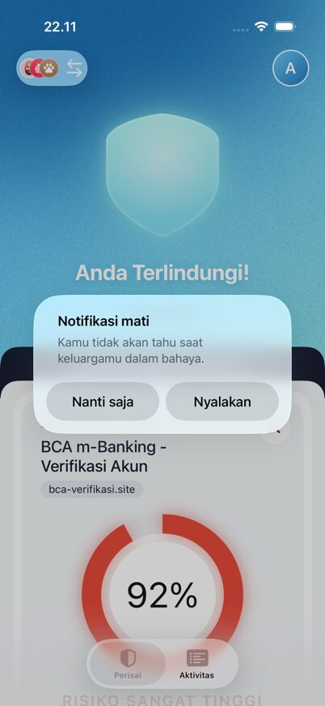<br>`home-pribadi` | 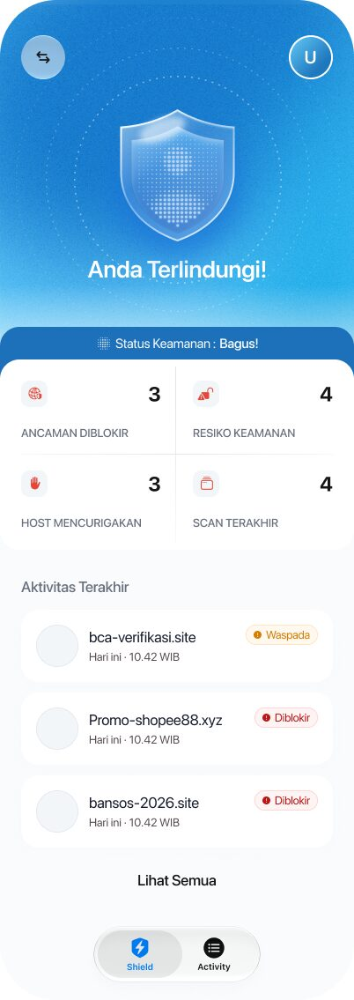 | 🟠 gap | Home Pribadi is the old layout: dim shield + last-blocked card. Figma: shield hero "Anda Terlindungi!", "Status Keamanan: Bagus!" bar, 4 stat tiles (Ancaman diblokir, Resiko keamanan, Host mencurigakan, Scan terakhir), Aktivitas Terakhir list. HOME is not marked Ready for dev. |
| [Guardian/Home](https://www.figma.com/design/6PgxbrY0LSkcdaJ5u4YBJP/-CH7--Shoo-Scam-App?node-id=435-20373)<br>`435:20373` | <br>`home-guardian` | 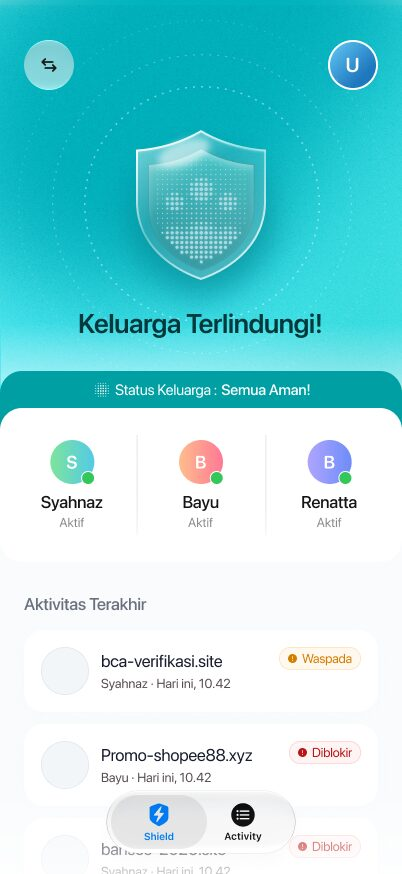 | 🟠 gap | Guardian Home is the old "Keluarga" card list. Figma: "Keluarga Terlindungi!" hero, "Status Keluarga: Semua Aman!" bar, member avatar row with Aktif, Aktivitas Terakhir with owner name. |
| [Guardian/Home · Keluarga butuh konfirmasi](https://www.figma.com/design/6PgxbrY0LSkcdaJ5u4YBJP/-CH7--Shoo-Scam-App?node-id=435-20899)<br>`435:20899` | <br>`home-guardian-pending` | 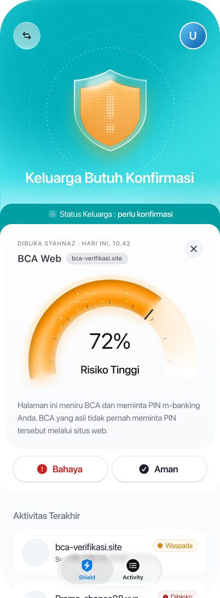 | 🔴 missing | No "Keluarga Butuh Konfirmasi" hero with the 72% gauge, page summary and Bahaya / Aman buttons on Home (mixedVerdicts has an unanswered warning). |
| [Guardian/Home · Belum ada orang](https://www.figma.com/design/6PgxbrY0LSkcdaJ5u4YBJP/-CH7--Shoo-Scam-App?node-id=435-20630)<br>`435:20630` | 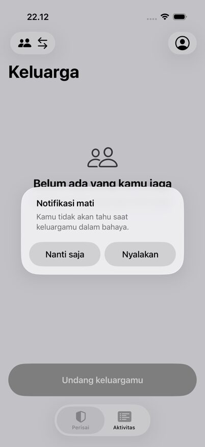<br>`home-guardian-empty` | 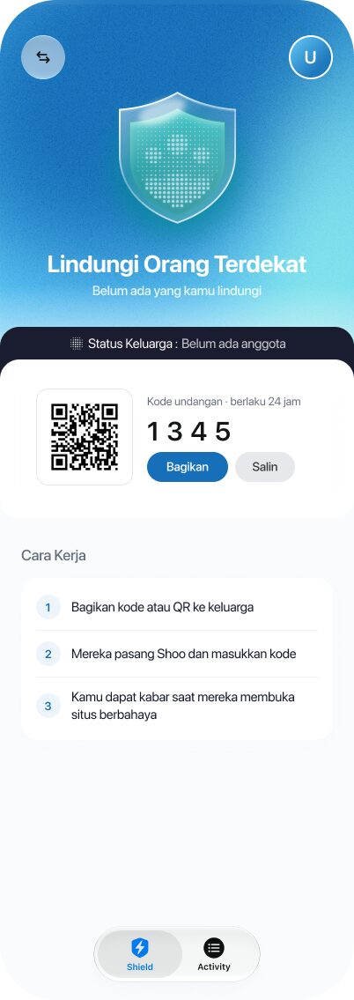 | 🟠 gap | Empty Guardian Home shows "Belum ada yang kamu jaga" + Undang keluargamu. Figma: "Lindungi Orang Terdekat" hero, inline invite code + QR with Bagikan / Salin, and the 3-step "Cara Kerja". |
| [protected/Home](https://www.figma.com/design/6PgxbrY0LSkcdaJ5u4YBJP/-CH7--Shoo-Scam-App?node-id=441-2736)<br>`441:2736` | 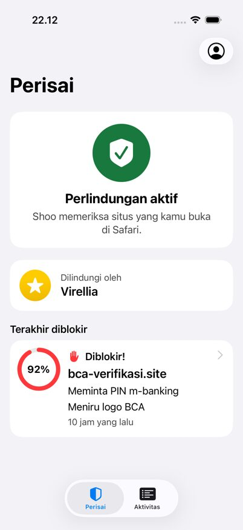<br>`home-protected` | 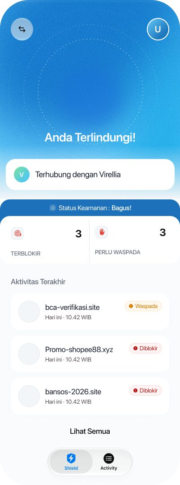 | 🟠 gap | Protected Home is "Perisai" (Perlindungan aktif, Dilindungi oleh Virellia, Terakhir diblokir). Figma: "Anda Terlindungi!" hero, "Terhubung dengan Virellia" pill, stat tiles, Aktivitas Terakhir. |
| [protected/Home · Lihat semua di atas](https://www.figma.com/design/6PgxbrY0LSkcdaJ5u4YBJP/-CH7--Shoo-Scam-App?node-id=441-3063)<br>`441:3063` | <br>`home-protected` | 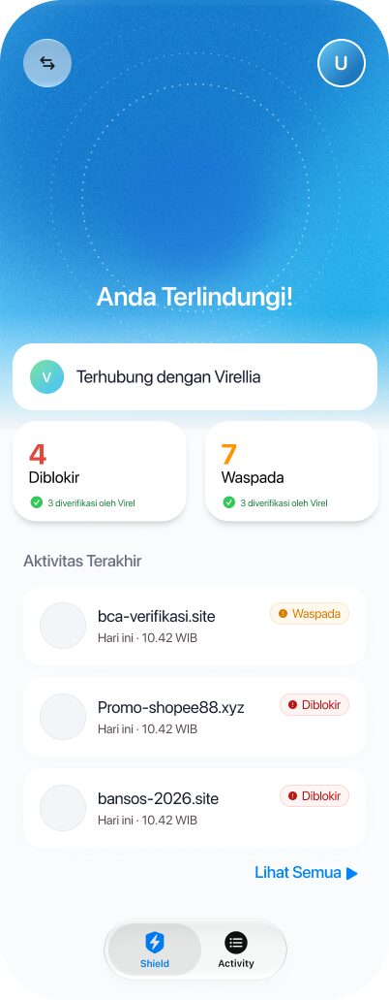 | 🟠 gap | Same as 441:2736; Figma adds Diblokir 4 / Waspada 7 tiles with "3 diverifikasi oleh Virellia". |
| [protected/Home · Kartu diblokir 92%](https://www.figma.com/design/6PgxbrY0LSkcdaJ5u4YBJP/-CH7--Shoo-Scam-App?node-id=441-3800)<br>`441:3800` | <br>`home-protected` | 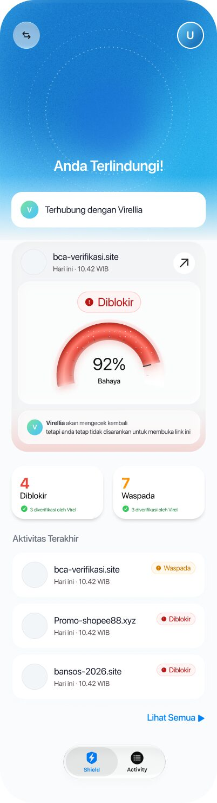 | 🟠 gap | No blocked card with gauge and "Virellia akan mengecek kembali" note on Protected Home. |
| [protected/Home · Kartu diblokir 92% (bawah)](https://www.figma.com/design/6PgxbrY0LSkcdaJ5u4YBJP/-CH7--Shoo-Scam-App?node-id=441-4414)<br>`441:4414` | <br>`home-protected-2` | 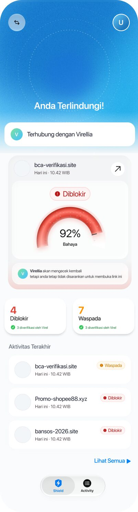 | 🟠 gap | Same as 441:3800 (scrolled). |

## ONBOARDING

| Frame | App now | Figma | Status | Note |
|---|---|---|---|---|
| [Splash Screen](https://www.figma.com/design/6PgxbrY0LSkcdaJ5u4YBJP/-CH7--Shoo-Scam-App?node-id=110-3585)<br>`110:3585` | 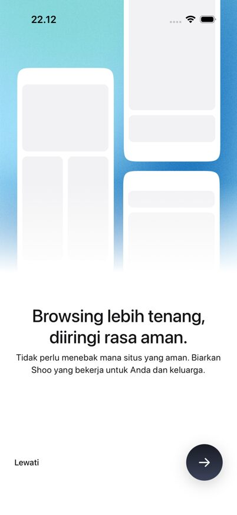<br>`on-splash-1` | 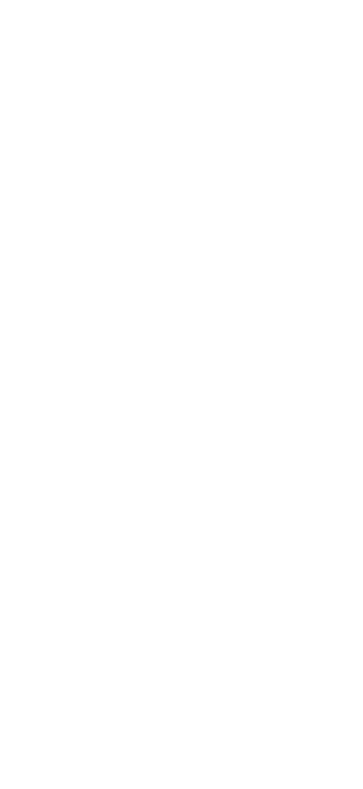 | 🟡 minor | App opens straight on slide 1; the Figma splash frame is a plain gradient with the logo (the launch screen covers it). |
| [Onboarding 1](https://www.figma.com/design/6PgxbrY0LSkcdaJ5u4YBJP/-CH7--Shoo-Scam-App?node-id=110-3692)<br>`110:3692` | 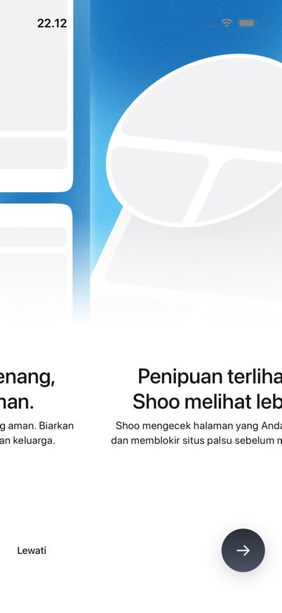<br>`on-splash-2` | 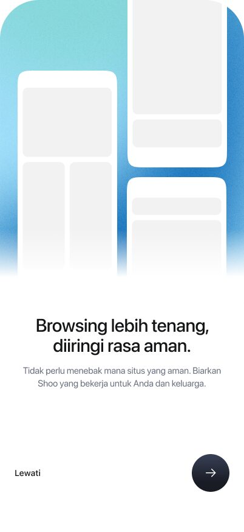 | ✅ match | Copy and layout match. The app shot was taken mid-swipe. |
| [Onboarding 2](https://www.figma.com/design/6PgxbrY0LSkcdaJ5u4YBJP/-CH7--Shoo-Scam-App?node-id=110-3786)<br>`110:3786` | 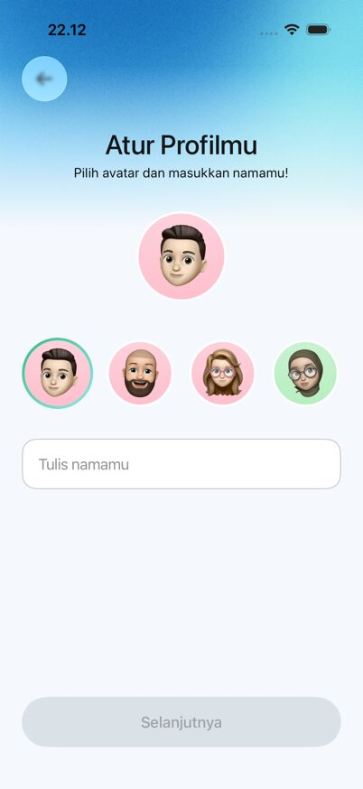<br>`on-splash-3` | 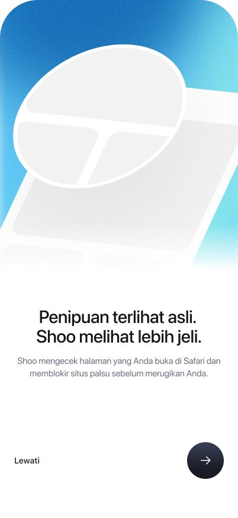 | ✅ match | Copy and layout match. |
| [Atur Nama · kosong](https://www.figma.com/design/6PgxbrY0LSkcdaJ5u4YBJP/-CH7--Shoo-Scam-App?node-id=110-3912)<br>`110:3912` | 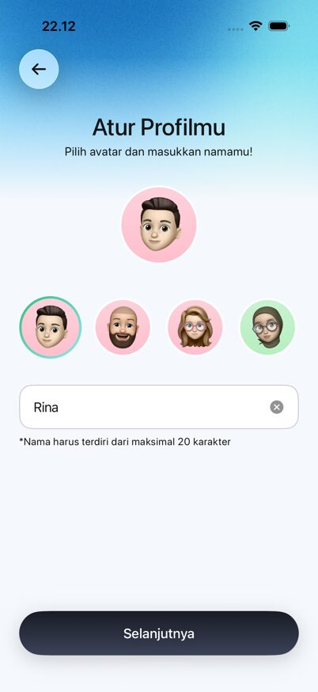<br>`on-name` | 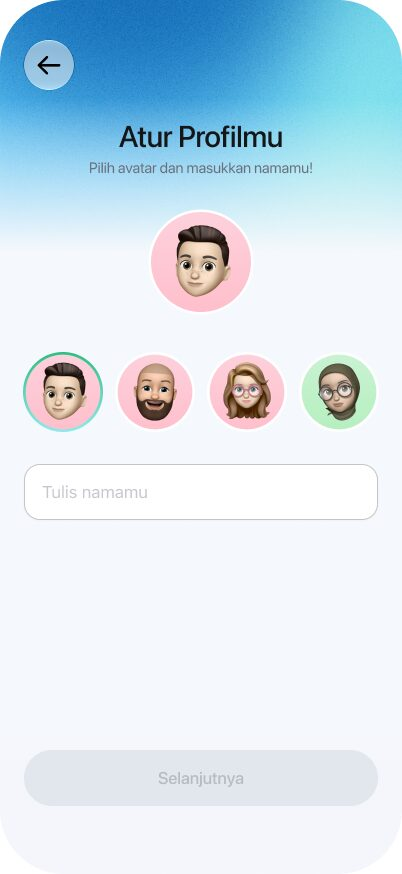 | ✅ match | Matches. |
| [Atur Nama · mengetik](https://www.figma.com/design/6PgxbrY0LSkcdaJ5u4YBJP/-CH7--Shoo-Scam-App?node-id=110-4023)<br>`110:4023` | 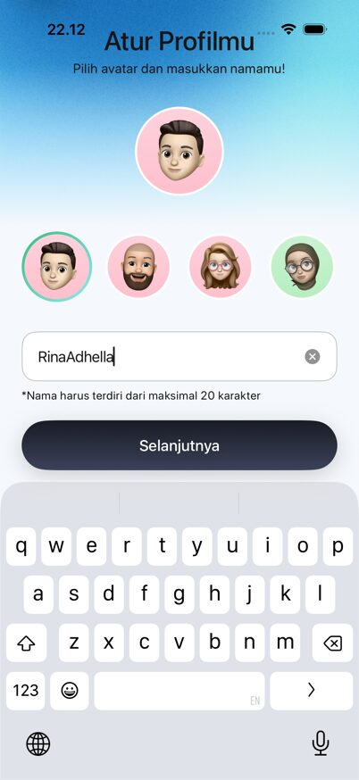<br>`on-name-typed` | 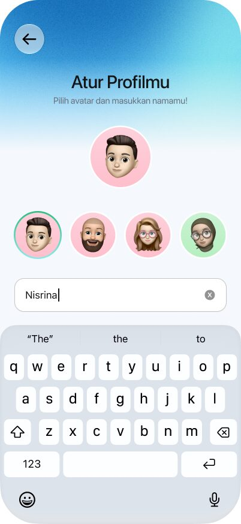 | ✅ match | Matches (the shot types after the screenshot name "Rina", hence "RinaAdhella"). |
| [Atur Nama · nama terlalu panjang](https://www.figma.com/design/6PgxbrY0LSkcdaJ5u4YBJP/-CH7--Shoo-Scam-App?node-id=110-4271)<br>`110:4271` | —<br>`—` | 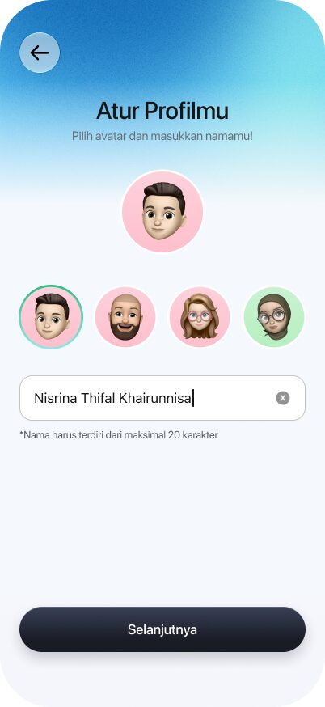 | ⚪ not shot | Not shot: the 20-character error state. The app shows the 20-character hint under the field at all times. |
| [Choose Mode](https://www.figma.com/design/6PgxbrY0LSkcdaJ5u4YBJP/-CH7--Shoo-Scam-App?node-id=110-4345)<br>`110:4345` | 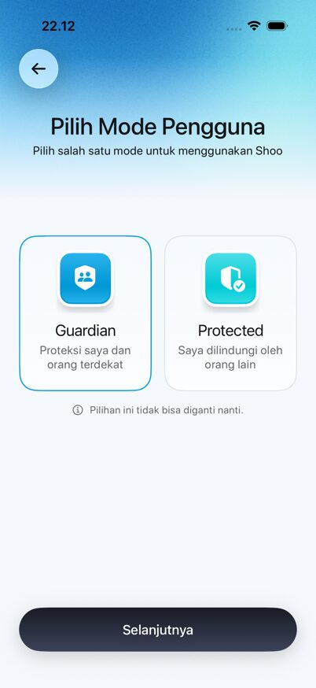<br>`on-mode` | 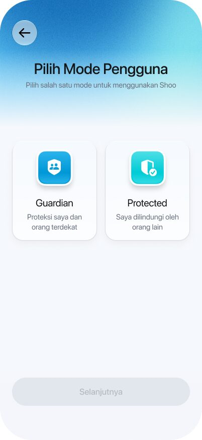 | 🟡 minor | App adds "Pilihan ini tidak bisa diganti nanti." under the cards; Guardian is preselected in the screenshot mode. |
| [Choose Mode - Guardian](https://www.figma.com/design/6PgxbrY0LSkcdaJ5u4YBJP/-CH7--Shoo-Scam-App?node-id=110-4558)<br>`110:4558` | 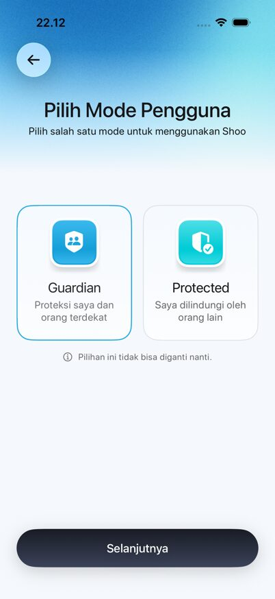<br>`on-mode-guardian` | 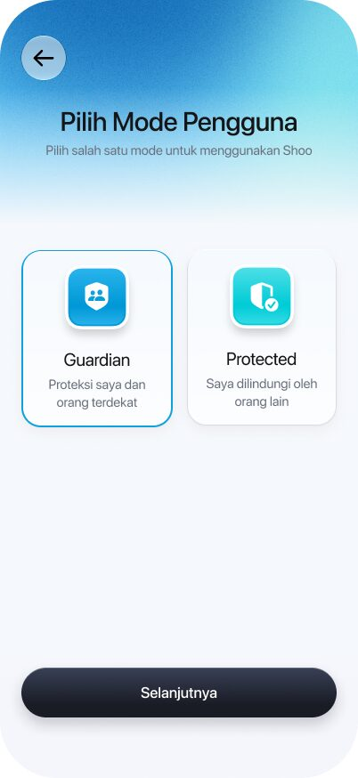 | ✅ match | Matches. |
| [Choose Mode - Protected](https://www.figma.com/design/6PgxbrY0LSkcdaJ5u4YBJP/-CH7--Shoo-Scam-App?node-id=110-4605)<br>`110:4605` | —<br>`—` | 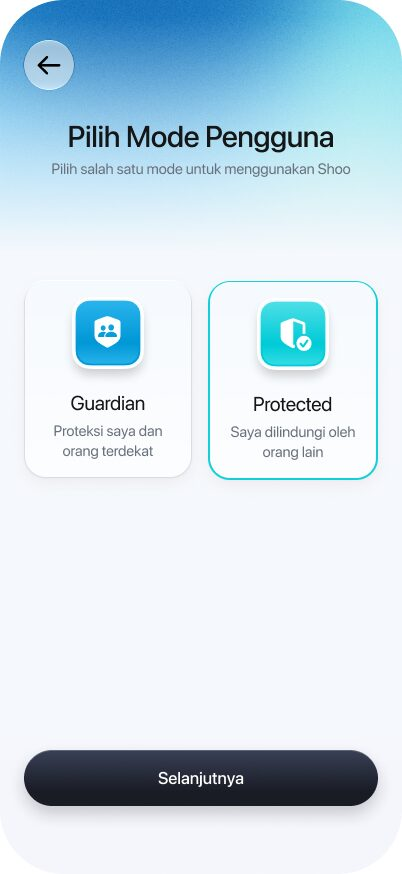 | ⚪ not shot | Not shot (Protected selected). Same layout as 110:4558. |
| [Connect with Guardian · Pindai QR](https://www.figma.com/design/6PgxbrY0LSkcdaJ5u4YBJP/-CH7--Shoo-Scam-App?node-id=140-5762)<br>`140:5762` | 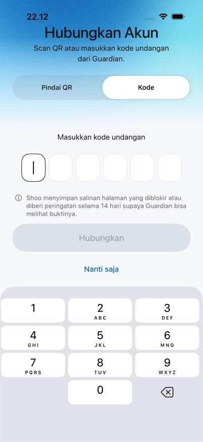<br>`on-connect` | 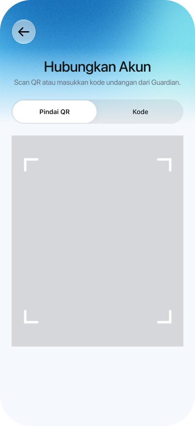 | 🟡 minor | App opens on the Kode tab; Figma opens on Pindai QR. |
| [Connect with Guardian · Kode](https://www.figma.com/design/6PgxbrY0LSkcdaJ5u4YBJP/-CH7--Shoo-Scam-App?node-id=141-5887)<br>`141:5887` | <br>`on-connect` |  | 🟡 minor | App has 6 code boxes (contract) + a privacy note + Nanti saja; Figma draws 5 boxes. |
| [Kode Kadaluarsa · QR](https://www.figma.com/design/6PgxbrY0LSkcdaJ5u4YBJP/-CH7--Shoo-Scam-App?node-id=205-1081)<br>`205:1081` | —<br>`—` | 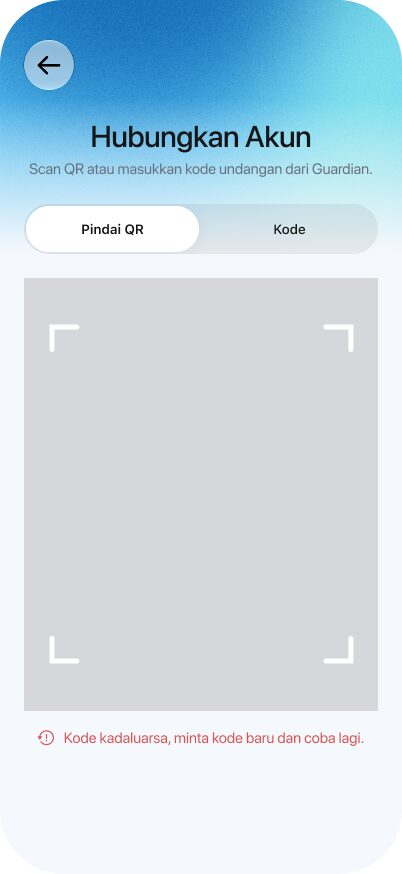 | ⚪ not shot | Not shot (expired on the QR tab). |
| [Kode Kadaluarsa · Kode](https://www.figma.com/design/6PgxbrY0LSkcdaJ5u4YBJP/-CH7--Shoo-Scam-App?node-id=205-1182)<br>`205:1182` | 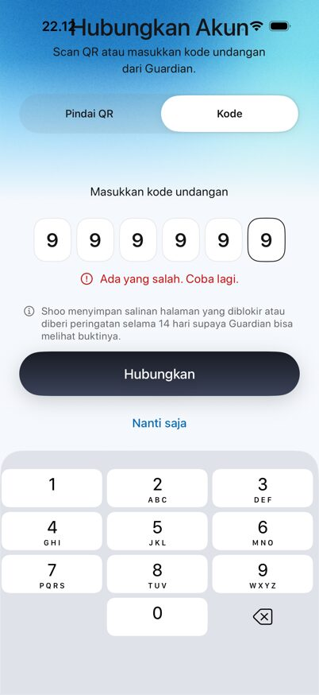<br>`on-connect-expired` | 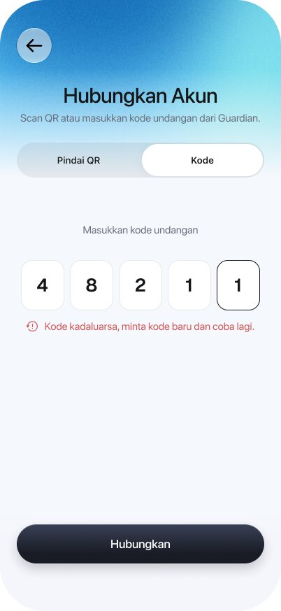 | 🟠 gap | Code 999999 (mock code_expired) shows the generic "Ada yang salah. Coba lagi." instead of "Kode kadaluarsa, minta kode baru dan coba lagi.". |
| [Aktifkan Ekstensi](https://www.figma.com/design/6PgxbrY0LSkcdaJ5u4YBJP/-CH7--Shoo-Scam-App?node-id=110-4440)<br>`110:4440` | <br>`on-turnOnExtension` | 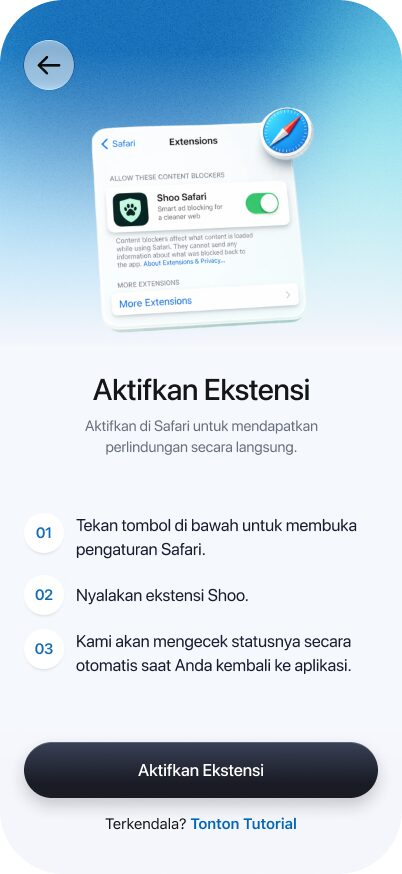 | ⚪ not shot | The run passes -UITestExtensionActive, so the step skips to the success screen. Live run 2b shows the real step: copy matches Figma. |
| [Ekstensi aktif](https://www.figma.com/design/6PgxbrY0LSkcdaJ5u4YBJP/-CH7--Shoo-Scam-App?node-id=126-5678)<br>`126:5678` | 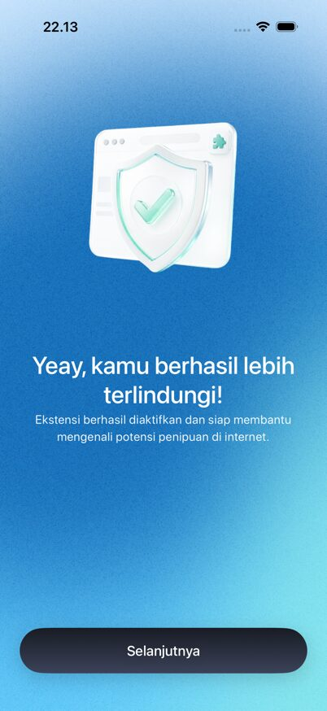<br>`on-extensionOn` | 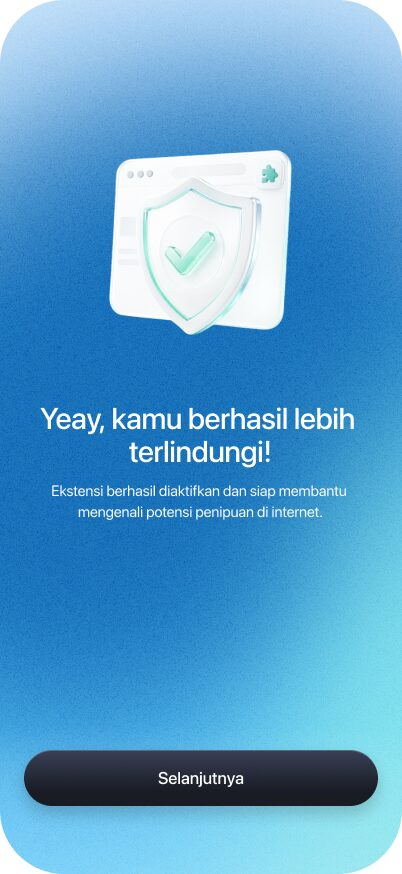 | ✅ match | Matches. |
| [Berhasil Terhubung](https://www.figma.com/design/6PgxbrY0LSkcdaJ5u4YBJP/-CH7--Shoo-Scam-App?node-id=141-5945)<br>`141:5945` | —<br>`—` | 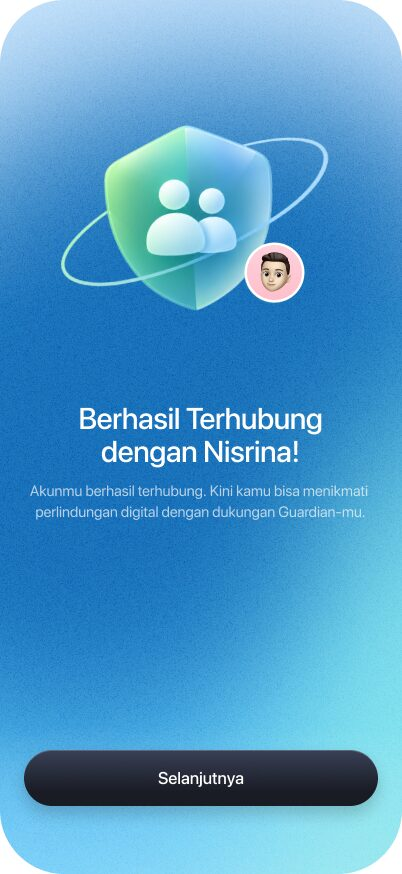 | ⚪ not shot | Not shot in the mock run; reached in the live run (protectedBy). |
| [Undang keluarga](https://www.figma.com/design/6PgxbrY0LSkcdaJ5u4YBJP/-CH7--Shoo-Scam-App?node-id=110-4779)<br>`110:4779` | 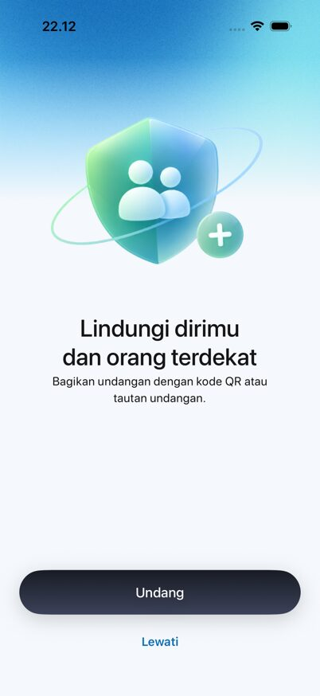<br>`on-invite` | 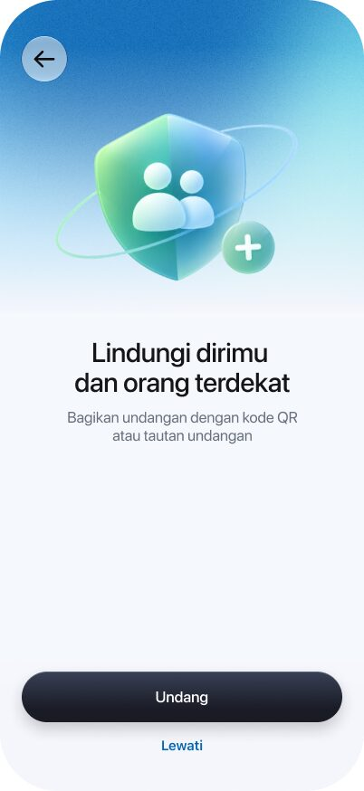 | ✅ match | Matches. |
| [Kirim Undangan (sheet)](https://www.figma.com/design/6PgxbrY0LSkcdaJ5u4YBJP/-CH7--Shoo-Scam-App?node-id=110-4817)<br>`110:4817` | —<br>`—` | 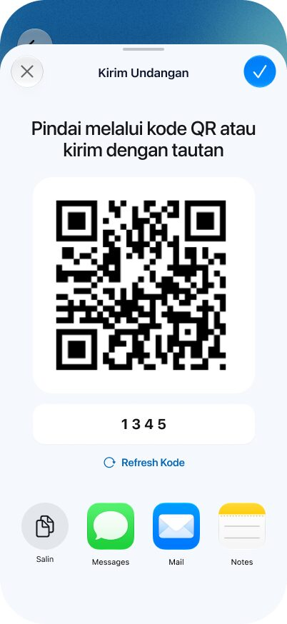 | ⚪ not shot | Not shot (share sheet). Figma code has 4 digits; the app uses 6. |

## Activity

| Frame | App now | Figma | Status | Note |
|---|---|---|---|---|
| [Aktivitas - Profil Pribadi](https://www.figma.com/design/6PgxbrY0LSkcdaJ5u4YBJP/-CH7--Shoo-Scam-App?node-id=416-8541)<br>`416:8541` | 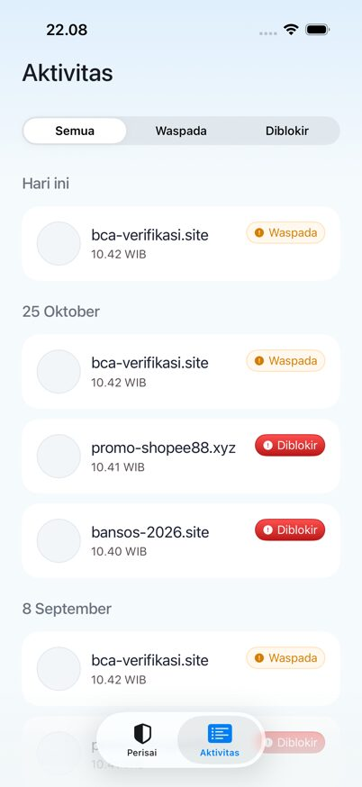<br>`act-pribadi` | 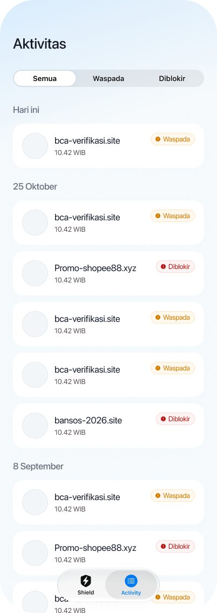 | 🟡 minor | Matches; status pills are filled red in the app, outlined in Figma. |
| [Aktivitas - Profil Pribadi : Filtered](https://www.figma.com/design/6PgxbrY0LSkcdaJ5u4YBJP/-CH7--Shoo-Scam-App?node-id=416-8669)<br>`416:8669` | 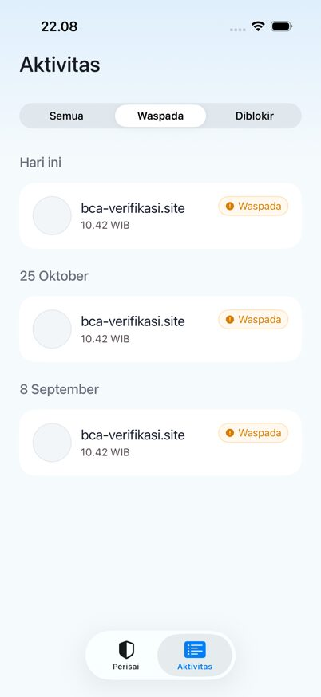<br>`act-pribadi-warning` | 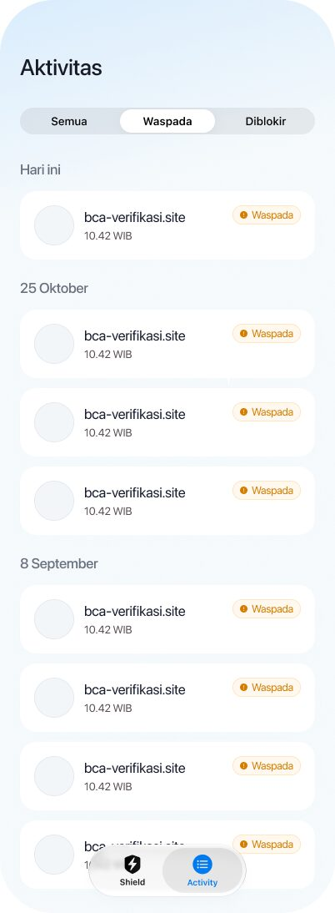 | ✅ match | Matches. |
| [Aktivitas - Profil Pribadi (v2, catatan Guardian)](https://www.figma.com/design/6PgxbrY0LSkcdaJ5u4YBJP/-CH7--Shoo-Scam-App?node-id=450-8443)<br>`450:8443` | 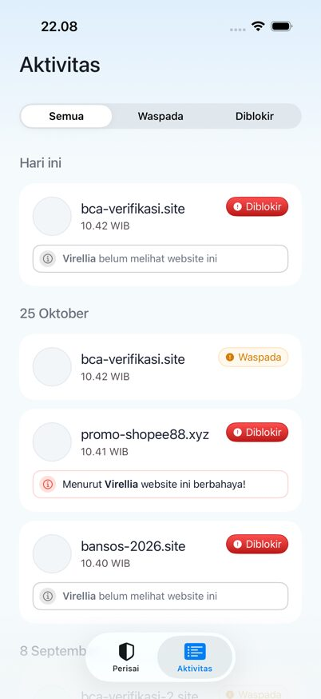<br>`act-protected` | 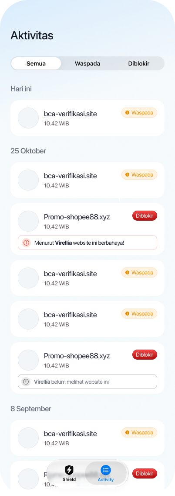 | ✅ match | Matches: "Virellia belum melihat website ini" / "Menurut Virellia website ini berbahaya!" notes under rows. |
| [Aktivitas - Profil Pribadi : Filtered (v2)](https://www.figma.com/design/6PgxbrY0LSkcdaJ5u4YBJP/-CH7--Shoo-Scam-App?node-id=450-8574)<br>`450:8574` | 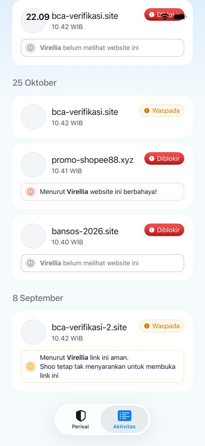<br>`act-protected-2` | 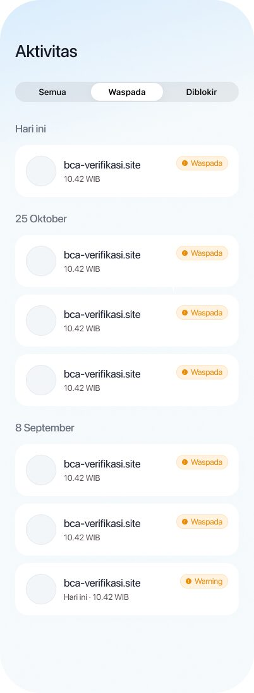 | ✅ match | Matches. |
| [Aktivitas - Profil Pribadi : Filtered (v2)](https://www.figma.com/design/6PgxbrY0LSkcdaJ5u4YBJP/-CH7--Shoo-Scam-App?node-id=450-8657)<br>`450:8657` | <br>`act-protected-2` | 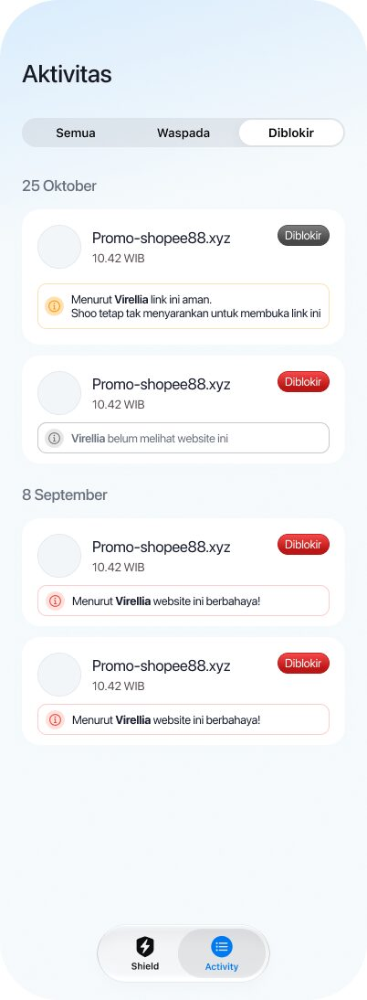 | 🟡 minor | Figma greys the Diblokir pill once the Guardian decided; the app keeps it red. |
| [Aktivitas - Profil Guardian](https://www.figma.com/design/6PgxbrY0LSkcdaJ5u4YBJP/-CH7--Shoo-Scam-App?node-id=416-8768)<br>`416:8768` | 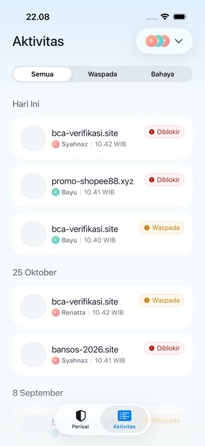<br>`act-guardian` | 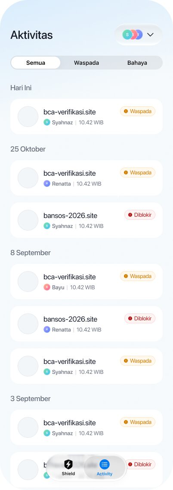 | ✅ match | Matches: owner chip, Semua / Waspada / Bahaya, person picker. |
| [Aktivitas - Profil Guardian / Only one selected](https://www.figma.com/design/6PgxbrY0LSkcdaJ5u4YBJP/-CH7--Shoo-Scam-App?node-id=416-8989)<br>`416:8989` | —<br>`act-guardian-one` |  | ⚪ not shot | Not shot: the person menu did not open by its identifier in the UI test. |
| [Picker](https://www.figma.com/design/6PgxbrY0LSkcdaJ5u4YBJP/-CH7--Shoo-Scam-App?node-id=416-9208)<br>`416:9208` | —<br>`act-guardian-picker` |  | ⚪ not shot | Not shot (same reason as 416:8989). |
| [Aktivitas · Semua · Belum ada aktivitas](https://www.figma.com/design/6PgxbrY0LSkcdaJ5u4YBJP/-CH7--Shoo-Scam-App?node-id=480-5490)<br>`480:5490` | <br>`act-empty-all` |  | ✅ match | Matches. |
| [Aktivitas · Waspada · Kosong](https://www.figma.com/design/6PgxbrY0LSkcdaJ5u4YBJP/-CH7--Shoo-Scam-App?node-id=480-5520)<br>`480:5520` | <br>`act-empty-warning` |  | ✅ match | Matches. |
| [Aktivitas · Diblokir · Kosong](https://www.figma.com/design/6PgxbrY0LSkcdaJ5u4YBJP/-CH7--Shoo-Scam-App?node-id=480-5550)<br>`480:5550` | <br>`act-empty-blocked` |  | ✅ match | Matches. |
| [Aktivitas · Semua · Perlindungan mati](https://www.figma.com/design/6PgxbrY0LSkcdaJ5u4YBJP/-CH7--Shoo-Scam-App?node-id=480-5580)<br>`480:5580` | <br>`act-off` |  | ✅ match | Matches. |
| [Guardian/Detail Aktivitas (Bahaya)](https://www.figma.com/design/6PgxbrY0LSkcdaJ5u4YBJP/-CH7--Shoo-Scam-App?node-id=416-9255)<br>`416:9255` | <br>`dt-blocked` |  | 🟡 minor | Matches the gauge, chip, link and evidence cards. The verdict footer floats over the cards in the app; in Figma it sits after them. |
| [Guardian/Detail Aktivitas, sebelum di cek](https://www.figma.com/design/6PgxbrY0LSkcdaJ5u4YBJP/-CH7--Shoo-Scam-App?node-id=487-4221)<br>`487:4221` | <br>`dt-unchecked` |  | 🔴 missing | No "Virellia belum melihat link ini" banner on the Detail header (no "seen" field in contracts/). |
| [Guardian/Detail Aktivitas Setelah Validasi](https://www.figma.com/design/6PgxbrY0LSkcdaJ5u4YBJP/-CH7--Shoo-Scam-App?node-id=416-9362)<br>`416:9362` | <br>`dt-validated` |  | ✅ match | Matches: "Diverifikasi sebagai penipuan oleh Anda". |
| [Guardian/Detail Aktivitas Waspada](https://www.figma.com/design/6PgxbrY0LSkcdaJ5u4YBJP/-CH7--Shoo-Scam-App?node-id=416-9469)<br>`416:9469` | <br>`dt-warning` |  | ✅ match | Matches. |
| [Guardian/Detail Aktivitas Waspada (v2, tanpa pemilik)](https://www.figma.com/design/6PgxbrY0LSkcdaJ5u4YBJP/-CH7--Shoo-Scam-App?node-id=487-5990)<br>`487:5990` | <br>`dt-pribadi` |  | ✅ match | Matches. |
| [Guardian/Detail Aktivitas · Ditandai Aman](https://www.figma.com/design/6PgxbrY0LSkcdaJ5u4YBJP/-CH7--Shoo-Scam-App?node-id=480-5768)<br>`480:5768` | <br>`dt-safe` |  | ✅ match | Matches: "Anda menandai ini aman" chip, verified card with Ubah, owner note. |
| [Catatan/Guardian memilih Aman](https://www.figma.com/design/6PgxbrY0LSkcdaJ5u4YBJP/-CH7--Shoo-Scam-App?node-id=480-5924)<br>`480:5924` | <br>`dt-protected-safe` |  | ✅ match | Design note (greyed AI score after a safe verdict): done. |
| [Bukti Foto — Highlight](https://www.figma.com/design/6PgxbrY0LSkcdaJ5u4YBJP/-CH7--Shoo-Scam-App?node-id=416-10831)<br>`416:10831` | <br>`dt-blocked-2` |  | ✅ match | Spotlight with label on the page copy: done. |
| [Catatan · sudah dicek, bahaya](https://www.figma.com/design/6PgxbrY0LSkcdaJ5u4YBJP/-CH7--Shoo-Scam-App?node-id=450-8734)<br>`450:8734` | <br>`act-protected` |  | ✅ match | Note component: done. |
| [Catatan · belum dicek](https://www.figma.com/design/6PgxbrY0LSkcdaJ5u4YBJP/-CH7--Shoo-Scam-App?node-id=450-8739)<br>`450:8739` | <br>`act-protected` |  | ✅ match | Note component: done. |
| [Catatan · sudah dicek, aman](https://www.figma.com/design/6PgxbrY0LSkcdaJ5u4YBJP/-CH7--Shoo-Scam-App?node-id=450-8744)<br>`450:8744` | <br>`act-protected-2` |  | ✅ match | Note component: done. |

## Profile

| Frame | App now | Figma | Status | Note |
|---|---|---|---|---|
| [Profile/Guardian](https://www.figma.com/design/6PgxbrY0LSkcdaJ5u4YBJP/-CH7--Shoo-Scam-App?node-id=416-10447)<br>`416:10447` | <br>`pf-guardian` |  | ✅ match | Matches (stats come from the mock). |
| [Profile/Guardian · Belum ada orang](https://www.figma.com/design/6PgxbrY0LSkcdaJ5u4YBJP/-CH7--Shoo-Scam-App?node-id=480-5353)<br>`480:5353` | <br>`pf-guardian-empty` |  | ✅ match | Matches. |
| [Profile/Pribadi](https://www.figma.com/design/6PgxbrY0LSkcdaJ5u4YBJP/-CH7--Shoo-Scam-App?node-id=416-10338)<br>`416:10338` | <br>`pf-pribadi` |  | 🟠 gap | Perlindungan shows "Ekstensi Safari · Aktif" as text; Figma has two switches: Ekstensi Safari and "Blokir situs berbahaya". |
| [Profile/Pribadi · Ajak jadi Guardian](https://www.figma.com/design/6PgxbrY0LSkcdaJ5u4YBJP/-CH7--Shoo-Scam-App?node-id=480-5227)<br>`480:5227` | <br>`pf-pribadi-2` |  | ✅ match | Ajak jadi Guardian card matches. |
| [Profile/Pribadi (v2, terhubung Virellia)](https://www.figma.com/design/6PgxbrY0LSkcdaJ5u4YBJP/-CH7--Shoo-Scam-App?node-id=455-10275)<br>`455:10275` | <br>`pf-protected` |  | 🟡 minor | Matches. "Ekstensi Safari · Aktif" is green without a chevron (Figma: grey with chevron). |
| [Profile/Pribadi (v2, layar pertama)](https://www.figma.com/design/6PgxbrY0LSkcdaJ5u4YBJP/-CH7--Shoo-Scam-App?node-id=455-10571)<br>`455:10571` | <br>`pf-protected` |  | 🟡 minor | Same as 455:10275. |
| [Guardian/Detail Orang Dilindungi](https://www.figma.com/design/6PgxbrY0LSkcdaJ5u4YBJP/-CH7--Shoo-Scam-App?node-id=416-10574)<br>`416:10574` | <br>`pf-member` |  | 🟡 minor | Matches. Copy: "Aktivitas Terakhir · Lihat Semua" vs Figma "Aktivitas terbaru · Lihat semua". |
| [Guardian/Detail Orang Dilindungi · Putuskan](https://www.figma.com/design/6PgxbrY0LSkcdaJ5u4YBJP/-CH7--Shoo-Scam-App?node-id=416-10676)<br>`416:10676` | <br>`pf-member-disconnect` |  | ✅ match | Matches. |
| [Pengaturan/Mode akun](https://www.figma.com/design/6PgxbrY0LSkcdaJ5u4YBJP/-CH7--Shoo-Scam-App?node-id=455-9515)<br>`455:9515` | <br>`pf-mode` |  | ⚪ not shot | This Figma frame is the Protected "Akun Tertaut" page (Terhubung row), not Mode akun. The app has it (linked.autoSend / linked.shareWarnings) but the run opened Guardian Mode akun instead. |
| [Pengaturan/Mode akun (pilihan lain)](https://www.figma.com/design/6PgxbrY0LSkcdaJ5u4YBJP/-CH7--Shoo-Scam-App?node-id=457-10896)<br>`457:10896` | <br>`pf-mode` |  | ⚪ not shot | Same as 455:9515 (Kirim link otomatis off). |
| [Pengaturan/Kelola profil (v2)](https://www.figma.com/design/6PgxbrY0LSkcdaJ5u4YBJP/-CH7--Shoo-Scam-App?node-id=462-11043)<br>`462:11043` | <br>`pf-manage` |  | ⚪ not shot | Protected Kelola profil (letter avatar, "Aktif sejak", Nama only): the run shot the Guardian version. |
| [Pengaturan/Kelola profil](https://www.figma.com/design/6PgxbrY0LSkcdaJ5u4YBJP/-CH7--Shoo-Scam-App?node-id=416-12854)<br>`416:12854` | <br>`pf-manage` |  | 🟠 gap | Missing "Akun · Perangkat terhubung (2 perangkat)" row. |
| [Pengaturan/Notifikasi (v2)](https://www.figma.com/design/6PgxbrY0LSkcdaJ5u4YBJP/-CH7--Shoo-Scam-App?node-id=455-9627)<br>`455:9627` | <br>`pf-notifications` |  | ⚪ not shot | Protected Notifikasi (Peringatan + Akun Terhubung · Link terblokir): the run shot the Guardian version. |
| [Pengaturan/Notifikasi](https://www.figma.com/design/6PgxbrY0LSkcdaJ5u4YBJP/-CH7--Shoo-Scam-App?node-id=416-12916)<br>`416:12916` | <br>`pf-notifications` |  | 🟡 minor | Matches, plus a "Notifikasi mati · Nyalakan" banner on top while the system permission is off. |
| [Pengaturan/Bahasa (v2)](https://www.figma.com/design/6PgxbrY0LSkcdaJ5u4YBJP/-CH7--Shoo-Scam-App?node-id=455-9697)<br>`455:9697` | <br>`pf-language` |  | 🟡 minor | Same options; the app lists English first, Figma lists Bahasa Indonesia first. |
| [Pengaturan/Bahasa](https://www.figma.com/design/6PgxbrY0LSkcdaJ5u4YBJP/-CH7--Shoo-Scam-App?node-id=416-12986)<br>`416:12986` | <br>`pf-language` |  | 🟡 minor | Same as 455:9697. |
| [Pengaturan/Tema (v2)](https://www.figma.com/design/6PgxbrY0LSkcdaJ5u4YBJP/-CH7--Shoo-Scam-App?node-id=455-9718)<br>`455:9718` | <br>`pf-theme` |  | 🟡 minor | Matches. "Kurangi efek kaca" subtitle differs (app: "Latar polos yang juga menghemat baterai"). |
| [Pengaturan/Tema](https://www.figma.com/design/6PgxbrY0LSkcdaJ5u4YBJP/-CH7--Shoo-Scam-App?node-id=416-13007)<br>`416:13007` | <br>`pf-theme` |  | 🟡 minor | Same as 455:9718. |
| [Pengaturan/Aksesibilitas (v2)](https://www.figma.com/design/6PgxbrY0LSkcdaJ5u4YBJP/-CH7--Shoo-Scam-App?node-id=455-9785)<br>`455:9785` | <br>`pf-accessibility` |  | 🟡 minor | Matches. Subtitles differ: Kurangi gerakan ("Matikan animasi di Shoo" vs "Matikan animasi gauge dan swipe kartu"), Bacakan peringatan. |
| [Pengaturan/Aksesibilitas](https://www.figma.com/design/6PgxbrY0LSkcdaJ5u4YBJP/-CH7--Shoo-Scam-App?node-id=416-13074)<br>`416:13074` | <br>`pf-accessibility` |  | 🟡 minor | Same as 455:9785. |
| [Pengaturan/Tentang Shoo (v2)](https://www.figma.com/design/6PgxbrY0LSkcdaJ5u4YBJP/-CH7--Shoo-Scam-App?node-id=455-9858)<br>`455:9858` | <br>`pf-about` |  | 🟡 minor | Matches. Version "Versi 1.0 (1)" vs "Versi 1.0.0 (42)" (build number), tagline "dirimu" vs "diri". |
| [Pengaturan/Tentang Shoo](https://www.figma.com/design/6PgxbrY0LSkcdaJ5u4YBJP/-CH7--Shoo-Scam-App?node-id=416-13147)<br>`416:13147` | <br>`pf-about` |  | 🟡 minor | Same as 455:9858. |

## AI vs GUARDIAN - EKSPLORASI

| Frame | App now | Figma | Status | Note |
|---|---|---|---|---|
| [Protected/Detail · Dibuka Guardian · Opsi 1](https://www.figma.com/design/6PgxbrY0LSkcdaJ5u4YBJP/-CH7--Shoo-Scam-App?node-id=487-7897)<br>`487:7897` | <br>`dt-protected-safe` |  | 🟠 gap | Exploration Opsi 1 (Protected sees "Virellia menandai situs ini aman · Blokir dibuka", AI first score 92, "Tetap hati-hati"). The app shows the gauge with "Ditandai aman oleh Virellia" and the verified card. |
| [Protected/Detail · Dibuka Guardian · Opsi 2](https://www.figma.com/design/6PgxbrY0LSkcdaJ5u4YBJP/-CH7--Shoo-Scam-App?node-id=487-8620)<br>`487:8620` | <br>`dt-protected-safe` |  | 🟠 gap | Exploration Opsi 2: same as 487:7897. |

## Test 1 — mock variants

Same screens with other data. Run: `TEST_RUNNER_QA_SCENARIO=<name> TEST_RUNNER_QA_SHOT_DIR=… xcodebuild test -only-testing:ShooAppUITests/FigmaParityUITests`.

### `mixedVerdicts` — Every verdict state: blocked/warning × none / safe / not safe

| `home-guardian` | `home-protected` | `act-guardian` | `act-protected` | `pf-guardian` |
|---|---|---|---|---|
|  |  |  |  |  |

### `heavy` — 3 members, 60 scans over 30 days, counters past 999

| `home-guardian` | `home-protected` | `act-guardian` | `act-protected` | `pf-guardian` | `dt-first` |
|---|---|---|---|---|---|
|  |  |  |  |  |  |

### `edge` — 20-character names, emoji, an 87-character domain, no title / favicon / screenshot, one signal

| `home-guardian` | `home-protected` | `act-guardian` | `act-protected` | `pf-guardian` | `dt-long` | `dt-one-signal` |
|---|---|---|---|---|---|---|
|  |  |  |  |  |  |  |

### `allSafe` — Every scan marked safe by the Guardian

| `home-guardian` | `home-protected` | `act-guardian` | `act-protected` | `pf-guardian` | `dt-safe` |
|---|---|---|---|---|---|
|  |  |  |  |  |  |

### `allBlocked` — Only blocked scans

| `home-guardian` | `home-protected` | `act-guardian` | `act-protected` | `pf-guardian` |
|---|---|---|---|---|
|  |  |  |  |  |

### `corpus` — Imelda's corpus with the detector's real scores and signals (41 scans ≥ 30)

| `home-guardian` | `home-protected` | `act-guardian` | `act-protected` | `pf-guardian` | `dt-top` | `dt-real-bsi` | `dt-real-lphone` | `dt-false-positive` |
|---|---|---|---|---|---|---|---|---|
|  |  |  |  |  |  |  |  |  |

## Test 2a — Imelda's corpus through layers 1–4 (offline)

`node ai/eval/run.mjs --analyze-url http://127.0.0.1:8788 --json --show-holdout` against `wrangler dev` of `ai/` with the LLM key in `ai/.dev.vars` and the prebuilt public blocklist (190 000 domains, `ai/scripts/build-blocklist.mjs`) in local KV. `plan/alief/qa/corpus-to-scans.mjs` turns the rows into the `corpus` scenario. No live page was opened for this test.

| | Samples | ≥ 30 (warning) | ≥ 50 | ≥ 80 (blocked) |
|---|---|---|---|---|
| Scam | 52 | 37 | 32 | 16 |
| Legit | 56 | 4 | 1 | 1 |

Targets (docs/mandates/imelda.md): 0 legit ≥ 30 — **4 found**; ≥ 90 % scam ≥ 50 — **62 %**; ≥ 70 % scam ≥ 80 — **31 %**. `/analyze` p95 6011 ms, remote failures 0. 9 samples got a layer-4 signal.

### Detector mismatches

| Sample | Label | Real? | Score | Signals |
|---|---|---|---|---|
| `trap-blog-cek-saldo-bca` | legit flagged | synthetic | 49 | suspicious_link:L2:24, brand_logo_offsite:L3:25 |
| `trap-github-pages-dokumentasi` | legit flagged | synthetic · holdout | 34 | suspicious_link:L2:19, asks_password:L3:15 |
| `trap-fintech-kyc-sah` | legit flagged | synthetic | 95 | suspicious_link:L2:10, asks_selfie_ktp:L3:35, asks_ktp:L3:25, asks_otp:L3:25 |
| `trap-asuransi-klaim-resmi` | legit flagged | synthetic · holdout | 35 | suspicious_link:L2:10, asks_ktp:L3:25 |
| `regs-apps14-code-php` | scam missed | real | 21 | suspicious_link:L2:21 |
| `fixture-bca-verifikasi` | scam missed | synthetic | 29 | brand_plus_keyword:L2:14, cheap_tld:L2:15 |
| `fixture-promo-shopee` | scam missed | synthetic | 29 | brand_plus_keyword:L2:14, cheap_tld:L2:15 |
| `fixture-bansos-kemensos` | scam missed | synthetic | 29 | brand_plus_keyword:L2:14, cheap_tld:L2:15 |
| `synthetic-p0stindonesia` | scam missed | synthetic | 25 | lookalike_domain:L2:25 |
| `syn-cimb-octo-limit` | scam missed | synthetic · holdout | 0 | — |
| `syn-sicepat-apk` | scam missed | synthetic | 5 | cheap_tld:L2:5 |
| `syn-anteraja-alamat` | scam missed | synthetic | 20 | asks_card:L3:20 |
| `syn-telkomsel-poin` | scam missed | synthetic | 25 | asks_otp:L3:25 |
| `syn-etilang-denda` | scam missed | synthetic · holdout | 20 | asks_card:L3:20 |
| `syn-samsat-pajak-kendaraan` | scam missed | synthetic · holdout | 5 | cheap_tld:L2:5 |
| `syn-find-my-iphone-hilang` | scam missed | synthetic | 25 | lookalike_domain:L2:10, cheap_tld:L2:15 |
| `syn-apple-pay-tagihan` | scam missed | synthetic | 25 | cheap_tld:L2:5, asks_card:L3:20 |
| `syn-loker-admin-online` | scam missed | synthetic | 0 | — |
| `syn-investasi-kripto-profit` | scam missed | synthetic | 0 | — |

<details><summary>All 108 samples</summary>

| Sample | Label | Real? | L1–2 | Total | Status | Signals |
|---|---|---|---|---|---|---|
| `bank-login-bri` | legit | real | 0 | 0 | normal |  |
| `bank-login-btn` | legit | real | 0 | 0 | normal |  |
| `bank-login-danamon` | legit | real | 0 | 0 | normal |  |
| `bank-login-klikbca` | legit | real | 0 | 0 | normal |  |
| `bank-login-mega` | legit | real · H | 0 | 0 | normal |  |
| `bank-login-permata` | legit | real | 0 | 0 | normal |  |
| `checkout-bukalapak` | legit | real | 0 | 0 | normal |  |
| `checkout-lazada` | legit | real | 0 | 0 | normal |  |
| `checkout-orami` | legit | real · H | 0 | 0 | normal |  |
| `checkout-ruparupa` | legit | real | 0 | 0 | normal |  |
| `checkout-shopee-cart` | legit | real · H | 0 | 0 | normal |  |
| `checkout-sociolla` | legit | real | 0 | 0 | normal |  |
| `checkout-tokopedia-cart` | legit | real | 0 | 0 | normal |  |
| `checkout-traveloka` | legit | real · H | 0 | 0 | normal |  |
| `checkout-zalora` | legit | real | 0 | 0 | normal |  |
| `gov-bi` | legit | real | 0 | 0 | normal |  |
| `gov-bpjs-kesehatan` | legit | real | 0 | 0 | normal |  |
| `gov-dukcapil` | legit | real | 0 | 0 | normal |  |
| `gov-kemensos` | legit | real | 0 | 0 | normal |  |
| `gov-komdigi` | legit | real | 0 | 0 | normal |  |
| `gov-ojk` | legit | real | 0 | 0 | normal |  |
| `gov-pajak` | legit | real | 0 | 0 | normal |  |
| `popular-cnnindonesia` | legit | real | 0 | 0 | normal |  |
| `popular-detik` | legit | real | 0 | 0 | normal |  |
| `popular-idntimes` | legit | real | 0 | 0 | normal |  |
| `popular-kompas` | legit | real · H | 0 | 0 | normal |  |
| `popular-kumparan` | legit | real | 0 | 0 | normal |  |
| `popular-liputan6` | legit | real · H | 0 | 0 | normal |  |
| `popular-tribunnews` | legit | real · H | 0 | 0 | normal |  |
| `popular-wikipedia-id` | legit | real | 0 | 0 | normal |  |
| `bank-login-bni-web` | legit | real · H | 0 | 0 | normal |  |
| `bank-login-mandiri-web` | legit | real | 0 | 0 | normal |  |
| `checkout-bhinneka` | legit | real · H | 0 | 0 | normal |  |
| `gov-kemenkeu` | legit | real | 0 | 0 | normal |  |
| `popular-merdeka` | legit | real · H | 0 | 0 | normal |  |
| `official-tokopedia-home` | legit | real | 0 | 0 | normal |  |
| `official-bca-home` | legit | real | 0 | 0 | normal |  |
| `official-shopee-home` | legit | real | 0 | 0 | normal |  |
| `popular-wikipedia` | legit | real | 0 | 0 | normal |  |
| `trap-dana-sosial` | legit | syn | 0 | 0 | normal |  |
| `trap-mandiri-jaya` | legit | syn | 0 | 0 | normal |  |
| `trap-toko-iphone-bekas` | legit | syn · H | 10 | 10 | normal | lookalike_domain:L2:10 |
| `trap-cloud-storage` | legit | syn | 0 | 0 | normal |  |
| `trap-toko-logo-bank-checkout` | legit | syn · H | 0 | 20 | normal | brand_logo_offsite:L3:12, urgent_language:L3:8 |
| `trap-blog-cek-saldo-bca` | legit | syn | 24 | 49 | warning 1 | suspicious_link:L2:24, brand_logo_offsite:L3:25 |
| `trap-github-pages-dokumentasi` | legit | syn · H | 19 | 34 | warning 1 | suspicious_link:L2:19, asks_password:L3:15 |
| `trap-sign-in-google-facebook` | legit | syn | 10 | 25 | normal | suspicious_link:L2:10, asks_password:L3:15 |
| `trap-fintech-kyc-sah` | legit | syn | 10 | 95 | blocked | suspicious_link:L2:10, asks_selfie_ktp:L3:35, asks_ktp:L3:25, asks_otp:L3:25 |
| `trap-berita-waspada-penipuan` | legit | syn | 0 | 20 | normal | brand_logo_offsite:L3:12, urgent_language:L3:8 |
| `trap-portal-orang-tua-sekolah` | legit | syn | 0 | 15 | normal | asks_password:L3:15 |
| `trap-asuransi-klaim-resmi` | legit | syn · H | 10 | 35 | warning 1 | suspicious_link:L2:10, asks_ktp:L3:25 |
| `trap-toko-kopi-kartu-native` | legit | syn | 0 | 20 | normal | asks_card:L3:20 |
| `trap-batik-card-checkout-en` | legit | syn | 5 | 25 | normal | cheap_tld:L2:5, asks_card:L3:20 |
| `syn-sekolah-portal2` | legit | syn · H | 0 | 0 | normal |  |
| `syn-toko-app3-index-php` | legit | syn | 0 | 0 | normal |  |
| `syn-kampus-code-path` | legit | syn | 0 | 0 | normal |  |
| `regs-apps14-code-php` | scam | real | 21 | 21 | normal | suspicious_link:L2:21 |
| `cusbsi-bsi-cash-management` | scam | real · H | 0 | 70 | warning 2 | unreasonable_request:L4:30, brand_logo_offsite:L3:25, asks_password:L3:15 |
| `lphone-login` | scam | real | 39 | 39 | warning 1 | lookalike_domain:L2:25, brand_plus_keyword:L2:14 |
| `fixture-bca-verifikasi` | scam | syn | 29 | 29 | normal | brand_plus_keyword:L2:14, cheap_tld:L2:15 |
| `fixture-promo-shopee` | scam | syn | 29 | 29 | normal | brand_plus_keyword:L2:14, cheap_tld:L2:15 |
| `fixture-bansos-kemensos` | scam | syn | 29 | 29 | normal | brand_plus_keyword:L2:14, cheap_tld:L2:15 |
| `synthetic-p0stindonesia` | scam | syn | 25 | 25 | normal | lookalike_domain:L2:25 |
| `syn-bri-token-expired` | scam | syn | 29 | 100 | blocked | brand_plus_keyword:L2:14, cheap_tld:L2:15, asks_pin:L3:35, asks_otp:L3:25, brand_logo_offsite:L3:25 |
| `syn-mandiri-livin-upgrade` | scam | syn · H | 29 | 100 | blocked | brand_plus_keyword:L2:14, cheap_tld:L2:15, unreasonable_request:L4:30, brand_logo_offsite:L3:25, asks_password:L3:15, urgent_language:L3:15 |
| `syn-bni-mobile-banking` | scam | syn · H | 25 | 100 | blocked | lookalike_domain:L2:10, cheap_tld:L2:15, unreasonable_request:L4:30, brand_logo_offsite:L3:25, asks_card:L3:20, asks_password:L3:15 |
| `syn-bsi-sharia-bonus` | scam | syn | 25 | 100 | blocked | lookalike_domain:L2:10, cheap_tld:L2:15, asks_pin:L3:35, unreasonable_request:L4:30, asks_ktp:L3:25, brand_logo_offsite:L3:25 |
| `syn-bca-klikbca-clean` | scam | syn | 0 | 80 | blocked | unreasonable_request:L4:30, asks_otp:L3:25, brand_logo_offsite:L3:25 |
| `syn-cimb-octo-limit` | scam | syn · H | 0 | 0 | normal |  |
| `syn-bca-blokir-kartu` | scam | syn · H | 14 | 89 | blocked | brand_plus_keyword:L2:14, unreasonable_request:L4:30, brand_logo_offsite:L3:25, asks_card:L3:20 |
| `syn-bri-cashback-survey` | scam | syn | 25 | 85 | blocked | lookalike_domain:L2:10, cheap_tld:L2:15, asks_pin:L3:35, brand_logo_offsite:L3:25 |
| `syn-mandiri-kyc-update` | scam | syn | 0 | 100 | blocked | asks_selfie_ktp:L3:35, unreasonable_request:L4:30, asks_ktp:L3:25, brand_logo_offsite:L3:25 |
| `syn-dana-kaget-bonus` | scam | syn | 29 | 100 | blocked | brand_plus_keyword:L2:14, cheap_tld:L2:15, unreasonable_request:L4:30, asks_otp:L3:25, brand_logo_offsite:L3:25 |
| `syn-ovo-upgrade-premier` | scam | syn | 25 | 100 | blocked | lookalike_domain:L2:10, cheap_tld:L2:15, asks_pin:L3:35, unreasonable_request:L4:30, asks_ktp:L3:25, brand_logo_offsite:L3:25 |
| `syn-gopay-driver-refund` | scam | syn | 29 | 100 | blocked | brand_plus_keyword:L2:14, cheap_tld:L2:15, asks_pin:L3:35, asks_otp:L3:25, brand_logo_offsite:L3:25 |
| `syn-shopeepay-limit` | scam | syn | 29 | 69 | warning 2 | brand_plus_keyword:L2:14, cheap_tld:L2:15, brand_logo_offsite:L3:25, asks_password:L3:15 |
| `syn-linkaja-hadiah` | scam | syn · H | 0 | 35 | warning 1 | asks_pin:L3:35 |
| `syn-dana-premium-pin` | scam | syn · H | 29 | 100 | blocked | brand_plus_keyword:L2:14, cheap_tld:L2:15, asks_pin:L3:35, asks_otp:L3:25, brand_logo_offsite:L3:25 |
| `syn-ovo-undian-grab` | scam | syn | 29 | 54 | warning 2 | brand_plus_keyword:L2:14, cheap_tld:L2:15, brand_logo_offsite:L3:25 |
| `syn-gopay-later-pinjam` | scam | syn | 5 | 90 | blocked | cheap_tld:L2:5, asks_selfie_ktp:L3:35, asks_ktp:L3:25, brand_logo_offsite:L3:25 |
| `syn-jne-paket-tertahan` | scam | syn | 25 | 70 | warning 2 | lookalike_domain:L2:10, cheap_tld:L2:15, brand_logo_offsite:L3:25, asks_card:L3:20 |
| `syn-jnt-tarif-selisih` | scam | syn | 25 | 50 | warning 2 | lookalike_domain:L2:10, cheap_tld:L2:15, brand_logo_offsite:L3:25 |
| `syn-sicepat-apk` | scam | syn | 5 | 5 | normal | cheap_tld:L2:5 |
| `syn-anteraja-alamat` | scam | syn | 0 | 20 | normal | asks_card:L3:20 |
| `syn-pos-kiriman-luar-negeri` | scam | syn | 25 | 50 | warning 2 | lookalike_domain:L2:25, brand_logo_offsite:L3:25 |
| `syn-tiki-nomor-resi` | scam | syn | 5 | 30 | warning 1 | cheap_tld:L2:5, asks_otp:L3:25 |
| `syn-ninja-ganti-rugi` | scam | syn · H | 5 | 40 | warning 1 | cheap_tld:L2:5, asks_pin:L3:35 |
| `syn-tokopedia-undian` | scam | syn · H | 29 | 69 | warning 2 | brand_plus_keyword:L2:14, cheap_tld:L2:15, brand_logo_offsite:L3:25, asks_password:L3:15 |
| `syn-telkomsel-poin` | scam | syn | 0 | 25 | normal | asks_otp:L3:25 |
| `syn-lazada-giveaway` | scam | syn | 25 | 70 | warning 2 | lookalike_domain:L2:10, cheap_tld:L2:15, brand_logo_offsite:L3:25, asks_card:L3:20 |
| `syn-shopee-flash-undian` | scam | syn | 29 | 54 | warning 2 | brand_plus_keyword:L2:14, cheap_tld:L2:15, brand_logo_offsite:L3:25 |
| `syn-bpjs-bonus-iuran` | scam | syn | 29 | 74 | warning 2 | brand_plus_keyword:L2:14, cheap_tld:L2:15, brand_logo_offsite:L3:25, asks_card:L3:20 |
| `syn-pertamina-subsidi` | scam | syn | 0 | 60 | warning 2 | asks_selfie_ktp:L3:35, asks_ktp:L3:25 |
| `syn-bukalapak-voucher` | scam | syn | 29 | 79 | warning 2 | brand_plus_keyword:L2:14, cheap_tld:L2:15, asks_otp:L3:25, brand_logo_offsite:L3:25 |
| `syn-bpjs-kesehatan-nonaktif` | scam | syn · H | 25 | 75 | warning 2 | lookalike_domain:L2:10, cheap_tld:L2:15, asks_ktp:L3:25, brand_logo_offsite:L3:25 |
| `syn-pajak-djp-sptp` | scam | syn | 29 | 69 | warning 2 | brand_plus_keyword:L2:14, cheap_tld:L2:15, brand_logo_offsite:L3:25, asks_password:L3:15 |
| `syn-etilang-denda` | scam | syn · H | 0 | 20 | normal | asks_card:L3:20 |
| `syn-samsat-pajak-kendaraan` | scam | syn · H | 5 | 5 | normal | cheap_tld:L2:5 |
| `syn-prakerja-gelombang` | scam | syn | 0 | 85 | blocked | asks_selfie_ktp:L3:35, asks_ktp:L3:25, asks_otp:L3:25 |
| `syn-dukcapil-ktp-digital` | scam | syn | 0 | 85 | blocked | asks_selfie_ktp:L3:35, asks_ktp:L3:25, asks_otp:L3:25 |
| `syn-kemensos-bansos-pkh` | scam | syn | 14 | 99 | blocked | brand_plus_keyword:L2:14, asks_pin:L3:35, asks_ktp:L3:25, brand_logo_offsite:L3:25 |
| `syn-icloud-terkunci` | scam | syn | 29 | 69 | warning 2 | brand_plus_keyword:L2:14, cheap_tld:L2:15, asks_otp:L3:25, asks_password:L3:15 |
| `syn-find-my-iphone-hilang` | scam | syn | 25 | 25 | normal | lookalike_domain:L2:10, cheap_tld:L2:15 |
| `syn-apple-pay-tagihan` | scam | syn | 5 | 25 | normal | cheap_tld:L2:5, asks_card:L3:20 |
| `syn-loker-admin-online` | scam | syn | 0 | 0 | normal |  |
| `syn-pinjol-cair-cepat` | scam | syn | 5 | 65 | warning 2 | cheap_tld:L2:5, asks_selfie_ktp:L3:35, asks_ktp:L3:25 |
| `syn-investasi-kripto-profit` | scam | syn | 0 | 0 | normal |  |
| `syn-olx-pembeli-cod` | scam | syn · H | 0 | 45 | warning 1 | asks_otp:L3:25, asks_card:L3:20 |

</details>

## Test 2b/2c — live, two simulators on a local stack built like prod

| Part | Local | Prod |
|---|---|---|
| API | `wrangler dev` of `backend/api` on :8787, `--test-scheduled` | Worker `shoo-api` |
| Database + Storage | `supabase start` + `supabase db reset` (all migrations, RLS) | Supabase project |
| Replicas | local R2 (Miniflare) | R2 `shoo-replicas` |
| AI layers 3–4 | `wrangler dev` of `ai/` on :8788, same LLM provider as prod, prebuilt blocklist in local KV | Worker `shoo-ai` |
| Push | APNs **sandbox**, new team key (AK7HLX5ZX5), topic `com.aliefauzan.shoo` | APNs |
| App | Debug build, `-debug.aiBaseURL http://localhost:8788` (new, Debug only) | Release |

Pairing (`LiveQAUITests`): Adhella (Guardian, "QA Guardian iPhone 17") and Maria (Protected, "QA Protected iPhone 17") onboard in Bahasa Indonesia, Maria joins with the code on Adhella's screen, both answer the real notification prompt. The Protected Safari has Shoo on with *All Websites: Allow*.

Guardrails: only corpus URLs, simulator only, page load only (no typing, no taps on the page, no downloads). Hosts were checked by DNS first: **45 of 108 resolve** (43 legit, 2 scam). The 50 scam hosts that don't resolve (all synthetic + one real) are covered by 2a only (2c).

45 pages opened (43 legit, 2 scam). 1 reached the server as a scan (score ≥ 30), 1 Guardian push attempt(s) in push_log.

| Sample | Label | 2a score | What the Safari shot shows | Scan on server | Guardian push |
|---|---|---|---|---|---|
| `regs-apps14-code-php` | scam | 21 | **46% Waspada banner** ("Asks for the code sent to your phone"), copy in English | 46 warning | failed:network |
| `lphone-login` | scam | 39 | redirects to the real icloud.com Find Devices; 0% badge (cloaked kit) | none | — |

<details><summary>43 legit pages</summary>

| Sample | Label | 2a score | What the Safari shot shows | Scan on server | Guardian push |
|---|---|---|---|---|---|
| `bank-login-bri` | legit | 0 | 0% badge | none | — |
| `bank-login-btn` | legit | 0 | 0% badge | none | — |
| `bank-login-danamon` | legit | 0 | page still blank at 15 s, no badge yet | none | — |
| `bank-login-klikbca` | legit | 0 | 0% badge | none | — |
| `bank-login-mega` | legit | 0 | 0% badge | none | — |
| `bank-login-permata` | legit | 0 | 0% badge | none | — |
| `checkout-bukalapak` | legit | 0 | 0% badge | none | — |
| `checkout-lazada` | legit | 0 | 0% badge | none | — |
| `checkout-orami` | legit | 0 | 0% badge | none | — |
| `checkout-ruparupa` | legit | 0 | 0% badge (Safari location prompt on top, left unanswered) | none | — |
| `checkout-shopee-cart` | legit | 0 | 0% badge (Safari location prompt on top, left unanswered) | none | — |
| `checkout-sociolla` | legit | 0 | 0% badge (Safari location prompt on top, left unanswered) | none | — |
| `checkout-tokopedia-cart` | legit | 0 | 0% badge (Safari location prompt on top, left unanswered) | none | — |
| `checkout-traveloka` | legit | 0 | 0% badge (Safari location prompt on top, left unanswered) | none | — |
| `checkout-zalora` | legit | 0 | 0% badge (Safari location prompt on top, left unanswered) | none | — |
| `gov-bi` | legit | 0 | 0% badge (Safari location prompt on top, left unanswered) | none | — |
| `gov-bpjs-kesehatan` | legit | 0 | 0% badge (Safari location prompt on top, left unanswered) | none | — |
| `gov-dukcapil` | legit | 0 | 0% badge (Safari location prompt on top, left unanswered) | none | — |
| `gov-kemensos` | legit | 0 | 0% badge (Safari location prompt on top, left unanswered) | none | — |
| `gov-komdigi` | legit | 0 | 0% badge (Safari location prompt on top, left unanswered) | none | — |
| `gov-ojk` | legit | 0 | 0% badge (Safari location prompt on top, left unanswered) | none | — |
| `gov-pajak` | legit | 0 | 0% badge (Safari location prompt on top, left unanswered) | none | — |
| `popular-cnnindonesia` | legit | 0 | 0% badge (Safari location prompt on top, left unanswered) | none | — |
| `popular-detik` | legit | 0 | 0% badge (Safari location prompt on top, left unanswered) | none | — |
| `popular-idntimes` | legit | 0 | 0% badge (Safari location prompt on top, left unanswered) | none | — |
| `popular-kompas` | legit | 0 | 0% badge (Safari location prompt on top, left unanswered) | none | — |
| `popular-kumparan` | legit | 0 | 0% badge (Safari location prompt on top, left unanswered) | none | — |
| `popular-liputan6` | legit | 0 | 0% badge (Safari location prompt on top, left unanswered) | none | — |
| `popular-tribunnews` | legit | 0 | 0% badge (Safari location prompt on top, left unanswered) | none | — |
| `popular-wikipedia-id` | legit | 0 | 0% badge (Safari location prompt on top, left unanswered) | none | — |
| `bank-login-bni-web` | legit | 0 | 0% badge (Safari location prompt on top, left unanswered) | none | — |
| `bank-login-mandiri-web` | legit | 0 | 0% badge (Safari location prompt on top, left unanswered) | none | — |
| `checkout-bhinneka` | legit | 0 | 0% badge (Safari location prompt on top, left unanswered) | none | — |
| `gov-kemenkeu` | legit | 0 | 0% badge (Safari location prompt on top, left unanswered) | none | — |
| `popular-merdeka` | legit | 0 | 0% badge (Safari location prompt on top, left unanswered) | none | — |
| `official-tokopedia-home` | legit | 0 | 0% badge (Safari location prompt on top, left unanswered) | none | — |
| `official-bca-home` | legit | 0 | 0% badge (Safari location prompt on top, left unanswered) | none | — |
| `official-shopee-home` | legit | 0 | 0% badge (Safari location prompt on top, left unanswered) | none | — |
| `popular-wikipedia` | legit | 0 | 0% badge (Safari location prompt on top, left unanswered) | none | — |
| `trap-cloud-storage` | legit | 0 | redirects to a sedo.com parking page; small 0% badge | none | — |
| `trap-blog-cek-saldo-bca` | legit | 49 | blog post now 404; 0% badge | none | — |
| `trap-github-pages-dokumentasi` | legit | 34 | GitHub Pages 404; small 0% badge | none | — |
| `trap-berita-waspada-penipuan` | legit | 20 | "Safari can’t open the page" (no server); badge dot only | none | — |

</details>

What happened, in order:

1. **Legit pages**: every page that loaded shows the green **0%** badge; none reached the server (only scores ≥ 30 are posted). The 4 legit traps that 2a flagged no longer serve their page (404, parking page, no server), so live they score 0.
2. **`regs-apps14.regnows-dfg.com/code.php`** (real scam, still up): the extension shows the **46% Waspada** banner, and the scan reaches the server with `asks_otp` (layer 3) + `suspicious_link` (layer 2). Offline it scored 21: the live page asks for an OTP, the corpus copy does not.
3. **`lphone-login.com`** (real scam, 39 offline): the host now redirects to the real `icloud.com` Find Devices page, so live it is a clean Apple page at 0%. A cloaked kit: only the offline copy shows the phishing form.
4. **No Guardian push on the first visit**: both devices were in *Jam tenang* (22:00–06:00, device zone Asia/Makassar, visit at 22:40). Warnings are muted then by design (PF-01, `notify.ts allowed()`); only blocked sites still push. After turning `quiet_hours` off in the local DB and reloading the page once, the Worker tried both pushes (Guardian + Maria's own) and logged **`failed:network`**: `wrangler dev` (workerd on the Mac) cannot speak HTTP/2, and APNs only takes HTTP/2. Production sends straight from the deployed Worker (spike passed in fase 07, D-alief-B01), so this is a limit of the local stack, not of prod. The app side of the push was checked with `xcrun simctl push` and the same payload the Worker builds (`pushText`, `scanId`).
5. **Guardian Activity is empty after pairing**: Adhella paired with Maria, but Family mode stays off until the Guardian switches it on from Home, so Activity shows only her own (empty) list. With `-settings.familyModeOn YES` both of Maria's scans show with her name, and Detail opens with the 46% gauge.
6. **Two rows for one page**: the second load of the same page made a second scan 1 min later; Activity lists both.
7. A Safari *Allow location?* prompt (from `ruparupa.com`) stayed on screen for the rest of the run; it was left unanswered during the visit and answered **Don't Allow** at the end. It covers part of the later shots but not the badge logic.
8. **Crons** fired by hand (`/cdn-cgi/handler/scheduled?cron=0+19+*+*+*` and `cron=5+*+*+*+*`): both 200, `ops_heartbeat` row written; nothing older than 14 days to delete on a fresh database.

| Safari · regs-apps14-code-php | Safari · lphone-login | Safari · bank-login-klikbca | Guardian Activity, Family mode off | Guardian Activity, Family mode on | Guardian Home | Guardian Detail | Guardian push (simctl) | Protected Activity | Protected Home |
|---|---|---|---|---|---|---|---|---|---|
|  |  |  |  |  |  |  |  |  |  |

## Re-run

```bash
# Figma frames (TalkToFigma plugin open in the file, channel joined)
node plan/alief/qa/figma-export.mjs plan/alief/qa/img/figma-parity/figma <channel>
# Test 1 + 2a screenshots
TEST_RUNNER_QA_SCENARIO=figma TEST_RUNNER_QA_SHOT_DIR=$PWD/plan/alief/qa/img/figma-parity/app xcodebuild test -project ios/Shoo.xcodeproj -scheme Shoo -destination 'platform=iOS Simulator,name=iPhone 17' -only-testing:ShooAppUITests/FigmaParityUITests
# Test 2a data
npx --prefix ai wrangler dev --cwd ai --port 8788 &
node ai/eval/run.mjs --analyze-url http://127.0.0.1:8788 --json --show-holdout > /tmp/corpus-eval.json && node plan/alief/qa/corpus-to-scans.mjs /tmp/corpus-eval.json
# Test 2b: pair, then visit
TEST_RUNNER_QA_LIVE=1 TEST_RUNNER_QA_PAIR_DIR=/tmp/pair xcodebuild test … -only-testing:ShooAppUITests/LiveQAUITests/testGuardianPairs   # Guardian sim
TEST_RUNNER_QA_LIVE=1 TEST_RUNNER_QA_PAIR_DIR=/tmp/pair xcodebuild test … -only-testing:ShooAppUITests/LiveQAUITests/testProtectedJoins  # Protected sim
bash plan/alief/qa/live-visit.sh <protected-udid>
# then write live/observations.json from the shots, and
node plan/alief/qa/live-results.mjs
node plan/alief/qa/figma-parity-report.mjs
```
