# QA — Figma parity, iOS app (2026-10-31, frames re-checked 2026-11-01)

Every iOS frame marked **Ready for dev** on the Figma page *High Fidelity*, plus HOME and *AI vs Guardian — Eksplorasi* (not marked, shown as they are), next to the app as it is on `main` today. Safari extension and web frames are out of scope.

| | |
|---|---|
| Device | Frame tables: iPhone 17 Pro simulator, iOS 26.4 (2026-11-01). Tests 1–2: iPhone 17 simulator, iOS 26.3 (2026-10-31). Bahasa Indonesia, light, `TZ=Asia/Jakarta` (WIB) |
| App | Frame tables: `feat/GD-01-home-figma` after the Figma parity pass (Home, Profile, Activity, Detail, Onboarding, Pairing; one Figma font, Figma shadows). Tests 1–2: `main` @ 2720b13 |
| Test 1 | `MockRepository` scenarios `figma`, `mixedVerdicts`, `heavy`, `edge`, `allSafe`, `allBlocked` (`Data/MockScenarios.swift`) |
| Test 2a | Imelda's eval corpus (`ai/eval/data`, 108 samples, holdout included) through layers 1–4 on a local `shoo-ai` Worker → scenario `corpus` |
| Test 2b/2c | Two paired simulators on a local stack built like prod; the Protected Safari opens every corpus URL that still resolves |
| Figma | [High Fidelity](https://www.figma.com/design/6PgxbrY0LSkcdaJ5u4YBJP/-CH7--Shoo-Scam-App?node-id=18-2), exported at 1x through the TalkToFigma plugin |

Result: **73 frames** — ✅ match 37 · 🟡 minor 30 · 🟠 gap 6 · 🔴 missing 0 · ⚪ not shot 0.

Figma frames are full height; the app shot is one screen (later screens of the same state are in `img/figma-parity/app/<shot>-2.jpg`, `-3.jpg`).

## Findings

Bugs and gaps the 2026-10-31 run found outside the frame-by-frame view (status as of that run unless marked):

1. 🔴 **Emoji in a name shows as ⍰ boxes** (scenario `edge`, `Bayu 🧑‍💻`) on Guardian Home and Profile: the custom font has no emoji fallback for ZWJ sequences. `edge-home-guardian`, `edge-pf-guardian`.
2. ✅ **Code expired shows the generic error** — fixed by 2026-11-01: `on-connect-expired` now shows "Kode kedaluwarsa, minta kode baru dan coba lagi." as in Figma 205:1182.
3. 🟡 **"Notifikasi mati" popup on every Home / Activity launch** in the mock run although `-UITestNotifications granted` is passed; the popup covers the hero in the Home shots.
4. 🟡 **Gauge label for 30–49**: a 39% warning (`corpus-dt-real-lphone`) reads "Risiko Tinggi", the same as 72%.
5. 🟡 **Counters** do not cap: Guardian Profile shows "3.000 Situs diblokir" in `heavy` (no "999+"); fits, but wider than Figma's tile.
6. 🟠 **Live: Guardian sees nothing after pairing** until Family mode is switched on by hand on Home (`live/guardian-activity.jpg` vs `guardian-activity-family.jpg`). Figma's Guardian Home/Activity always show the family.
7. 🟠 **Live: push cannot be tested on the local stack**: `wrangler dev` has no HTTP/2, APNs answers nothing (`push_log` `failed:network`). Prod path is the deployed Worker; a local relay or a cloud staging Worker is needed for an end-to-end push test.
8. 🟡 **Live: same page twice = two scans** in Activity (`regnows-dfg.com` 22.40 and 22.41).
9. 🟡 **Live: the extension banner is English** ("46% · Be careful") while the app is set to Bahasa Indonesia; the extension follows the system language (extension is out of scope for this report, noted for the lead).
10. 🟡 **Live: Detail "Salinan halaman" stays grey** for the live scan (no page copy drawn) and the favicon circle is empty.
11. ⚪ **Detector, 2a**: 4 legit pages ≥ 30 (target 0) and 20 scam pages < 30; 62 % of scams ≥ 50 (target 90 %). Details in Test 2a.

Per frame (most severe first):

| | Frame | Note |
|---|---|---|
| 🟠 gap | [protected/Home](https://www.figma.com/design/6PgxbrY0LSkcdaJ5u4YBJP/-CH7--Shoo-Scam-App?node-id=441-2736) | Alternative protected Home (status strip, Terblokir / Perlu Waspada tiles). The app builds 441:3800; designer to say which one is final. |
| 🟠 gap | [protected/Home · Lihat semua di atas](https://www.figma.com/design/6PgxbrY0LSkcdaJ5u4YBJP/-CH7--Shoo-Scam-App?node-id=441-3063) | Alternative protected Home (wider card, 11 pt gap). The app builds 441:3800; designer to say which one is final. |
| 🟠 gap | [Profile/Pribadi](https://www.figma.com/design/6PgxbrY0LSkcdaJ5u4YBJP/-CH7--Shoo-Scam-App?node-id=416-10338) | Perlindungan shows "Ekstensi Safari · Aktif" as text; Figma has two switches (Ekstensi Safari, Blokir situs berbahaya). Feature decision. |
| 🟠 gap | [Pengaturan/Kelola profil](https://www.figma.com/design/6PgxbrY0LSkcdaJ5u4YBJP/-CH7--Shoo-Scam-App?node-id=416-12854) | Missing "Akun · Perangkat terhubung" row (feature). "Ubah foto" is app-only; username has no chevron (not editable). |
| 🟠 gap | [Protected/Detail · Dibuka Guardian · Opsi 1](https://www.figma.com/design/6PgxbrY0LSkcdaJ5u4YBJP/-CH7--Shoo-Scam-App?node-id=487-7897) | Exploration Opsi 1 (Protected sees "Virellia menandai situs ini aman · Blokir dibuka", AI first score 92, "Tetap hati-hati"). The app shows the gauge with "Ditandai aman oleh Virellia" and the verified card. |
| 🟠 gap | [Protected/Detail · Dibuka Guardian · Opsi 2](https://www.figma.com/design/6PgxbrY0LSkcdaJ5u4YBJP/-CH7--Shoo-Scam-App?node-id=487-8620) | Exploration Opsi 2: same as 487:7897. |
| 🟡 minor | [Pribadi/Home](https://www.figma.com/design/6PgxbrY0LSkcdaJ5u4YBJP/-CH7--Shoo-Scam-App?node-id=435-20058) | Hero, strip, tiles and list at Figma positions (±1 pt), real Figma hero gradient, dashed rings. Top bar sits ~19 pt lower than Figma (iOS navigation bar places it); tab labels Perisai/Aktivitas vs Figma Shield/Activity (product). Switch button is iOS 26 Liquid Glass (brighter cyan than Figma's grey). "RISIKO" spelled correctly (Figma: RESIKO). |
| 🟡 minor | [Guardian/Home](https://www.figma.com/design/6PgxbrY0LSkcdaJ5u4YBJP/-CH7--Shoo-Scam-App?node-id=435-20373) | Matches (shot `home-guardian-members`; the old map paired the waiting-site shot). Top bar sits ~19 pt lower than Figma (iOS navigation bar places it); tab labels Perisai/Aktivitas vs Figma Shield/Activity (product). |
| 🟡 minor | [Guardian/Home · Keluarga butuh konfirmasi](https://www.figma.com/design/6PgxbrY0LSkcdaJ5u4YBJP/-CH7--Shoo-Scam-App?node-id=435-20899) | Matches: eyebrow "DIBUKA SYAHNAZ · HARI INI, 10.42", 18 pt title, chip, 237 pt gauge, Bahaya/Aman with Figma's spread −3 shadow. Top bar sits ~19 pt lower than Figma (iOS navigation bar places it); tab labels Perisai/Aktivitas vs Figma Shield/Activity (product). |
| 🟡 minor | [Guardian/Home · Belum ada orang](https://www.figma.com/design/6PgxbrY0LSkcdaJ5u4YBJP/-CH7--Shoo-Scam-App?node-id=435-20630) | Matches: blue-teal hero, no rings, invite card, QR, code spacing. Top bar sits ~19 pt lower than Figma (iOS navigation bar places it); tab labels Perisai/Aktivitas vs Figma Shield/Activity (product). Mock gives a 6-digit code. |
| 🟡 minor | [protected/Home · Kartu diblokir 92%](https://www.figma.com/design/6PgxbrY0LSkcdaJ5u4YBJP/-CH7--Shoo-Scam-App?node-id=441-3800) | Matches: hero glow only (no shield, as Figma), 26 pt column spacing, blocked card with 242 pt gauge and two-line note, count tiles. Top bar sits ~19 pt lower than Figma (iOS navigation bar places it); tab labels Perisai/Aktivitas vs Figma Shield/Activity (product). |
| 🟡 minor | [protected/Home · Kartu diblokir 92% (bawah)](https://www.figma.com/design/6PgxbrY0LSkcdaJ5u4YBJP/-CH7--Shoo-Scam-App?node-id=441-4414) | Same as 441:3800 (scrolled). |
| 🟡 minor | [Splash Screen](https://www.figma.com/design/6PgxbrY0LSkcdaJ5u4YBJP/-CH7--Shoo-Scam-App?node-id=110-3585) | Figma frame is an empty white frame; the app keeps its brand splash. |
| 🟡 minor | [Atur Nama · nama terlalu panjang](https://www.figma.com/design/6PgxbrY0LSkcdaJ5u4YBJP/-CH7--Shoo-Scam-App?node-id=110-4271) | Shot added. Note text matches; the app keeps Selanjutnya disabled per the 1–20 rule (Figma shows it enabled). |
| 🟡 minor | [Choose Mode](https://www.figma.com/design/6PgxbrY0LSkcdaJ5u4YBJP/-CH7--Shoo-Scam-App?node-id=110-4345) | Matches layout and colours. App adds "Pilihan ini tidak bisa diganti nanti."; Figma's chosen card is 2 pt bigger, the app keeps both the same size. |
| 🟡 minor | [Connect with Guardian · Kode](https://www.figma.com/design/6PgxbrY0LSkcdaJ5u4YBJP/-CH7--Shoo-Scam-App?node-id=141-5887) | 72 pt code boxes, 8 pt gaps, tab shadow match. 6 boxes (API code) vs Figma 5; Figma's code font Geist needs `project.yml` (lead); the 14-day note and Nanti saja are app extras. |
| 🟡 minor | [Kode Kadaluarsa · QR](https://www.figma.com/design/6PgxbrY0LSkcdaJ5u4YBJP/-CH7--Shoo-Scam-App?node-id=205-1081) | Shot added; same code-box notes as 141:5887. |
| 🟡 minor | [Kode Kadaluarsa · Kode](https://www.figma.com/design/6PgxbrY0LSkcdaJ5u4YBJP/-CH7--Shoo-Scam-App?node-id=205-1182) | Now shows "Kode kedaluwarsa, minta kode baru dan coba lagi." Same code-box notes as 141:5887. |
| 🟡 minor | [Aktifkan Ekstensi](https://www.figma.com/design/6PgxbrY0LSkcdaJ5u4YBJP/-CH7--Shoo-Scam-App?node-id=110-4440) | Shot with the extension off. "Aktifkan Ekstensi" copy, "Terkendala? Tonton Tutorial" match; step text per iOS version and the "Shoo dimatikan" hint are app extras. |
| 🟡 minor | [Kirim Undangan (sheet)](https://www.figma.com/design/6PgxbrY0LSkcdaJ5u4YBJP/-CH7--Shoo-Scam-App?node-id=110-4817) | Shot added. Spacing and QR size match; share row is WhatsApp / Pesan / Lainnya (Figma: Messages / Mail / Notes) and the countdown is an app extra. Figma code has 4 digits; the app uses 6. |
| 🟡 minor | [Aktivitas - Profil Pribadi](https://www.figma.com/design/6PgxbrY0LSkcdaJ5u4YBJP/-CH7--Shoo-Scam-App?node-id=416-8541) | v1 frame: outlined Diblokir pill. The app follows the newer 450:8443 (solid pill). |
| 🟡 minor | [Aktivitas - Profil Guardian](https://www.figma.com/design/6PgxbrY0LSkcdaJ5u4YBJP/-CH7--Shoo-Scam-App?node-id=416-8768) | Matches. The person button is real iOS 26 glass, whiter than Figma's. |
| 🟡 minor | [Guardian/Detail Aktivitas (Bahaya)](https://www.figma.com/design/6PgxbrY0LSkcdaJ5u4YBJP/-CH7--Shoo-Scam-App?node-id=416-9255) | Score Card, chips, contribution bar and footer match. Header sits ~26 pt lower (the Figma frame has no status bar); the "Salinan halaman" caption is the page-copy feature, not in Figma. |
| 🟡 minor | [Guardian/Detail Aktivitas, sebelum di cek](https://www.figma.com/design/6PgxbrY0LSkcdaJ5u4YBJP/-CH7--Shoo-Scam-App?node-id=487-4221) | "Virellia belum melihat link ini" banner built; shot `dt-protected` (Protected owner view). Same header offset as 416:9255. |
| 🟡 minor | [Guardian/Detail Aktivitas Setelah Validasi](https://www.figma.com/design/6PgxbrY0LSkcdaJ5u4YBJP/-CH7--Shoo-Scam-App?node-id=416-9362) | Verified card matches. Figma puts "Kontribusi" over the photo here; the app follows the newer frames (under the photo). |
| 🟡 minor | [Guardian/Detail Aktivitas Waspada](https://www.figma.com/design/6PgxbrY0LSkcdaJ5u4YBJP/-CH7--Shoo-Scam-App?node-id=416-9469) | Same as 416:9362. |
| 🟡 minor | [Guardian/Detail Aktivitas Waspada (v2, tanpa pemilik)](https://www.figma.com/design/6PgxbrY0LSkcdaJ5u4YBJP/-CH7--Shoo-Scam-App?node-id=487-5990) | Shot `dt-protected-warning` (no owner chip, no buttons). Same Kontribusi note as 416:9362. If the frame means a guardian's own scan, hiding Aman/Bahaya is a product decision (#190). |
| 🟡 minor | [Profile/Pribadi (v2, terhubung Virellia)](https://www.figma.com/design/6PgxbrY0LSkcdaJ5u4YBJP/-CH7--Shoo-Scam-App?node-id=455-10275) | Matches pill, stats and Terhubung card. Figma shows a letter "U" avatar for Protected (app: memoji); "Ekstensi Safari" chevron left off (row does nothing); Figma's Akun spacing differs between the two v2 frames. |
| 🟡 minor | [Profile/Pribadi (v2, layar pertama)](https://www.figma.com/design/6PgxbrY0LSkcdaJ5u4YBJP/-CH7--Shoo-Scam-App?node-id=455-10571) | Same as 455:10275. |
| 🟡 minor | [Pengaturan/Mode akun](https://www.figma.com/design/6PgxbrY0LSkcdaJ5u4YBJP/-CH7--Shoo-Scam-App?node-id=455-9515) | This frame is the Protected "Akun Tertaut" page, now shot as `pf-protected-connection`. Switches show "Segera hadir" (behind flag #183); Figma says "You" in the Indonesian UI. |
| 🟡 minor | [Pengaturan/Mode akun (pilihan lain)](https://www.figma.com/design/6PgxbrY0LSkcdaJ5u4YBJP/-CH7--Shoo-Scam-App?node-id=457-10896) | Same as 455:9515. |
| 🟡 minor | [Pengaturan/Kelola profil (v2)](https://www.figma.com/design/6PgxbrY0LSkcdaJ5u4YBJP/-CH7--Shoo-Scam-App?node-id=462-11043) | Shot `pf-protected-manage`; matches except the letter-avatar question in 455:10275. |
| 🟡 minor | [Pengaturan/Notifikasi (v2)](https://www.figma.com/design/6PgxbrY0LSkcdaJ5u4YBJP/-CH7--Shoo-Scam-App?node-id=455-9627) | Shot `pf-protected-notifications`. "Akun Terhubung" is behind flag #183. |
| 🟡 minor | [Pengaturan/Notifikasi](https://www.figma.com/design/6PgxbrY0LSkcdaJ5u4YBJP/-CH7--Shoo-Scam-App?node-id=416-12916) | Matches; the "Notifikasi mati" banner shows because the test leaves permission undecided. |
| 🟡 minor | [Pengaturan/Tentang Shoo (v2)](https://www.figma.com/design/6PgxbrY0LSkcdaJ5u4YBJP/-CH7--Shoo-Scam-App?node-id=455-9858) | Matches; the version number comes from the build. |
| 🟡 minor | [Pengaturan/Tentang Shoo](https://www.figma.com/design/6PgxbrY0LSkcdaJ5u4YBJP/-CH7--Shoo-Scam-App?node-id=416-13147) | Same as 455:9858. |

## HOME

| Frame | App now | Figma | Status | Note |
|---|---|---|---|---|
| [Pribadi/Home](https://www.figma.com/design/6PgxbrY0LSkcdaJ5u4YBJP/-CH7--Shoo-Scam-App?node-id=435-20058)<br>`435:20058` | 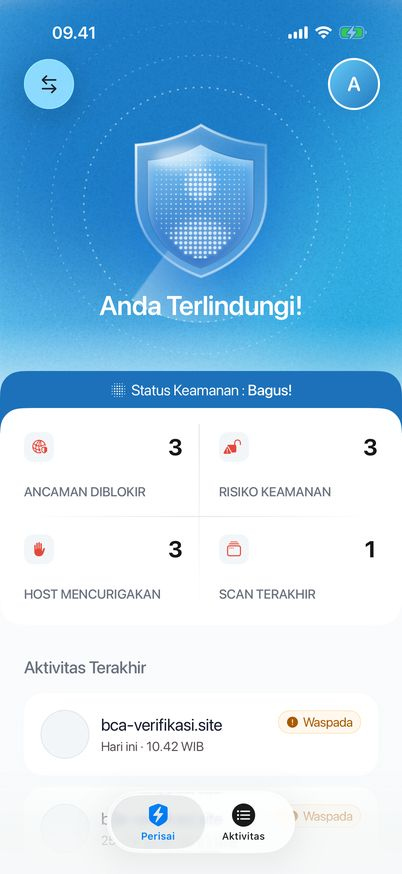<br>`home-pribadi` | 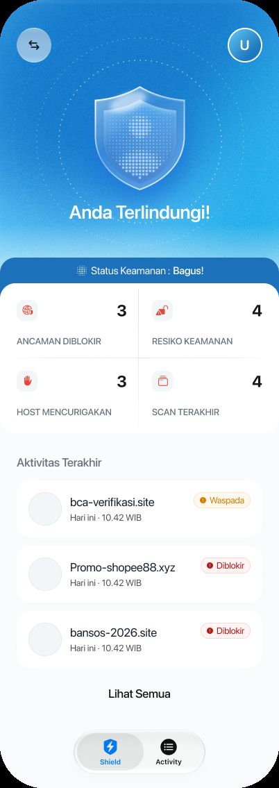 | 🟡 minor | Hero, strip, tiles and list at Figma positions (±1 pt), real Figma hero gradient, dashed rings. Top bar sits ~19 pt lower than Figma (iOS navigation bar places it); tab labels Perisai/Aktivitas vs Figma Shield/Activity (product). Switch button is iOS 26 Liquid Glass (brighter cyan than Figma's grey). "RISIKO" spelled correctly (Figma: RESIKO). |
| [Guardian/Home](https://www.figma.com/design/6PgxbrY0LSkcdaJ5u4YBJP/-CH7--Shoo-Scam-App?node-id=435-20373)<br>`435:20373` | 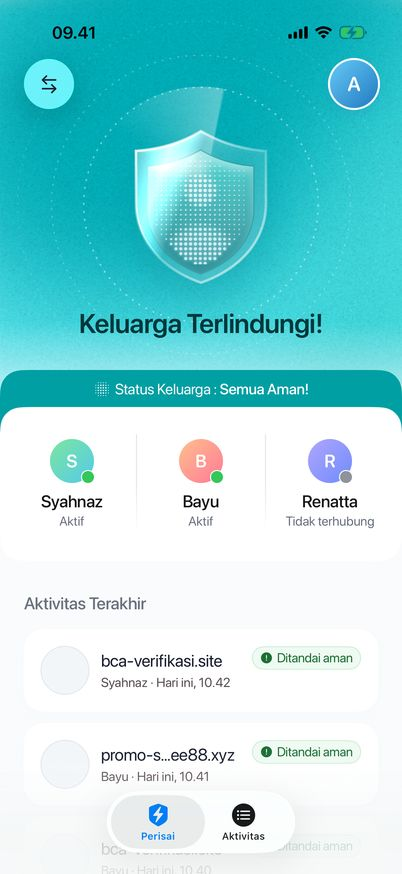<br>`home-guardian-members` | 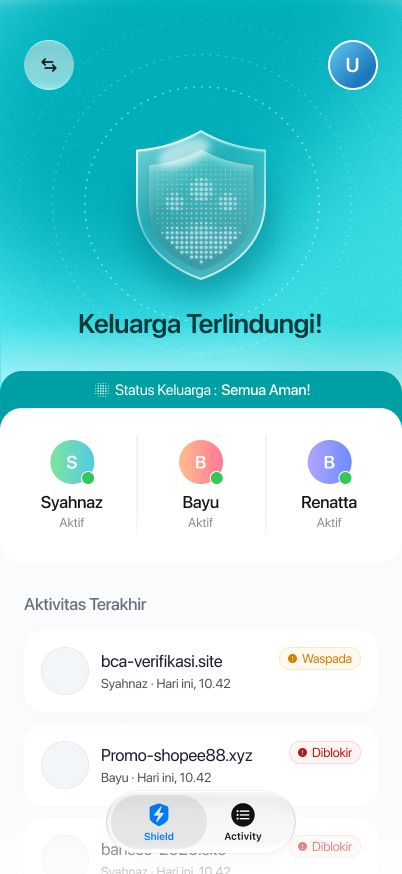 | 🟡 minor | Matches (shot `home-guardian-members`; the old map paired the waiting-site shot). Top bar sits ~19 pt lower than Figma (iOS navigation bar places it); tab labels Perisai/Aktivitas vs Figma Shield/Activity (product). |
| [Guardian/Home · Keluarga butuh konfirmasi](https://www.figma.com/design/6PgxbrY0LSkcdaJ5u4YBJP/-CH7--Shoo-Scam-App?node-id=435-20899)<br>`435:20899` | 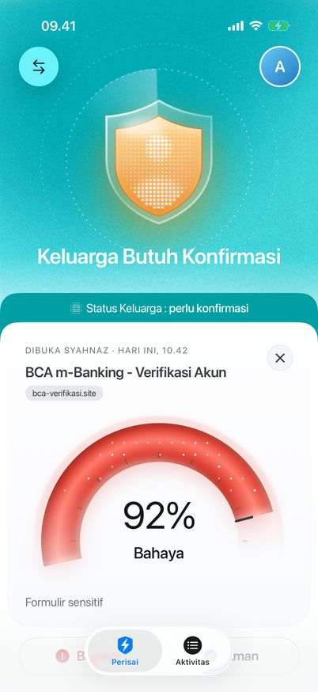<br>`home-guardian-pending` | 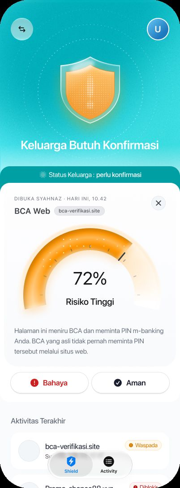 | 🟡 minor | Matches: eyebrow "DIBUKA SYAHNAZ · HARI INI, 10.42", 18 pt title, chip, 237 pt gauge, Bahaya/Aman with Figma's spread −3 shadow. Top bar sits ~19 pt lower than Figma (iOS navigation bar places it); tab labels Perisai/Aktivitas vs Figma Shield/Activity (product). |
| [Guardian/Home · Belum ada orang](https://www.figma.com/design/6PgxbrY0LSkcdaJ5u4YBJP/-CH7--Shoo-Scam-App?node-id=435-20630)<br>`435:20630` | 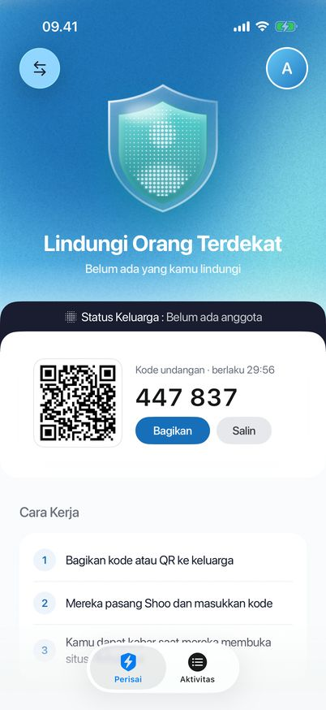<br>`home-guardian-empty` | 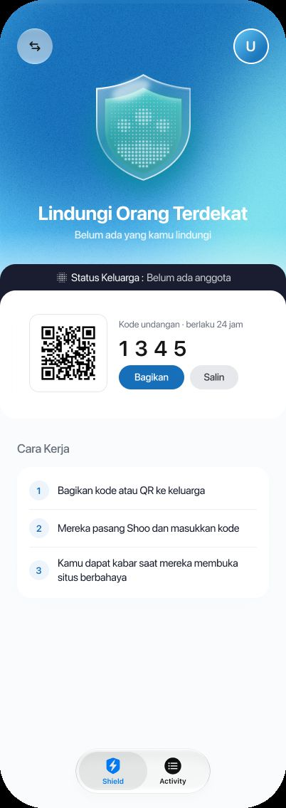 | 🟡 minor | Matches: blue-teal hero, no rings, invite card, QR, code spacing. Top bar sits ~19 pt lower than Figma (iOS navigation bar places it); tab labels Perisai/Aktivitas vs Figma Shield/Activity (product). Mock gives a 6-digit code. |
| [protected/Home](https://www.figma.com/design/6PgxbrY0LSkcdaJ5u4YBJP/-CH7--Shoo-Scam-App?node-id=441-2736)<br>`441:2736` | 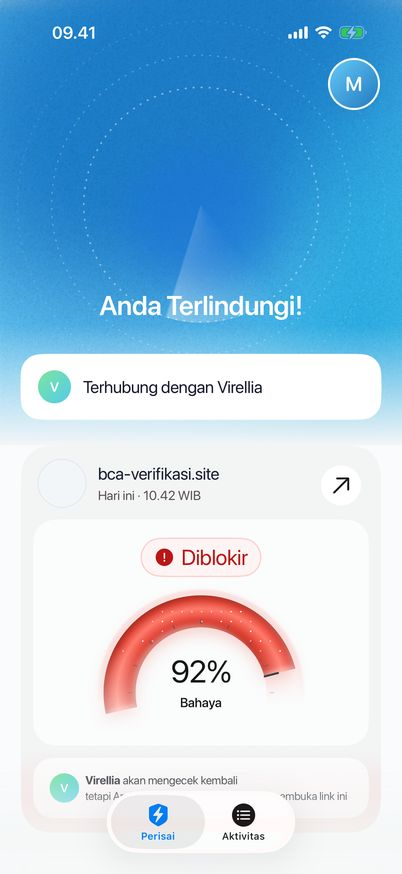<br>`home-protected` | 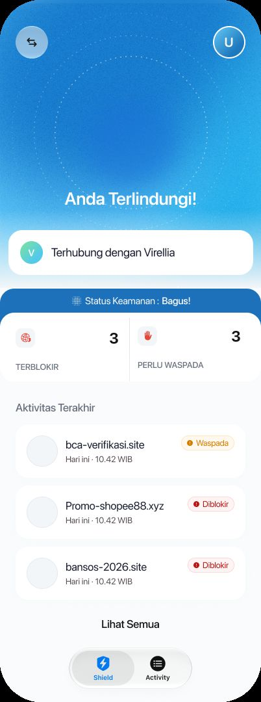 | 🟠 gap | Alternative protected Home (status strip, Terblokir / Perlu Waspada tiles). The app builds 441:3800; designer to say which one is final. |
| [protected/Home · Lihat semua di atas](https://www.figma.com/design/6PgxbrY0LSkcdaJ5u4YBJP/-CH7--Shoo-Scam-App?node-id=441-3063)<br>`441:3063` | <br>`home-protected` | 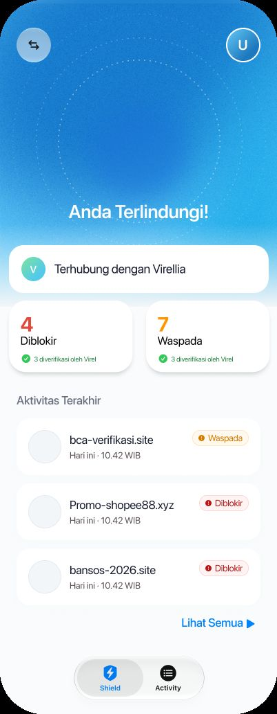 | 🟠 gap | Alternative protected Home (wider card, 11 pt gap). The app builds 441:3800; designer to say which one is final. |
| [protected/Home · Kartu diblokir 92%](https://www.figma.com/design/6PgxbrY0LSkcdaJ5u4YBJP/-CH7--Shoo-Scam-App?node-id=441-3800)<br>`441:3800` | <br>`home-protected` | 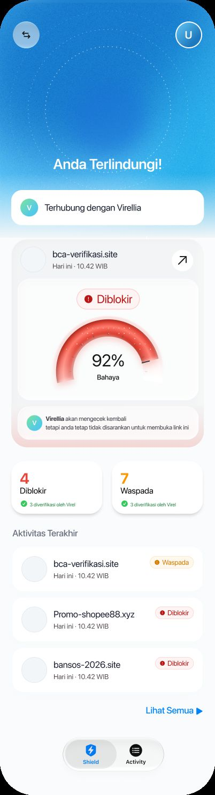 | 🟡 minor | Matches: hero glow only (no shield, as Figma), 26 pt column spacing, blocked card with 242 pt gauge and two-line note, count tiles. Top bar sits ~19 pt lower than Figma (iOS navigation bar places it); tab labels Perisai/Aktivitas vs Figma Shield/Activity (product). |
| [protected/Home · Kartu diblokir 92% (bawah)](https://www.figma.com/design/6PgxbrY0LSkcdaJ5u4YBJP/-CH7--Shoo-Scam-App?node-id=441-4414)<br>`441:4414` | 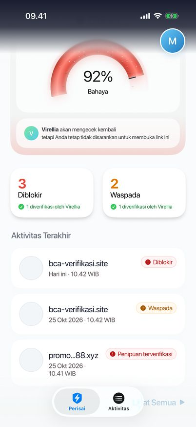<br>`home-protected-2` | 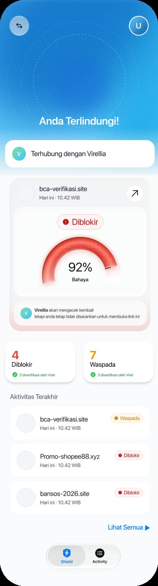 | 🟡 minor | Same as 441:3800 (scrolled). |

## ONBOARDING

| Frame | App now | Figma | Status | Note |
|---|---|---|---|---|
| [Splash Screen](https://www.figma.com/design/6PgxbrY0LSkcdaJ5u4YBJP/-CH7--Shoo-Scam-App?node-id=110-3585)<br>`110:3585` | —<br>`—` |  | 🟡 minor | Figma frame is an empty white frame; the app keeps its brand splash. |
| [Onboarding 1](https://www.figma.com/design/6PgxbrY0LSkcdaJ5u4YBJP/-CH7--Shoo-Scam-App?node-id=110-3692)<br>`110:3692` | 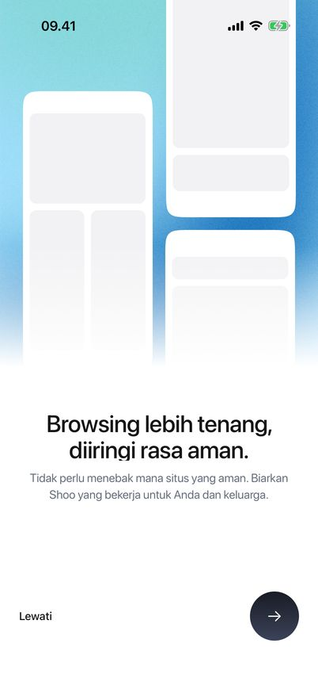<br>`on-splash-1` | 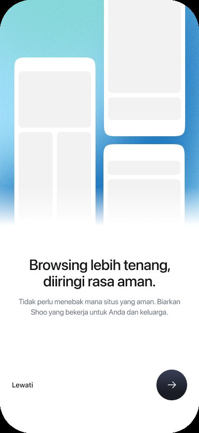 | ✅ match | Matches (arrow size, button position, no button shadow). |
| [Onboarding 2](https://www.figma.com/design/6PgxbrY0LSkcdaJ5u4YBJP/-CH7--Shoo-Scam-App?node-id=110-3786)<br>`110:3786` | 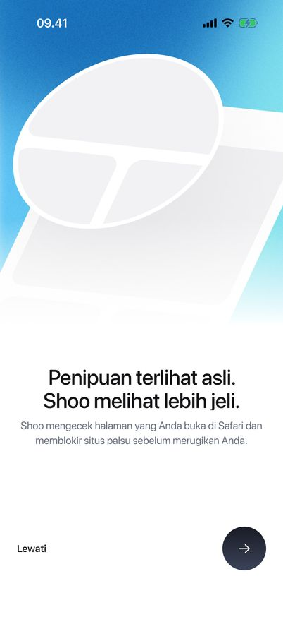<br>`on-splash-2` | 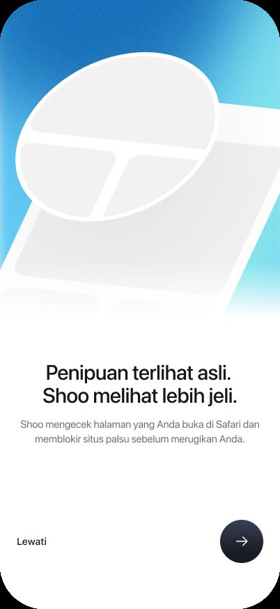 | ✅ match | Matches. |
| [Atur Nama · kosong](https://www.figma.com/design/6PgxbrY0LSkcdaJ5u4YBJP/-CH7--Shoo-Scam-App?node-id=110-3912)<br>`110:3912` | 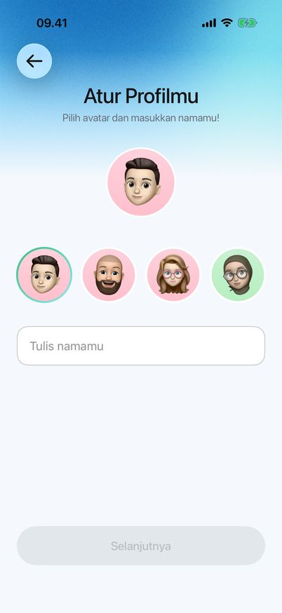<br>`on-name` | 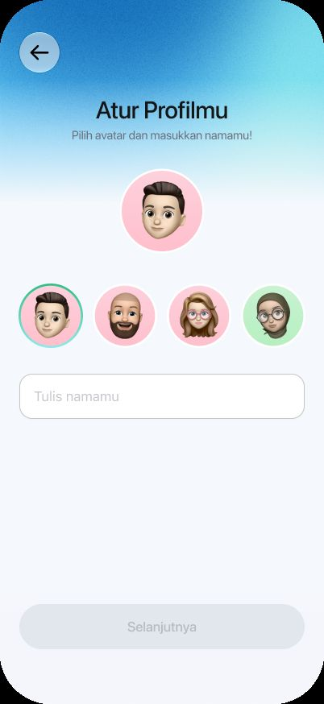 | ✅ match | Matches: headline y 120, Figma line heights (iOS 26+), body #6A717E. |
| [Atur Nama · mengetik](https://www.figma.com/design/6PgxbrY0LSkcdaJ5u4YBJP/-CH7--Shoo-Scam-App?node-id=110-4023)<br>`110:4023` | 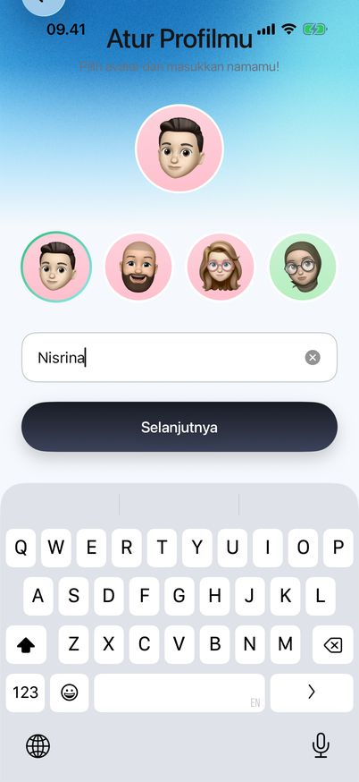<br>`on-name-typed` | 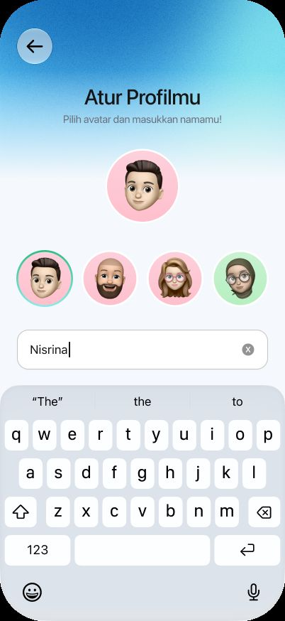 | ✅ match | Matches. |
| [Atur Nama · nama terlalu panjang](https://www.figma.com/design/6PgxbrY0LSkcdaJ5u4YBJP/-CH7--Shoo-Scam-App?node-id=110-4271)<br>`110:4271` | 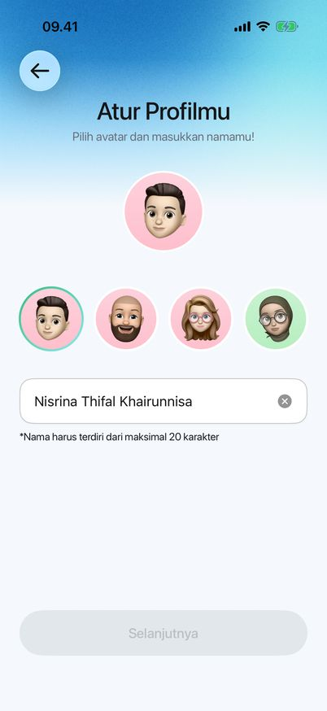<br>`on-name-tooLong` | 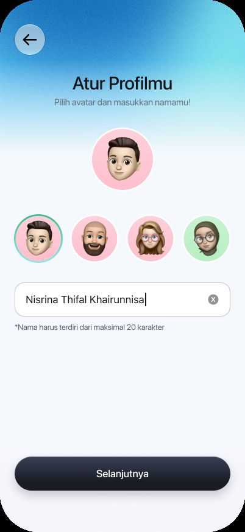 | 🟡 minor | Shot added. Note text matches; the app keeps Selanjutnya disabled per the 1–20 rule (Figma shows it enabled). |
| [Choose Mode](https://www.figma.com/design/6PgxbrY0LSkcdaJ5u4YBJP/-CH7--Shoo-Scam-App?node-id=110-4345)<br>`110:4345` | 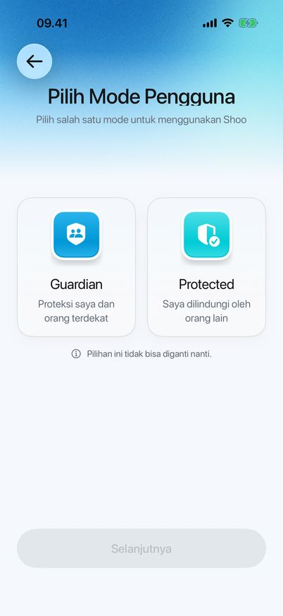<br>`on-mode` | 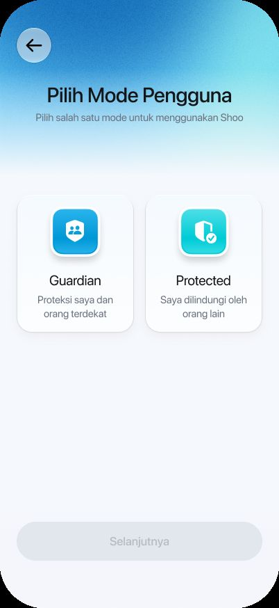 | 🟡 minor | Matches layout and colours. App adds "Pilihan ini tidak bisa diganti nanti."; Figma's chosen card is 2 pt bigger, the app keeps both the same size. |
| [Choose Mode - Guardian](https://www.figma.com/design/6PgxbrY0LSkcdaJ5u4YBJP/-CH7--Shoo-Scam-App?node-id=110-4558)<br>`110:4558` | 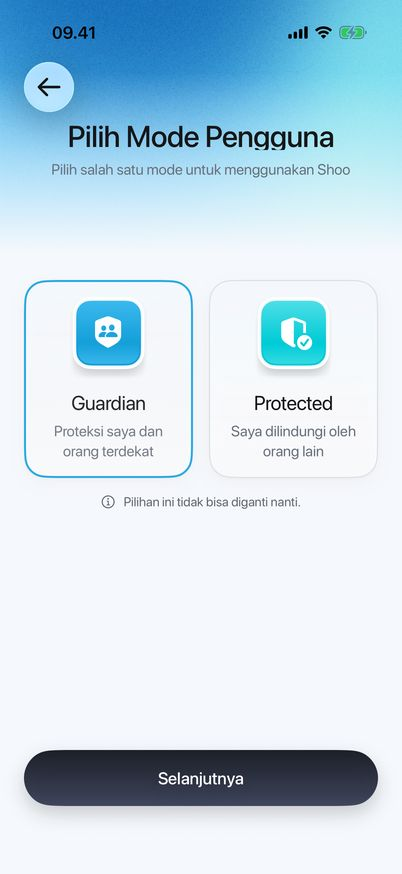<br>`on-mode-guardian` | 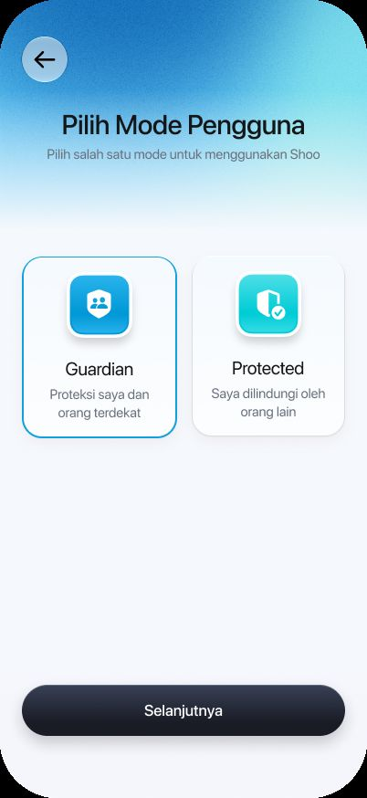 | ✅ match | Matches (2 pt blue border). |
| [Choose Mode - Protected](https://www.figma.com/design/6PgxbrY0LSkcdaJ5u4YBJP/-CH7--Shoo-Scam-App?node-id=110-4605)<br>`110:4605` | 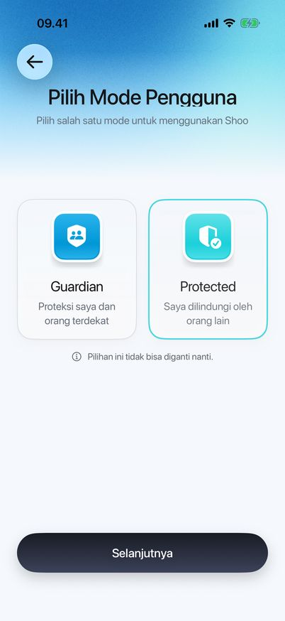<br>`on-mode-protected` | 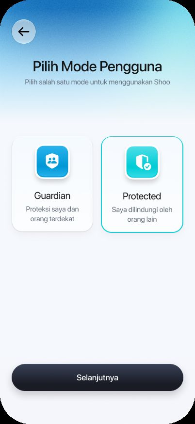 | ✅ match | Shot added; matches (2 pt teal border). |
| [Connect with Guardian · Pindai QR](https://www.figma.com/design/6PgxbrY0LSkcdaJ5u4YBJP/-CH7--Shoo-Scam-App?node-id=140-5762)<br>`140:5762` | 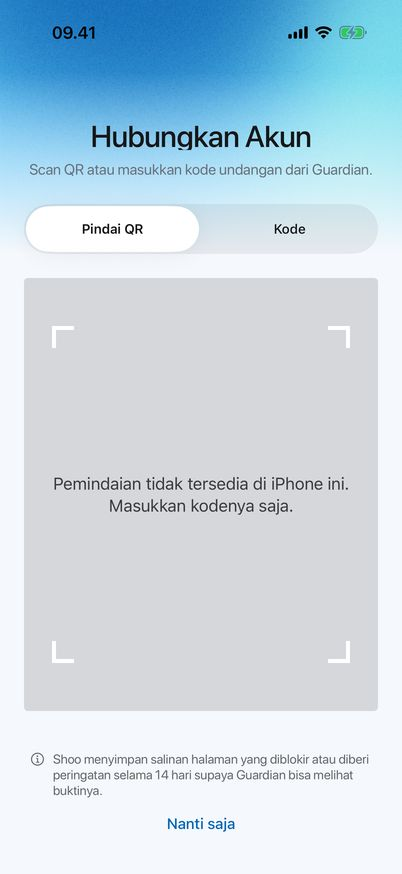<br>`on-connect-qr` | 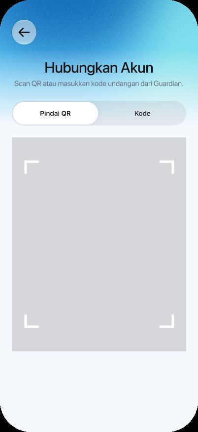 | ✅ match | Shot added on the QR tab; matches. |
| [Connect with Guardian · Kode](https://www.figma.com/design/6PgxbrY0LSkcdaJ5u4YBJP/-CH7--Shoo-Scam-App?node-id=141-5887)<br>`141:5887` | 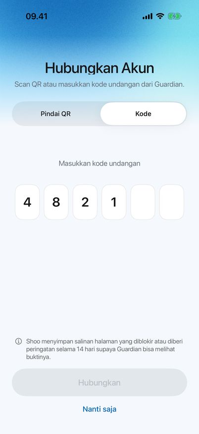<br>`on-connect-typed` | 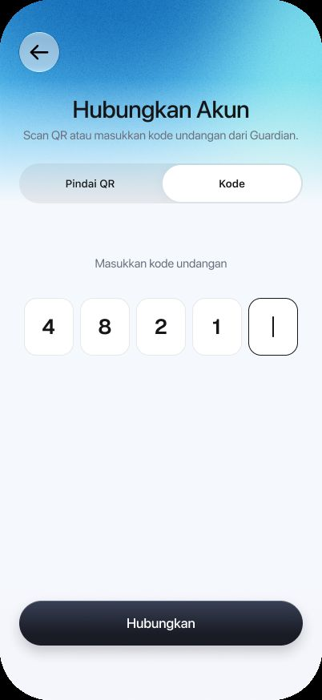 | 🟡 minor | 72 pt code boxes, 8 pt gaps, tab shadow match. 6 boxes (API code) vs Figma 5; Figma's code font Geist needs `project.yml` (lead); the 14-day note and Nanti saja are app extras. |
| [Kode Kadaluarsa · QR](https://www.figma.com/design/6PgxbrY0LSkcdaJ5u4YBJP/-CH7--Shoo-Scam-App?node-id=205-1081)<br>`205:1081` | 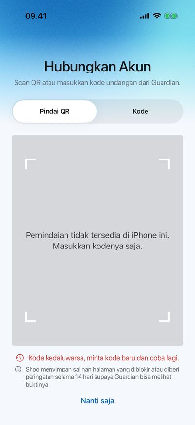<br>`on-connect-expired-qr` |  | 🟡 minor | Shot added; same code-box notes as 141:5887. |
| [Kode Kadaluarsa · Kode](https://www.figma.com/design/6PgxbrY0LSkcdaJ5u4YBJP/-CH7--Shoo-Scam-App?node-id=205-1182)<br>`205:1182` | 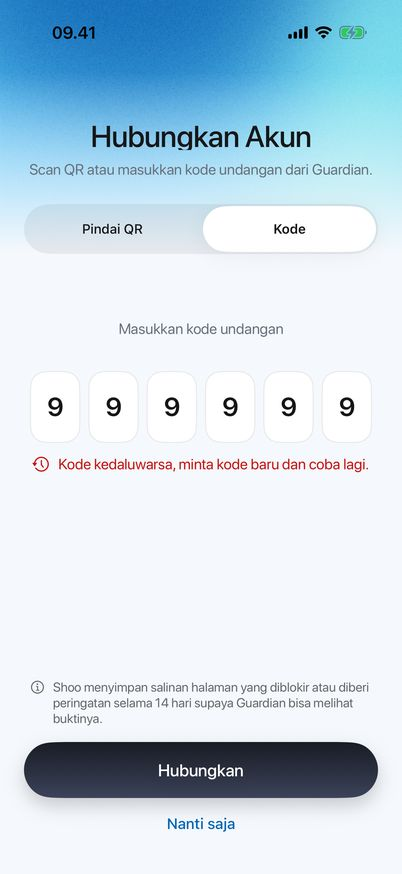<br>`on-connect-expired` |  | 🟡 minor | Now shows "Kode kedaluwarsa, minta kode baru dan coba lagi." Same code-box notes as 141:5887. |
| [Aktifkan Ekstensi](https://www.figma.com/design/6PgxbrY0LSkcdaJ5u4YBJP/-CH7--Shoo-Scam-App?node-id=110-4440)<br>`110:4440` | 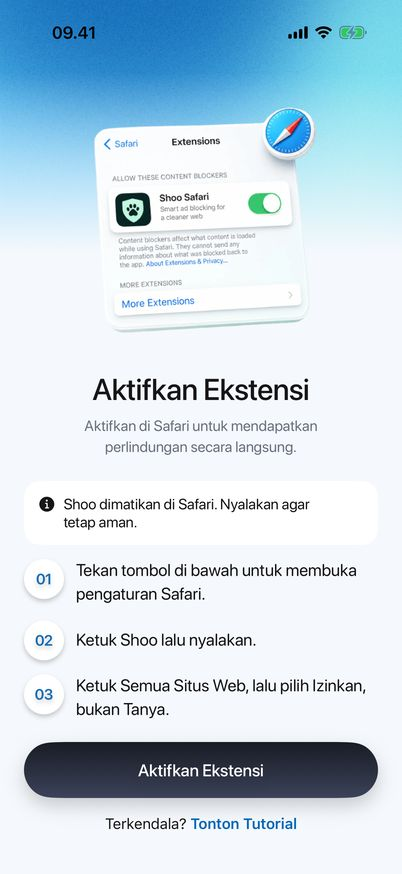<br>`on-turnOnExtension` | 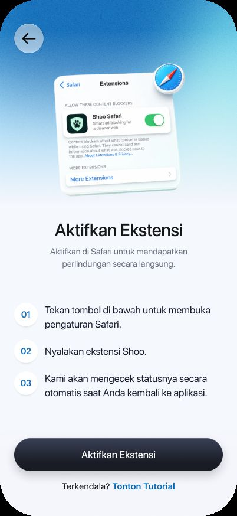 | 🟡 minor | Shot with the extension off. "Aktifkan Ekstensi" copy, "Terkendala? Tonton Tutorial" match; step text per iOS version and the "Shoo dimatikan" hint are app extras. |
| [Ekstensi aktif](https://www.figma.com/design/6PgxbrY0LSkcdaJ5u4YBJP/-CH7--Shoo-Scam-App?node-id=126-5678)<br>`126:5678` | 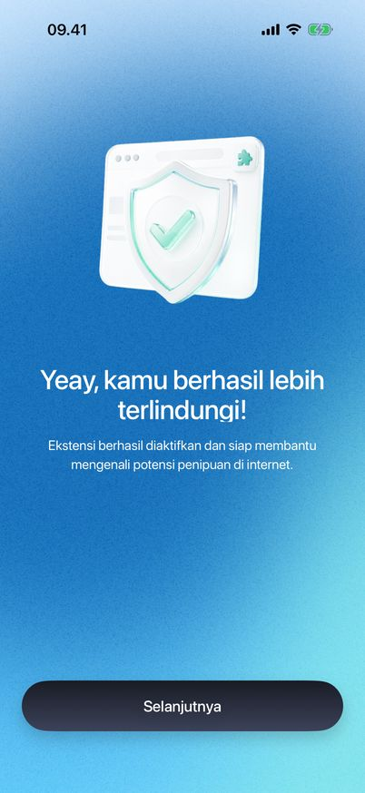<br>`on-extensionOn` | 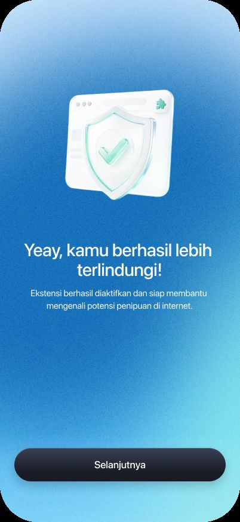 | ✅ match | Matches. |
| [Berhasil Terhubung](https://www.figma.com/design/6PgxbrY0LSkcdaJ5u4YBJP/-CH7--Shoo-Scam-App?node-id=141-5945)<br>`141:5945` | 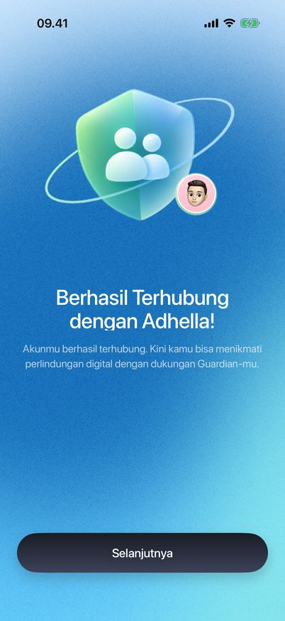<br>`on-connected` | 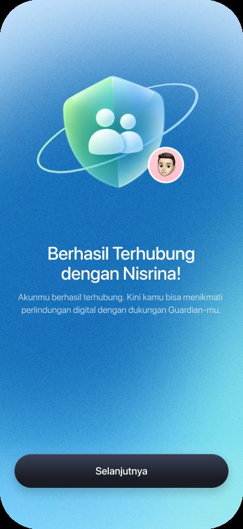 | ✅ match | Shot added (scenario `unpaired`); matches. |
| [Undang keluarga](https://www.figma.com/design/6PgxbrY0LSkcdaJ5u4YBJP/-CH7--Shoo-Scam-App?node-id=110-4779)<br>`110:4779` | 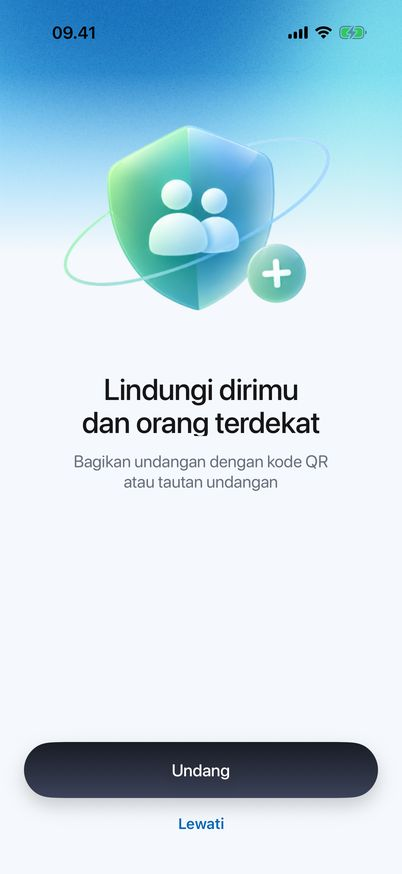<br>`on-invite` | 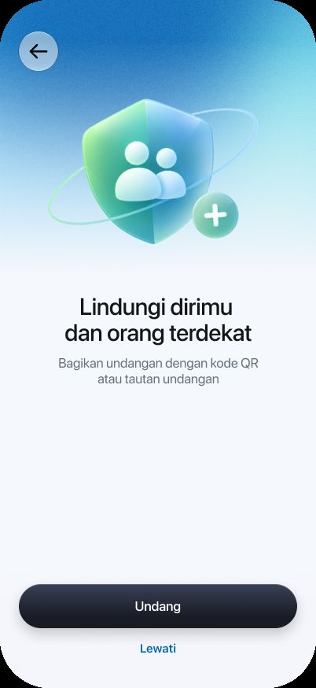 | ✅ match | Matches (80 pt avatars, 2.67 pt rings). |
| [Kirim Undangan (sheet)](https://www.figma.com/design/6PgxbrY0LSkcdaJ5u4YBJP/-CH7--Shoo-Scam-App?node-id=110-4817)<br>`110:4817` | 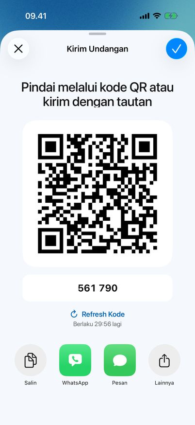<br>`on-invite-sheet` | 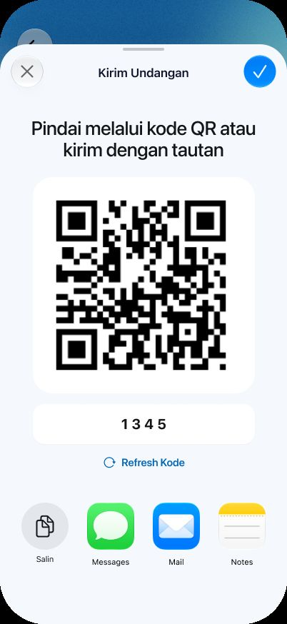 | 🟡 minor | Shot added. Spacing and QR size match; share row is WhatsApp / Pesan / Lainnya (Figma: Messages / Mail / Notes) and the countdown is an app extra. Figma code has 4 digits; the app uses 6. |

## Activity

| Frame | App now | Figma | Status | Note |
|---|---|---|---|---|
| [Aktivitas - Profil Pribadi](https://www.figma.com/design/6PgxbrY0LSkcdaJ5u4YBJP/-CH7--Shoo-Scam-App?node-id=416-8541)<br>`416:8541` | 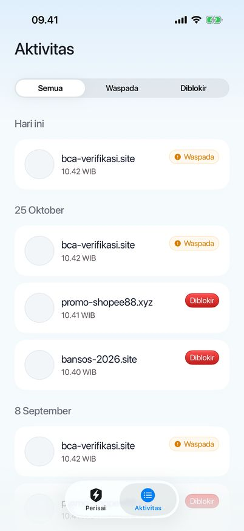<br>`act-pribadi` | 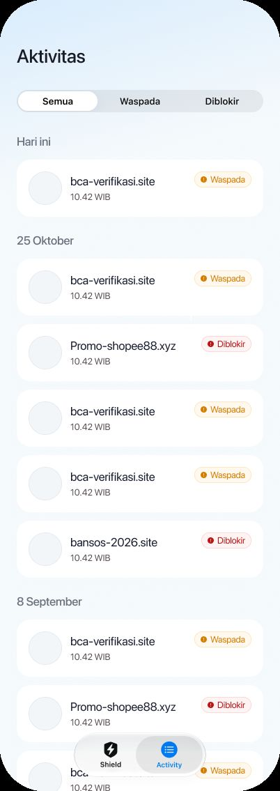 | 🟡 minor | v1 frame: outlined Diblokir pill. The app follows the newer 450:8443 (solid pill). |
| [Aktivitas - Profil Pribadi : Filtered](https://www.figma.com/design/6PgxbrY0LSkcdaJ5u4YBJP/-CH7--Shoo-Scam-App?node-id=416-8669)<br>`416:8669` | 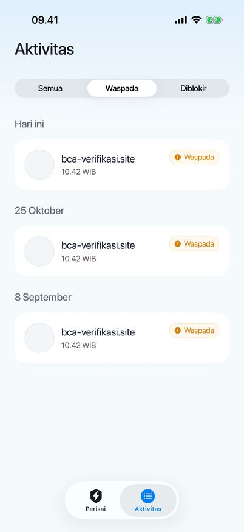<br>`act-pribadi-warning` | 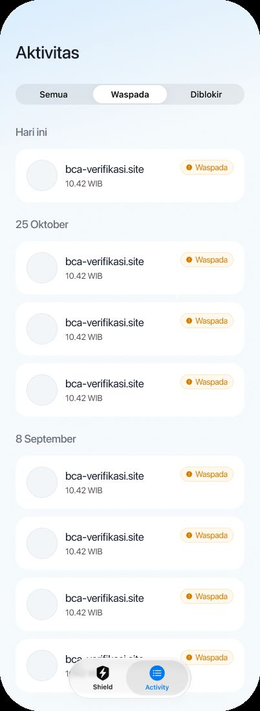 | ✅ match | Matches. |
| [Aktivitas - Profil Pribadi (v2, catatan Guardian)](https://www.figma.com/design/6PgxbrY0LSkcdaJ5u4YBJP/-CH7--Shoo-Scam-App?node-id=450-8443)<br>`450:8443` | <br>`act-protected` |  | ✅ match | Matches: solid Diblokir pill without icon, note card 118 pt. |
| [Aktivitas - Profil Pribadi : Filtered (v2)](https://www.figma.com/design/6PgxbrY0LSkcdaJ5u4YBJP/-CH7--Shoo-Scam-App?node-id=450-8574)<br>`450:8574` | <br>`act-protected-warning` |  | ✅ match | Matches (shot `act-protected-warning`; the old map used the scrolled Semua list). |
| [Aktivitas - Profil Pribadi : Filtered (v2)](https://www.figma.com/design/6PgxbrY0LSkcdaJ5u4YBJP/-CH7--Shoo-Scam-App?node-id=450-8657)<br>`450:8657` | <br>`act-protected-blocked` |  | ✅ match | Matches (shot `act-protected-blocked`). |
| [Aktivitas - Profil Guardian](https://www.figma.com/design/6PgxbrY0LSkcdaJ5u4YBJP/-CH7--Shoo-Scam-App?node-id=416-8768)<br>`416:8768` | <br>`act-guardian` |  | 🟡 minor | Matches. The person button is real iOS 26 glass, whiter than Figma's. |
| [Aktivitas - Profil Guardian / Only one selected](https://www.figma.com/design/6PgxbrY0LSkcdaJ5u4YBJP/-CH7--Shoo-Scam-App?node-id=416-8989)<br>`416:8989` | <br>`act-guardian-one` |  | ✅ match | Shot added; matches. |
| [Picker](https://www.figma.com/design/6PgxbrY0LSkcdaJ5u4YBJP/-CH7--Shoo-Scam-App?node-id=416-9208)<br>`416:9208` | <br>`act-guardian-picker` |  | ✅ match | Shot added; matches (menu padding 10, shadow black 25 % y 8 blur 48). |
| [Aktivitas · Semua · Belum ada aktivitas](https://www.figma.com/design/6PgxbrY0LSkcdaJ5u4YBJP/-CH7--Shoo-Scam-App?node-id=480-5490)<br>`480:5490` | <br>`act-empty-all` |  | ✅ match | Matches (140 % text half-leading, 296 pt width). |
| [Aktivitas · Waspada · Kosong](https://www.figma.com/design/6PgxbrY0LSkcdaJ5u4YBJP/-CH7--Shoo-Scam-App?node-id=480-5520)<br>`480:5520` | <br>`act-empty-warning` |  | ✅ match | Matches. |
| [Aktivitas · Diblokir · Kosong](https://www.figma.com/design/6PgxbrY0LSkcdaJ5u4YBJP/-CH7--Shoo-Scam-App?node-id=480-5550)<br>`480:5550` | <br>`act-empty-blocked` |  | ✅ match | Matches. |
| [Aktivitas · Semua · Perlindungan mati](https://www.figma.com/design/6PgxbrY0LSkcdaJ5u4YBJP/-CH7--Shoo-Scam-App?node-id=480-5580)<br>`480:5580` | <br>`act-off` |  | ✅ match | Matches. |
| [Guardian/Detail Aktivitas (Bahaya)](https://www.figma.com/design/6PgxbrY0LSkcdaJ5u4YBJP/-CH7--Shoo-Scam-App?node-id=416-9255)<br>`416:9255` | <br>`dt-blocked` |  | 🟡 minor | Score Card, chips, contribution bar and footer match. Header sits ~26 pt lower (the Figma frame has no status bar); the "Salinan halaman" caption is the page-copy feature, not in Figma. |
| [Guardian/Detail Aktivitas, sebelum di cek](https://www.figma.com/design/6PgxbrY0LSkcdaJ5u4YBJP/-CH7--Shoo-Scam-App?node-id=487-4221)<br>`487:4221` | <br>`dt-protected` |  | 🟡 minor | "Virellia belum melihat link ini" banner built; shot `dt-protected` (Protected owner view). Same header offset as 416:9255. |
| [Guardian/Detail Aktivitas Setelah Validasi](https://www.figma.com/design/6PgxbrY0LSkcdaJ5u4YBJP/-CH7--Shoo-Scam-App?node-id=416-9362)<br>`416:9362` | <br>`dt-validated` |  | 🟡 minor | Verified card matches. Figma puts "Kontribusi" over the photo here; the app follows the newer frames (under the photo). |
| [Guardian/Detail Aktivitas Waspada](https://www.figma.com/design/6PgxbrY0LSkcdaJ5u4YBJP/-CH7--Shoo-Scam-App?node-id=416-9469)<br>`416:9469` | <br>`dt-warning` |  | 🟡 minor | Same as 416:9362. |
| [Guardian/Detail Aktivitas Waspada (v2, tanpa pemilik)](https://www.figma.com/design/6PgxbrY0LSkcdaJ5u4YBJP/-CH7--Shoo-Scam-App?node-id=487-5990)<br>`487:5990` | <br>`dt-protected-warning` |  | 🟡 minor | Shot `dt-protected-warning` (no owner chip, no buttons). Same Kontribusi note as 416:9362. If the frame means a guardian's own scan, hiding Aman/Bahaya is a product decision (#190). |
| [Guardian/Detail Aktivitas · Ditandai Aman](https://www.figma.com/design/6PgxbrY0LSkcdaJ5u4YBJP/-CH7--Shoo-Scam-App?node-id=480-5768)<br>`480:5768` | <br>`dt-safe` |  | ✅ match | Matches: chips 6 pt apart, 30 pt blue chip, centred owner note. |
| [Catatan/Guardian memilih Aman](https://www.figma.com/design/6PgxbrY0LSkcdaJ5u4YBJP/-CH7--Shoo-Scam-App?node-id=480-5924)<br>`480:5924` | <br>`dt-protected-safe` |  | ✅ match | Matches. |
| [Bukti Foto — Highlight](https://www.figma.com/design/6PgxbrY0LSkcdaJ5u4YBJP/-CH7--Shoo-Scam-App?node-id=416-10831)<br>`416:10831` | <br>`dt-blocked-2` |  | ✅ match | Matches. |
| [Catatan · sudah dicek, bahaya](https://www.figma.com/design/6PgxbrY0LSkcdaJ5u4YBJP/-CH7--Shoo-Scam-App?node-id=450-8734)<br>`450:8734` | <br>`act-protected` |  | ✅ match | Matches. |
| [Catatan · belum dicek](https://www.figma.com/design/6PgxbrY0LSkcdaJ5u4YBJP/-CH7--Shoo-Scam-App?node-id=450-8739)<br>`450:8739` | <br>`act-protected` |  | ✅ match | Matches. |
| [Catatan · sudah dicek, aman](https://www.figma.com/design/6PgxbrY0LSkcdaJ5u4YBJP/-CH7--Shoo-Scam-App?node-id=450-8744)<br>`450:8744` | <br>`act-protected-2` |  | ✅ match | Matches. |

## Profile

| Frame | App now | Figma | Status | Note |
|---|---|---|---|---|
| [Profile/Guardian](https://www.figma.com/design/6PgxbrY0LSkcdaJ5u4YBJP/-CH7--Shoo-Scam-App?node-id=416-10447)<br>`416:10447` | <br>`pf-guardian` |  | ✅ match | Matches: 32 pt under the header card, pills, Renatta at 50 % when off. |
| [Profile/Guardian · Belum ada orang](https://www.figma.com/design/6PgxbrY0LSkcdaJ5u4YBJP/-CH7--Shoo-Scam-App?node-id=480-5353)<br>`480:5353` | <br>`pf-guardian-empty` |  | ✅ match | Matches. |
| [Profile/Pribadi](https://www.figma.com/design/6PgxbrY0LSkcdaJ5u4YBJP/-CH7--Shoo-Scam-App?node-id=416-10338)<br>`416:10338` | <br>`pf-pribadi` |  | 🟠 gap | Perlindungan shows "Ekstensi Safari · Aktif" as text; Figma has two switches (Ekstensi Safari, Blokir situs berbahaya). Feature decision. |
| [Profile/Pribadi · Ajak jadi Guardian](https://www.figma.com/design/6PgxbrY0LSkcdaJ5u4YBJP/-CH7--Shoo-Scam-App?node-id=480-5227)<br>`480:5227` | <br>`pf-pribadi-2` |  | ✅ match | Matches (card shadow added). |
| [Profile/Pribadi (v2, terhubung Virellia)](https://www.figma.com/design/6PgxbrY0LSkcdaJ5u4YBJP/-CH7--Shoo-Scam-App?node-id=455-10275)<br>`455:10275` | <br>`pf-protected` |  | 🟡 minor | Matches pill, stats and Terhubung card. Figma shows a letter "U" avatar for Protected (app: memoji); "Ekstensi Safari" chevron left off (row does nothing); Figma's Akun spacing differs between the two v2 frames. |
| [Profile/Pribadi (v2, layar pertama)](https://www.figma.com/design/6PgxbrY0LSkcdaJ5u4YBJP/-CH7--Shoo-Scam-App?node-id=455-10571)<br>`455:10571` | <br>`pf-protected` |  | 🟡 minor | Same as 455:10275. |
| [Guardian/Detail Orang Dilindungi](https://www.figma.com/design/6PgxbrY0LSkcdaJ5u4YBJP/-CH7--Shoo-Scam-App?node-id=416-10574)<br>`416:10574` | <br>`pf-member` |  | ✅ match | Matches: no avatar shadow, status pill, chips, "Aktivitas terbaru · Lihat semua". |
| [Guardian/Detail Orang Dilindungi · Putuskan](https://www.figma.com/design/6PgxbrY0LSkcdaJ5u4YBJP/-CH7--Shoo-Scam-App?node-id=416-10676)<br>`416:10676` | <br>`pf-member-disconnect` |  | ✅ match | Matches (the floating sheet is iOS chrome). |
| [Pengaturan/Mode akun](https://www.figma.com/design/6PgxbrY0LSkcdaJ5u4YBJP/-CH7--Shoo-Scam-App?node-id=455-9515)<br>`455:9515` | <br>`pf-protected-connection` |  | 🟡 minor | This frame is the Protected "Akun Tertaut" page, now shot as `pf-protected-connection`. Switches show "Segera hadir" (behind flag #183); Figma says "You" in the Indonesian UI. |
| [Pengaturan/Mode akun (pilihan lain)](https://www.figma.com/design/6PgxbrY0LSkcdaJ5u4YBJP/-CH7--Shoo-Scam-App?node-id=457-10896)<br>`457:10896` | <br>`pf-protected-connection` |  | 🟡 minor | Same as 455:9515. |
| [Pengaturan/Kelola profil (v2)](https://www.figma.com/design/6PgxbrY0LSkcdaJ5u4YBJP/-CH7--Shoo-Scam-App?node-id=462-11043)<br>`462:11043` | <br>`pf-protected-manage` |  | 🟡 minor | Shot `pf-protected-manage`; matches except the letter-avatar question in 455:10275. |
| [Pengaturan/Kelola profil](https://www.figma.com/design/6PgxbrY0LSkcdaJ5u4YBJP/-CH7--Shoo-Scam-App?node-id=416-12854)<br>`416:12854` | <br>`pf-manage` |  | 🟠 gap | Missing "Akun · Perangkat terhubung" row (feature). "Ubah foto" is app-only; username has no chevron (not editable). |
| [Pengaturan/Notifikasi (v2)](https://www.figma.com/design/6PgxbrY0LSkcdaJ5u4YBJP/-CH7--Shoo-Scam-App?node-id=455-9627)<br>`455:9627` | <br>`pf-protected-notifications` |  | 🟡 minor | Shot `pf-protected-notifications`. "Akun Terhubung" is behind flag #183. |
| [Pengaturan/Notifikasi](https://www.figma.com/design/6PgxbrY0LSkcdaJ5u4YBJP/-CH7--Shoo-Scam-App?node-id=416-12916)<br>`416:12916` | <br>`pf-notifications` |  | 🟡 minor | Matches; the "Notifikasi mati" banner shows because the test leaves permission undecided. |
| [Pengaturan/Bahasa (v2)](https://www.figma.com/design/6PgxbrY0LSkcdaJ5u4YBJP/-CH7--Shoo-Scam-App?node-id=455-9697)<br>`455:9697` | <br>`pf-language` |  | ✅ match | Matches (Bahasa Indonesia first). |
| [Pengaturan/Bahasa](https://www.figma.com/design/6PgxbrY0LSkcdaJ5u4YBJP/-CH7--Shoo-Scam-App?node-id=416-12986)<br>`416:12986` | <br>`pf-language` |  | ✅ match | Matches. |
| [Pengaturan/Tema (v2)](https://www.figma.com/design/6PgxbrY0LSkcdaJ5u4YBJP/-CH7--Shoo-Scam-App?node-id=455-9718)<br>`455:9718` | <br>`pf-theme` |  | ✅ match | Matches: theme previews, Efek section. |
| [Pengaturan/Tema](https://www.figma.com/design/6PgxbrY0LSkcdaJ5u4YBJP/-CH7--Shoo-Scam-App?node-id=416-13007)<br>`416:13007` | <br>`pf-theme` |  | ✅ match | Matches. |
| [Pengaturan/Aksesibilitas (v2)](https://www.figma.com/design/6PgxbrY0LSkcdaJ5u4YBJP/-CH7--Shoo-Scam-App?node-id=455-9785)<br>`455:9785` | <br>`pf-accessibility` |  | ✅ match | Matches: slider rail and settings rows. |
| [Pengaturan/Aksesibilitas](https://www.figma.com/design/6PgxbrY0LSkcdaJ5u4YBJP/-CH7--Shoo-Scam-App?node-id=416-13074)<br>`416:13074` | <br>`pf-accessibility` |  | ✅ match | Matches. |
| [Pengaturan/Tentang Shoo (v2)](https://www.figma.com/design/6PgxbrY0LSkcdaJ5u4YBJP/-CH7--Shoo-Scam-App?node-id=455-9858)<br>`455:9858` | <br>`pf-about` |  | 🟡 minor | Matches; the version number comes from the build. |
| [Pengaturan/Tentang Shoo](https://www.figma.com/design/6PgxbrY0LSkcdaJ5u4YBJP/-CH7--Shoo-Scam-App?node-id=416-13147)<br>`416:13147` | <br>`pf-about` |  | 🟡 minor | Same as 455:9858. |

## AI vs GUARDIAN - EKSPLORASI

| Frame | App now | Figma | Status | Note |
|---|---|---|---|---|
| [Protected/Detail · Dibuka Guardian · Opsi 1](https://www.figma.com/design/6PgxbrY0LSkcdaJ5u4YBJP/-CH7--Shoo-Scam-App?node-id=487-7897)<br>`487:7897` | <br>`dt-protected-safe` |  | 🟠 gap | Exploration Opsi 1 (Protected sees "Virellia menandai situs ini aman · Blokir dibuka", AI first score 92, "Tetap hati-hati"). The app shows the gauge with "Ditandai aman oleh Virellia" and the verified card. |
| [Protected/Detail · Dibuka Guardian · Opsi 2](https://www.figma.com/design/6PgxbrY0LSkcdaJ5u4YBJP/-CH7--Shoo-Scam-App?node-id=487-8620)<br>`487:8620` | <br>`dt-protected-safe` |  | 🟠 gap | Exploration Opsi 2: same as 487:7897. |

## Test 1 — mock variants

Same screens with other data. Run: `TEST_RUNNER_QA_SCENARIO=<name> TEST_RUNNER_QA_SHOT_DIR=… xcodebuild test -only-testing:ShooAppUITests/FigmaParityUITests`.

### `mixedVerdicts` — Every verdict state: blocked/warning × none / safe / not safe

| `home-guardian` | `home-protected` | `act-guardian` | `act-protected` | `pf-guardian` |
|---|---|---|---|---|
|  |  |  |  |  |

### `heavy` — 3 members, 60 scans over 30 days, counters past 999

| `home-guardian` | `home-protected` | `act-guardian` | `act-protected` | `pf-guardian` | `dt-first` |
|---|---|---|---|---|---|
|  |  |  |  |  |  |

### `edge` — 20-character names, emoji, an 87-character domain, no title / favicon / screenshot, one signal

| `home-guardian` | `home-protected` | `act-guardian` | `act-protected` | `pf-guardian` | `dt-long` | `dt-one-signal` |
|---|---|---|---|---|---|---|
|  |  |  |  |  |  |  |

### `allSafe` — Every scan marked safe by the Guardian

| `home-guardian` | `home-protected` | `act-guardian` | `act-protected` | `pf-guardian` | `dt-safe` |
|---|---|---|---|---|---|
|  |  |  |  |  |  |

### `allBlocked` — Only blocked scans

| `home-guardian` | `home-protected` | `act-guardian` | `act-protected` | `pf-guardian` |
|---|---|---|---|---|
|  |  |  |  |  |

### `corpus` — Imelda's corpus with the detector's real scores and signals (41 scans ≥ 30)

| `home-guardian` | `home-protected` | `act-guardian` | `act-protected` | `pf-guardian` | `dt-top` | `dt-real-bsi` | `dt-real-lphone` | `dt-false-positive` |
|---|---|---|---|---|---|---|---|---|
|  |  |  |  |  |  |  |  |  |

## Test 2a — Imelda's corpus through layers 1–4 (offline)

`node ai/eval/run.mjs --analyze-url http://127.0.0.1:8788 --json --show-holdout` against `wrangler dev` of `ai/` with the LLM key in `ai/.dev.vars` and the prebuilt public blocklist (190 000 domains, `ai/scripts/build-blocklist.mjs`) in local KV. `plan/alief/qa/corpus-to-scans.mjs` turns the rows into the `corpus` scenario. No live page was opened for this test.

| | Samples | ≥ 30 (warning) | ≥ 50 | ≥ 80 (blocked) |
|---|---|---|---|---|
| Scam | 52 | 37 | 32 | 16 |
| Legit | 56 | 4 | 1 | 1 |

Targets (docs/mandates/imelda.md): 0 legit ≥ 30 — **4 found**; ≥ 90 % scam ≥ 50 — **62 %**; ≥ 70 % scam ≥ 80 — **31 %**. `/analyze` p95 6011 ms, remote failures 0. 9 samples got a layer-4 signal.

Expected per sample, from the corpus label and the thresholds in `contracts/README.md` and the targets in `docs/mandates/imelda.md`: a scam page should score **≥ 80 %** (blocked; 50 % is the floor), a legit page **< 30 %** (normal, nothing shown).

### Detector mismatches

| Sample | Label | Real? | Expected | Score | Signals |
|---|---|---|---|---|---|
| `trap-blog-cek-saldo-bca` | legit flagged | synthetic | < 30 % · Not scam (normal) | 49 | suspicious_link:L2:24, brand_logo_offsite:L3:25 |
| `trap-github-pages-dokumentasi` | legit flagged | synthetic · holdout | < 30 % · Not scam (normal) | 34 | suspicious_link:L2:19, asks_password:L3:15 |
| `trap-fintech-kyc-sah` | legit flagged | synthetic | < 30 % · Not scam (normal) | 95 | suspicious_link:L2:10, asks_selfie_ktp:L3:35, asks_ktp:L3:25, asks_otp:L3:25 |
| `trap-asuransi-klaim-resmi` | legit flagged | synthetic · holdout | < 30 % · Not scam (normal) | 35 | suspicious_link:L2:10, asks_ktp:L3:25 |
| `regs-apps14-code-php` | scam missed | real | ≥ 80 % · Scam (blocked) | 21 | suspicious_link:L2:21 |
| `fixture-bca-verifikasi` | scam missed | synthetic | ≥ 80 % · Scam (blocked) | 29 | brand_plus_keyword:L2:14, cheap_tld:L2:15 |
| `fixture-promo-shopee` | scam missed | synthetic | ≥ 80 % · Scam (blocked) | 29 | brand_plus_keyword:L2:14, cheap_tld:L2:15 |
| `fixture-bansos-kemensos` | scam missed | synthetic | ≥ 80 % · Scam (blocked) | 29 | brand_plus_keyword:L2:14, cheap_tld:L2:15 |
| `synthetic-p0stindonesia` | scam missed | synthetic | ≥ 80 % · Scam (blocked) | 25 | lookalike_domain:L2:25 |
| `syn-cimb-octo-limit` | scam missed | synthetic · holdout | ≥ 80 % · Scam (blocked) | 0 | — |
| `syn-sicepat-apk` | scam missed | synthetic | ≥ 80 % · Scam (blocked) | 5 | cheap_tld:L2:5 |
| `syn-anteraja-alamat` | scam missed | synthetic | ≥ 80 % · Scam (blocked) | 20 | asks_card:L3:20 |
| `syn-telkomsel-poin` | scam missed | synthetic | ≥ 80 % · Scam (blocked) | 25 | asks_otp:L3:25 |
| `syn-etilang-denda` | scam missed | synthetic · holdout | ≥ 80 % · Scam (blocked) | 20 | asks_card:L3:20 |
| `syn-samsat-pajak-kendaraan` | scam missed | synthetic · holdout | ≥ 80 % · Scam (blocked) | 5 | cheap_tld:L2:5 |
| `syn-find-my-iphone-hilang` | scam missed | synthetic | ≥ 80 % · Scam (blocked) | 25 | lookalike_domain:L2:10, cheap_tld:L2:15 |
| `syn-apple-pay-tagihan` | scam missed | synthetic | ≥ 80 % · Scam (blocked) | 25 | cheap_tld:L2:5, asks_card:L3:20 |
| `syn-loker-admin-online` | scam missed | synthetic | ≥ 80 % · Scam (blocked) | 0 | — |
| `syn-investasi-kripto-profit` | scam missed | synthetic | ≥ 80 % · Scam (blocked) | 0 | — |

<details><summary>All 108 samples</summary>

| Sample | Label | Real? | Expected | L1–2 | Total | Status | Signals |
|---|---|---|---|---|---|---|---|
| `bank-login-bri` | legit | real | < 30 % · Not scam (normal) | 0 | 0 | normal |  |
| `bank-login-btn` | legit | real | < 30 % · Not scam (normal) | 0 | 0 | normal |  |
| `bank-login-danamon` | legit | real | < 30 % · Not scam (normal) | 0 | 0 | normal |  |
| `bank-login-klikbca` | legit | real | < 30 % · Not scam (normal) | 0 | 0 | normal |  |
| `bank-login-mega` | legit | real · H | < 30 % · Not scam (normal) | 0 | 0 | normal |  |
| `bank-login-permata` | legit | real | < 30 % · Not scam (normal) | 0 | 0 | normal |  |
| `checkout-bukalapak` | legit | real | < 30 % · Not scam (normal) | 0 | 0 | normal |  |
| `checkout-lazada` | legit | real | < 30 % · Not scam (normal) | 0 | 0 | normal |  |
| `checkout-orami` | legit | real · H | < 30 % · Not scam (normal) | 0 | 0 | normal |  |
| `checkout-ruparupa` | legit | real | < 30 % · Not scam (normal) | 0 | 0 | normal |  |
| `checkout-shopee-cart` | legit | real · H | < 30 % · Not scam (normal) | 0 | 0 | normal |  |
| `checkout-sociolla` | legit | real | < 30 % · Not scam (normal) | 0 | 0 | normal |  |
| `checkout-tokopedia-cart` | legit | real | < 30 % · Not scam (normal) | 0 | 0 | normal |  |
| `checkout-traveloka` | legit | real · H | < 30 % · Not scam (normal) | 0 | 0 | normal |  |
| `checkout-zalora` | legit | real | < 30 % · Not scam (normal) | 0 | 0 | normal |  |
| `gov-bi` | legit | real | < 30 % · Not scam (normal) | 0 | 0 | normal |  |
| `gov-bpjs-kesehatan` | legit | real | < 30 % · Not scam (normal) | 0 | 0 | normal |  |
| `gov-dukcapil` | legit | real | < 30 % · Not scam (normal) | 0 | 0 | normal |  |
| `gov-kemensos` | legit | real | < 30 % · Not scam (normal) | 0 | 0 | normal |  |
| `gov-komdigi` | legit | real | < 30 % · Not scam (normal) | 0 | 0 | normal |  |
| `gov-ojk` | legit | real | < 30 % · Not scam (normal) | 0 | 0 | normal |  |
| `gov-pajak` | legit | real | < 30 % · Not scam (normal) | 0 | 0 | normal |  |
| `popular-cnnindonesia` | legit | real | < 30 % · Not scam (normal) | 0 | 0 | normal |  |
| `popular-detik` | legit | real | < 30 % · Not scam (normal) | 0 | 0 | normal |  |
| `popular-idntimes` | legit | real | < 30 % · Not scam (normal) | 0 | 0 | normal |  |
| `popular-kompas` | legit | real · H | < 30 % · Not scam (normal) | 0 | 0 | normal |  |
| `popular-kumparan` | legit | real | < 30 % · Not scam (normal) | 0 | 0 | normal |  |
| `popular-liputan6` | legit | real · H | < 30 % · Not scam (normal) | 0 | 0 | normal |  |
| `popular-tribunnews` | legit | real · H | < 30 % · Not scam (normal) | 0 | 0 | normal |  |
| `popular-wikipedia-id` | legit | real | < 30 % · Not scam (normal) | 0 | 0 | normal |  |
| `bank-login-bni-web` | legit | real · H | < 30 % · Not scam (normal) | 0 | 0 | normal |  |
| `bank-login-mandiri-web` | legit | real | < 30 % · Not scam (normal) | 0 | 0 | normal |  |
| `checkout-bhinneka` | legit | real · H | < 30 % · Not scam (normal) | 0 | 0 | normal |  |
| `gov-kemenkeu` | legit | real | < 30 % · Not scam (normal) | 0 | 0 | normal |  |
| `popular-merdeka` | legit | real · H | < 30 % · Not scam (normal) | 0 | 0 | normal |  |
| `official-tokopedia-home` | legit | real | < 30 % · Not scam (normal) | 0 | 0 | normal |  |
| `official-bca-home` | legit | real | < 30 % · Not scam (normal) | 0 | 0 | normal |  |
| `official-shopee-home` | legit | real | < 30 % · Not scam (normal) | 0 | 0 | normal |  |
| `popular-wikipedia` | legit | real | < 30 % · Not scam (normal) | 0 | 0 | normal |  |
| `trap-dana-sosial` | legit | syn | < 30 % · Not scam (normal) | 0 | 0 | normal |  |
| `trap-mandiri-jaya` | legit | syn | < 30 % · Not scam (normal) | 0 | 0 | normal |  |
| `trap-toko-iphone-bekas` | legit | syn · H | < 30 % · Not scam (normal) | 10 | 10 | normal | lookalike_domain:L2:10 |
| `trap-cloud-storage` | legit | syn | < 30 % · Not scam (normal) | 0 | 0 | normal |  |
| `trap-toko-logo-bank-checkout` | legit | syn · H | < 30 % · Not scam (normal) | 0 | 20 | normal | brand_logo_offsite:L3:12, urgent_language:L3:8 |
| `trap-blog-cek-saldo-bca` | legit | syn | < 30 % · Not scam (normal) | 24 | 49 | warning 1 | suspicious_link:L2:24, brand_logo_offsite:L3:25 |
| `trap-github-pages-dokumentasi` | legit | syn · H | < 30 % · Not scam (normal) | 19 | 34 | warning 1 | suspicious_link:L2:19, asks_password:L3:15 |
| `trap-sign-in-google-facebook` | legit | syn | < 30 % · Not scam (normal) | 10 | 25 | normal | suspicious_link:L2:10, asks_password:L3:15 |
| `trap-fintech-kyc-sah` | legit | syn | < 30 % · Not scam (normal) | 10 | 95 | blocked | suspicious_link:L2:10, asks_selfie_ktp:L3:35, asks_ktp:L3:25, asks_otp:L3:25 |
| `trap-berita-waspada-penipuan` | legit | syn | < 30 % · Not scam (normal) | 0 | 20 | normal | brand_logo_offsite:L3:12, urgent_language:L3:8 |
| `trap-portal-orang-tua-sekolah` | legit | syn | < 30 % · Not scam (normal) | 0 | 15 | normal | asks_password:L3:15 |
| `trap-asuransi-klaim-resmi` | legit | syn · H | < 30 % · Not scam (normal) | 10 | 35 | warning 1 | suspicious_link:L2:10, asks_ktp:L3:25 |
| `trap-toko-kopi-kartu-native` | legit | syn | < 30 % · Not scam (normal) | 0 | 20 | normal | asks_card:L3:20 |
| `trap-batik-card-checkout-en` | legit | syn | < 30 % · Not scam (normal) | 5 | 25 | normal | cheap_tld:L2:5, asks_card:L3:20 |
| `syn-sekolah-portal2` | legit | syn · H | < 30 % · Not scam (normal) | 0 | 0 | normal |  |
| `syn-toko-app3-index-php` | legit | syn | < 30 % · Not scam (normal) | 0 | 0 | normal |  |
| `syn-kampus-code-path` | legit | syn | < 30 % · Not scam (normal) | 0 | 0 | normal |  |
| `regs-apps14-code-php` | scam | real | ≥ 80 % · Scam (blocked) | 21 | 21 | normal | suspicious_link:L2:21 |
| `cusbsi-bsi-cash-management` | scam | real · H | ≥ 80 % · Scam (blocked) | 0 | 70 | warning 2 | unreasonable_request:L4:30, brand_logo_offsite:L3:25, asks_password:L3:15 |
| `lphone-login` | scam | real | ≥ 80 % · Scam (blocked) | 39 | 39 | warning 1 | lookalike_domain:L2:25, brand_plus_keyword:L2:14 |
| `fixture-bca-verifikasi` | scam | syn | ≥ 80 % · Scam (blocked) | 29 | 29 | normal | brand_plus_keyword:L2:14, cheap_tld:L2:15 |
| `fixture-promo-shopee` | scam | syn | ≥ 80 % · Scam (blocked) | 29 | 29 | normal | brand_plus_keyword:L2:14, cheap_tld:L2:15 |
| `fixture-bansos-kemensos` | scam | syn | ≥ 80 % · Scam (blocked) | 29 | 29 | normal | brand_plus_keyword:L2:14, cheap_tld:L2:15 |
| `synthetic-p0stindonesia` | scam | syn | ≥ 80 % · Scam (blocked) | 25 | 25 | normal | lookalike_domain:L2:25 |
| `syn-bri-token-expired` | scam | syn | ≥ 80 % · Scam (blocked) | 29 | 100 | blocked | brand_plus_keyword:L2:14, cheap_tld:L2:15, asks_pin:L3:35, asks_otp:L3:25, brand_logo_offsite:L3:25 |
| `syn-mandiri-livin-upgrade` | scam | syn · H | ≥ 80 % · Scam (blocked) | 29 | 100 | blocked | brand_plus_keyword:L2:14, cheap_tld:L2:15, unreasonable_request:L4:30, brand_logo_offsite:L3:25, asks_password:L3:15, urgent_language:L3:15 |
| `syn-bni-mobile-banking` | scam | syn · H | ≥ 80 % · Scam (blocked) | 25 | 100 | blocked | lookalike_domain:L2:10, cheap_tld:L2:15, unreasonable_request:L4:30, brand_logo_offsite:L3:25, asks_card:L3:20, asks_password:L3:15 |
| `syn-bsi-sharia-bonus` | scam | syn | ≥ 80 % · Scam (blocked) | 25 | 100 | blocked | lookalike_domain:L2:10, cheap_tld:L2:15, asks_pin:L3:35, unreasonable_request:L4:30, asks_ktp:L3:25, brand_logo_offsite:L3:25 |
| `syn-bca-klikbca-clean` | scam | syn | ≥ 80 % · Scam (blocked) | 0 | 80 | blocked | unreasonable_request:L4:30, asks_otp:L3:25, brand_logo_offsite:L3:25 |
| `syn-cimb-octo-limit` | scam | syn · H | ≥ 80 % · Scam (blocked) | 0 | 0 | normal |  |
| `syn-bca-blokir-kartu` | scam | syn · H | ≥ 80 % · Scam (blocked) | 14 | 89 | blocked | brand_plus_keyword:L2:14, unreasonable_request:L4:30, brand_logo_offsite:L3:25, asks_card:L3:20 |
| `syn-bri-cashback-survey` | scam | syn | ≥ 80 % · Scam (blocked) | 25 | 85 | blocked | lookalike_domain:L2:10, cheap_tld:L2:15, asks_pin:L3:35, brand_logo_offsite:L3:25 |
| `syn-mandiri-kyc-update` | scam | syn | ≥ 80 % · Scam (blocked) | 0 | 100 | blocked | asks_selfie_ktp:L3:35, unreasonable_request:L4:30, asks_ktp:L3:25, brand_logo_offsite:L3:25 |
| `syn-dana-kaget-bonus` | scam | syn | ≥ 80 % · Scam (blocked) | 29 | 100 | blocked | brand_plus_keyword:L2:14, cheap_tld:L2:15, unreasonable_request:L4:30, asks_otp:L3:25, brand_logo_offsite:L3:25 |
| `syn-ovo-upgrade-premier` | scam | syn | ≥ 80 % · Scam (blocked) | 25 | 100 | blocked | lookalike_domain:L2:10, cheap_tld:L2:15, asks_pin:L3:35, unreasonable_request:L4:30, asks_ktp:L3:25, brand_logo_offsite:L3:25 |
| `syn-gopay-driver-refund` | scam | syn | ≥ 80 % · Scam (blocked) | 29 | 100 | blocked | brand_plus_keyword:L2:14, cheap_tld:L2:15, asks_pin:L3:35, asks_otp:L3:25, brand_logo_offsite:L3:25 |
| `syn-shopeepay-limit` | scam | syn | ≥ 80 % · Scam (blocked) | 29 | 69 | warning 2 | brand_plus_keyword:L2:14, cheap_tld:L2:15, brand_logo_offsite:L3:25, asks_password:L3:15 |
| `syn-linkaja-hadiah` | scam | syn · H | ≥ 80 % · Scam (blocked) | 0 | 35 | warning 1 | asks_pin:L3:35 |
| `syn-dana-premium-pin` | scam | syn · H | ≥ 80 % · Scam (blocked) | 29 | 100 | blocked | brand_plus_keyword:L2:14, cheap_tld:L2:15, asks_pin:L3:35, asks_otp:L3:25, brand_logo_offsite:L3:25 |
| `syn-ovo-undian-grab` | scam | syn | ≥ 80 % · Scam (blocked) | 29 | 54 | warning 2 | brand_plus_keyword:L2:14, cheap_tld:L2:15, brand_logo_offsite:L3:25 |
| `syn-gopay-later-pinjam` | scam | syn | ≥ 80 % · Scam (blocked) | 5 | 90 | blocked | cheap_tld:L2:5, asks_selfie_ktp:L3:35, asks_ktp:L3:25, brand_logo_offsite:L3:25 |
| `syn-jne-paket-tertahan` | scam | syn | ≥ 80 % · Scam (blocked) | 25 | 70 | warning 2 | lookalike_domain:L2:10, cheap_tld:L2:15, brand_logo_offsite:L3:25, asks_card:L3:20 |
| `syn-jnt-tarif-selisih` | scam | syn | ≥ 80 % · Scam (blocked) | 25 | 50 | warning 2 | lookalike_domain:L2:10, cheap_tld:L2:15, brand_logo_offsite:L3:25 |
| `syn-sicepat-apk` | scam | syn | ≥ 80 % · Scam (blocked) | 5 | 5 | normal | cheap_tld:L2:5 |
| `syn-anteraja-alamat` | scam | syn | ≥ 80 % · Scam (blocked) | 0 | 20 | normal | asks_card:L3:20 |
| `syn-pos-kiriman-luar-negeri` | scam | syn | ≥ 80 % · Scam (blocked) | 25 | 50 | warning 2 | lookalike_domain:L2:25, brand_logo_offsite:L3:25 |
| `syn-tiki-nomor-resi` | scam | syn | ≥ 80 % · Scam (blocked) | 5 | 30 | warning 1 | cheap_tld:L2:5, asks_otp:L3:25 |
| `syn-ninja-ganti-rugi` | scam | syn · H | ≥ 80 % · Scam (blocked) | 5 | 40 | warning 1 | cheap_tld:L2:5, asks_pin:L3:35 |
| `syn-tokopedia-undian` | scam | syn · H | ≥ 80 % · Scam (blocked) | 29 | 69 | warning 2 | brand_plus_keyword:L2:14, cheap_tld:L2:15, brand_logo_offsite:L3:25, asks_password:L3:15 |
| `syn-telkomsel-poin` | scam | syn | ≥ 80 % · Scam (blocked) | 0 | 25 | normal | asks_otp:L3:25 |
| `syn-lazada-giveaway` | scam | syn | ≥ 80 % · Scam (blocked) | 25 | 70 | warning 2 | lookalike_domain:L2:10, cheap_tld:L2:15, brand_logo_offsite:L3:25, asks_card:L3:20 |
| `syn-shopee-flash-undian` | scam | syn | ≥ 80 % · Scam (blocked) | 29 | 54 | warning 2 | brand_plus_keyword:L2:14, cheap_tld:L2:15, brand_logo_offsite:L3:25 |
| `syn-bpjs-bonus-iuran` | scam | syn | ≥ 80 % · Scam (blocked) | 29 | 74 | warning 2 | brand_plus_keyword:L2:14, cheap_tld:L2:15, brand_logo_offsite:L3:25, asks_card:L3:20 |
| `syn-pertamina-subsidi` | scam | syn | ≥ 80 % · Scam (blocked) | 0 | 60 | warning 2 | asks_selfie_ktp:L3:35, asks_ktp:L3:25 |
| `syn-bukalapak-voucher` | scam | syn | ≥ 80 % · Scam (blocked) | 29 | 79 | warning 2 | brand_plus_keyword:L2:14, cheap_tld:L2:15, asks_otp:L3:25, brand_logo_offsite:L3:25 |
| `syn-bpjs-kesehatan-nonaktif` | scam | syn · H | ≥ 80 % · Scam (blocked) | 25 | 75 | warning 2 | lookalike_domain:L2:10, cheap_tld:L2:15, asks_ktp:L3:25, brand_logo_offsite:L3:25 |
| `syn-pajak-djp-sptp` | scam | syn | ≥ 80 % · Scam (blocked) | 29 | 69 | warning 2 | brand_plus_keyword:L2:14, cheap_tld:L2:15, brand_logo_offsite:L3:25, asks_password:L3:15 |
| `syn-etilang-denda` | scam | syn · H | ≥ 80 % · Scam (blocked) | 0 | 20 | normal | asks_card:L3:20 |
| `syn-samsat-pajak-kendaraan` | scam | syn · H | ≥ 80 % · Scam (blocked) | 5 | 5 | normal | cheap_tld:L2:5 |
| `syn-prakerja-gelombang` | scam | syn | ≥ 80 % · Scam (blocked) | 0 | 85 | blocked | asks_selfie_ktp:L3:35, asks_ktp:L3:25, asks_otp:L3:25 |
| `syn-dukcapil-ktp-digital` | scam | syn | ≥ 80 % · Scam (blocked) | 0 | 85 | blocked | asks_selfie_ktp:L3:35, asks_ktp:L3:25, asks_otp:L3:25 |
| `syn-kemensos-bansos-pkh` | scam | syn | ≥ 80 % · Scam (blocked) | 14 | 99 | blocked | brand_plus_keyword:L2:14, asks_pin:L3:35, asks_ktp:L3:25, brand_logo_offsite:L3:25 |
| `syn-icloud-terkunci` | scam | syn | ≥ 80 % · Scam (blocked) | 29 | 69 | warning 2 | brand_plus_keyword:L2:14, cheap_tld:L2:15, asks_otp:L3:25, asks_password:L3:15 |
| `syn-find-my-iphone-hilang` | scam | syn | ≥ 80 % · Scam (blocked) | 25 | 25 | normal | lookalike_domain:L2:10, cheap_tld:L2:15 |
| `syn-apple-pay-tagihan` | scam | syn | ≥ 80 % · Scam (blocked) | 5 | 25 | normal | cheap_tld:L2:5, asks_card:L3:20 |
| `syn-loker-admin-online` | scam | syn | ≥ 80 % · Scam (blocked) | 0 | 0 | normal |  |
| `syn-pinjol-cair-cepat` | scam | syn | ≥ 80 % · Scam (blocked) | 5 | 65 | warning 2 | cheap_tld:L2:5, asks_selfie_ktp:L3:35, asks_ktp:L3:25 |
| `syn-investasi-kripto-profit` | scam | syn | ≥ 80 % · Scam (blocked) | 0 | 0 | normal |  |
| `syn-olx-pembeli-cod` | scam | syn · H | ≥ 80 % · Scam (blocked) | 0 | 45 | warning 1 | asks_otp:L3:25, asks_card:L3:20 |

</details>

## Test 2b/2c — live, two simulators on a local stack built like prod

| Part | Local | Prod |
|---|---|---|
| API | `wrangler dev` of `backend/api` on :8787, `--test-scheduled` | Worker `shoo-api` |
| Database + Storage | `supabase start` + `supabase db reset` (all migrations, RLS) | Supabase project |
| Replicas | local R2 (Miniflare) | R2 `shoo-replicas` |
| AI layers 3–4 | `wrangler dev` of `ai/` on :8788, same LLM provider as prod, prebuilt blocklist in local KV | Worker `shoo-ai` |
| Push | APNs **sandbox**, new team key (AK7HLX5ZX5), topic `com.aliefauzan.shoo` | APNs |
| App | Debug build, `-debug.aiBaseURL http://localhost:8788` (new, Debug only) | Release |

Pairing (`LiveQAUITests`): Adhella (Guardian, "QA Guardian iPhone 17") and Maria (Protected, "QA Protected iPhone 17") onboard in Bahasa Indonesia, Maria joins with the code on Adhella's screen, both answer the real notification prompt. The Protected Safari has Shoo on with *All Websites: Allow*.

Guardrails: only corpus URLs, simulator only, page load only (no typing, no taps on the page, no downloads). Hosts were checked by DNS first: **45 of 108 resolve** (43 legit, 2 scam). The 50 scam hosts that don't resolve (all synthetic + one real) are covered by 2a only (2c).

45 pages opened (43 legit, 2 scam). 1 reached the server as a scan (score ≥ 30), 1 Guardian push attempt(s) in push_log.

| Sample | Label | 2a score | What the Safari shot shows | Scan on server | Guardian push |
|---|---|---|---|---|---|
| `regs-apps14-code-php` | scam | 21 | **46% Waspada banner** ("Asks for the code sent to your phone"), copy in English | 46 warning | failed:network |
| `lphone-login` | scam | 39 | redirects to the real icloud.com Find Devices; 0% badge (cloaked kit) | none | — |

<details><summary>43 legit pages</summary>

| Sample | Label | 2a score | What the Safari shot shows | Scan on server | Guardian push |
|---|---|---|---|---|---|
| `bank-login-bri` | legit | 0 | 0% badge | none | — |
| `bank-login-btn` | legit | 0 | 0% badge | none | — |
| `bank-login-danamon` | legit | 0 | page still blank at 15 s, no badge yet | none | — |
| `bank-login-klikbca` | legit | 0 | 0% badge | none | — |
| `bank-login-mega` | legit | 0 | 0% badge | none | — |
| `bank-login-permata` | legit | 0 | 0% badge | none | — |
| `checkout-bukalapak` | legit | 0 | 0% badge | none | — |
| `checkout-lazada` | legit | 0 | 0% badge | none | — |
| `checkout-orami` | legit | 0 | 0% badge | none | — |
| `checkout-ruparupa` | legit | 0 | 0% badge (Safari location prompt on top, left unanswered) | none | — |
| `checkout-shopee-cart` | legit | 0 | 0% badge (Safari location prompt on top, left unanswered) | none | — |
| `checkout-sociolla` | legit | 0 | 0% badge (Safari location prompt on top, left unanswered) | none | — |
| `checkout-tokopedia-cart` | legit | 0 | 0% badge (Safari location prompt on top, left unanswered) | none | — |
| `checkout-traveloka` | legit | 0 | 0% badge (Safari location prompt on top, left unanswered) | none | — |
| `checkout-zalora` | legit | 0 | 0% badge (Safari location prompt on top, left unanswered) | none | — |
| `gov-bi` | legit | 0 | 0% badge (Safari location prompt on top, left unanswered) | none | — |
| `gov-bpjs-kesehatan` | legit | 0 | 0% badge (Safari location prompt on top, left unanswered) | none | — |
| `gov-dukcapil` | legit | 0 | 0% badge (Safari location prompt on top, left unanswered) | none | — |
| `gov-kemensos` | legit | 0 | 0% badge (Safari location prompt on top, left unanswered) | none | — |
| `gov-komdigi` | legit | 0 | 0% badge (Safari location prompt on top, left unanswered) | none | — |
| `gov-ojk` | legit | 0 | 0% badge (Safari location prompt on top, left unanswered) | none | — |
| `gov-pajak` | legit | 0 | 0% badge (Safari location prompt on top, left unanswered) | none | — |
| `popular-cnnindonesia` | legit | 0 | 0% badge (Safari location prompt on top, left unanswered) | none | — |
| `popular-detik` | legit | 0 | 0% badge (Safari location prompt on top, left unanswered) | none | — |
| `popular-idntimes` | legit | 0 | 0% badge (Safari location prompt on top, left unanswered) | none | — |
| `popular-kompas` | legit | 0 | 0% badge (Safari location prompt on top, left unanswered) | none | — |
| `popular-kumparan` | legit | 0 | 0% badge (Safari location prompt on top, left unanswered) | none | — |
| `popular-liputan6` | legit | 0 | 0% badge (Safari location prompt on top, left unanswered) | none | — |
| `popular-tribunnews` | legit | 0 | 0% badge (Safari location prompt on top, left unanswered) | none | — |
| `popular-wikipedia-id` | legit | 0 | 0% badge (Safari location prompt on top, left unanswered) | none | — |
| `bank-login-bni-web` | legit | 0 | 0% badge (Safari location prompt on top, left unanswered) | none | — |
| `bank-login-mandiri-web` | legit | 0 | 0% badge (Safari location prompt on top, left unanswered) | none | — |
| `checkout-bhinneka` | legit | 0 | 0% badge (Safari location prompt on top, left unanswered) | none | — |
| `gov-kemenkeu` | legit | 0 | 0% badge (Safari location prompt on top, left unanswered) | none | — |
| `popular-merdeka` | legit | 0 | 0% badge (Safari location prompt on top, left unanswered) | none | — |
| `official-tokopedia-home` | legit | 0 | 0% badge (Safari location prompt on top, left unanswered) | none | — |
| `official-bca-home` | legit | 0 | 0% badge (Safari location prompt on top, left unanswered) | none | — |
| `official-shopee-home` | legit | 0 | 0% badge (Safari location prompt on top, left unanswered) | none | — |
| `popular-wikipedia` | legit | 0 | 0% badge (Safari location prompt on top, left unanswered) | none | — |
| `trap-cloud-storage` | legit | 0 | redirects to a sedo.com parking page; small 0% badge | none | — |
| `trap-blog-cek-saldo-bca` | legit | 49 | blog post now 404; 0% badge | none | — |
| `trap-github-pages-dokumentasi` | legit | 34 | GitHub Pages 404; small 0% badge | none | — |
| `trap-berita-waspada-penipuan` | legit | 20 | "Safari can’t open the page" (no server); badge dot only | none | — |

</details>

What happened, in order:

1. **Legit pages**: every page that loaded shows the green **0%** badge; none reached the server (only scores ≥ 30 are posted). The 4 legit traps that 2a flagged no longer serve their page (404, parking page, no server), so live they score 0.
2. **`regs-apps14.regnows-dfg.com/code.php`** (real scam, still up): the extension shows the **46% Waspada** banner, and the scan reaches the server with `asks_otp` (layer 3) + `suspicious_link` (layer 2). Offline it scored 21: the live page asks for an OTP, the corpus copy does not.
3. **`lphone-login.com`** (real scam, 39 offline): the host now redirects to the real `icloud.com` Find Devices page, so live it is a clean Apple page at 0%. A cloaked kit: only the offline copy shows the phishing form.
4. **No Guardian push on the first visit**: both devices were in *Jam tenang* (22:00–06:00, device zone Asia/Makassar, visit at 22:40). Warnings are muted then by design (PF-01, `notify.ts allowed()`); only blocked sites still push. After turning `quiet_hours` off in the local DB and reloading the page once, the Worker tried both pushes (Guardian + Maria's own) and logged **`failed:network`**: `wrangler dev` (workerd on the Mac) cannot speak HTTP/2, and APNs only takes HTTP/2. Production sends straight from the deployed Worker (spike passed in fase 07, D-alief-B01), so this is a limit of the local stack, not of prod. The app side of the push was checked with `xcrun simctl push` and the same payload the Worker builds (`pushText`, `scanId`).
5. **Guardian Activity is empty after pairing**: Adhella paired with Maria, but Family mode stays off until the Guardian switches it on from Home, so Activity shows only her own (empty) list. With `-settings.familyModeOn YES` both of Maria's scans show with her name, and Detail opens with the 46% gauge.
6. **Two rows for one page**: the second load of the same page made a second scan 1 min later; Activity lists both.
7. A Safari *Allow location?* prompt (from `ruparupa.com`) stayed on screen for the rest of the run; it was left unanswered during the visit and answered **Don't Allow** at the end. It covers part of the later shots but not the badge logic.
8. **Crons** fired by hand (`/cdn-cgi/handler/scheduled?cron=0+19+*+*+*` and `cron=5+*+*+*+*`): both 200, `ops_heartbeat` row written; nothing older than 14 days to delete on a fresh database.

| Safari · regs-apps14-code-php | Safari · lphone-login | Safari · bank-login-klikbca | Guardian Activity, Family mode off | Guardian Activity, Family mode on | Guardian Home | Guardian Detail | Guardian push (simctl) | Protected Activity | Protected Home |
|---|---|---|---|---|---|---|---|---|---|
|  |  |  |  |  |  |  |  |  |  |

## Re-run

```bash
# Figma frames (TalkToFigma plugin open in the file, channel joined)
node plan/alief/qa/figma-export.mjs plan/alief/qa/img/figma-parity/figma <channel>
# Test 1 + 2a screenshots
TEST_RUNNER_QA_SCENARIO=figma TEST_RUNNER_QA_SHOT_DIR=$PWD/plan/alief/qa/img/figma-parity/app xcodebuild test -project ios/Shoo.xcodeproj -scheme Shoo -destination 'platform=iOS Simulator,name=iPhone 17' -only-testing:ShooAppUITests/FigmaParityUITests
# Test 2a data
npx --prefix ai wrangler dev --cwd ai --port 8788 &
node ai/eval/run.mjs --analyze-url http://127.0.0.1:8788 --json --show-holdout > /tmp/corpus-eval.json && node plan/alief/qa/corpus-to-scans.mjs /tmp/corpus-eval.json
# Test 2b: pair, then visit
TEST_RUNNER_QA_LIVE=1 TEST_RUNNER_QA_PAIR_DIR=/tmp/pair xcodebuild test … -only-testing:ShooAppUITests/LiveQAUITests/testGuardianPairs   # Guardian sim
TEST_RUNNER_QA_LIVE=1 TEST_RUNNER_QA_PAIR_DIR=/tmp/pair xcodebuild test … -only-testing:ShooAppUITests/LiveQAUITests/testProtectedJoins  # Protected sim
bash plan/alief/qa/live-visit.sh <protected-udid>
# then write live/observations.json from the shots, and
node plan/alief/qa/live-results.mjs
node plan/alief/qa/figma-parity-report.mjs
```
