# Goldfish UX pass — what still feels odd or hard (21 Nov 2026)

Report only. No code changed. Build: `origin/main` d63beef8 (after #636, #640, #642, #644). Language `id`. Mock mode.

Every finding shows its screenshots. All 49 are at the end ([All screenshots, in order](#all-screenshots-in-order)).

## Keputusan Alief setelah review Figma (21 Nov 2026)

Figma: frame elephant–goldfish `2423:4227`.

- **F2:** konfirmasi juga untuk QR. Setelah QR undangan terbaca, dialog "Gabung dengan keluarga …?" yang sama muncul sebelum terhubung (kolom "Usulan · lewat QR").
- **F4:** tidak perlu. Kartu dihapus dari Figma.
- **F6:** ulang dari langkah onboarding yang belum selesai. Ini bisa dideteksi:
  - App tahu sudah daftar tapi onboarding belum selesai: `settings.mode` terisi dan `onboardingCompleted` false (OnboardingModel.swift:97-104).
  - App bisa membaca status ekstensi: saklar Safari ditambah heartbeat (`ExtensionStatus.nextStep`).
  - Ekstensi belum menyala, atau belum "Izinkan" untuk semua situs: kembali ke Aktifkan Ekstensi.
  - Ekstensi sudah menyala: ke Jadikan Safari Default. Browser default tidak bisa dibaca, jadi app menyimpan tanda setelah langkah ini selesai.
  - Setelah itu layar sukses dengan dialog "Nyalakan notifikasi?", lalu Home.
- **F7:** ditolak. Pesan undangan tetap seperti sekarang.
- **F8:** kartu "Punya kode undangan?" ada di bawah kartu Mode Guardian, bukan di atasnya.
- **C2 / C3:** jangan pakai "Shoo mati", karena bisa dikira aplikasinya terhapus atau kuotanya habis.
  - Status anggota jadi "Ekstensi aktif" / "Ekstensi tidak aktif".
  - Backend hanya tahu "tidak ada heartbeat ekstensi 24 jam" (`extensionActive`, families.ts:75-81), jadi penyebabnya tidak bisa dipastikan.
  - Detail anggota menampilkan apa yang perlu dicek di HP anggota:
    1. Safari › Ekstensi › Shoo menyala dan diizinkan untuk semua situs.
    2. Safari dipakai: Shoo baru mengirim kabar saat Safari dipakai.
    3. HP tersambung internet, dan aplikasi Shoo masih terpasang.
  - Kalau nanti mau dibedakan lebih tepat, `allSites` perlu dikirim ke backend. Itu perubahan kontrak, jadi lewat Lead.
- **V3:** pilihan A diberi visual di sheet modus, berupa contoh SMS link palsu, lalu situs palsu yang meminta PIN.
- **V10:** di Home yang masih kosong, ikon perisai abu-abu diganti maskot Shoo dengan pose kaca pembesar ("Shoo lagi berjaga"). Alief memilih pilihan A, jadi pose jempol tidak dipakai.
  - Teks: "Shoo lagi berjaga. Kalau ada web mencurigakan, akan muncul di sini."
- **V8:** label tetap di bawah teks dan ikonnya centang. Ukuran mengikuti praktik umum iOS:
  - jarak 8 pt dari teks di atasnya;
  - tinggi 24 pt;
  - teks 13 pt (minimal 11 pt);
  - ikon 12 pt;
  - padding kiri-kanan 8 pt, jarak ikon-teks 4 pt;
  - radius 12 pt;
  - kontras teks minimal 4.5:1.

## Method (Google elephant–goldfish model)

- **Goldfish**: one fresh subagent. It had no code, no PRD, no history. It saw only the 49 simulator screenshots and [log.txt](img/goldfish-21nov/log.txt), which lists the tap behind each screenshot. Persona: a naive Indonesian adult who installed a scam blocker. It paraphrased the app first, then listed stumbles by screen with Blocker / Major / Nit.
- **Elephant**: this session. It holds the code, the PRD, the 19 Nov audit ([egm-audit-2026-11-19.md](egm-audit-2026-11-19.md)) and the recent PRs. It checked every stumble against code and decisions. It tagged each one:
  - **PROPOSE FIX**: real; fix given.
  - **ESCALATE**: real for the user, but a decision outside the screen (Figma, Alief, lead) set it.
  - **CONTEST**: the screens show something the goldfish missed.
  - **DECLINE**: mock or simulator artefact.
- Comprehension gaps were not contested, and severities were not changed. Blocker → **blocker**, Major → **confusing**, Nit → **polish**.
- Setup: own simulator "Shoo Goldfish iPhone 17 Pro" (iOS 27.0), own DerivedData, `-UITestMock YES -settings.language id`. Scenarios: reset, `homePribadi`, `empty`, `standard`. `-UITestExtensionStatus someSitesOnly` / `-UITestExtensionActive YES` for the ON-04 return states.
- Flows walked:
  - Onboarding: name, ON-04 with the consent box, Safari default, success.
  - Home Pribadi.
  - Becoming Guardian: ⇆, intro, invite, Bagikan.
  - Joining: Profil › Mode akun › Punya kode undangan.
  - Activity.
  - Blocked and warning detail, then Tandai aman.
  - Profile.
  - Disconnecting a member.
  - Mode switch.

Not raised again (decided or in progress):
- Settings opens at the root (Apple bug; see the `open-ext-settings` note).
- Skipping the tutorial.
- Call or chat from a notification.
- Telling the family a site is safe (#640 shipped).
- L3 on the App Store build.
- Banner shield icon.
- "Mode Terawasi" card on Pribadi Home after being Guardian.

**Cara baca kolom Elephant**
- **Perlu diperbaiki**: masalah nyata, ada saran perbaikannya.
- **Perlu keputusan (desain)**: disengaja oleh Figma atau keputusan tim. Perbaikannya butuh keputusan dulu.
- **Sebagian benar / sebagian bukan masalah**: sebagian keluhan goldfish berasal dari data contoh (mock), sebagian masalah asli.
- Baris kecil "Kode: …" untuk developer: file yang perlu diubah.

## Flow is hard

| # | Screen | Goldfish (own words) | Elephant: kenapa terjadi | Severity | Cara memperbaiki |
|---|---|---|---|---|---|
| F1 | <a href="img/goldfish-21nov/38-safe-sheet.png">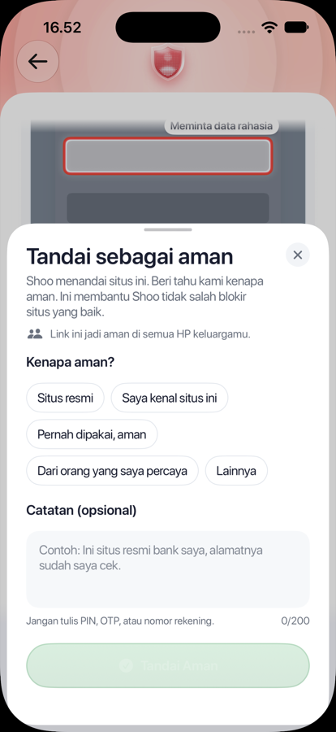</a> 38 <a href="img/goldfish-21nov/39-after-safe.png">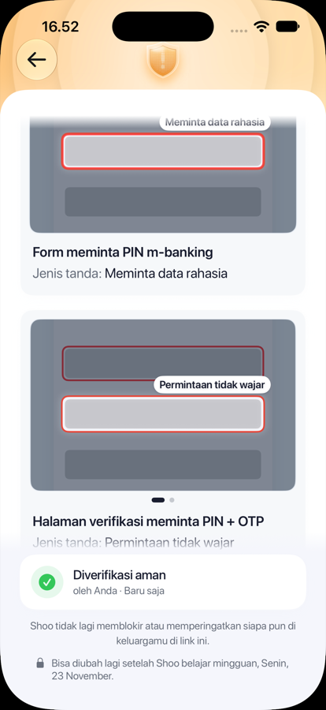</a> 39 Tandai aman on a 92/100 BCA phish | "I can whitelist a fake BCA login page for my whole family with two taps." "Only after the fact: 'Bisa diubah lagi setelah Shoo belajar mingguan, Senin, 23 November'. I can't undo my mistake for days." | **Perlu diperbaiki.** Layar 'Tandai aman' tidak bilang dua hal penting. (1) Tanda aman berlaku untuk semua HP keluarga; ini cuma satu baris abu-abu kecil. (2) Setelah disimpan, tidak bisa diubah sampai Senin. Tidak ada pertanyaan 'yakin?', padahal skor Shoo 92/100. Sejak PR #640 tanda aman berlaku untuk seluruh keluarga, jadi salah tap sekali jadi lebih berbahaya. Kode: SafeReasonSheet.swift | blocker | Di atas tombol, tulis jelas: "Berlaku untuk semua HP keluargamu. Tidak bisa diubah sampai {tanggal}." Kalau skor 80 ke atas, tanya sekali lagi: "Shoo yakin ini penipuan. Tetap tandai aman?" |
| F2 | <a href="img/goldfish-21nov/29-join-code.png">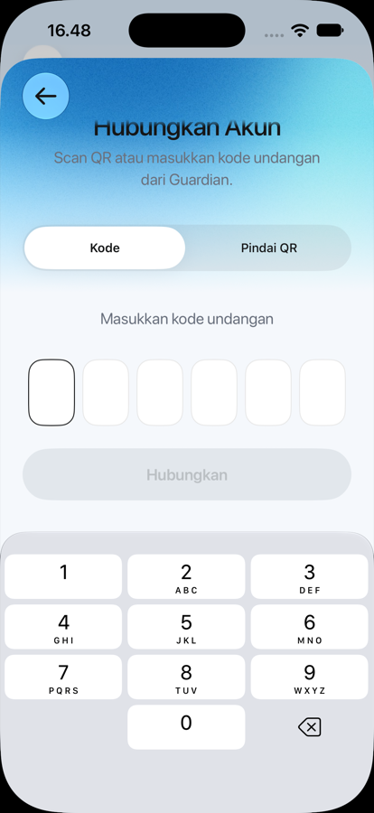</a> 29 <a href="img/goldfish-21nov/31-join-success.png">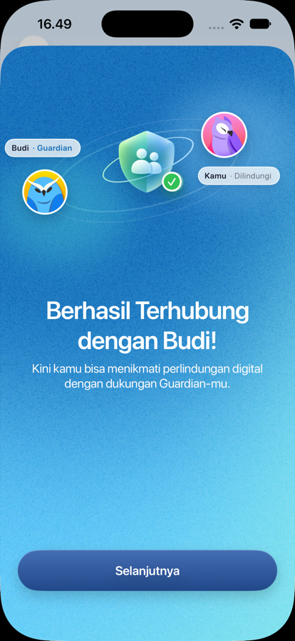</a> 31 <a href="img/goldfish-21nov/34-linked-account.png">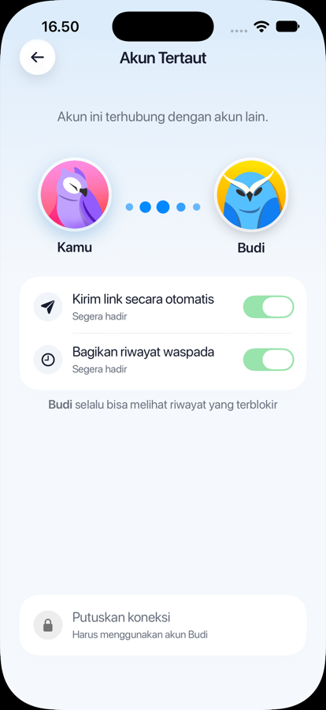</a> 34 Joining a family | "A correct code connected me immediately: no 'Budi will see X, Y, Z — setuju?' step." "'Putuskan koneksi — Harus menggunakan akun Budi': I cannot leave… never said before I joined." | **Perlu diperbaiki.** Catatan "Shoo menyimpan salinan halaman … supaya Guardian bisa melihat buktinya" sebenarnya ada. Tapi catatan itu disembunyikan saat kolom kode aktif, dan kolom kode langsung aktif waktu layar dibuka. Jadi orang yang mengetik kode benar tidak pernah melihatnya. Goldfish baru melihatnya setelah salah kode (30). Dua hal lain juga tidak disebut sebelum bergabung: hanya Guardian yang bisa memutus koneksi (desain Figma), dan riwayat lama di HP ini dihapus (B14 di audit 19 Nov, belum diperbaiki). Kode: ConnectView.swift:133, ProfilePages.swift:881 | blocker | Setelah tekan Hubungkan, tampilkan satu layar konfirmasi: "Budi akan melihat situs yang diblokir atau diberi peringatan di HP-mu (salinannya disimpan 14 hari). Hanya Budi yang bisa memutus koneksi. Riwayatmu di HP ini akan dihapus." Tombol: Gabung / Batal. |
| F3 | <a href="img/goldfish-21nov/09-ext-back-nothing.png">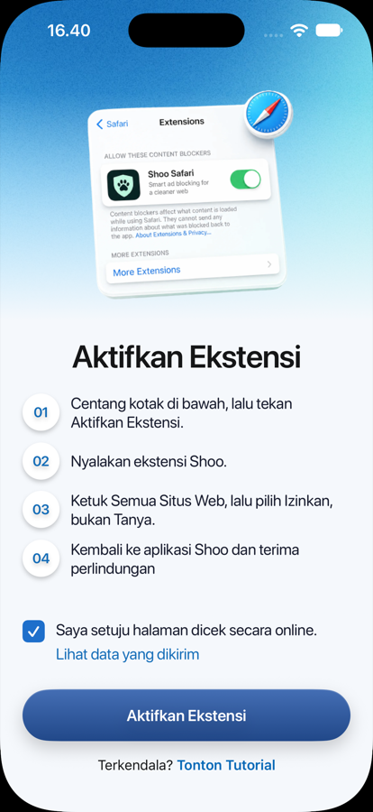</a> 09 Back from Settings, extension still off | "Nothing says 'belum aktif', and the back arrow is gone. I don't know whether it worked or what to do next." | **Perlu diperbaiki.** Di luar onboarding, setelah kembali dari Settings, Shoo menampilkan catatan status ("Shoo belum menyala…"). Di onboarding catatan itu dimatikan, dan sejak PR #636 layar juga tidak lanjut sendiri. Hasilnya, layar terlihat sama persis seperti sebelum ke Settings. Panah kembali hilang karena HP sudah terdaftar di tap pertama (memang desainnya). Kode: TurnOnExtensionView.swift, showsStatusNote | confusing | Di onboarding juga: kalau kembali dari Settings dan ekstensi masih mati, tampilkan "Shoo belum menyala. Coba lagi langkah 02." |
| F4 | <a href="img/goldfish-21nov/14-ext-already-on.png">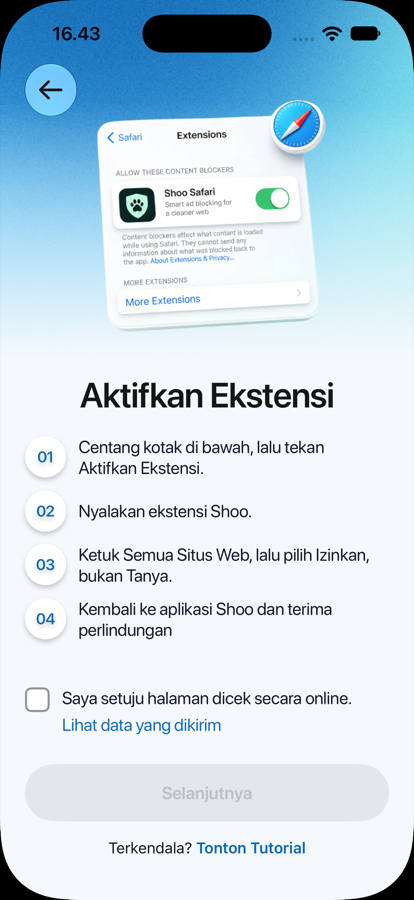</a> 14 <a href="img/goldfish-21nov/16-safari-default.png">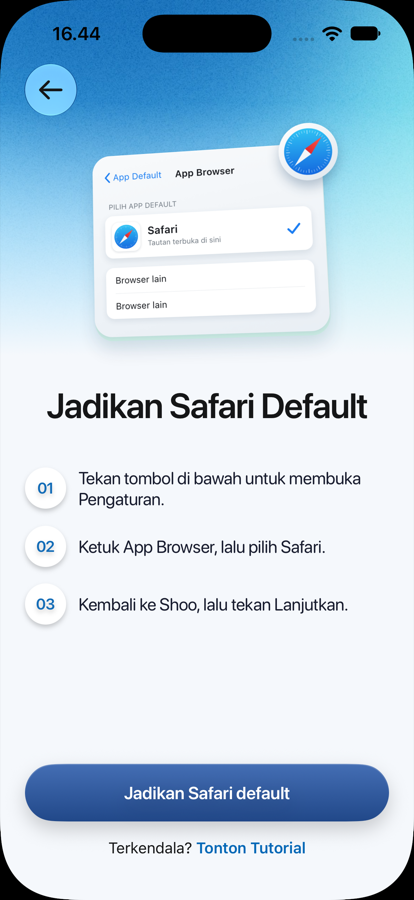</a> 16 Steps buttons | "Step 01 says 'lalu tekan Aktifkan Ekstensi', but the button says 'Selanjutnya'." "Step 03 says 'tekan Lanjutkan', but there is no 'Lanjutkan' button, only 'Jadikan Safari default'." The goldfish also did not know why Safari must be the default. | **Perlu diperbaiki.** Teks langkah tidak ikut berubah dengan tombolnya. Langkah 01 selalu bilang "tekan Aktifkan Ekstensi", walaupun ekstensi sudah menyala dan tombolnya jadi "Selanjutnya". Langkah 03 di Safari Default bilang "tekan Lanjutkan", padahal tombol itu baru muncul setelah kembali dari Settings. Layar ini juga tidak bilang kenapa Safari harus jadi default. | confusing | Kalau ekstensi sudah menyala, langkah 01 jadi "…lalu tekan Selanjutnya". Langkah 03 Safari jadi "Setelah kembali ke Shoo, tekan Lanjutkan". Tambah satu baris: "Shoo hanya bekerja di Safari." |
| F5 | <a href="img/goldfish-21nov/13-home-turnon-sheet.png">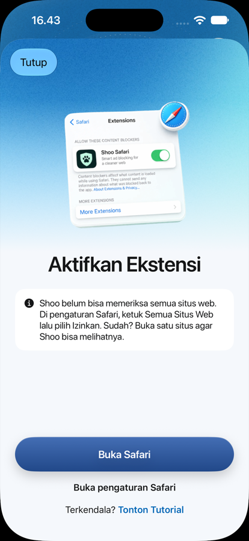</a> 13 Home "Nyalakan sekarang" sheet (some sites only) | "The text says go to Safari settings first, then 'Sudah? Buka satu situs'. The big button is 'Buka Safari'… the order is reversed." | **Perlu diperbaiki.** Isi teksnya sudah benar: buka pengaturan dulu, baru buka situs. Tapi tombol besarnya "Buka Safari", sedangkan "Buka pengaturan Safari" cuma link kecil. Orang menekan tombol besar dulu, jadi urutannya terbalik. | confusing | Untuk keadaan ini, "Buka pengaturan Safari" jadi tombol besar, "Buka Safari" jadi link kecil. |
| F6 | <a href="img/goldfish-21nov/10-home-after-kill.png">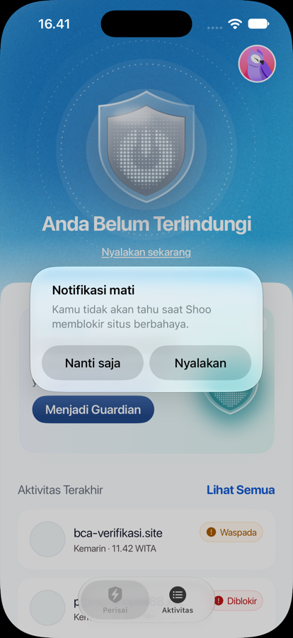</a> 10 iOS closed the app in Settings | "I landed on Home… setup was silently abandoned. The Safari-default and notification steps were never offered." | **Perlu keputusan (desain).** Ini disengaja. Kalau iOS menutup app di tengah onboarding, saat dibuka lagi app langsung ke Home, dan Home yang menunjukkan apa yang masih mati (catatan Figma 141:6085). Masalahnya, Home tidak punya pengingat "jadikan Safari default", jadi langkah itu hilang selamanya. Kode: OnboardingModel.swift:97-104 | confusing | Pilih satu: setelah app dibuka lagi, lanjutkan di layar Safari Default; atau tambah pengingat "Jadikan Safari default" di Home. |
| F7 | <a href="img/goldfish-21nov/25-share-sheet.png">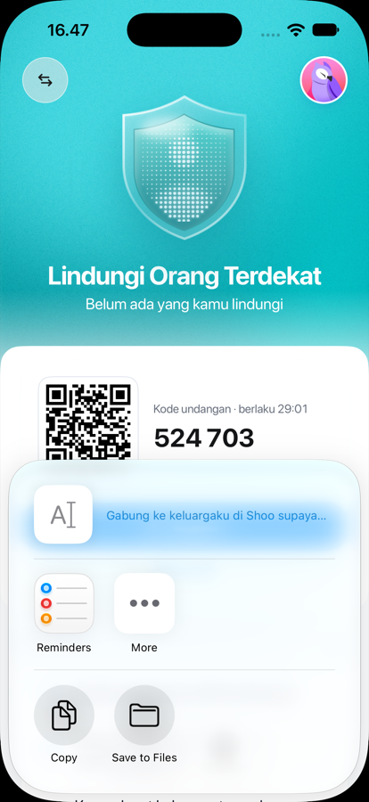</a> 25 Invite message | "Says 'masukkan kode … di Shoo' but not where… doesn't say the code expires in about 30 minutes. My mother would be stuck." | **Perlu diperbaiki.** Pesan undangan berhenti di "masukkan kode … di Shoo". Tidak bilang harus pasang Shoo dulu, di mana tempat memasukkan kode, atau bahwa kode hanya berlaku 30 menit. Link di pesan hanya bekerja kalau Shoo sudah terpasang. | confusing | Tambah di akhir pesan: "Pasang Shoo dulu, lalu buka Profil › Mode akun › Punya kode undangan. Kode berlaku 30 menit." |
| F8 | <a href="img/goldfish-21nov/26-profile-pribadi.png">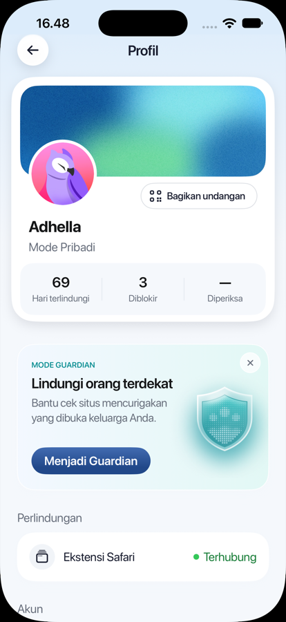</a> 26 <a href="img/goldfish-21nov/28-mode-akun.png">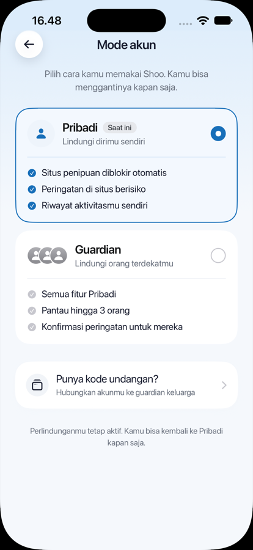</a> 28 Where to join | "A 'Pribadi' user sees 'Bagikan undangan' at the top of Profil… joining with a code is hidden two levels down." | **Perlu diperbaiki.** Pengguna Pribadi melihat "Bagikan undangan" (untuk mengundang orang) paling atas di Profil. Tempat memasukkan kode malah tersembunyi di Profil › Mode akun › "Punya kode undangan?", dengan ikon browser yang tidak cocok. | confusing | Di Profil Pribadi, tambah baris "Punya kode undangan?" tepat di sebelah "Bagikan undangan". |
| F9 | <a href="img/goldfish-21nov/21-guardian-intro.png">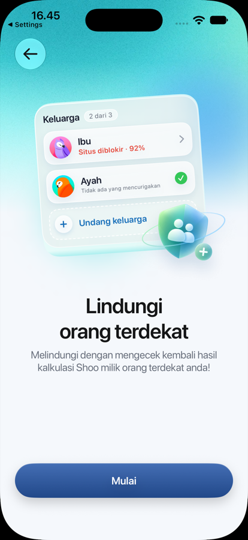</a> 21 <a href="img/goldfish-21nov/23-guardian-home-new.png">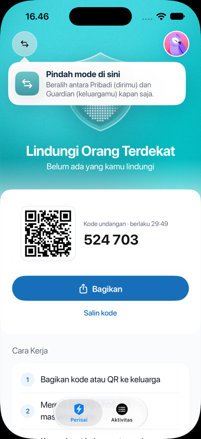</a> 23 Becoming Guardian | "Nothing says what I will see of my family's browsing, or what they will know about me watching, before I tap 'Mulai'." "Became Guardian instantly… no word on whether my own protection continues." | **Perlu diperbaiki.** Layar perkenalan Guardian cuma punya satu kalimat (lihat C4). Tidak dijelaskan apa yang Guardian lihat dari HP keluarga, dan apakah perlindungan dirinya tetap jalan. Notifikasi pindah ke Pribadi bilang "Perlindunganmu tetap menyala", tapi notifikasi jadi Guardian tidak. | confusing | Tambah di layar perkenalan: "Kamu akan melihat situs yang diblokir atau diberi peringatan di HP mereka. Perlindunganmu sendiri tetap menyala." |
| F10 | <a href="img/goldfish-21nov/47-disconnect-confirm.png">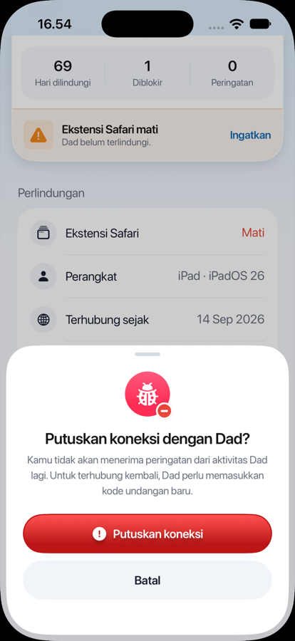</a> 47 Disconnect confirm | "Doesn't say whether Dad keeps his own protection, whether his history is deleted, or… that 'Dad akan diberi tahu'." | **Perlu diperbaiki.** Halaman Dad di belakangnya sudah bilang Dad akan diberi tahu. Tapi jendela konfirmasi "Putuskan koneksi" tidak menyebut akibat apa pun untuk Dad. | confusing | Isi jendela konfirmasi dengan akibatnya, misalnya "Shoo di HP Dad tetap menyala. Dad akan diberi tahu. Kamu tidak lagi melihat riwayatnya." Cek dulu perilaku aslinya. |
| F11 | <a href="img/goldfish-21nov/49-switch-mode.png">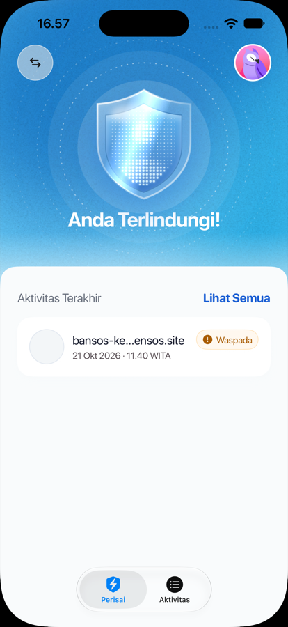</a> 49 ⇆ mode switch | "One tap… switched me to Pribadi with no question… I don't know whether Mom is still guarded while I'm in Pribadi." | **Sebagian benar.** Notifikasi "Mode Pribadi aktif" sudah menyebut mode yang aktif. Tapi pertanyaan goldfish benar: tidak dijelaskan apakah keluarga masih dijaga selama aku di mode Pribadi. | confusing | Kalau sudah punya anggota keluarga, tambah di notifikasi: "Keluargamu tetap terhubung." |
| F12 | <a href="img/goldfish-21nov/24-guardian-home-scrolled.png">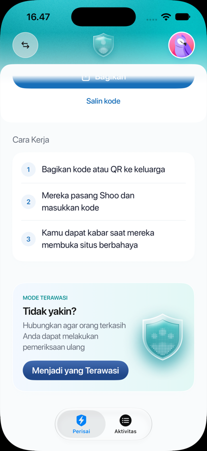</a> 24 Guardian Home with no family | "While in Guardian mode, I'm offered 'MODE TERAWASI… Menjadi yang Terawasi'. Why would a Guardian be pitched to become supervised?" | **Perlu keputusan (desain).** Guardian yang belum punya anggota keluarga melihat kartu "Menjadi yang Terawasi". Ini sesuai Figma 1253:2381. Ini bukan kartu yang sedang dihapus sesi lain (yang itu di Home Pribadi), tapi masalahnya sama. Sebaiknya beri tahu sesi itu atau desainer. Kode: GuardianHomeView.swift:348 | confusing | Sembunyikan kartu ini di mode Guardian. Atau ganti jadi baris kecil di bawah kartu undangan: "Diundang orang lain? Masukkan kodenya". |

## Copy unclear

| # | Screen | Goldfish (own words) | Elephant: kenapa terjadi | Severity | Cara memperbaiki |
|---|---|---|---|---|---|
| C1 | <a href="img/goldfish-21nov/40-after-safe-top.png">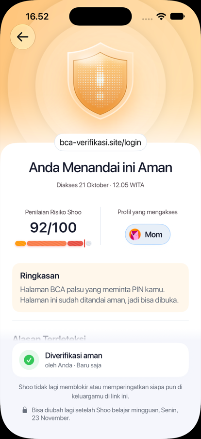</a> 40 <a href="img/goldfish-21nov/36-detail-blocked.png">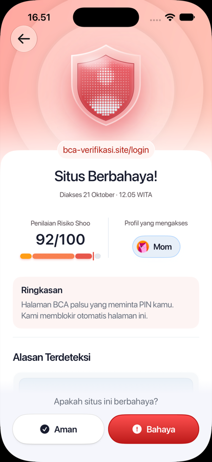</a> 36 Detail summary | "'Halaman BCA palsu yang meminta PIN kamu. Halaman ini sudah ditandai aman, jadi bisa dibuka.' The app literally says 'this is a fake BCA page, you can open it'." "I'm the Guardian looking at Mom's visit, but… 'meminta PIN **kamu**'." | **Perlu diperbaiki.** App menyusun ringkasan dari dua potong kalimat: "Halaman BCA palsu yang meminta PIN kamu" dan "Halaman ini sudah ditandai aman, jadi bisa dibuka." Potongan pertama selalu bilang "palsu" dan selalu "kamu". Itu tetap muncul setelah ditandai aman, dan walaupun yang membuka situsnya Mom, bukan Guardian. Kode: DetailSummaryCard.swift:92-102 | blocker | Setelah ditandai aman: "Shoo mengira halaman ini meniru BCA. {Nama} menandainya aman." Kalau scan milik orang lain, "PIN kamu" jadi "PIN-nya" atau pakai nama pemiliknya. |
| C2 | <a href="img/goldfish-21nov/11-home-pribadi.png">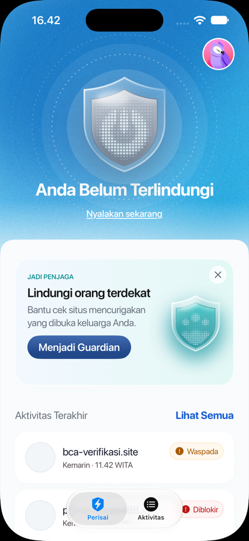</a> 11  26  24  28 <a href="img/goldfish-21nov/33-profile-protected.png">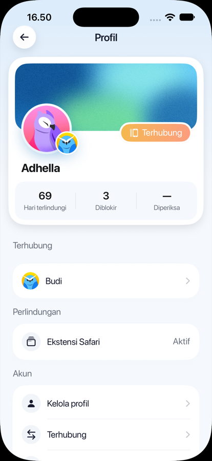</a> 33 <a href="img/goldfish-21nov/45-member-dad.png">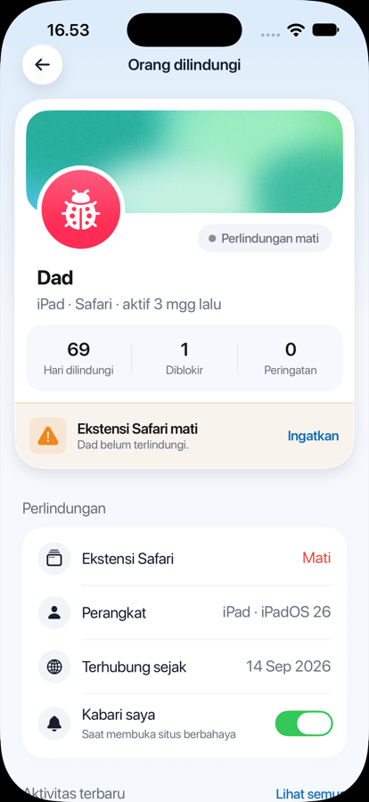</a> 45 Role names | "The invited person is called 'Terawasi', 'Dilindungi', 'Orang dilindungi' or 'Terhubung'." "Is it Penjaga or Guardian?" "'Pantau hingga 3 orang'. 'Pantau' means 'monitor', while everywhere else the app says 'Lindungi'." | **Perlu diperbaiki.** Satu peran punya banyak nama, karena tiap teks ditulis terpisah: "JADI PENJAGA" vs "Menjadi Guardian"; "Menjadi yang Terawasi" vs "Dilindungi" vs "Terhubung"; "Pantau hingga 3 orang" vs "Lindungi". "Terawasi" dan "Pantau" juga terdengar seperti memata-matai. | confusing | Pilih satu nama per peran (misalnya Guardian dan Dilindungi), lalu pakai di semua layar. "Pantau" diganti "Lindungi". |
| C3 | <a href="img/goldfish-21nov/35-guardian-home-family.png">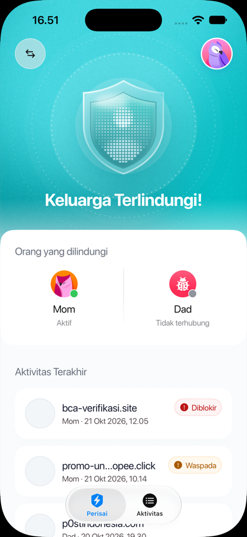</a> 35 <a href="img/goldfish-21nov/44-profile-guardian.png">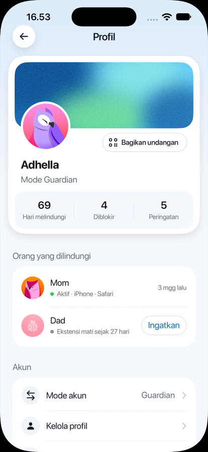</a> 44  45 Member status | "Dad is 'Ekstensi mati sejak 27 hari' here but 'Tidak terhubung' on Home." "'69 Hari dilindungi', next to 'Perlindungan mati'." "Home said Dad is 'Tidak terhubung', yet here it says 'Terhubung sejak 14 Sep 2026'." | **Perlu diperbaiki.** Kata "Terhubung" dipakai untuk dua hal: (1) sudah bergabung ke keluarga; (2) ekstensi Shoo di HP-nya masih mengirim kabar. Jadi Dad bisa "Tidak terhubung" (ekstensi mati) sekaligus "Terhubung sejak 14 Sep" (sudah bergabung). Judul "Keluarga Terlindungi!" saat Dad mati adalah B4, sudah diputuskan tetap, jadi tidak diangkat lagi. "69 hari" itu data contoh. | confusing | Di Home, anggota yang ekstensinya mati ditulis "Shoo mati", bukan "Tidak terhubung". "Terhubung" hanya untuk "sudah bergabung ke keluarga". |
| C4 |  21 Guardian intro | "'hasil kalkulasi' is jargon, and 'anda' is lowercase… '92%' of what? '2 dari 3'?" | **Perlu diperbaiki.** "Hasil kalkulasi" itu istilah teknis, dan "anda" ditulis huruf kecil. Gambar "92%" dan "2 dari 3" tidak dijelaskan. | confusing | Ganti kalimatnya: "Bantu jaga orang terdekatmu: cek situs yang Shoo tandai di HP mereka." |
| C5 | <a href="img/goldfish-21nov/41-activity.png">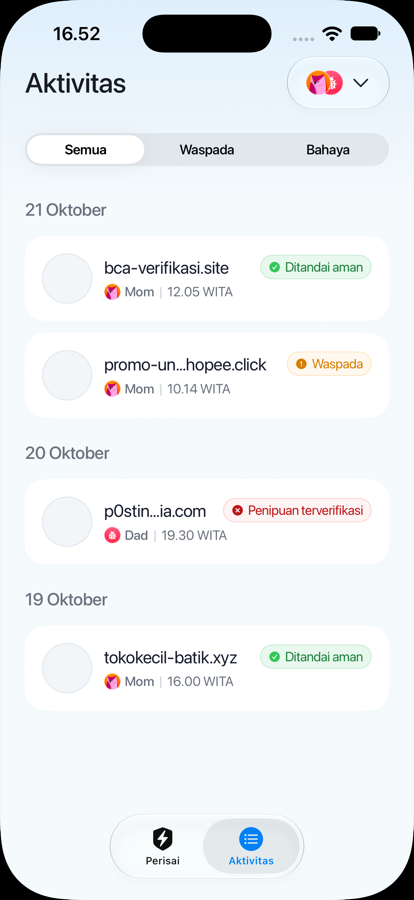</a> 41  36 <a href="img/goldfish-21nov/43-detail-warning.png">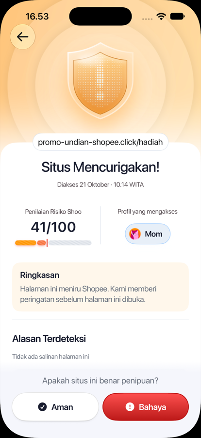</a> 43 Status words | "Filter tabs 'Semua / Waspada / Bahaya' don't match the badges 'Ditandai aman', 'Waspada', 'Penipuan terverifikasi', 'Diblokir'." "The question changed to 'Apakah situs ini benar penipuan?', but the answers are still 'Aman' / 'Bahaya'." "'Situs Berbahaya!'… then asks me 'Apakah situs ini berbahaya?'" | **Perlu diperbaiki.** Satu keadaan punya banyak kata. Filter: "Waspada / Bahaya". Label: "Diblokir / Penipuan terverifikasi / Ditandai aman". Pertanyaannya juga beda: halaman diblokir tanya "Apakah situs ini berbahaya?", halaman peringatan tanya "Apakah situs ini benar penipuan?", padahal jawabannya sama (Aman / Bahaya). Satu situs punya beberapa status sebagian karena data contoh: beberapa anggota membuka situs yang sama. | confusing | Satu pertanyaan di kedua halaman: "Menurutmu situs ini aman?" (Aman / Bahaya). Nama filter disamakan dengan kata di label. |
| C6 | <a href="img/goldfish-21nov/06-data-sheet.png">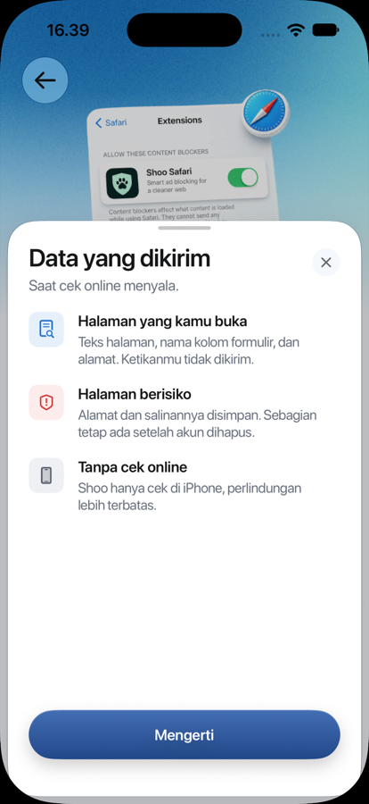</a> 06 Data sheet | "'Sebagian tetap ada setelah akun dihapus.' Which account? I never made one. Which part stays, and for how long?" | **Perlu diperbaiki.** Isinya benar: alamat situs dan labelnya memang tetap disimpan. Tapi kata "akun" belum pernah muncul sebelumnya, jadi orang bingung akun yang mana. Bagian mana yang tetap ada juga tidak dijelaskan. | confusing | Ganti jadi: "Alamat situs dan labelnya tetap kami simpan setelah kamu menghapus Shoo, tanpa namamu." Samakan dengan halaman privasi. |
| C7 |  05 ON-04 illustration | "In English: 'Shoo Safari – Smart ad blocking for a cleaner web', 'They cannot send any information… back to the app'. I installed a scam blocker." | **Perlu diperbaiki.** Gambar di layar ini gambar lama: contoh pemblokir iklan, berbahasa Inggris. Isinya ("tidak bisa mengirim informasi apa pun") juga bertentangan dengan kotak "dicek secara online" tepat di bawahnya. Lokasi: Resources/…xcassets/Onboarding | confusing | Ganti dengan tangkapan layar Settings berbahasa Indonesia yang menunjukkan halaman ekstensi Shoo yang asli. |
| C8 |  23 Invite code | "'Kode undangan · berlaku 29:49': until 29:49 o'clock, or 29 minutes left?" | **Perlu diperbaiki.** "29:49" adalah sisa waktu (menit:detik), tapi terbaca seperti jam. | confusing | Tulis "berlaku 29 menit lagi". Detik hanya muncul di menit terakhir. |
| C9 |  33 Protected Profile | "'Terhubung' appears three times: as a pill, a section header and a menu row." "'Ekstensi Safari' now says 'Aktif'; before joining, it said 'Terhubung'." | **Perlu diperbaiki.** Sama dengan C3: "Terhubung" dipakai untuk terlalu banyak hal di satu layar. | confusing | Label oranye jadi "Dijaga Budi", judul bagian jadi "Akun Tertaut", baris ekstensi selalu "Aktif" atau "Mati". |
| C10 |  13  10 | "'Shoo belum bisa memeriksa semua situs web', so the extension is partly on. Home said flatly 'Anda Belum Terlindungi'. Which is true?" | **Perlu diperbaiki.** Home cuma punya satu kalimat, "Belum Terlindungi", untuk dua keadaan: ekstensi mati total, dan ekstensi menyala tapi baru boleh di sebagian situs. | confusing | Kalau baru sebagian situs: "Belum terlindungi penuh". |
| C11 |  05  10 Register | "This screen speaks formally ('Anda')… the register keeps switching." | **Perlu diperbaiki.** Sebagian layar pakai "Anda", sebagian "kamu". | polish | Pakai "kamu" di semua teks Indonesia, misalnya "Kamu Terlindungi!". |
| C12 |  43 Warning detail | "Under 'Alasan Terdeteksi' it says only 'Tidak ada salinan halaman ini', yet I'm asked to judge with no evidence." | **Sebagian bukan masalah.** Data contoh situs ini memang tidak punya alasan, jadi daftarnya kosong. Masalah aslinya: "Tidak ada salinan halaman ini" ditaruh di dalam daftar "Alasan Terdeteksi", jadi terbaca seperti alasan. | polish | Pindahkan "Tidak ada salinan halaman ini" ke bagian salinan halaman, keluar dari daftar alasan. |

## Visual

| # | Screen | Goldfish (own words) | Elephant: kenapa terjadi | Severity | Cara memperbaiki |
|---|---|---|---|---|---|
| V1 |  34 Akun Tertaut | "'Kirim link secara otomatis' and 'Bagikan riwayat waspada' show green 'on' switches, but they say 'Segera hadir'… Is my warning history being shared with Budi right now?" | **Perlu diperbaiki.** Di layar privasi, tombol yang terlihat menyala dibaca sebagai fakta. Orang mengira riwayatnya sudah dibagikan sekarang. | confusing | Buat tombolnya abu-abu dan mati, atau sembunyikan baris ini sampai fiturnya ada. |
| V2 |  39 After Tandai aman | "A site I just marked safe now shows an orange (warning) shield together with a green 'Diverifikasi aman' tick." | **Perlu diperbaiki.** Setelah ditandai aman, bagian atas halaman tetap oranye (warna peringatan), padahal statusnya aman. | confusing | Setelah ditandai aman, bagian atas pakai warna aman (hijau). |
| V3 | <a href="img/goldfish-21nov/12-home-pribadi-scrolled.png">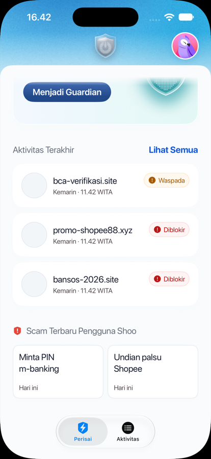</a> 12 Scam Terbaru cards | "Look like tappable cards but do nothing. I wanted to read about the scam." | **Perlu diperbaiki.** Kartu "Scam Terbaru" terlihat bisa ditekan, tapi memang tidak ada aksinya. Kode: LatestScamsCard.swift | confusing | Pilih satu: kartu membuka penjelasan singkat tentang modus itu, atau ubah tampilannya supaya tidak terlihat seperti tombol. |
| V4 |  33 Orange "Terhubung" pill | "Looks like a warning or a button." | **Perlu diperbaiki.** Di app ini oranye berarti peringatan. Di sini oranye dipakai untuk keadaan baik (sudah terhubung). | confusing | Pakai warna netral atau biru untuk label ini. |
| V5 |  38 Disabled "Tandai Aman" | "Pale green and still looks enabled." | **Perlu diperbaiki.** Harus pilih minimal satu alasan dulu, tapi petunjuk itu hanya dibacakan VoiceOver, tidak terlihat di layar. Tombol yang mati juga masih hijau pucat. | polish | Tombol mati jadi abu-abu, dan tampilkan "Pilih minimal satu alasan" di atasnya. |
| V6 |  29 "Hubungkan Akun" | "Title is clipped at the top on first open." | **Perlu diperbaiki.** Terlihat di screenshot: judul terpotong di bagian atas. | polish | Beri jarak di atas judul, di bawah tombol kembali. |
| V7 |  11 <a href="img/goldfish-21nov/22-home-pribadi-empty.png">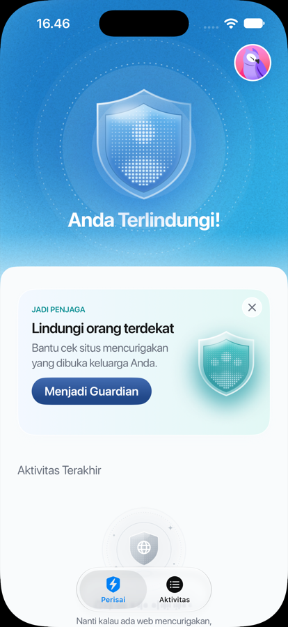</a> 22  23 Tab bar | "Covers the second activity row… empty-state text cut off… step 2 of Cara Kerja hidden." | **Perlu diperbaiki.** Bilah tab yang mengambang menutupi isi paling bawah layar. | polish | Tambah ruang kosong di bawah isi, setinggi bilah tab. |
| V8 | <a href="img/goldfish-21nov/48-after-disconnect.png">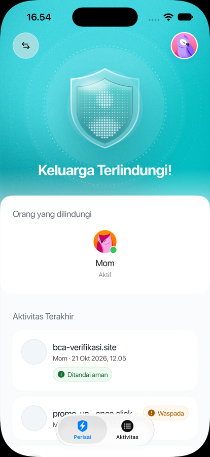</a> 48 Home badge | "'Ditandai aman' badge is green with a '!' warning icon (the list in 41 used a tick)." | **Perlu diperbaiki.** Label "Ditandai aman" di Home pakai ikon "!" (tanda peringatan). Di Aktivitas pakai centang. | polish | Pakai ikon centang yang sama dengan di Aktivitas. |
| V9 | <a href="img/goldfish-21nov/01-splash1.png">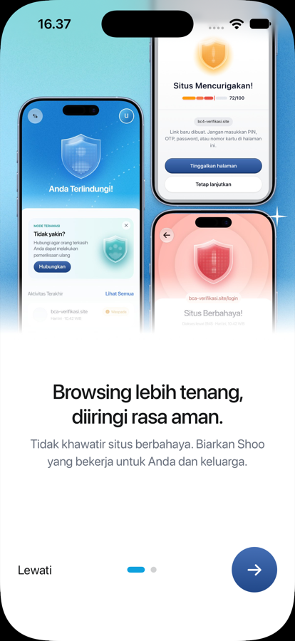</a> 01 Splash promo | "'bca-verifikasi.site' as 'Waspada' in the list and 'Situs Berbahaya!' on the next card." | **Perlu diperbaiki.** Gambar splash dibuat dari layar lama (masih ada kartu "Mode Terawasi"). | polish | Buat ulang gambar splash dari layar yang sekarang. |

## Escalations that are not new findings

- **Consent box is required on ON-04** ([05](img/goldfish-21nov/05-ext.png)). The goldfish said: "Screen 06 mentions 'Tanpa cek online', but nothing lets me pick it. Consent is forced in practice." This was decided by Alief on 20 Nov (aad52006, which reverses 5dbec833 for #616).
  - The data sheet still lists "Tanpa cek online" as an option.
  - `OnboardingModel.swift:68-69` still says it "can't be required" (App Review 5.1.1(iv)).
  - Either drop that option from the sheet and fix the comment, or bring the opt-out back. Owner: Alief, and the lead if App Review is the worry.
- **"Keluarga Terlindungi!" while a member is off** ([35](img/goldfish-21nov/35-guardian-home-family.png)): B4, kept as decided. The goldfish raised it again unprompted (its top 4).
- **Protected user cannot disconnect** ([34](img/goldfish-21nov/34-linked-account.png)): Figma design. The fix asked for here is only to say it before joining (F2).

## Declined (mock or simulator artefacts)

- 10: the avatar picked in onboarding is not shown. The mock profile ignores it.
- 10: activity rows on a fresh install, and "Notifikasi mati" with notifications granted. Both come from the mock repository and the mock notification service.
- 10, 20: no iOS notification prompt. The mock skips it. Not verified on a device.
- 17: "Jadikan Safari default" opened a blank Settings page. `openDefaultApplicationsSettingsURLString` in the simulator. **Verify on a device.**
- 08: Settings at its root. Apple bug, decided.
- 30: "999999" is the mock's expired code, so "Kode kedaluwarsa" is correct for it.
- 35, 44: WIB/WITA mix, "Aktif · 3 mgg lalu", "69 hari", the ladybug avatar, the "—" stat. Fixture data and simulator time zone.
- 04, 06: first tap lost. Simulator input injection.

## Top 5 to fix first

1. **Tandai aman (F1 + C1, blocker).** Two taps whitelist a 92/100 fake BCA page for the whole family. The lock until Monday shows only after saving, and the summary then says "Halaman BCA palsu … jadi bisa dibuka". Fixes:
   - Put the lock date and "semua HP keluargamu" on the sheet.
   - Confirm when the score is ≥ 80.
   - Rewrite the summary after a safe mark, in the third person on someone else's scan.
2. **Joining a family (F2, blocker).** The Guardian/copy disclosure is hidden while the code field is focused (`ConnectView.swift:133`), so a valid code joins with no disclosure. Add one confirm before Connect: what Budi sees, that only Budi can disconnect, and that the history is deleted (B14).
3. **One status vocabulary (C3 + C9 + C10 + C5, confusing).** "Terhubung" means both the family link and the extension. The same member reads "Tidak terhubung" / "Terhubung sejak" / "69 hari dilindungi". The filters don't match the badges, and the two pages ask two different questions. Fixes:
   - Home member status: "Shoo mati".
   - "Belum terlindungi penuh" for some sites only.
   - One question: "Menurutmu situs ini aman?"
4. **ON-04 / Safari Default instructions vs buttons (F3 + F4 + F5, confusing).**
   - Step text names a button that isn't on screen.
   - No "belum aktif" note after returning from Settings in onboarding.
   - The Home sheet's primary button opens Safari, but the fix is in Settings.
5. **Family can't find where to enter the code (F7 + F8 + C2, confusing).** Fixes:
   - The invite message says where to type the code and that it expires in 30 minutes.
   - Pribadi Profile gets a "Punya kode undangan?" row.
   - One name per role (Guardian / Dilindungi, no "Terawasi" or "Pantau").

## All screenshots, in order

Every screenshot the goldfish saw, with the tap that led to it (from [log.txt](img/goldfish-21nov/log.txt)). Click an image for full size.

<table>
<tr><td valign="top" width="33%"> <b>01-splash1</b> fresh install, app opened for the first time.</td><td valign="top" width="33%"><a href="img/goldfish-21nov/02-splash2.png">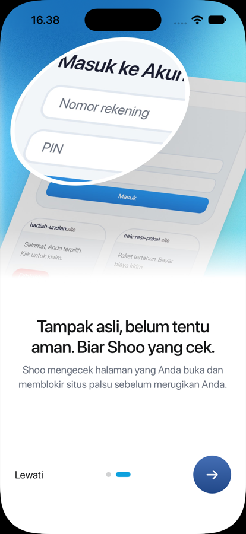</a> <b>02-splash2</b> Tapped the round arrow button.</td><td valign="top" width="33%"><a href="img/goldfish-21nov/03-name.png">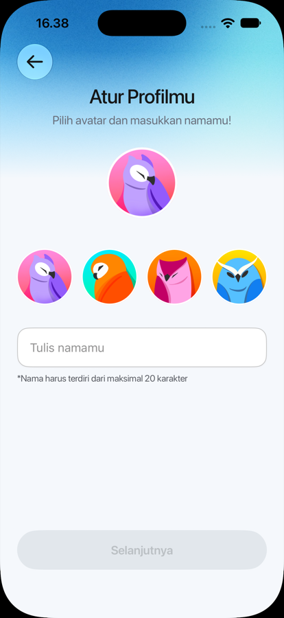</a> <b>03-name</b> Tapped the round arrow button again.</td></tr>
<tr><td valign="top" width="33%"><a href="img/goldfish-21nov/04-name-filled.png">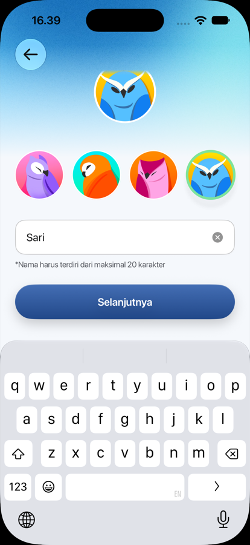</a> <b>04-name-filled</b> Picked the blue owl (4th) and typed the name &#x27;Sari&#x27;.</td><td valign="top" width="33%"> <b>05-ext</b> Tapped Selanjutnya. (First tap while the keyboard was up did nothing; second tap worked.)</td><td valign="top" width="33%"> <b>06-data-sheet</b> Tapped &#x27;Lihat data yang dikirim&#x27; (first tap on the link did nothing, second opened this).</td></tr>
<tr><td valign="top" width="33%"><a href="img/goldfish-21nov/07-ext-checked.png">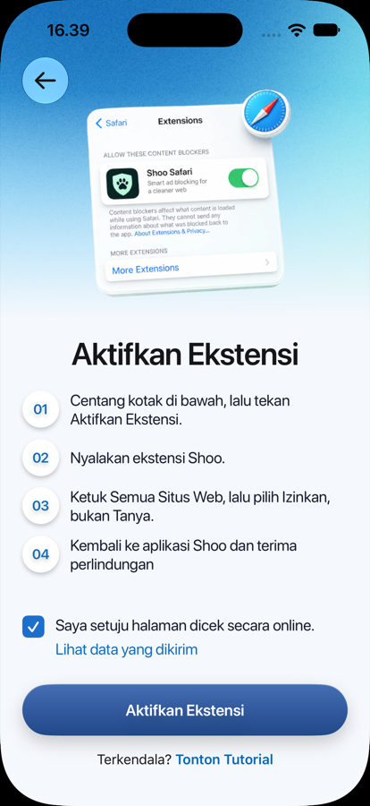</a> <b>07-ext-checked</b> Closed the sheet with Mengerti, then ticked the box.</td><td valign="top" width="33%"><a href="img/goldfish-21nov/08-settings-root.png">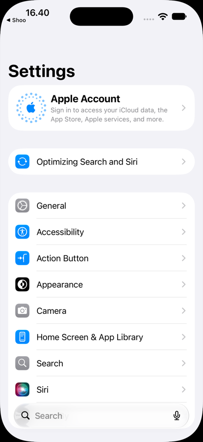</a> <b>08-settings-root</b> Tapped Aktifkan Ekstensi. iPhone Settings opened at its top page.</td><td valign="top" width="33%"> <b>09-ext-back-nothing</b> Went back to Shoo without changing anything in Settings (waited ~6 s). The back arrow at top-left is gone now.</td></tr>
<tr><td valign="top" width="33%"> <b>10-home-after-kill</b> While in Settings the phone closed the Shoo app. Opened Shoo again from the Home Screen. This is the first thing shown. (Shoo extension is turned on in Safari but only for some websites.)</td><td valign="top" width="33%"> <b>11-home-pribadi</b> Tapped Nyalakan on the &#x27;Notifikasi mati&#x27; popup (needed two taps). The popup closed; no iPhone permission question appeared.</td><td valign="top" width="33%"> <b>12-home-pribadi-scrolled</b> Scrolled down on Home.</td></tr>
<tr><td valign="top" width="33%"> <b>13-home-turnon-sheet</b> Back at the top of Home, tapped &#x27;Nyalakan sekarang&#x27; under &#x27;Anda Belum Terlindungi&#x27;.</td><td valign="top" width="33%"> <b>14-ext-already-on</b> SECOND RUN (a different person who had already turned on the Shoo extension in Safari before opening the app). Skipped intro with Lewati, typed name, pressed return.</td><td valign="top" width="33%"> <b>15-ext-consent-nudge</b> Tapped the grey Selanjutnya without ticking the box.</td></tr>
<tr><td valign="top" width="33%"> <b>16-safari-default</b> Ticked the box and tapped Selanjutnya.</td><td valign="top" width="33%"><a href="img/goldfish-21nov/17-safari-settings.png">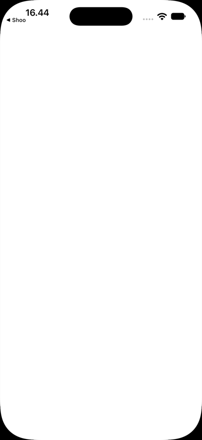</a> <b>17-safari-settings</b> Tapped Jadikan Safari default. iPhone Settings opened here.</td><td valign="top" width="33%"><a href="img/goldfish-21nov/18-safari-default-back.png">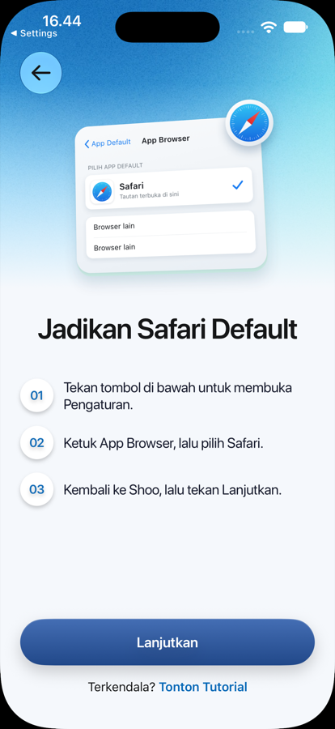</a> <b>18-safari-default-back</b> Went back to Shoo from Settings without changing anything.</td></tr>
<tr><td valign="top" width="33%"><a href="img/goldfish-21nov/19-success.png">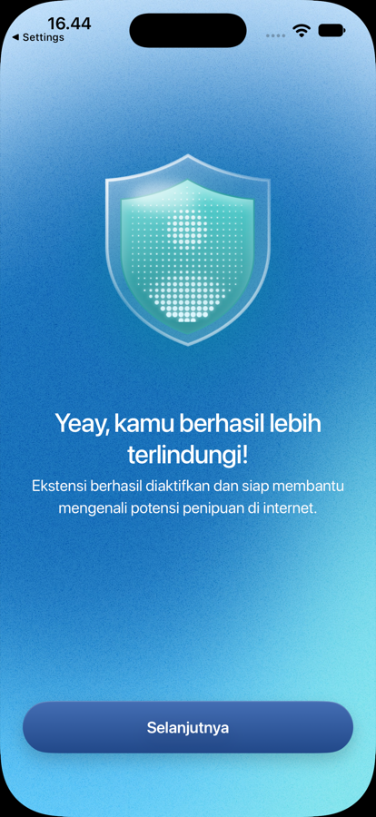</a> <b>19-success</b> Tapped Lanjutkan.</td><td valign="top" width="33%"><a href="img/goldfish-21nov/20-home-protected.png">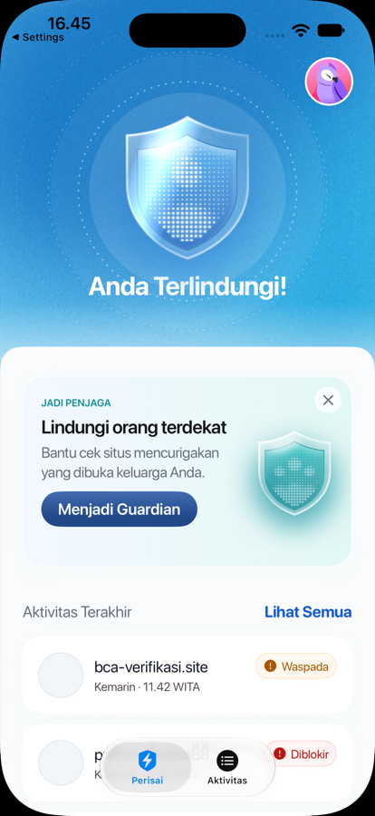</a> <b>20-home-protected</b> Tapped Selanjutnya on the success screen. No iPhone notification permission question appeared; went straight here.</td><td valign="top" width="33%"> <b>21-guardian-intro</b> Tapped Menjadi Guardian on the &#x27;Jadi Penjaga&#x27; card (second tap).</td></tr>
<tr><td valign="top" width="33%"> <b>22-home-pribadi-empty</b> THIRD RUN: a person who finished setup and has not browsed yet. Opened app; closed the &#x27;Notifikasi mati&#x27; popup with Nanti saja.</td><td valign="top" width="33%"> <b>23-guardian-home-new</b> Tapped Menjadi Guardian, then Mulai on the &#x27;Lindungi orang terdekat&#x27; intro page (same page as screenshot 21). Landed here.</td><td valign="top" width="33%"> <b>24-guardian-home-scrolled</b> Tapped the &#x27;Pindah mode di sini&#x27; tip to close it, then scrolled down. A &#x27;Mode Guardian aktif&#x27; banner slid in at the top.</td></tr>
<tr><td valign="top" width="33%"> <b>25-share-sheet</b> Waited for the banner to go, scrolled up, tapped Bagikan.</td><td valign="top" width="33%"> <b>26-profile-pribadi</b> FOURTH RUN: a Pribadi user (name Adhella) who got an invite code from family and wants to join. Opened app, closed &#x27;Notifikasi mati&#x27; popup, tapped the avatar at top-right.</td><td valign="top" width="33%"><a href="img/goldfish-21nov/27-profile-settings.png">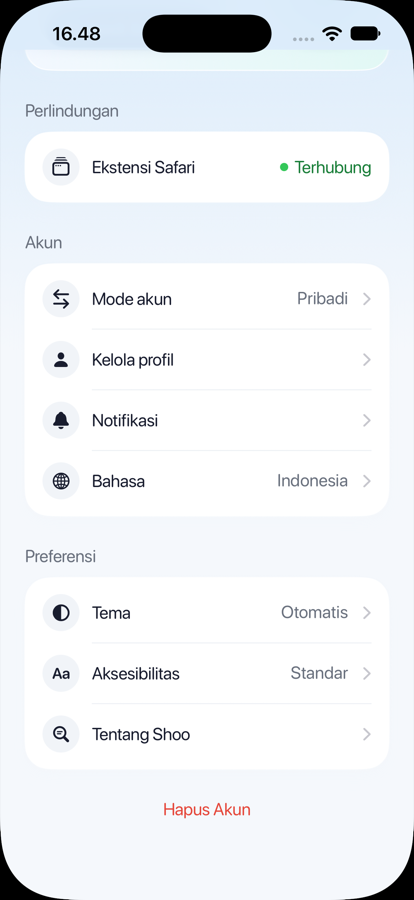</a> <b>27-profile-settings</b> Scrolled down on Profil.</td></tr>
<tr><td valign="top" width="33%"> <b>28-mode-akun</b> Tapped Mode akun.</td><td valign="top" width="33%"> <b>29-join-code</b> Tapped &#x27;Punya kode undangan?&#x27;.</td><td valign="top" width="33%"><a href="img/goldfish-21nov/30-join-expired.png">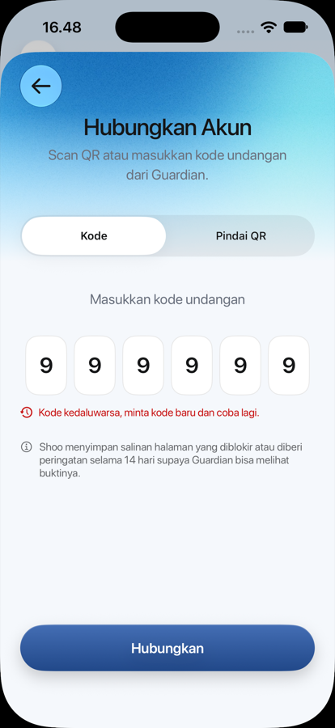</a> <b>30-join-expired</b> Typed an old code 999999 and tapped Hubungkan.</td></tr>
<tr><td valign="top" width="33%"> <b>31-join-success</b> Deleted the digits, typed the code from the family member (524703), tapped Hubungkan. A spinner showed ~2 s, no question asked before, then this.</td><td valign="top" width="33%"><a href="img/goldfish-21nov/32-home-protected-joined.png">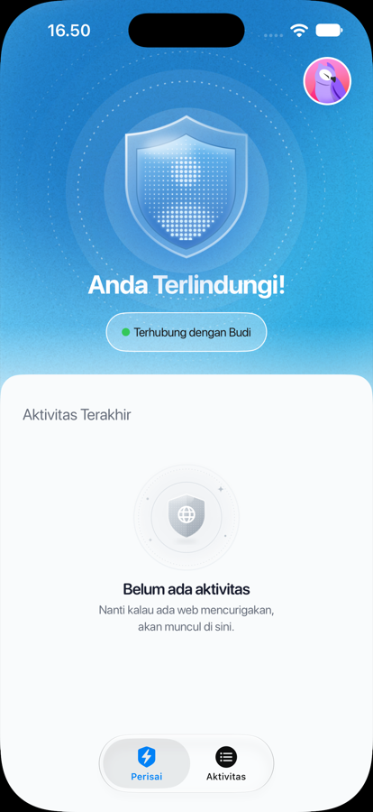</a> <b>32-home-protected-joined</b> Tapped Selanjutnya.</td><td valign="top" width="33%"> <b>33-profile-protected</b> Tapped the avatar at top-right (now joined to Budi&#x27;s family).</td></tr>
<tr><td valign="top" width="33%"> <b>34-linked-account</b> Tapped the row &#x27;Budi&#x27; under &#x27;Terhubung&#x27;. (Tried tapping the two green switches: nothing changes.)</td><td valign="top" width="33%"> <b>35-guardian-home-family</b> FIFTH RUN: a Guardian whose family (Mom, Dad) joined some days ago. Opened app (white screen for ~6 s first), closed &#x27;Notifikasi mati&#x27; with Nanti saja.</td><td valign="top" width="33%"> <b>36-detail-blocked</b> Tapped the bca-verifikasi.site row (Mom, Diblokir).</td></tr>
<tr><td valign="top" width="33%"><a href="img/goldfish-21nov/37-detail-reasons.png">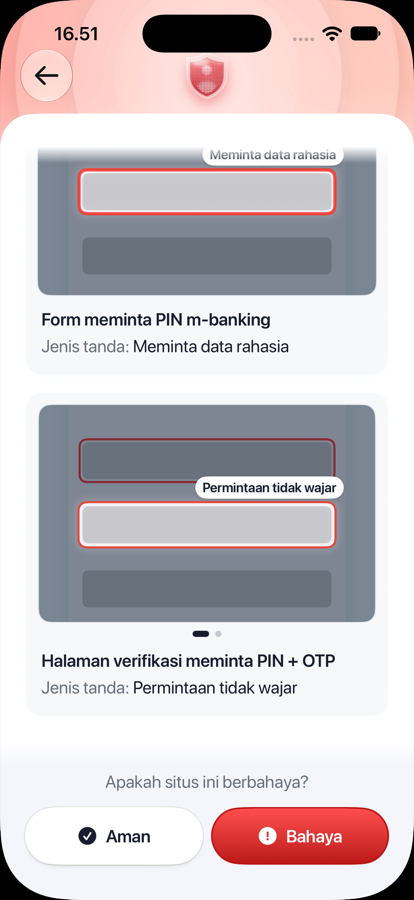</a> <b>37-detail-reasons</b> Scrolled down under &#x27;Alasan Terdeteksi&#x27;.</td><td valign="top" width="33%"> <b>38-safe-sheet</b> Tapped Aman.</td><td valign="top" width="33%"> <b>39-after-safe</b> Picked &#x27;Saya kenal situs ini&#x27;, tapped Tandai Aman. Sheet closed; bottom of the page now shows this.</td></tr>
<tr><td valign="top" width="33%"> <b>40-after-safe-top</b> Scrolled to the top of the same page.</td><td valign="top" width="33%"> <b>41-activity</b> Tapped back, then the Aktivitas tab at the bottom.</td><td valign="top" width="33%"><a href="img/goldfish-21nov/42-activity-picker.png">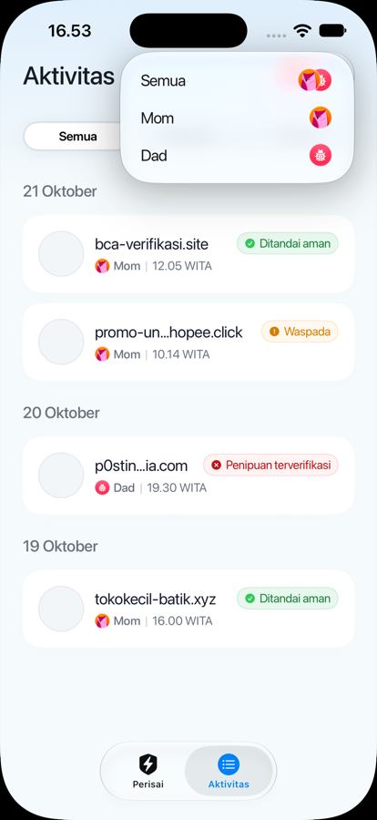</a> <b>42-activity-picker</b> Tapped the round faces button at top-right.</td></tr>
<tr><td valign="top" width="33%"> <b>43-detail-warning</b> Closed the menu, tapped the promo-un...hopee.click row (Waspada).</td><td valign="top" width="33%"> <b>44-profile-guardian</b> Tapped back, the Perisai tab, then the avatar at top-right.</td><td valign="top" width="33%"> <b>45-member-dad</b> Tapped Dad&#x27;s row.</td></tr>
<tr><td valign="top" width="33%"><a href="img/goldfish-21nov/46-member-dad-bottom.png">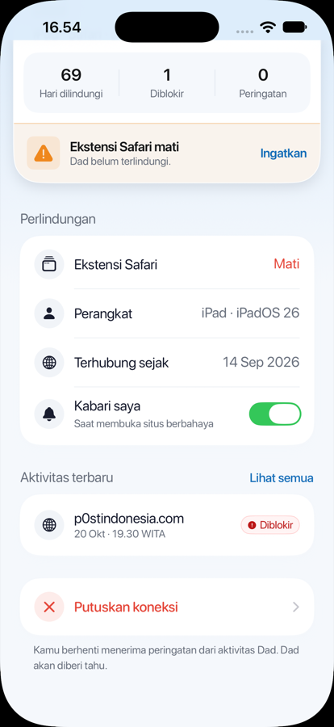</a> <b>46-member-dad-bottom</b> Scrolled down on Dad&#x27;s page.</td><td valign="top" width="33%"> <b>47-disconnect-confirm</b> Tapped Putuskan koneksi.</td><td valign="top" width="33%"> <b>48-after-disconnect</b> Tapped the red Putuskan koneksi. Went back to Home by itself.</td></tr>
<tr><td valign="top" width="33%"> <b>49-switch-mode</b> On Guardian Home, tapped the round icon top-left (the arrows icon). No question asked.</td></tr>
</table>

