# Android port: screenshots of every screen and use case

Shoo for Android (`android/`, branch `feat/android-app`) on the Android emulator (Pixel, API 35, 1080 × 2400),
Debug build on the Mock backend (`contracts/fixtures` + `MockScenarios`). Bahasa Indonesia unless noted.
158 screenshots, taken by an automated runner that launches each scenario with
Debug launch extras (the same flags as the iOS UI tests), e.g.

```
adb shell am start -n com.shoo.app.debug/com.shoo.app.MainActivity --es -settings.mode guardian \
  --es -settings.onboardingCompleted YES --es -mock.scenario figma --es -debug.tab activity
```

## Onboarding (ON-01 … ON-05)

<table>
<tr>
<td align="center" valign="top" width="33%">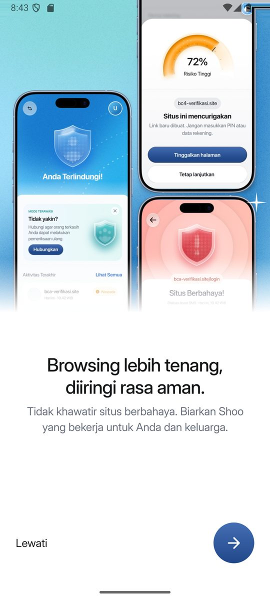<br><sub><b>ON-01 Slide 1</b><br><code>on-01-slide-1</code></sub></td>
<td align="center" valign="top" width="33%">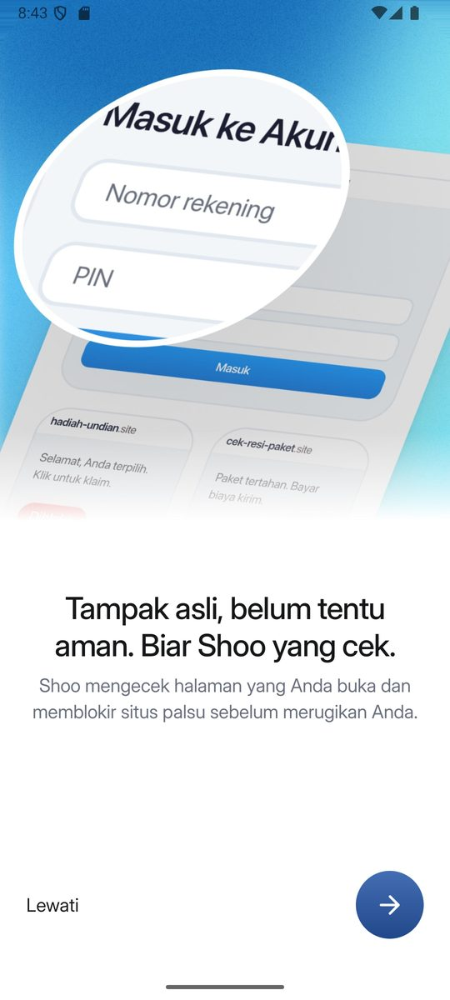<br><sub><b>ON-01 Slide 2</b><br><code>on-01-slide-2</code></sub></td>
<td align="center" valign="top" width="33%">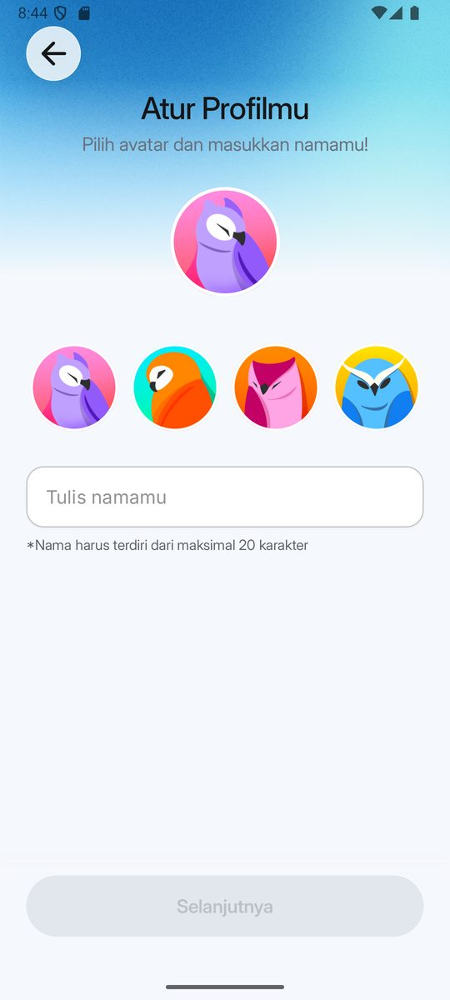<br><sub><b>ON-02 Profile setup (empty)</b><br><code>on-02-name-empty</code></sub></td>
</tr>
<tr>
<td align="center" valign="top" width="33%">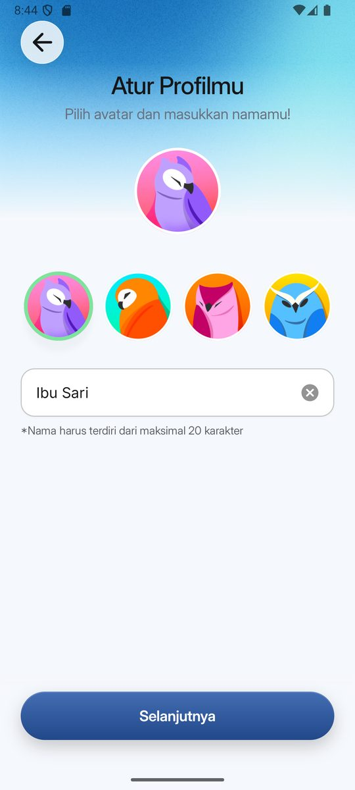<br><sub><b>ON-02 Profile setup (name typed)</b><br><code>on-02-name-filled</code></sub></td>
<td align="center" valign="top" width="33%">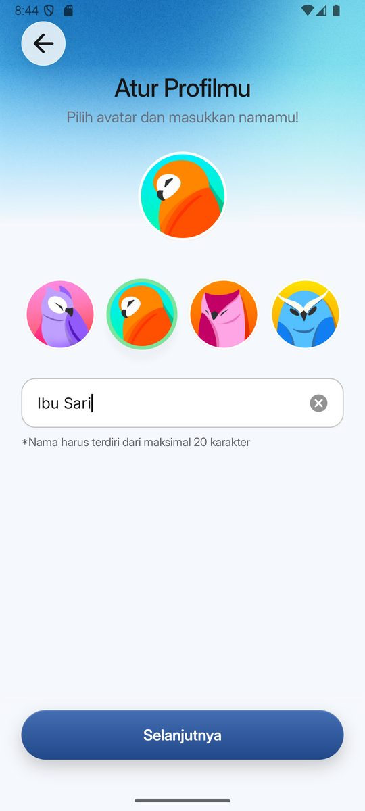<br><sub><b>ON-02 Another avatar picked</b><br><code>on-02-avatar-picked</code></sub></td>
<td align="center" valign="top" width="33%">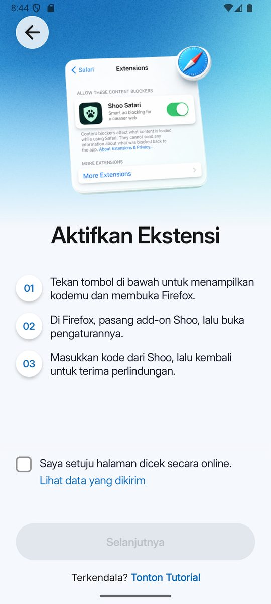<br><sub><b>ON-04 Turn on the add-on (consent not ticked)</b><br><code>on-04-turn-on</code></sub></td>
</tr>
<tr>
<td align="center" valign="top" width="33%">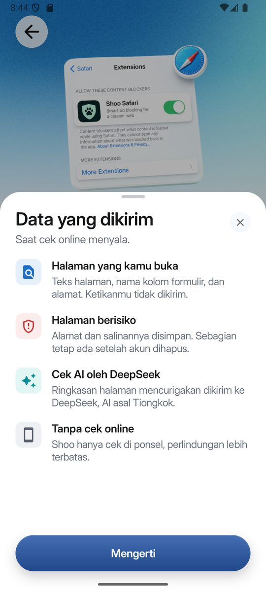<br><sub><b>ON-04 'See what is sent' sheet</b><br><code>on-04-data-sent-sheet</code></sub></td>
<td align="center" valign="top" width="33%">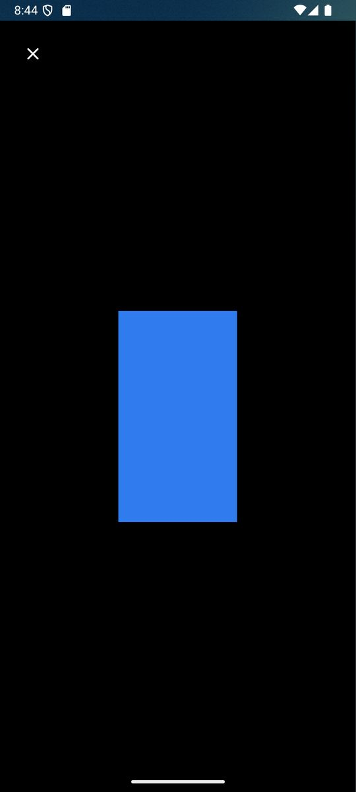<br><sub><b>ON-04 Tutorial video</b><br><code>on-04-tutorial</code></sub></td>
<td align="center" valign="top" width="33%">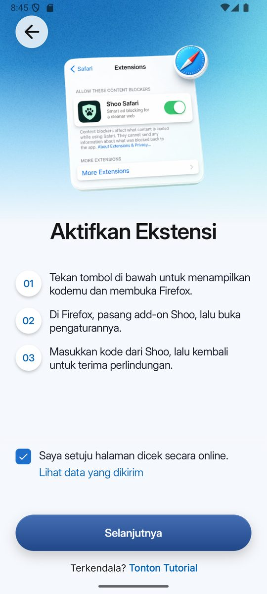<br><sub><b>ON-04 Consent ticked</b><br><code>on-04-consent-ticked</code></sub></td>
</tr>
<tr>
<td align="center" valign="top" width="33%">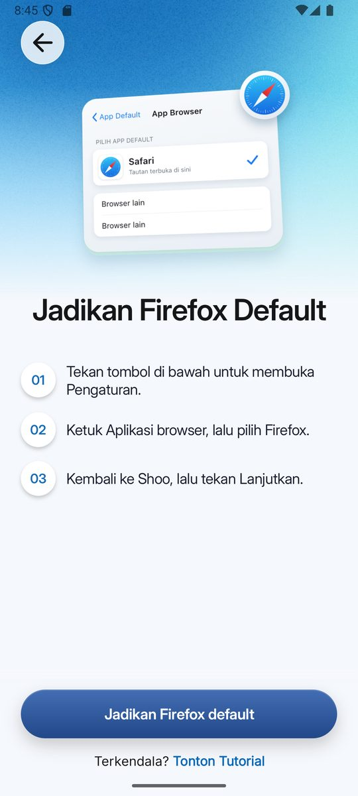<br><sub><b>ON-04b Make Firefox the default browser</b><br><code>on-04b-firefox-default</code></sub></td>
<td align="center" valign="top" width="33%">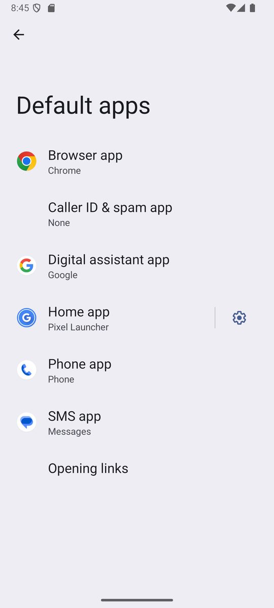<br><sub><b>ON-04b opens Android Default apps settings</b><br><code>on-04b-android-default-apps</code></sub></td>
<td align="center" valign="top" width="33%">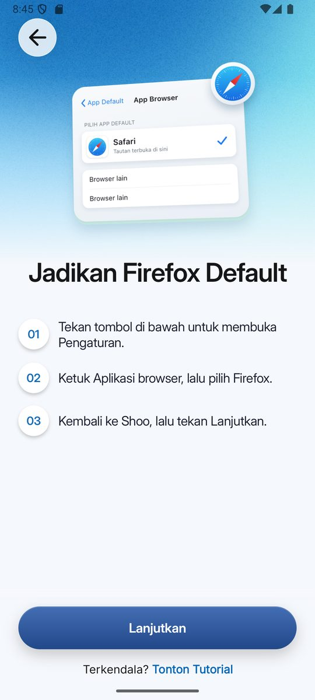<br><sub><b>ON-04b Back in Shoo (Continue)</b><br><code>on-04b-back-in-shoo</code></sub></td>
</tr>
<tr>
<td align="center" valign="top" width="33%">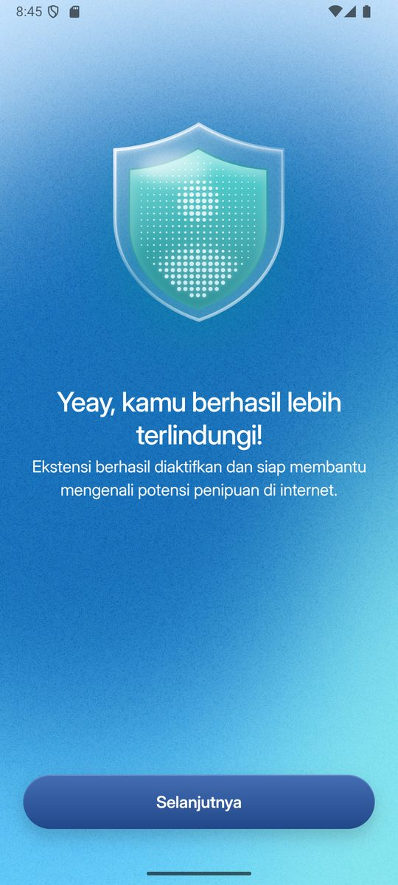<br><sub><b>ON-05 Success: you are better protected</b><br><code>on-05-protected-success</code></sub></td>
<td align="center" valign="top" width="33%">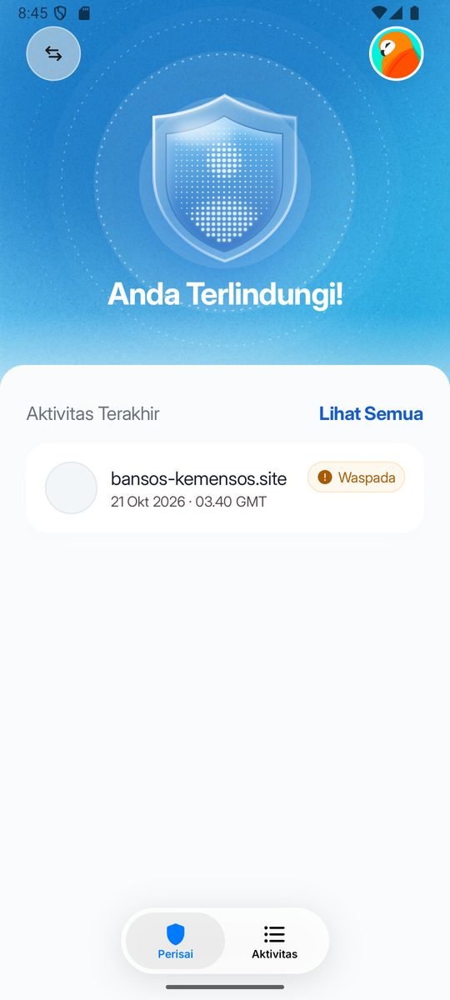<br><sub><b>After onboarding: Home</b><br><code>on-05-done-home</code></sub></td>
<td align="center" valign="top" width="33%">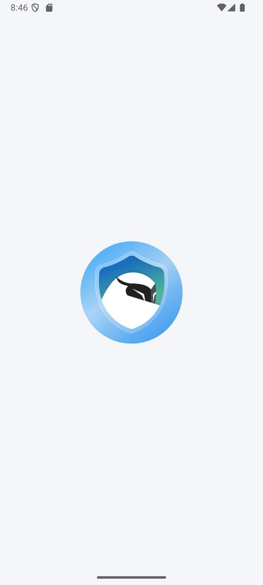<br><sub><b>ON-01 Launch splash</b><br><code>on-00-launch-splash</code></sub></td>
</tr>
<tr>
<td align="center" valign="top" width="33%">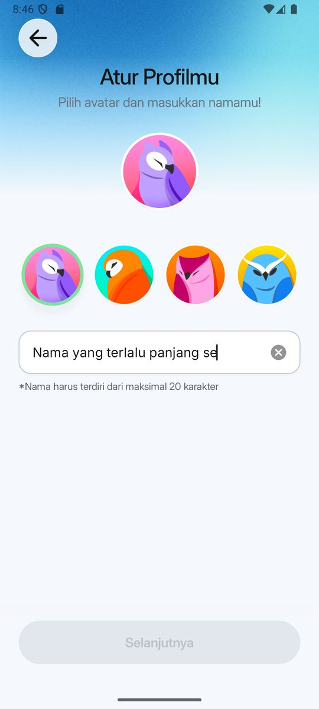<br><sub><b>ON-02 Name longer than 20 characters</b><br><code>on-02-name-too-long</code></sub></td>
<td align="center" valign="top" width="33%">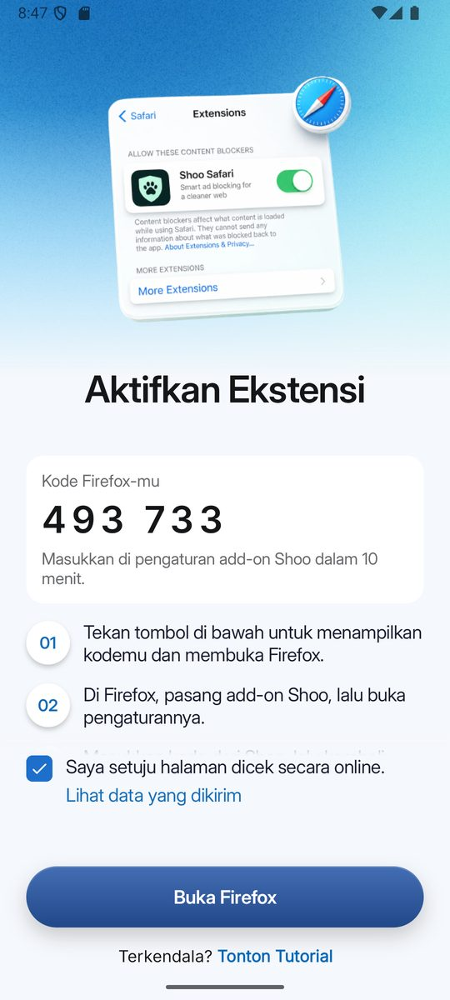<br><sub><b>ON-04 Firefox link code (add-on not linked yet)</b><br><code>on-04-firefox-code</code></sub></td>
<td align="center" valign="top" width="33%">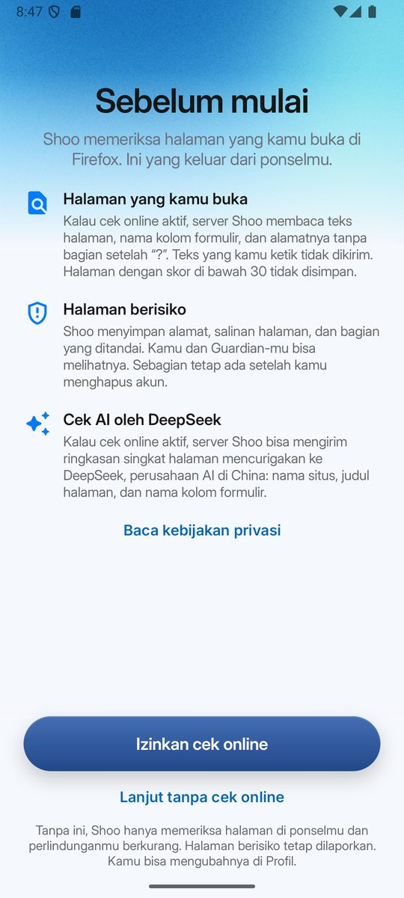<br><sub><b>Data consent question (existing user)</b><br><code>on-06-data-consent</code></sub></td>
</tr>
</table>

## Session

<table>
<tr>
<td align="center" valign="top" width="33%">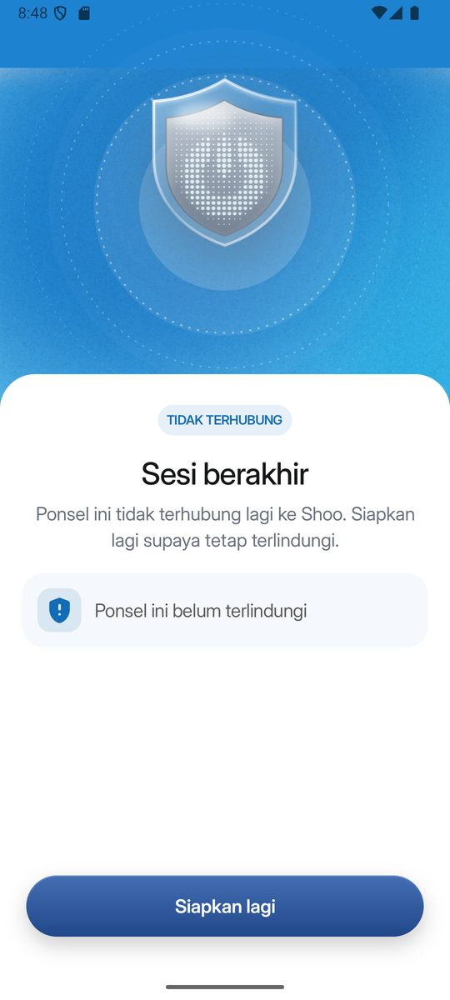<br><sub><b>Session expired</b><br><code>x-session-expired</code></sub></td>
</tr>
</table>

## Home · Pribadi (Guardian, personal)

<table>
<tr>
<td align="center" valign="top" width="33%"><br><sub><b>Home - Pribadi - scenario homePribadi</b><br><code>gd-01-pribadi-homePribadi</code></sub></td>
<td align="center" valign="top" width="33%">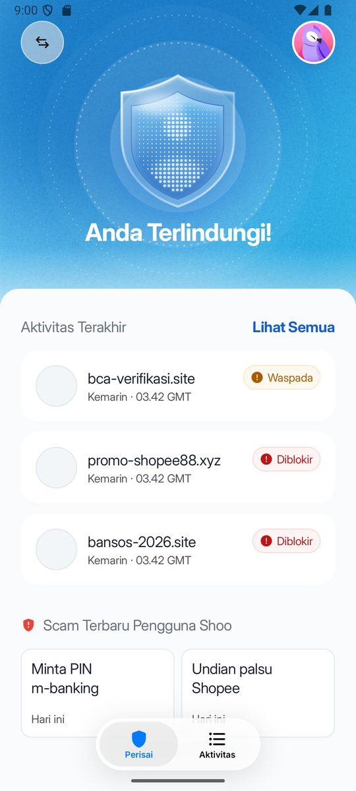<br><sub><b>Home - Pribadi - homePribadi (scrolled)</b><br><code>gd-01-pribadi-homePribadi-scrolled</code></sub></td>
<td align="center" valign="top" width="33%">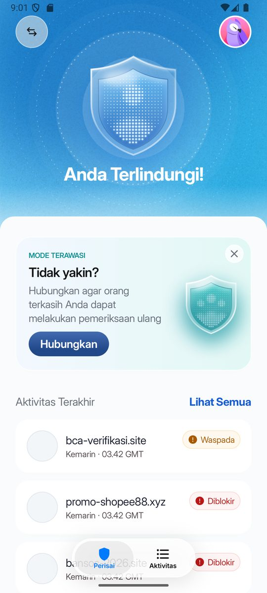<br><sub><b>Home - Pribadi - scenario homePribadiAlone</b><br><code>gd-01-pribadi-homePribadiAlone</code></sub></td>
</tr>
<tr>
<td align="center" valign="top" width="33%">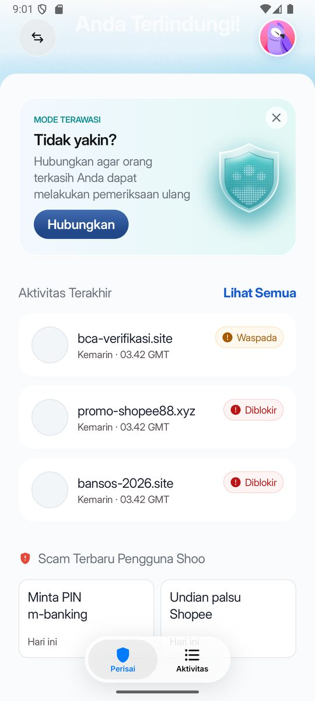<br><sub><b>Home - Pribadi - homePribadiAlone (scrolled)</b><br><code>gd-01-pribadi-homePribadiAlone-scrolled</code></sub></td>
<td align="center" valign="top" width="33%">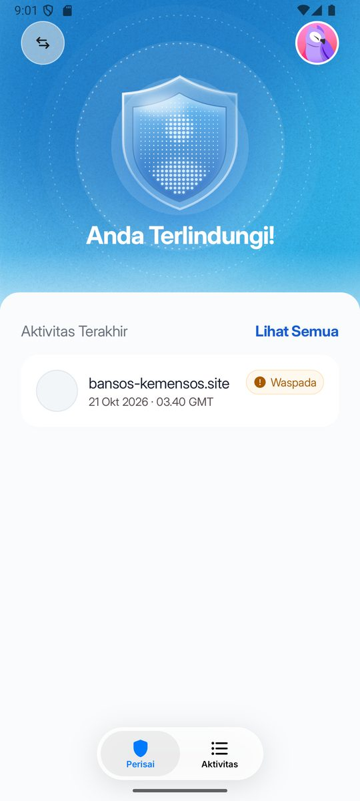<br><sub><b>Home - Pribadi - scenario standard</b><br><code>gd-01-pribadi-standard</code></sub></td>
<td align="center" valign="top" width="33%"><br><sub><b>Home - Pribadi - standard (scrolled)</b><br><code>gd-01-pribadi-standard-scrolled</code></sub></td>
</tr>
<tr>
<td align="center" valign="top" width="33%">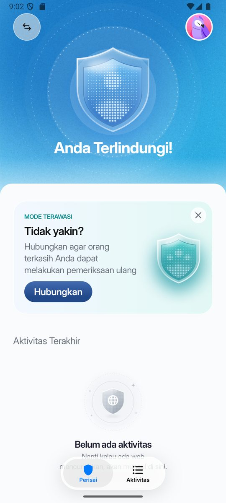<br><sub><b>Home - Pribadi - scenario empty</b><br><code>gd-01-pribadi-empty</code></sub></td>
<td align="center" valign="top" width="33%">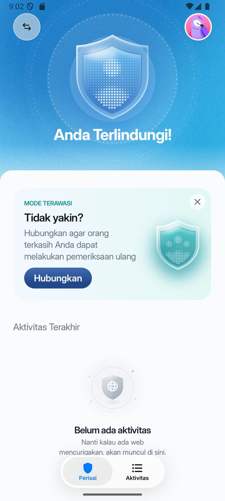<br><sub><b>Home - Pribadi - empty (scrolled)</b><br><code>gd-01-pribadi-empty-scrolled</code></sub></td>
<td align="center" valign="top" width="33%">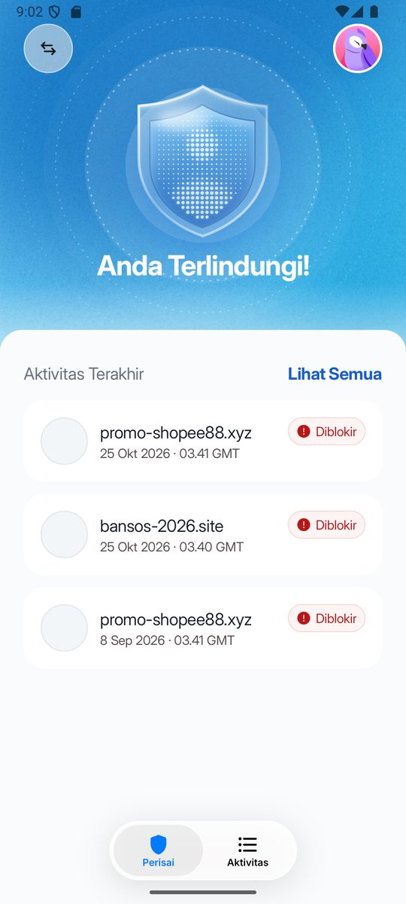<br><sub><b>Home - Pribadi - scenario allBlocked</b><br><code>gd-01-pribadi-allBlocked</code></sub></td>
</tr>
<tr>
<td align="center" valign="top" width="33%"><br><sub><b>Home - Pribadi - allBlocked (scrolled)</b><br><code>gd-01-pribadi-allBlocked-scrolled</code></sub></td>
<td align="center" valign="top" width="33%">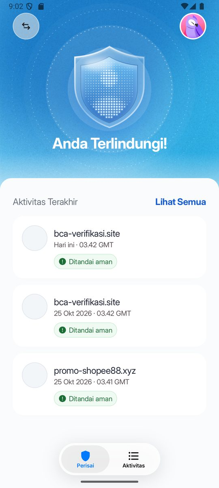<br><sub><b>Home - Pribadi - scenario allSafe</b><br><code>gd-01-pribadi-allSafe</code></sub></td>
<td align="center" valign="top" width="33%"><br><sub><b>Home - Pribadi - allSafe (scrolled)</b><br><code>gd-01-pribadi-allSafe-scrolled</code></sub></td>
</tr>
<tr>
<td align="center" valign="top" width="33%"><br><sub><b>Home - Pribadi - scenario figma</b><br><code>gd-01-pribadi-figma</code></sub></td>
<td align="center" valign="top" width="33%">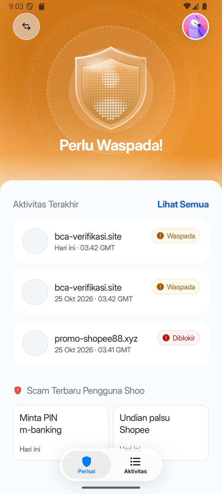<br><sub><b>Home - Pribadi - figma (scrolled)</b><br><code>gd-01-pribadi-figma-scrolled</code></sub></td>
</tr>
</table>

## Guardian intro (GD-02)

<table>
<tr>
<td align="center" valign="top" width="33%">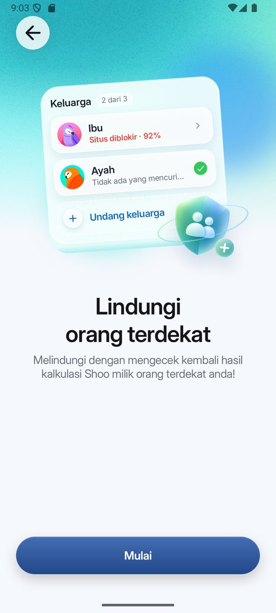<br><sub><b>GD-02 Become a Guardian intro</b><br><code>gd-02-guardian-intro</code></sub></td>
</tr>
</table>

## Home · Family mode (Guardian, GD-01/GD-03)

<table>
<tr>
<td align="center" valign="top" width="33%">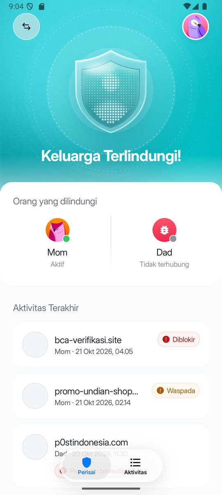<br><sub><b>Home - Family mode - scenario standard</b><br><code>gd-01-family-standard</code></sub></td>
<td align="center" valign="top" width="33%"><br><sub><b>Home - Family mode - standard (scrolled)</b><br><code>gd-01-family-standard-scrolled</code></sub></td>
<td align="center" valign="top" width="33%">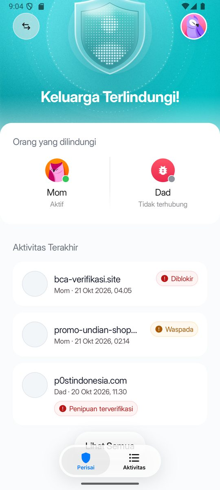<br><sub><b>Home - Family mode - standard (bottom)</b><br><code>gd-01-family-standard-bottom</code></sub></td>
</tr>
<tr>
<td align="center" valign="top" width="33%"><br><sub><b>Home - Family mode - scenario figma</b><br><code>gd-01-family-figma</code></sub></td>
<td align="center" valign="top" width="33%">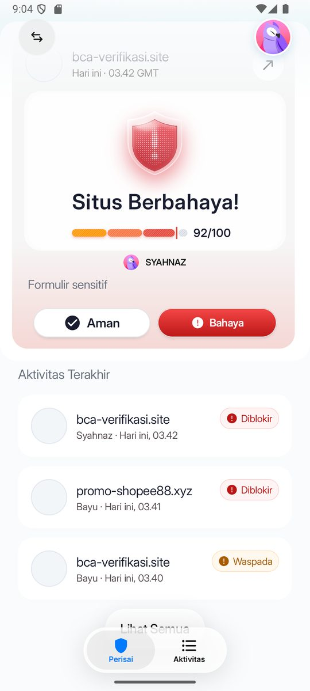<br><sub><b>Home - Family mode - figma (scrolled)</b><br><code>gd-01-family-figma-scrolled</code></sub></td>
<td align="center" valign="top" width="33%"><br><sub><b>Home - Family mode - figma (bottom)</b><br><code>gd-01-family-figma-bottom</code></sub></td>
</tr>
<tr>
<td align="center" valign="top" width="33%">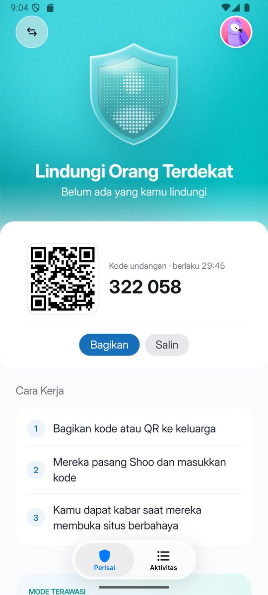<br><sub><b>Home - Family mode - scenario empty</b><br><code>gd-01-family-empty</code></sub></td>
<td align="center" valign="top" width="33%"><br><sub><b>Home - Family mode - empty (scrolled)</b><br><code>gd-01-family-empty-scrolled</code></sub></td>
<td align="center" valign="top" width="33%">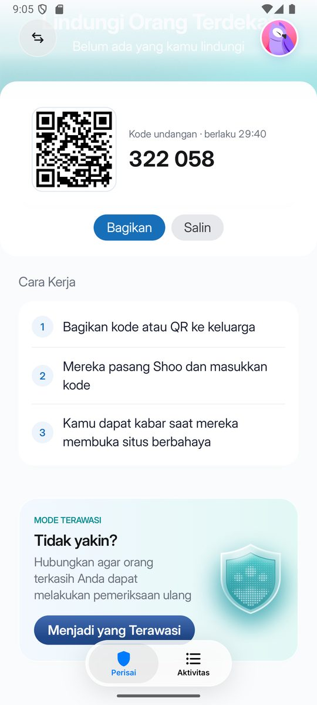<br><sub><b>Home - Family mode - empty (bottom)</b><br><code>gd-01-family-empty-bottom</code></sub></td>
</tr>
<tr>
<td align="center" valign="top" width="33%">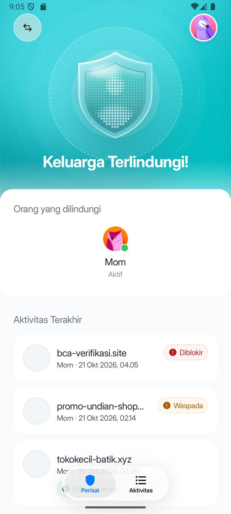<br><sub><b>Home - Family mode - scenario oneMember</b><br><code>gd-01-family-oneMember</code></sub></td>
<td align="center" valign="top" width="33%">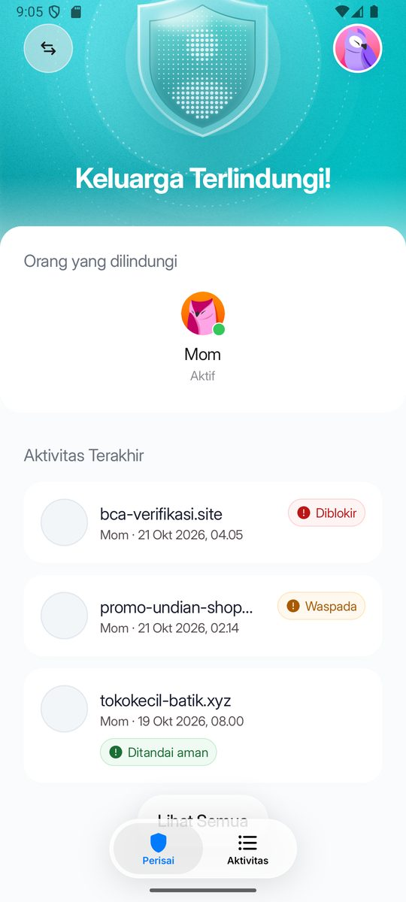<br><sub><b>Home - Family mode - oneMember (scrolled)</b><br><code>gd-01-family-oneMember-scrolled</code></sub></td>
<td align="center" valign="top" width="33%"><br><sub><b>Home - Family mode - oneMember (bottom)</b><br><code>gd-01-family-oneMember-bottom</code></sub></td>
</tr>
<tr>
<td align="center" valign="top" width="33%">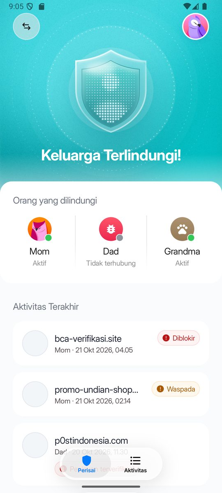<br><sub><b>Home - Family mode - scenario threeMembers</b><br><code>gd-01-family-threeMembers</code></sub></td>
<td align="center" valign="top" width="33%">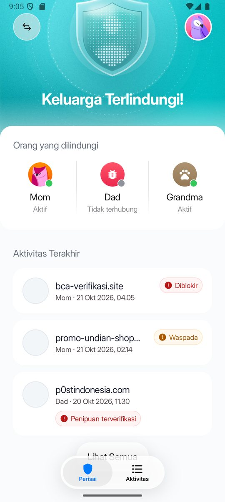<br><sub><b>Home - Family mode - threeMembers (scrolled)</b><br><code>gd-01-family-threeMembers-scrolled</code></sub></td>
<td align="center" valign="top" width="33%"><br><sub><b>Home - Family mode - threeMembers (bottom)</b><br><code>gd-01-family-threeMembers-bottom</code></sub></td>
</tr>
<tr>
<td align="center" valign="top" width="33%"><br><sub><b>Home - Family mode - scenario mixedVerdicts</b><br><code>gd-01-family-mixedVerdicts</code></sub></td>
<td align="center" valign="top" width="33%">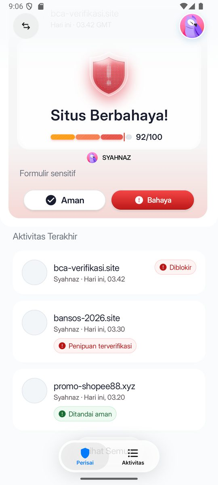<br><sub><b>Home - Family mode - mixedVerdicts (scrolled)</b><br><code>gd-01-family-mixedVerdicts-scrolled</code></sub></td>
<td align="center" valign="top" width="33%">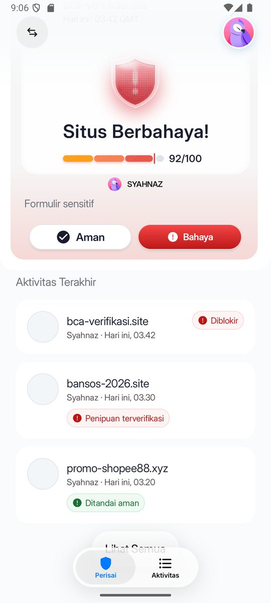<br><sub><b>Home - Family mode - mixedVerdicts (bottom)</b><br><code>gd-01-family-mixedVerdicts-bottom</code></sub></td>
</tr>
</table>

## Home · Protected (PR-04)

<table>
<tr>
<td align="center" valign="top" width="33%">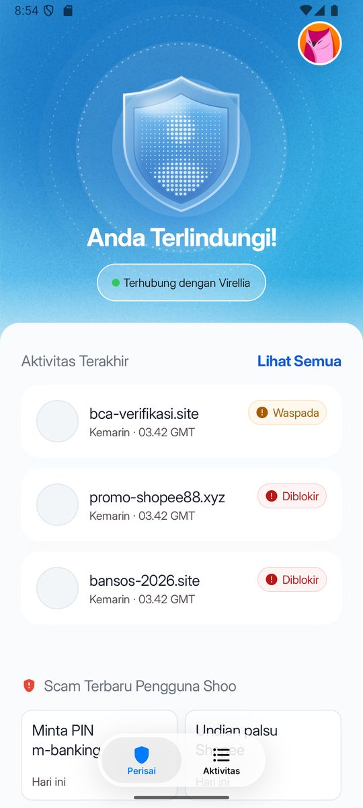<br><sub><b>Home - Protected - scenario protectedQuiet</b><br><code>pr-04-protectedQuiet</code></sub></td>
<td align="center" valign="top" width="33%">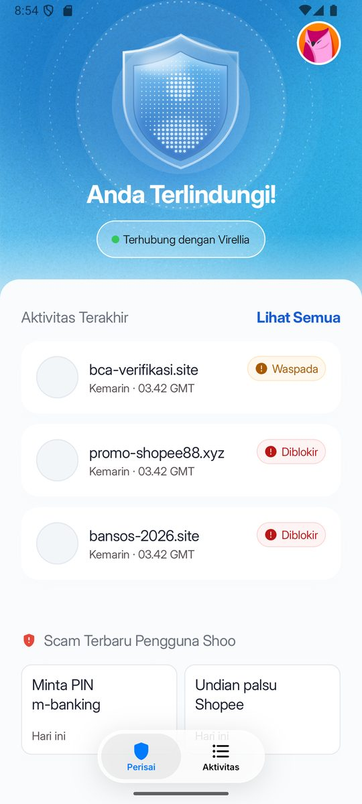<br><sub><b>Home - Protected - protectedQuiet (scrolled)</b><br><code>pr-04-protectedQuiet-scrolled</code></sub></td>
<td align="center" valign="top" width="33%">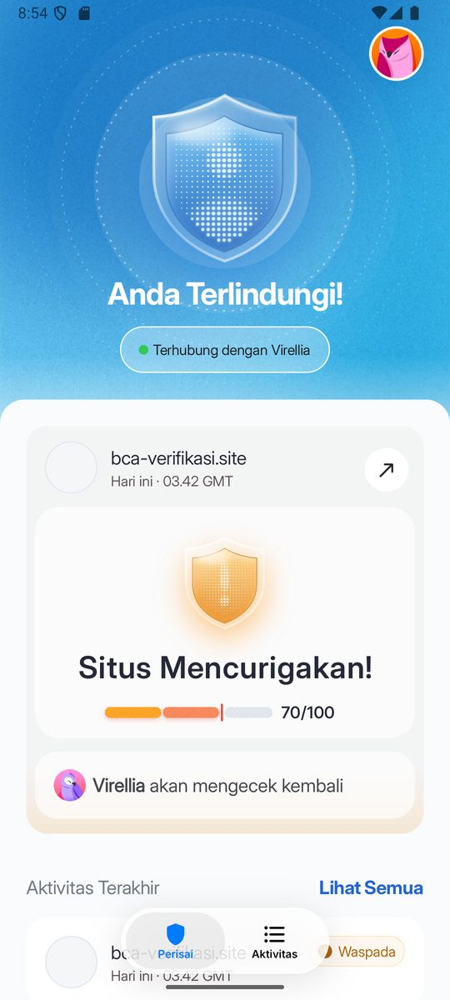<br><sub><b>Home - Protected - scenario protectedWarning</b><br><code>pr-04-protectedWarning</code></sub></td>
</tr>
<tr>
<td align="center" valign="top" width="33%">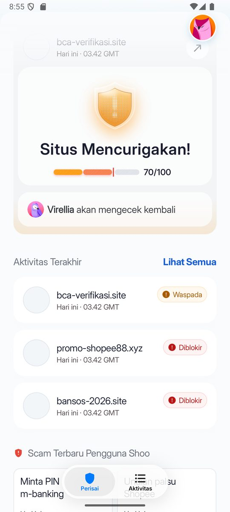<br><sub><b>Home - Protected - protectedWarning (scrolled)</b><br><code>pr-04-protectedWarning-scrolled</code></sub></td>
<td align="center" valign="top" width="33%">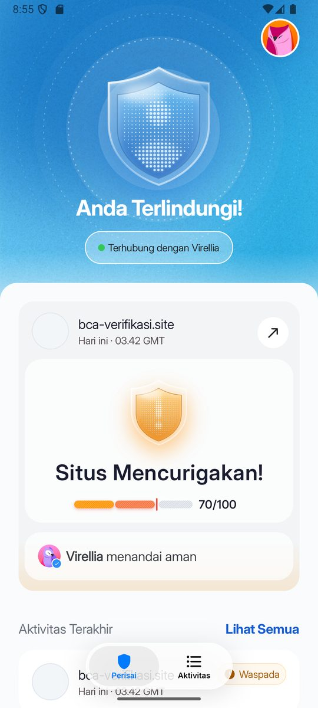<br><sub><b>Home - Protected - scenario protectedWarningSafe</b><br><code>pr-04-protectedWarningSafe</code></sub></td>
<td align="center" valign="top" width="33%">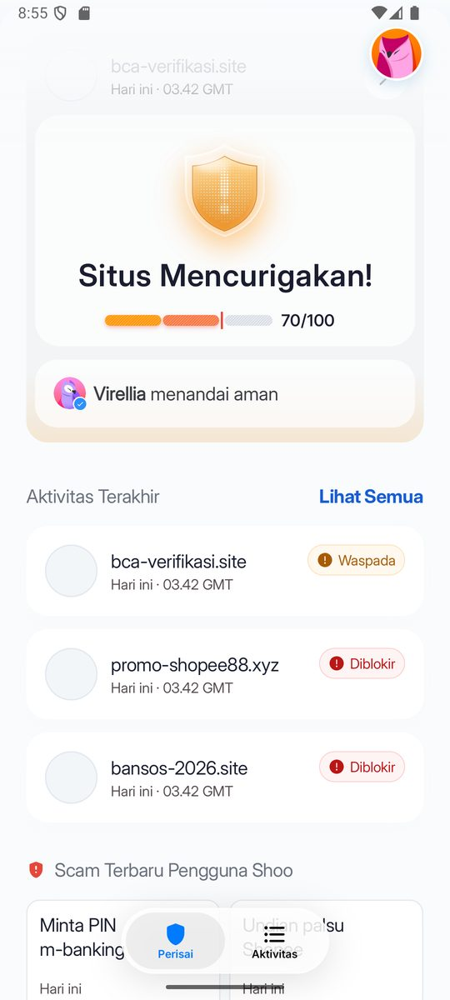<br><sub><b>Home - Protected - protectedWarningSafe (scrolled)</b><br><code>pr-04-protectedWarningSafe-scrolled</code></sub></td>
</tr>
<tr>
<td align="center" valign="top" width="33%">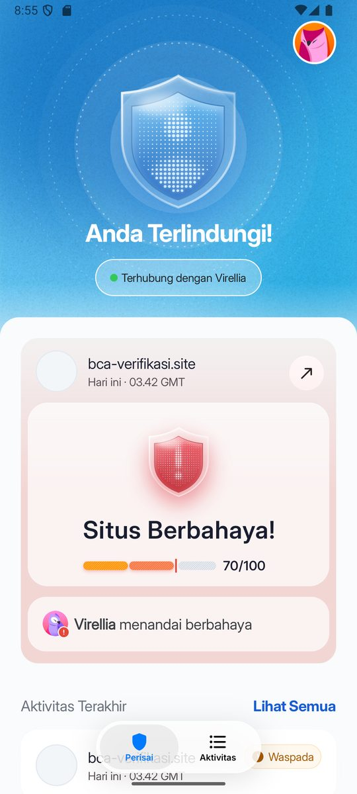<br><sub><b>Home - Protected - scenario protectedWarningScam</b><br><code>pr-04-protectedWarningScam</code></sub></td>
<td align="center" valign="top" width="33%">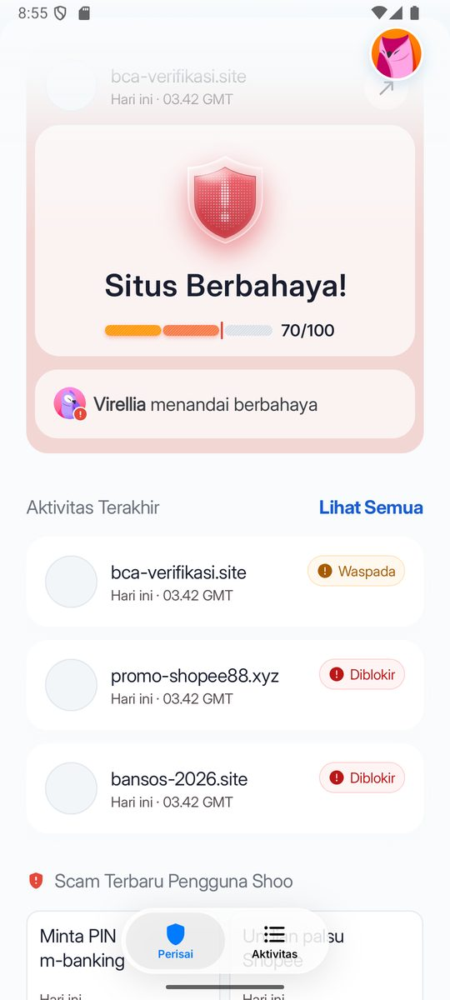<br><sub><b>Home - Protected - protectedWarningScam (scrolled)</b><br><code>pr-04-protectedWarningScam-scrolled</code></sub></td>
<td align="center" valign="top" width="33%">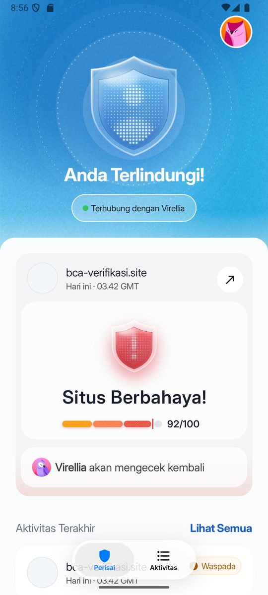<br><sub><b>Home - Protected - scenario protectedBlocked</b><br><code>pr-04-protectedBlocked</code></sub></td>
</tr>
<tr>
<td align="center" valign="top" width="33%">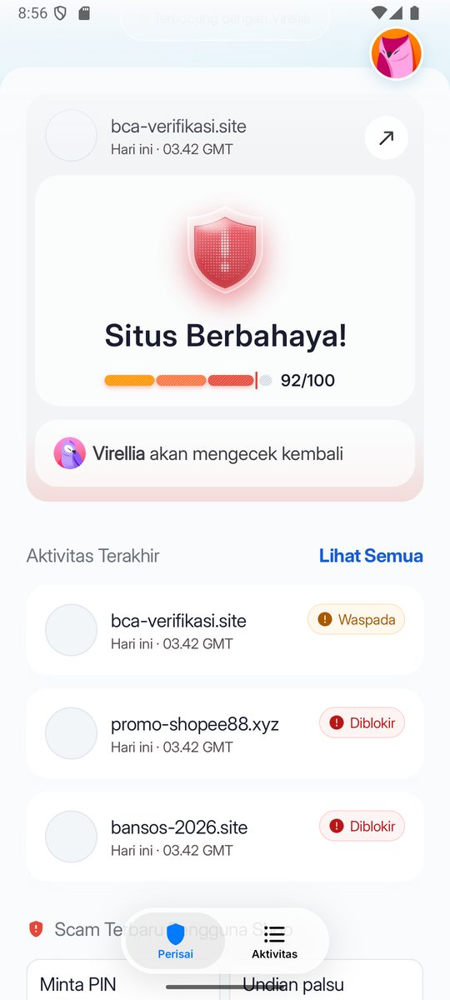<br><sub><b>Home - Protected - protectedBlocked (scrolled)</b><br><code>pr-04-protectedBlocked-scrolled</code></sub></td>
<td align="center" valign="top" width="33%"><br><sub><b>Home - Protected - scenario protectedBlockedSafe</b><br><code>pr-04-protectedBlockedSafe</code></sub></td>
<td align="center" valign="top" width="33%"><br><sub><b>Home - Protected - protectedBlockedSafe (scrolled)</b><br><code>pr-04-protectedBlockedSafe-scrolled</code></sub></td>
</tr>
<tr>
<td align="center" valign="top" width="33%"><br><sub><b>Home - Protected - scenario protectedBlockedScam</b><br><code>pr-04-protectedBlockedScam</code></sub></td>
<td align="center" valign="top" width="33%"><br><sub><b>Home - Protected - protectedBlockedScam (scrolled)</b><br><code>pr-04-protectedBlockedScam-scrolled</code></sub></td>
<td align="center" valign="top" width="33%"><br><sub><b>Home - Protected - scenario protectedAlone</b><br><code>pr-04-protectedAlone</code></sub></td>
</tr>
<tr>
<td align="center" valign="top" width="33%"><br><sub><b>Home - Protected - protectedAlone (scrolled)</b><br><code>pr-04-protectedAlone-scrolled</code></sub></td>
<td align="center" valign="top" width="33%"><br><sub><b>Home - Protected - scenario unpaired</b><br><code>pr-04-unpaired</code></sub></td>
<td align="center" valign="top" width="33%"><br><sub><b>Home - Protected - unpaired (scrolled)</b><br><code>pr-04-unpaired-scrolled</code></sub></td>
</tr>
<tr>
<td align="center" valign="top" width="33%"><br><sub><b>Home - Protected - add-on switched off</b><br><code>pr-04-addon-off</code></sub></td>
<td align="center" valign="top" width="33%"><br><sub><b>Turn on the add-on sheet</b><br><code>pr-04-turn-on-sheet</code></sub></td>
</tr>
</table>

## Pairing · Connect (PR-01)

<table>
<tr>
<td align="center" valign="top" width="33%"><br><sub><b>PR-01 Connect to a Guardian</b><br><code>pr-01-connect</code></sub></td>
<td align="center" valign="top" width="33%"><br><sub><b>PR-01 Code entered</b><br><code>pr-01-connect-code</code></sub></td>
<td align="center" valign="top" width="33%"><br><sub><b>PR-01 Connected</b><br><code>pr-01-connected</code></sub></td>
</tr>
<tr>
<td align="center" valign="top" width="33%"><br><sub><b>PR-01 Wrong code</b><br><code>pr-01-connect-error</code></sub></td>
<td align="center" valign="top" width="33%"><br><sub><b>PR-01 Scan QR (camera permission asked just in time)</b><br><code>pr-01-scan-qr</code></sub></td>
</tr>
</table>

## Pairing · Invite (GD-04)

<table>
<tr>
<td align="center" valign="top" width="33%"><br><sub><b>GD-04 Invite sheet (QR, code, share)</b><br><code>gd-04-invite-sheet</code></sub></td>
<td align="center" valign="top" width="33%"><br><sub><b>GD-04 Invite sheet (scrolled)</b><br><code>gd-04-invite-sheet-scrolled</code></sub></td>
</tr>
</table>

## Activity (PR-05)

<table>
<tr>
<td align="center" valign="top" width="33%"><br><sub><b>Activity - Pribadi</b><br><code>pr-05-activity-pribadi</code></sub></td>
<td align="center" valign="top" width="33%"><br><sub><b>Activity - Pribadi - filter Waspada</b><br><code>pr-05-activity-pribadi-filter-warning</code></sub></td>
<td align="center" valign="top" width="33%"><br><sub><b>Activity - Pribadi - filter Diblokir</b><br><code>pr-05-activity-pribadi-filter-blocked</code></sub></td>
</tr>
<tr>
<td align="center" valign="top" width="33%"><br><sub><b>Activity - Protected</b><br><code>pr-05-activity-protected</code></sub></td>
<td align="center" valign="top" width="33%"><br><sub><b>Activity - Protected - filter Waspada</b><br><code>pr-05-activity-protected-filter-warning</code></sub></td>
<td align="center" valign="top" width="33%"><br><sub><b>Activity - Protected - filter Diblokir</b><br><code>pr-05-activity-protected-filter-blocked</code></sub></td>
</tr>
<tr>
<td align="center" valign="top" width="33%"><br><sub><b>Activity - empty</b><br><code>pr-05-activity-empty</code></sub></td>
<td align="center" valign="top" width="33%"><br><sub><b>Activity - could not load</b><br><code>pr-05-activity-error</code></sub></td>
</tr>
</table>

## Activity · Family (GD-05)

<table>
<tr>
<td align="center" valign="top" width="33%"><br><sub><b>Activity - Family</b><br><code>gd-05-activity-family</code></sub></td>
<td align="center" valign="top" width="33%"><br><sub><b>Activity - Family - filter Waspada</b><br><code>gd-05-activity-family-filter-warning</code></sub></td>
<td align="center" valign="top" width="33%"><br><sub><b>Activity - Family - filter Diblokir</b><br><code>gd-05-activity-family-filter-blocked</code></sub></td>
</tr>
<tr>
<td align="center" valign="top" width="33%"><br><sub><b>Activity - Family - person picker</b><br><code>gd-05-activity-person-picker</code></sub></td>
</tr>
</table>

## Detail (DT-*)

<table>
<tr>
<td align="center" valign="top" width="33%"><br><sub><b>Detail - blocked-92 - Guardian (family)</b><br><code>dt-blocked-92</code></sub></td>
<td align="center" valign="top" width="33%"><br><sub><b>Detail - blocked-92 - evidence</b><br><code>dt-blocked-92-2</code></sub></td>
<td align="center" valign="top" width="33%"><br><sub><b>Detail - blocked-92 - further down</b><br><code>dt-blocked-92-3</code></sub></td>
</tr>
<tr>
<td align="center" valign="top" width="33%"><br><sub><b>Detail - warning-63 - Guardian (family)</b><br><code>dt-warning-63</code></sub></td>
<td align="center" valign="top" width="33%"><br><sub><b>Detail - warning-63 - evidence</b><br><code>dt-warning-63-2</code></sub></td>
<td align="center" valign="top" width="33%"><br><sub><b>Detail - warning-63 - further down</b><br><code>dt-warning-63-3</code></sub></td>
</tr>
<tr>
<td align="center" valign="top" width="33%"><br><sub><b>Detail - warning-41 - Guardian (family)</b><br><code>dt-warning-41</code></sub></td>
<td align="center" valign="top" width="33%"><br><sub><b>Detail - warning-41 - evidence</b><br><code>dt-warning-41-2</code></sub></td>
<td align="center" valign="top" width="33%"><br><sub><b>Detail - warning-41 - further down</b><br><code>dt-warning-41-3</code></sub></td>
</tr>
<tr>
<td align="center" valign="top" width="33%"><br><sub><b>Detail - verified-scam - Guardian (family)</b><br><code>dt-verified-scam</code></sub></td>
<td align="center" valign="top" width="33%"><br><sub><b>Detail - verified-scam - evidence</b><br><code>dt-verified-scam-2</code></sub></td>
<td align="center" valign="top" width="33%"><br><sub><b>Detail - verified-scam - further down</b><br><code>dt-verified-scam-3</code></sub></td>
</tr>
<tr>
<td align="center" valign="top" width="33%"><br><sub><b>Detail - marked-safe - Guardian (family)</b><br><code>dt-marked-safe</code></sub></td>
<td align="center" valign="top" width="33%"><br><sub><b>Detail - marked-safe - evidence</b><br><code>dt-marked-safe-2</code></sub></td>
<td align="center" valign="top" width="33%"><br><sub><b>Detail - marked-safe - further down</b><br><code>dt-marked-safe-3</code></sub></td>
</tr>
<tr>
<td align="center" valign="top" width="33%"><br><sub><b>Detail - blocked - Protected view</b><br><code>dt-blocked-92-protected</code></sub></td>
<td align="center" valign="top" width="33%"><br><sub><b>DT-04 Page copy (replica)</b><br><code>dt-04-page-copy</code></sub></td>
<td align="center" valign="top" width="33%"><br><sub><b>Detail - scan no longer exists</b><br><code>dt-gone</code></sub></td>
</tr>
</table>

## Verdict (GD-07)

<table>
<tr>
<td align="center" valign="top" width="33%"><br><sub><b>GD-07 Why is it safe? sheet</b><br><code>gd-07-safe-reason-sheet</code></sub></td>
<td align="center" valign="top" width="33%"><br><sub><b>GD-07 Marked dangerous</b><br><code>gd-07-marked-danger</code></sub></td>
</tr>
</table>

## Profile (PF-01)

<table>
<tr>
<td align="center" valign="top" width="33%"><br><sub><b>Profile - pribadi</b><br><code>pf-01-profile-pribadi</code></sub></td>
<td align="center" valign="top" width="33%"><br><sub><b>Profile - pribadi (scrolled)</b><br><code>pf-01-profile-pribadi-2</code></sub></td>
<td align="center" valign="top" width="33%"><br><sub><b>Profile - pribadi (bottom)</b><br><code>pf-01-profile-pribadi-3</code></sub></td>
</tr>
<tr>
<td align="center" valign="top" width="33%"><br><sub><b>Profile - family</b><br><code>pf-01-profile-family</code></sub></td>
<td align="center" valign="top" width="33%"><br><sub><b>Profile - family (scrolled)</b><br><code>pf-01-profile-family-2</code></sub></td>
<td align="center" valign="top" width="33%"><br><sub><b>Profile - family (bottom)</b><br><code>pf-01-profile-family-3</code></sub></td>
</tr>
<tr>
<td align="center" valign="top" width="33%"><br><sub><b>Profile - protected</b><br><code>pf-01-profile-protected</code></sub></td>
<td align="center" valign="top" width="33%"><br><sub><b>Profile - protected (scrolled)</b><br><code>pf-01-profile-protected-2</code></sub></td>
<td align="center" valign="top" width="33%"><br><sub><b>Profile - protected (bottom)</b><br><code>pf-01-profile-protected-3</code></sub></td>
</tr>
<tr>
<td align="center" valign="top" width="33%"><br><sub><b>Profile page - mode</b><br><code>pf-01-page-mode</code></sub></td>
<td align="center" valign="top" width="33%"><br><sub><b>Profile page - mode (scrolled)</b><br><code>pf-01-page-mode-2</code></sub></td>
<td align="center" valign="top" width="33%"><br><sub><b>Profile page - editProfile</b><br><code>pf-01-page-editProfile</code></sub></td>
</tr>
<tr>
<td align="center" valign="top" width="33%"><br><sub><b>Profile page - editProfile (scrolled)</b><br><code>pf-01-page-editProfile-2</code></sub></td>
<td align="center" valign="top" width="33%"><br><sub><b>Profile page - notifications</b><br><code>pf-01-page-notifications</code></sub></td>
<td align="center" valign="top" width="33%"><br><sub><b>Profile page - notifications (scrolled)</b><br><code>pf-01-page-notifications-2</code></sub></td>
</tr>
<tr>
<td align="center" valign="top" width="33%"><br><sub><b>Profile page - language</b><br><code>pf-01-page-language</code></sub></td>
<td align="center" valign="top" width="33%"><br><sub><b>Profile page - language (scrolled)</b><br><code>pf-01-page-language-2</code></sub></td>
<td align="center" valign="top" width="33%"><br><sub><b>Profile page - theme</b><br><code>pf-01-page-theme</code></sub></td>
</tr>
<tr>
<td align="center" valign="top" width="33%"><br><sub><b>Profile page - theme (scrolled)</b><br><code>pf-01-page-theme-2</code></sub></td>
<td align="center" valign="top" width="33%"><br><sub><b>Profile page - accessibility</b><br><code>pf-01-page-accessibility</code></sub></td>
<td align="center" valign="top" width="33%"><br><sub><b>Profile page - accessibility (scrolled)</b><br><code>pf-01-page-accessibility-2</code></sub></td>
</tr>
<tr>
<td align="center" valign="top" width="33%"><br><sub><b>Profile page - about</b><br><code>pf-01-page-about</code></sub></td>
<td align="center" valign="top" width="33%"><br><sub><b>Profile page - about (scrolled)</b><br><code>pf-01-page-about-2</code></sub></td>
<td align="center" valign="top" width="33%"><br><sub><b>Profile page - licenses</b><br><code>pf-01-page-licenses</code></sub></td>
</tr>
<tr>
<td align="center" valign="top" width="33%"><br><sub><b>Profile page - licenses (scrolled)</b><br><code>pf-01-page-licenses-2</code></sub></td>
<td align="center" valign="top" width="33%"><br><sub><b>Profile page - Linked account (Protected)</b><br><code>pf-01-page-connection</code></sub></td>
<td align="center" valign="top" width="33%"><br><sub><b>Profile page - Manage profile (Protected)</b><br><code>pf-01-page-editProfile-protected</code></sub></td>
</tr>
<tr>
<td align="center" valign="top" width="33%"><br><sub><b>Profile - name sheet</b><br><code>pf-01-name-sheet</code></sub></td>
<td align="center" valign="top" width="33%"><br><sub><b>Profile - avatar sheet</b><br><code>pf-01-avatar-sheet</code></sub></td>
<td align="center" valign="top" width="33%"><br><sub><b>Profile - family member detail</b><br><code>pf-01-member-detail</code></sub></td>
</tr>
<tr>
<td align="center" valign="top" width="33%"><br><sub><b>Member detail (scrolled)</b><br><code>pf-01-member-detail-2</code></sub></td>
<td align="center" valign="top" width="33%"><br><sub><b>Profile - delete account sheet</b><br><code>pf-01-delete-sheet</code></sub></td>
</tr>
</table>

## Variants: English, dark theme, largest text

<table>
<tr>
<td align="center" valign="top" width="33%"><br><sub><b>English - Home</b><br><code>var-en-home</code></sub></td>
<td align="center" valign="top" width="33%"><br><sub><b>English - Activity</b><br><code>var-en-activity</code></sub></td>
<td align="center" valign="top" width="33%"><br><sub><b>English - Detail</b><br><code>var-en-detail</code></sub></td>
</tr>
<tr>
<td align="center" valign="top" width="33%"><br><sub><b>English - Profile</b><br><code>var-en-profile</code></sub></td>
<td align="center" valign="top" width="33%"><br><sub><b>Dark theme - Home</b><br><code>var-dark-home</code></sub></td>
<td align="center" valign="top" width="33%"><br><sub><b>Dark theme - Activity</b><br><code>var-dark-activity</code></sub></td>
</tr>
<tr>
<td align="center" valign="top" width="33%"><br><sub><b>Dark theme - Detail</b><br><code>var-dark-detail</code></sub></td>
<td align="center" valign="top" width="33%"><br><sub><b>Dark theme - Profile</b><br><code>var-dark-profile</code></sub></td>
<td align="center" valign="top" width="33%"><br><sub><b>Largest text - Home</b><br><code>var-large-home</code></sub></td>
</tr>
<tr>
<td align="center" valign="top" width="33%"><br><sub><b>Largest text - Activity</b><br><code>var-large-activity</code></sub></td>
<td align="center" valign="top" width="33%"><br><sub><b>Largest text - Detail</b><br><code>var-large-detail</code></sub></td>
<td align="center" valign="top" width="33%"><br><sub><b>Largest text - Profile</b><br><code>var-large-profile</code></sub></td>
</tr>
<tr>
<td align="center" valign="top" width="33%"><br><sub><b>English - Onboarding slide 1</b><br><code>var-en-onboarding</code></sub></td>
</tr>
</table>

## Firefox for Android add-on

<table>
<tr>
<td align="center" valign="top" width="33%"><br><sub><b>Firefox add-on - settings page linked to the app (code entered)</b><br><code>addon-01-settings-linked</code></sub></td>
<td align="center" valign="top" width="33%"><br><sub><b>Firefox add-on - block page (Safari pipeline running in Firefox)</b><br><code>addon-02-block-page</code></sub></td>
</tr>
</table>

## Motion: Android next to iOS

Recorded with animations on (`adb screenrecord`, 12 fps GIF). The iOS GIFs are the existing QA
recordings in `plan/alief/qa/img/`. Every animation site is listed in `android/MOTION-PARITY.md`.

<table>
<tr><th>Use case</th><th>Android</th><th>iOS</th></tr>
<tr><td>ON-01 Launch splash (cold start)</td><td></td><td></td></tr>
<tr><td>ON-01 Slides → profile setup</td><td></td><td>—</td></tr>
<tr><td>Home hero: shield breath, halftone wave, glass sweep, pulse rings</td><td></td><td></td></tr>
<tr><td>PR-04 Protected status</td><td></td><td></td></tr>
<tr><td>GD-01 Verdict on Home (Bahaya)</td><td></td><td></td></tr>
<tr><td>GD-07 Verdict on Detail (Bahaya)</td><td></td><td></td></tr>
<tr><td>GD-07 'Why is it safe?' sheet in/out</td><td></td><td>—</td></tr>
<tr><td>PR-01 Wrong code</td><td></td><td></td></tr>
<tr><td>PR-01 Joined</td><td></td><td></td></tr>
<tr><td>GD-04 Copy invite (icon motion)</td><td></td><td></td></tr>
<tr><td>PF-01 Remind → Sent</td><td></td><td></td></tr>
<tr><td>Tab switch, push Detail, back</td><td></td><td>—</td></tr>
</table>

## Reproduce

Each entry of `manifest.json` lists the launch extras of its screenshot. Install the Debug APK, then pass them
with `--es <flag> <value>` as above. Flags: `-settings.<key>` (mode, language, familyModeOn, theme, textSize…),
`-mock.scenario`, `-mock.fail`, `-debug.tab|detail|profile|profilePage|member|sessionExpired`, `-UITest*`.
