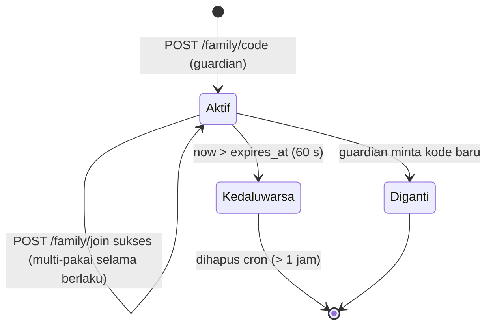
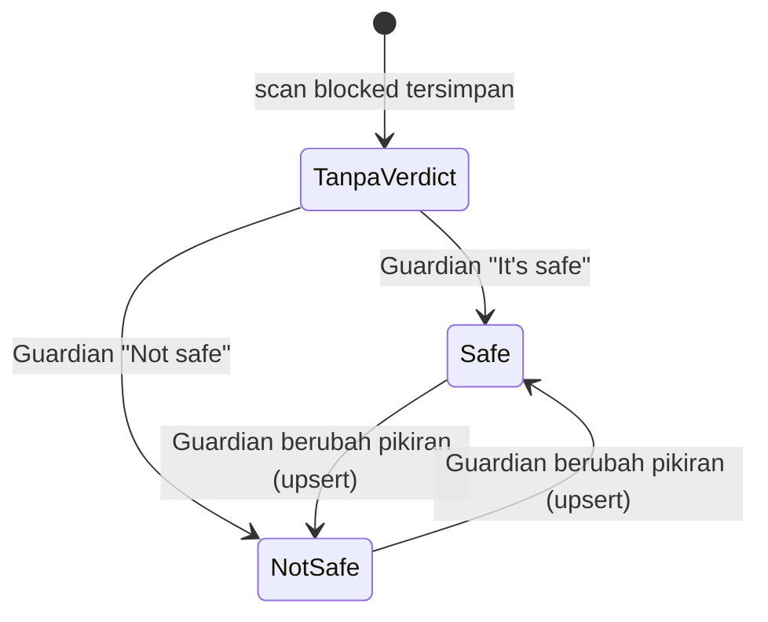

# R4 — State machine: family code, join, verdict, retensi

## 1. Family code (GD-04)



Aturan:
- `POST /family/code` di dalam transaksi: hapus kode lama milik guardian, hapus kode kedaluwarsa yang bentrok, pilih 4 digit acak (`crypto.getRandomValues`) yang tidak sedang aktif (maks 20 percobaan, lalu 503 `code_unavailable`, kode baru di R3 §1), insert `expires_at = now() + 60 s`.
- App Guardian meminta kode baru otomatis saat hitung mundur 0 (GD-04 "ganti tiap 60 detik"), hanya selama layar Family code terbuka.
- Kode tetap bisa dipakai beberapa Protected selama berlaku, sampai keluarga penuh.

## 2. Join (PR-01, PR-03)

```text
POST /family/join {code}  (protected)
 1. Cek batas percobaan (R3 §5) → 429 too_many_attempts
 2. Sudah punya guardian → 409 already_connected
 3. Kode tidak ada → catat gagal, 404 code_invalid
 4. Kode kedaluwarsa → catat gagal, 410 code_expired
 5. Transaksi: advisory lock guardian → count links ≥ 3 → 409 family_full
 6. Insert family_links, catat sukses
 7. 200 { guardian: { deviceId, name, avatarId } }
```

Disconnect: `DELETE /family/members/{id}` (guardian) atau `DELETE /family/guardian` (protected) menghapus baris `family_links`. Akses Guardian ke scan lama langsung hilang (SECURITY T12). Verdict yang sudah dibuat tetap milik pemilik scan.

## 3. Scan → push (GD-06)

```text
POST /scans (device X)
 1. Validasi + simpan scan (owner = X)
 2. Screenshot: lolos batas ukuran, dedupe, kuota → upload; selain itu dibuang
 3. Respons 201 { id }
 4. waitUntil: kalau X mode protected dan punya guardian G dengan apns_token:
      (lookup sebelum respons; maks 10 push / 10 menit per G) kirim push ke G lewat ApnsSender langsung
      (D-alief-B01/B11; teks bahasa G), 410 → kosongkan apns_token (compare-and-clear), tulis push_log (kode hasil saja)
    kalau X mode guardian: tidak ada push (dia melihat popup sendiri)
```

## 4. Verdict → unblock (GD-07, EX-06)



- Verdict berlaku per `(owner_id, domain)` (kontrak). Semua scan **blocked** pemilik itu di domain yang sama ikut menampilkan verdict tersebut; scan warning tetap `verdict: null`.
- `safe` → extension Protected (polling `GET /verdicts?domain=` tiap 5 s) membuka halaman. Target: `GET /verdicts` mencerminkan keputusan ≤ 1 s setelah `POST /verdicts` (cache Hyperdrive dimatikan, D-alief-17); halaman terbuka ≤ 10 s ujung ke ujung. Diukur di Worker cloud, bukan hanya lokal. Halaman yang diblokir tidak pernah terbuka otomatis tanpa verdict.
- `not_safe` → Detail menampilkan "Verified scam by [nama]"; kalau layak (R2 §5), domain masuk antrean `blocklist_entries` dan baru muncul di `GET /blocklist` (layer 1 detector Imelda) setelah review manual (D-alief-25).
- Tidak ada layar konfirmasi di app (GD-07). App menerapkan optimistic update lalu rollback kalau request gagal, dengan pesan error.

## 5. Retensi (harian, Cron Worker `0 19 * * *` UTC = 03:00 WITA)

```text
1. Ambil batch 500 scan created_at < now() - 14 hari (returning id, screenshot_path)
2. Hapus objek Storage untuk path yang tidak dipakai scan lain yang lebih baru (dedupe!)
3. Hapus baris scan batch itu (satu `DELETE /storage/v1/object/screenshots` dengan `prefixes` per batch); ulangi sampai kosong atau 10 batch (Workers Free: 10 ms CPU + 50 subrequest per Cron)
4. Hapus family_codes, join_attempts, push_log lama (R2 §6)
5. Upsert `ops_heartbeat`, log jumlah yang dihapus
```

Uji lokal: `curl "http://localhost:8787/cdn-cgi/local/scheduled?cron=0+19+*+*+*"` saat `wrangler dev` jalan.

Karena dedupe screenshot memakai ulang `screenshot_path`, objek hanya dihapus kalau tidak ada scan tersisa yang menunjuk ke path itu.
