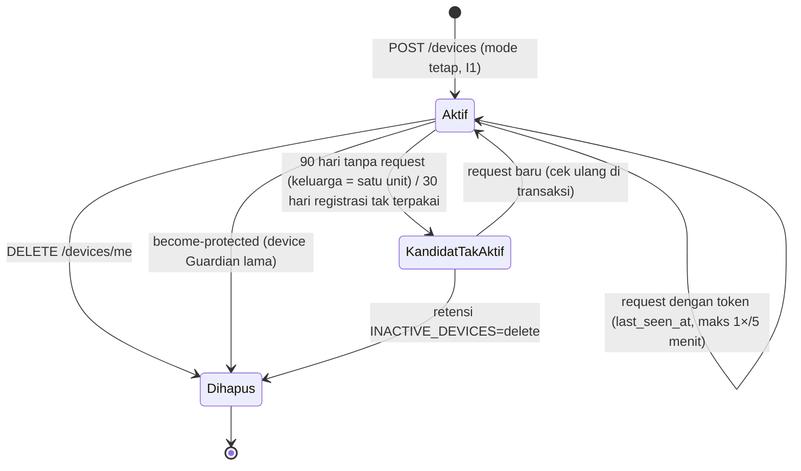
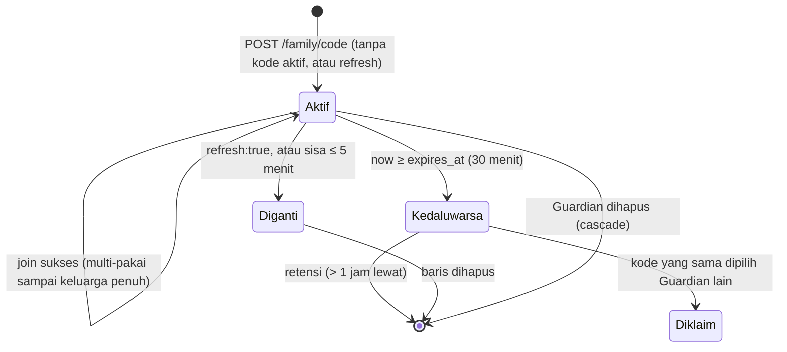
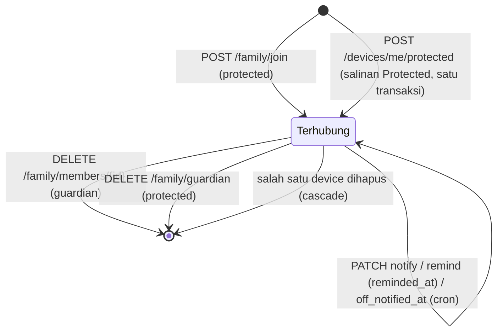
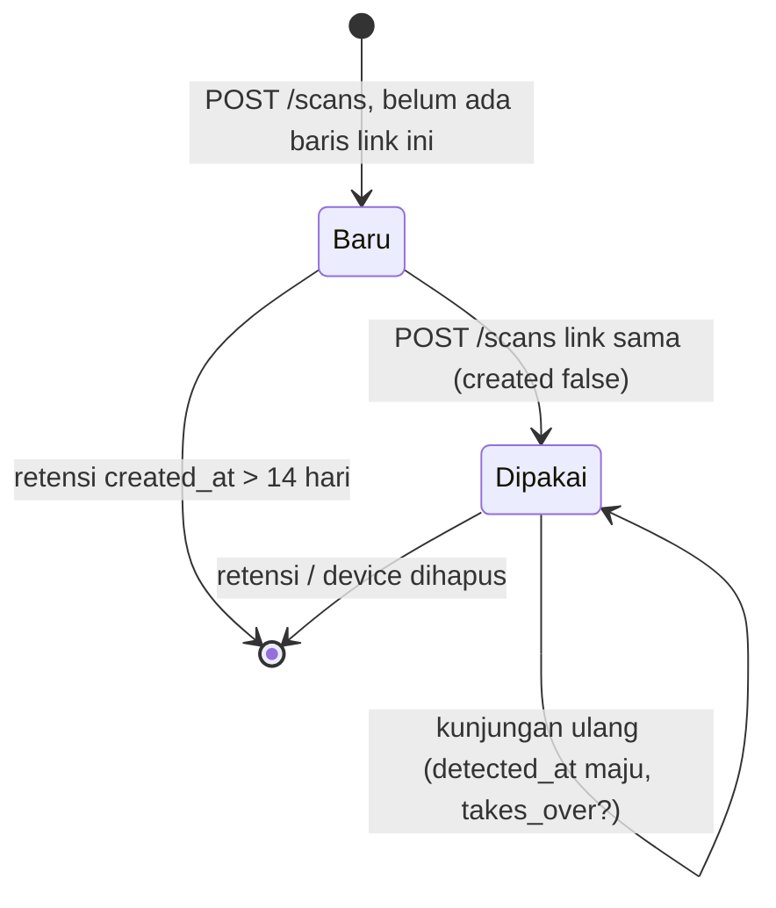
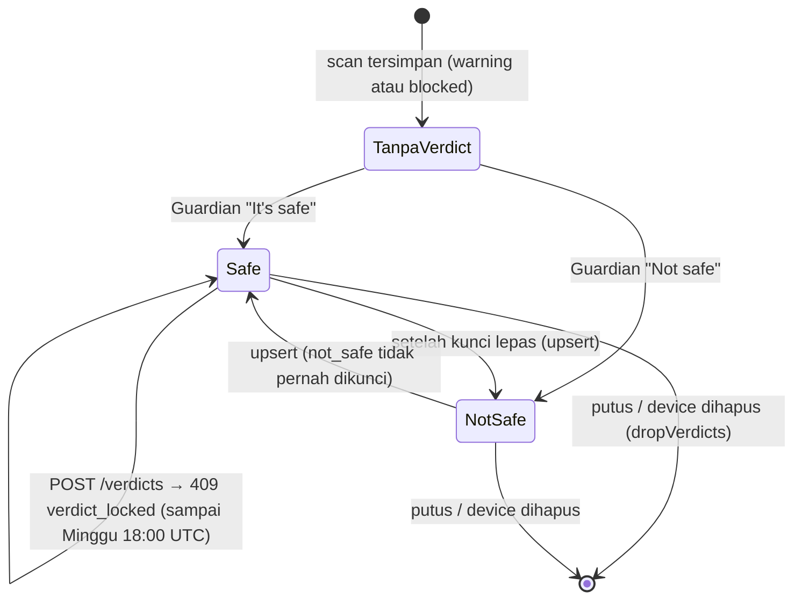
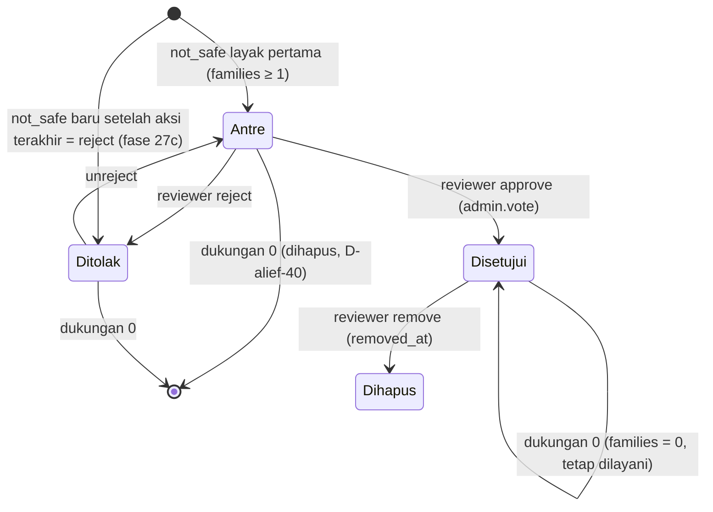
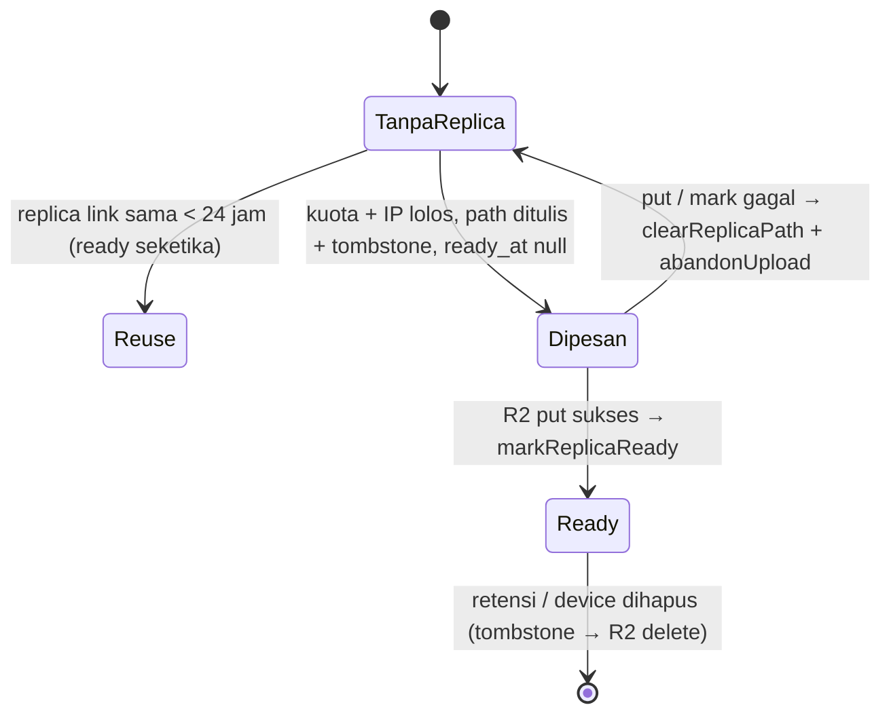
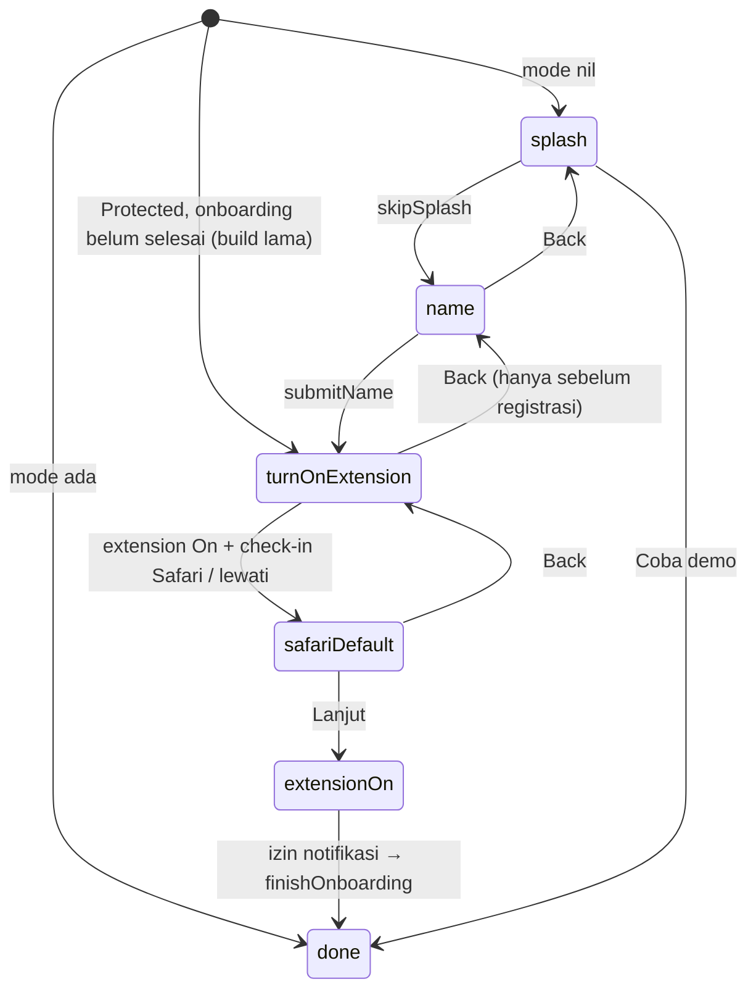
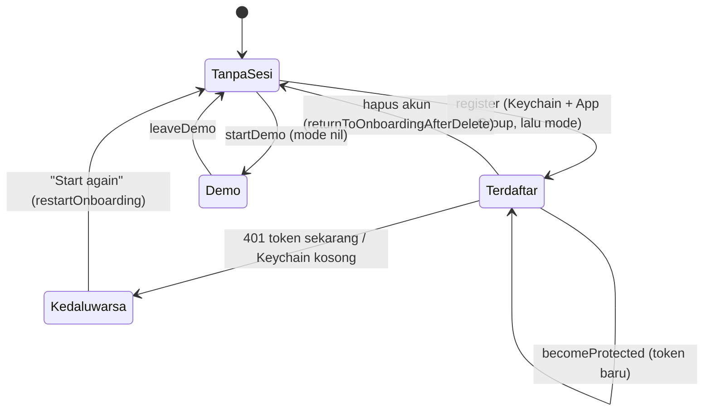

# R4 — State machine Shoo (peta dari audit fase 27)

> Ditulis ulang 15 Nov 2026 (fase 27z) dari peta state audit [`../fase-27-state-machines.md`](../fase-27-state-machines.md) + [`../log/fase-27.md`](../log/fase-27.md), diverifikasi terhadap `main` `c14abbcf`. Isi lama dihapus: kode 4 digit / 60 s, verdict per domain, verdict bertahan setelah putus.
> Path backend relatif ke `backend/api/src/`, path app relatif ke `ios/ShooApp/`. Setiap baris tabel = satu transisi: pemicu → guard → `file:baris`.
> Bukti fase 27 (`log/fase-27-repro/`) **tidak** dihapus di sini; PR terpisah setelah Q1 + Q4 ditutup.

Isi: §1 Device · §2 Kode keluarga · §3 Link keluarga (join, become-protected, putus) · §4 Pairing di app · §5 Scan · §6 Push + token push · §7 Verdict · §8 Blocklist · §9 Replica · §10 Favicon · §11 Live Activity (dihapus) · §12 Cron, retensi, `ops_jobs` · §13 Onboarding · §14 Sesi app · §15 Diterima / masih terbuka.

## 1. Device (`devices`)



| Transisi | Guard | Kode |
|---|---|---|
| Daftar | 30/jam per IP + 1000/hari semua; avatar ON-02 atau acak | `routes/devices.ts:96-117` |
| Mode tidak pernah berubah | trigger I1 | `backend/db/supabase/migrations/20261021130000_init.sql:129-140` |
| `last_seen_at` maju | hanya kalau > 5 menit | `http/auth.ts:42`, `db/repo/devices.ts:22-25` |
| Hapus (`DELETE /devices/me`) | kontak keluarga dibaca dulu, retry sekali pada 40P01/40001/55P03, objek Storage/R2 setelah commit | `routes/devices.ts:203-234` |
| Isi hapus | link → `dropVerdicts` (kunci domain) → `scans … for update` → device → tombstone path | `db/repo/devices.ts:255-271` |
| Kandidat tak aktif | K1 90 hari semua anggota keluarga; K4 30 hari, tidak pernah dipakai > 1 jam, tanpa link | `db/repo/devices.ts:175-192` |
| Hapus tak aktif | cek ulang kandidat di transaksi + `for share` keluarga + `lock_timeout` | `db/repo/devices.ts:225-247`, `cron/retention.ts:345-356` |

Mode cron `INACTIVE_DEVICES` sekarang `dry_run` (hanya hitung, `wrangler.jsonc`).

## 2. Kode keluarga (`family_codes`, GD-04, PR-03)



| Transisi | Guard | Kode |
|---|---|---|
| Keluarkan / pakai ulang | kunci Guardian; tanpa `refresh` dan sisa > 5 menit → kode lama | `services/family.ts:27-49`, `db/repo/codes.ts:14-19` |
| Kode baru | hapus semua kode Guardian, lalu 20× acak 6 digit seragam (`000000`–`999999`); bentrok aktif → coba lagi; habis → 503 `code_unavailable` | `services/family.ts:14-20,40-47`, `db/repo/codes.ts:22-39` |
| TTL | 30 menit | `db/repo/codes.ts:4` |
| Kode kedaluwarsa dipakai ulang | `on conflict … where expires_at <= now()` | `db/repo/codes.ts:34-36` |
| Hapus lama | `expires_at < now() - 1 jam` | `cron/retention.ts:194-196` |
| App | hitung mundur dari `expiresAt` (maks 30 menit), minta kode saat habis; jawaban lama tidak menimpa kode baru (token request, F-A10) | `Features/Pairing/FamilyCodeModel.swift:23,51-52,132-200` |

Respons `inviteUrl = ${INVITE_BASE_URL}/j/<code>` (`routes/family.ts:32`). Halaman `/j/<code>` hanya membaca kode (tidak pernah memakainya), lihat R3 §4.

## 3. Link keluarga (`family_links`)



### Join (`POST /family/join`, PR-01, PR-03)

```text
sql.begin (services/family.ts:107-127)
 validateJoinInTx (services/family.ts:76-101):
  1. kunci percobaan: device (kelas 1) lalu IP (kelas 2)          joinAttempts.ts:14-18
  2. ≥ 5 gagal/device atau ≥ 20 gagal/IP dalam 10 menit → 429      family.ts:79-80, joinAttempts.ts:4-7
  3. sudah punya Guardian → 409 already_connected (tidak dicatat)  family.ts:81
  4. kode tidak ada / kedaluwarsa → catat gagal, 404 / 410         family.ts:83-87
  5. kunci Guardian (urut id), cek ulang kode masih milik dia     family.ts:93-98
  6. anggota ≥ 3 → 409 family_full                                 family.ts:99
 insertLink + catat sukses → 200 { guardian }                      family.ts:113-115
 cadangan: 23505 → already_connected, 23503 → code_invalid, 23514 family_full   family.ts:118-123
```

Kegagalan dicatat di transaksi yang memegang kunci, error dilempar setelah commit. Trigger `family_links_check` (I3/I4) menegakkan mode + maks 3 di DB (`init.sql:143-169`).

### Become-protected (`POST /devices/me/protected`, PF-01 "Punya kode undangan?", fase 27a)

| Langkah | Guard / hasil | Kode |
|---|---|---|
| Batas token | 30/jam per device → 429 `too_many_attempts` | `routes/devices.ts:176-182` |
| Pre-check murah | punya anggota → 409 `has_members` (tanpa memakai percobaan) | `routes/devices.ts:185-186` |
| Validasi (1–6) | `validateJoinInTx` dengan anggaran device **lama**; kode milik sendiri → `code_invalid` (F-B1); kunci kedua Guardian urut id | `services/becomeProtected.ts:54-61`, `services/family.ts:88-95` |
| Cek ulang | Guardian lama masih tanpa anggota (F-B2) | `services/becomeProtected.ts:63` |
| (7) salinan | `insertProtectedCopy` (nama, avatar, bahasa, token push, pengaturan; `weekly_summary = false`) | `services/becomeProtected.ts:66-68`, `db/repo/devices.ts:141-156` |
| (8) hapus lama | `deleteDeviceInTx(oldId)`; sudah terhapus → batal | `services/becomeProtected.ts:69-72` |
| (9) link | `insertLink(copy, tujuan)` paling akhir (urutan kunci K3) | `services/becomeProtected.ts:76` |
| Retry | sekali pada 40P01/40001/55P03; pemetaan error | `services/becomeProtected.ts:82-121` |

Tidak ada keadaan "join commit, device lama masih ada" (F-B3). Hasil: device baru + token baru; history scan tetap milik device lama dan ikut terhapus.

### Putus

| Transisi | Guard | Kode |
|---|---|---|
| Guardian memutus anggota | 404 kalau bukan anggota; verdict Guardian itu untuk anggota dihapus (P13); push "stopped protecting you" ke anggota | `routes/family.ts:62-75`, `db/repo/families.ts:150-158` |
| Protected memutus | 404 kalau tanpa link; verdict Guardian dihapus | `routes/family.ts:111-114`, `db/repo/families.ts:160-168` |
| `dropVerdicts` | kunci domain urut `hashtext`, baris `(owner_id, url)`, hitung ulang antrean | `db/repo/verdicts.ts:142-160` |

Akses Guardian ke scan, replica, favicon, screenshot dicek dari `family_links` **setiap request** (`db/repo/scans.ts:578-624`), jadi hilang saat link hilang (SECURITY T12).

## 4. Pairing di app

| Pemicu | Guard | Hasil | Kode |
|---|---|---|---|
| Link `shoo://join?code=` atau `https://<api host>/j/<code>` | tepat 6 digit; host = API build ini atau Worker cloud | `pendingJoinCode` di router | `App/DeepLink.swift:18-63`, `App/Router.swift:60-61` |
| Kode tertunda | lebih tua dari 30 menit → dibuang | – | `App/Router.swift:186-197` |
| Kode saat app di layar utama | `routeInvite`: Guardian dengan anggota → banner "masih melindungi"; Protected dengan Guardian → banner; lainnya → sheet join (Pribadi) / Connect (Protected tanpa Guardian) | | `App/AppEnvironment.swift:590-620` |
| Kode saat onboarding | ditunda; setelah ON-05 sheet join dibuka sekali | | `App/AppEnvironment.swift:692-712` |
| Connect (Protected) | `ConnectModel`: `entering → joining → joined` atau error (invalid, expired, full, tooManyAttempts, alreadyConnected, hasMembers, offline) | `POST /family/join` | `Features/Pairing/ConnectModel.swift:9-41,162-176` |
| Sheet join (Pribadi/Guardian) | `becomeProtected`: `switchingSessions` selama request; sukses → sesi baru disimpan, mode Protected, token push + info device dikirim ulang, push lama dihapus | `POST /devices/me/protected` | `App/AppEnvironment.swift:527-556`, `Features/Profile/ProfilePages.swift:406` |

Riwayat: fase 27d memasang langkah `.consent` + Connect **di dalam** onboarding undangan. Sejak #467 (`31832aaf`) semua instal baru mulai sebagai Pribadi dan join terjadi setelah onboarding, jadi langkah itu tidak ada lagi (`Features/Onboarding/OnboardingModel.swift:42-57`); flag lama `inviteRegistrationPending` hanya dibersihkan (`:85`).

## 5. Scan (`scans`, satu baris per link)



| Transisi | Guard | Kode |
|---|---|---|
| Kunci | advisory `scanSite` per owner + domain | `db/repo/scans.ts:37` |
| Cari baris | baris owner+domain dengan `verdict_link(url)` sama | `db/repo/scans.ts:39-43` |
| Push? | kunjungan pertama ke domain, atau blokir pertama di domain | `db/repo/scans.ts:44` |
| Pakai ulang + `takes_over` | baris **dengan** verdict: hanya skor lebih tinggi; tanpa verdict: blokir mengganti waspada di skor berapa pun, waspada tidak pernah mengganti blokir (B-02) | `db/repo/scans.ts:45-88` |
| Baris baru | insert + hitung total seumur hidup | `db/repo/scans.ts:90,95-112` |
| Route | tanpa baris baru dan tanpa push → 201 `{ id, notified: null }`; favicon hanya untuk baris baru; replica + fragmen setelah push | `routes/scans.ts:176-255` |

Hitungan profil (`blocked_total`, `warning_total`) naik di setiap scan, termasuk kunjungan ulang (`db/repo/scans.ts:84-87`).

## 6. Push + token push

### Scan push (`waitUntil` setelah respons)

| Penerima | Guard | Kode |
|---|---|---|
| Guardian | pemilik Protected, link `notify` + `notify_family`, token ada, waspada tidak di jam tenang, < 10 push/10 menit | `services/push/notify.ts:34-42,52-66` |
| Device sendiri (`ownPush`) | switch `notify_blocked`/`notify_warning`, aturan sama | `services/push/notify.ts:72-85` |
| Kirim | `deliverPush`: send → 410 compare-and-clear token → `push_log` (dilewati kalau scan/device sudah dihapus) | `services/push/deliver.ts:7-24`, `db/repo/push.ts:9-32` |

Push keluarga tanpa `scanId`: putus (`routes/family.ts:67-73`), hapus akun (`routes/devices.ts:224-232`), "Ingatkan" (klaim atomik 1 per 6 jam, `db/repo/families.ts:121-141`). Push cron (`cron/notifications.ts`): "Perlindungan mati" diklaim dengan `off_notified_at`, direset saat heartbeat kembali (`:110-140`); ringkasan mingguan diklaim dengan `summary_sent_on` (`:151-168`).

Tap push di app: dengan `scanId` → Detail di mode apa pun, tanpa → Shield (`App/AppEnvironment.swift:638-645`, fase 27g).

### Token push (`devices.apns_token`)

| Transisi | Guard | Kode |
|---|---|---|
| Diset | `PATCH /devices/me { apnsToken }`; app mengirim sekali per token per device | `db/repo/devices.ts:92`, `App/AppEnvironment.swift:665-682` |
| Device baru di app | `register` / `becomeProtected` mereset `sentPushToken` + epoch | `App/AppEnvironment.swift:275-278,548-551` |
| Dikosongkan | APNs 410, hanya kalau token masih sama | `db/repo/push.ts:30-32` |
| `null` | `PATCH /devices/me { apnsToken: null }` | `db/repo/devices.ts:92` |

## 7. Verdict (`verdicts`, per link, GD-07, EX-06)



| Transisi | Guard | Kode |
|---|---|---|
| Putuskan | scan ada; pemilik = Guardian sendiri atau anggota (link `for share`); warning atau blocked | `db/repo/verdicts.ts:37-60` |
| Kunci `safe` | `safe` di link ini dikunci sampai Minggu 18:00 UTC pertama setelah diputuskan (#476) | `db/repo/verdicts.ts:67-71`, `db/repo/verdictLock.ts:13-21` |
| Upsert | PK `(owner_id, url)`, `url = verdict_link(scan.url)` (origin + path, #241); catatan ≤ 280 | `db/repo/verdicts.ts:88-111` |
| Kelayakan antrean | `not_safe`, pemilik Protected terhubung, domain tidak dilindungi, maks 10 domain baru/24 jam per Guardian | `db/repo/verdicts.ts:62-83`, `db/repo/domainLists.ts:11` |
| Baca (`GET /verdicts?url=&domain=`) | link persis → `not_safe` di domain (bukan host bersama) → null; `safe` tidak keluar dari link-nya | `db/repo/verdicts.ts:167-180` |
| Baca usang (`?domain=`) | `not_safe` mana pun, lalu `safe` terbaru (F-B14, sesuai kontrak lama) | `db/repo/verdicts.ts:186-195` |
| Hapus | putus / hapus device (P13). Retensi **tidak** menghapus verdict (D-alief-14), hanya `notes` setelah 14 hari | `db/repo/verdicts.ts:142-160`, `cron/retention.ts:178-193` |

Extension: layar blokir polling `GET /verdicts` 2 s selama 2 menit, 5 s sampai 10 menit, lalu 15 s; 429 → tunggu `Retry-After`; berhenti setelah verdict pertama (`ios/ShooExtension/Resources/blocked-page.js:8-12,72-73`, PR #414).

App: `GuardianHomeModel.decide` memasang verdict hanya ke scan dengan id itu, epoch menahan refresh lama (`Features/Shield/GuardianHomeModel.swift:248-264`, fase 27e); Detail sama (`Features/Detail/DetailModel.swift:145-152,252`); Activity memuat ulang kalau `verdictSaves` berubah (`Features/Activity/ActivityModel.swift:159`); kunci `safe` dihitung sama di app (`Features/Detail/VerdictLock.swift:17-26`).

## 8. Blocklist (`blocklist_entries`)



| Transisi | Guard | Kode |
|---|---|---|
| Masuk / hitung ulang | `queue_blocklist_domain(domain, n)` (`security definer`): insert atau update `families`; aksi terakhir di `admin.review_decisions` = reject → disisipkan sudah ditolak | `db/repo/verdicts.ts:119-128`, `backend/db/supabase/migrations/20261111100000_queue_blocklist_domain.sql` |
| Dukungan 0 | baris belum disetujui dan belum dihapus → dihapus; yang disetujui → `families = 0` | `db/repo/verdicts.ts:129-133` |
| Dilayani | hanya `approved_at` terisi; `removed[]` kalau `since` diisi | `db/repo/blocklist.ts:18-45` |

Worker tidak bisa approve/reject (grant kolom `domain, families` saja, R2 §3).

## 9. Replica (`scans.replica_*`, R2 `shoo-replicas`, EX-07)



| Transisi | Guard | Kode |
|---|---|---|
| Mulai | kill-switch `REPLICAS_ENABLED`, binding R2 ada, scan baru, setelah push | `routes/scans.ts:234-243`, `services/replicas.ts:85-94` |
| Pre-check | reuse link, kuota (pemilik, keluarga, byte, global, cadangan) sebelum IP + inflate | `db/repo/scans.ts:309-322`, `services/replicas.ts:96-104` |
| IP | 300/24 jam | `services/replicas.ts:106-111` |
| Pesan | kunci per pemilik + kunci global `(replica, 0)`; scan hilang → `gone` | `db/repo/scans.ts:344-370` |
| Ready | hanya kalau baris masih menunjuk path itu | `db/repo/scans.ts:501-504`, `services/replicas.ts:122-136` |
| Dilayani | `replica_ready_at` terisi + akses keluarga saat ini | `db/repo/scans.ts:619-624` |

F-B9 (baris "dipesan" macet kalau `waitUntil` mati) belum diukur (§15).

## 10. Favicon (`scans.favicon_*`, R2, PR-05)

Sama dengan replica, tanpa kuota keluarga: reuse pemilik + domain 24 jam (hanya yang ready), else 30 unduhan/hari per pemilik + 1000/hari semua, unduh, `put`, `markFaviconReady` (fase 27k F-B8).

| Transisi | Kode |
|---|---|
| Pesan / reuse | `db/repo/scans.ts:209-230` |
| Batal | `db/repo/scans.ts:236-241` |
| Ready | `db/repo/scans.ts:249-252`, `services/favicons.ts:72` |
| Dilayani / dipakai ulang hanya kalau ready | `db/repo/scans.ts:259-265,537,606-611` |
| Alur | `services/favicons.ts:27-82` (+ salinan per domain ke arsip `shoo-replica-archive`, `:81`) |

## 11. Live Activity (dihapus)

Dynamic Island / Live Activity (EX-03, #49) dihapus di #555 (17 Nov 2026): tidak ada lagi `POST /live`, `services/push/live.ts`, `App/LiveActivityTokens.swift`, maupun kolom token Live Activity (migrasi `20261117120000_drop_live_activity_tokens.sql`). Field lama yang masih dikirim build lama ke `PATCH /devices/me` diabaikan (`routes/devices.ts:53`). Nomor bagian dipertahankan supaya tautan lama tidak bergeser.

## 12. Cron, retensi, `ops_jobs`

`scheduled` memilih job dari ekspresi cron (`index.ts:10-31`): `0 19 * * *` retensi (03:00 WITA), `5 * * * *` notifikasi per jam.

Retensi (`cron/retention.ts:116-223`), tiap langkah berdiri sendiri, error pertama dilempar di akhir:

```text
heartbeat ops_heartbeat('cron')               :131-133   (sinyal anti-pause, tidak bergantung langkah lain)
ops_start                                     :136
plain_scans: scan tanpa file, 2000 × maks 25   :141
scans: scan dengan screenshot/favicon/replica  :142, :241, :333   (tombstone → Storage/R2 delete)
tombstones: Supabase 500, R2 + arsip dari sisa anggaran 40 batch   :143-177
verdict_notes: notes null setelah 14 hari      :178-193
family_codes > 1 jam lewat, join_attempts > 1 hari, push_log > 14 hari, rate_limit_hits > 1 hari   :194-212
inactive_devices (off | dry_run | delete)       :216, :345-380
ops_finish (failed, backlog)                    :219
```

`ops_jobs` per job (`retention`, `notifications`):

| Transisi | Kode |
|---|---|
| `started_at = now()` | `db/repo/ops.ts:15-18` |
| `finished_at`, `failed`, `backlog`; `ok_at` hanya kalau `failed = 0` | `db/repo/ops.ts:21-28` |
| Dibaca `GET /ops/status` (umur run, gagal, backlog) | `routes/ops.ts:38-60`, `services/opsStatus.ts:30` |
| Notifikasi menulis start/finish; gagal tulis tidak menggagalkan push | `cron/notifications.ts:42,69,76-82` |

`started_at` lebih baru dari `finished_at` = run sedang jalan atau mati di tengah.

## 13. Onboarding (app, ON-01..05)



| Transisi | Guard | Kode |
|---|---|---|
| Langkah awal | mode nil → splash; Protected belum selesai → ON-04; lainnya → done | `Features/Onboarding/OnboardingModel.swift:81-94` |
| Name → ON-04 | nama valid (aturan sama dengan server); kode undangan tetap di router | `Features/Onboarding/OnboardingModel.swift:113-118` |
| Back | tidak saat `isWorking`; ON-04 → Name hanya kalau belum terdaftar | `Features/Onboarding/OnboardingModel.swift:121-134` |
| Daftar (tap pertama ON-04) | consent: checkbox hanya kalau belum dijawab; jawaban "tidak" sebelumnya tidak ditimpa; registrasi sebagai Pribadi (Guardian, Family mode mati) | `Features/Onboarding/OnboardingModel.swift:137-176` |
| ON-04 → Safari default | terdaftar, extension On, sudah check-in, bukan setelah Back | `Features/Onboarding/OnboardingModel.swift:181-196` |
| Selesai | `onboardingCompleted = true`; kode undangan → sheet join sekali | `App/AppEnvironment.swift:692-712` |
| Root | sessionExpired → dataConsent (device lama tanpa jawaban, hanya setelah onboarding) → main → onboarding | `App/RootView.swift:16-19`, `App/AppEnvironment.swift:236-238` |

## 14. Sesi app



| Transisi | Guard | Kode |
|---|---|---|
| Daftar | hapus device instal sebelumnya (token Keychain tanpa mode) dulu; simpan sesi **sebelum** mode; gagal simpan → sesi dikosongkan; reset token push, info device, Live Activity | `App/AppEnvironment.swift:259-309` |
| Simpan / hapus sesi | Keychain + key App Group | `Data/SessionStore.swift:86,174-181` |
| Cek saat launch | Keychain tanpa token + mode ada → Kedaluwarsa | `App/AppEnvironment.swift:419-436` |
| 401 | hanya token **sekarang**, dan tidak selama `becomeProtected` (`switchingSessions`, F-A3) | `App/AppEnvironment.swift:441-444,527-529` |
| Kedaluwarsa | sesi dikosongkan, layar hanya untuk device terdaftar, push tampil dihapus | `App/AppEnvironment.swift:447-454` |
| becomeProtected | 401 request itu sendiri → Kedaluwarsa; gagal simpan → Kedaluwarsa | `App/AppEnvironment.swift:527-556` |
| Start again | sesi, router, settings direset | `App/AppEnvironment.swift:482-488` |
| Setelah hapus akun | `sessionExpired = false` (401 lain yang telat tidak memunculkan layar, F-N7) | `App/AppEnvironment.swift:493-500` |
| Foreground | heartbeat extension + info device sekali per device | `App/AppEnvironment.swift:315-345` |

## 15. Diterima / masih terbuka

| ID | Status | Catatan |
|---|---|---|
| F-B4 (27b, Q4) | terbuka | Komentar `db/repo/scans.ts:47` masih menyebut Q4. Sejak #447 baris per link, jadi kunjungan link lain membuat baris baru; bentuk awal F-B4 (url baris pindah ke link lain) tampaknya tidak terjadi lagi. **Belum dites ulang.** |
| F-B5 (Q1) | terbuka | Guardian melihat scan anggota dari sebelum terhubung (`routes/scans.ts:274-277`, `db/repo/scans.ts:578-590`) |
| F-B9 | belum diukur | replica "dipesan" macet; LANGKAH MANUAL fase 27 |
| F-B10 | diterima | arsip admin menyimpan data kunjungan pertama |
| F-B11 | diterima | check-then-act kecil (membership GET /scans, target push sebelum respons, cap push) |
| F-B13 | diterima | baris yang terus dikunjungi tetap kedaluwarsa menurut `created_at` (`cron/retention.ts:241`) |
| F-N8 | diterima | cursor blocklist = waktu tulis, bukan commit |
| F-N9 | diterima | paging `(detected_at, id)`: baris dikunjungi ulang melompat ke atas |
| F-A9 (Q3) | terbuka | "Dimatikan" baru terlihat Guardian setelah jendela 24 jam |

Nomor baris di `fase-27-state-machines.md` mengacu ke `02d590e4` (11 Nov) dan banyak yang bergeser (contoh: `routes/devices.ts:163-199` → `:172-197`; `services/family.ts:58-91` → `:76-127`; `AppEnvironment.swift:188/384-402/436-450` → `:236/527-556/638-645`; langkah `.consent` 27d dihapus #467). File itu tidak diubah di 27z.
