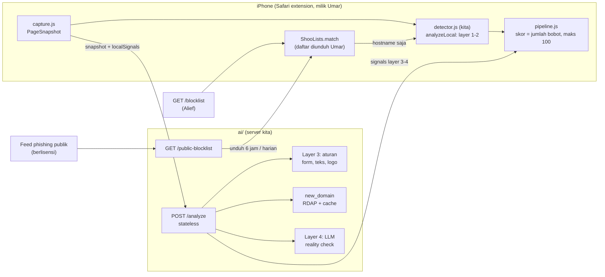

# Shoo · Team AI — Arsitektur teknis (1 halaman)

> Cakupan: `detector/` (layer 1–2, di HP) dan `ai/` (layer 3–4, server). Extension (Umar) dan app/backend (Alief) hanya tetangga.
> Kontrak: `contracts/detector-interface.md`, `contracts/api.md` (bagian AI + Blocklist), `contracts/scan-result.schema.json`.

## 1. Gambaran besar

Dua aturan bentuk arsitektur: **detector tanpa jaringan** (URL tidak keluar dari HP untuk layer 1–2) dan **`/analyze` stateless** (halaman dikirim untuk dianalisis, tidak disimpan).

## 2. Alur satu halaman

1. Extension menangkap `PageSnapshot` (url, domain, title, lang, text ≤ 20.000 karakter, forms tanpa nilai, imageAlts ≤ 50).
2. `analyzeLocal` (kita): `ShooLists.match(hostname)` → bila cocok `db_match` (100) dan berhenti. Bila tidak → aturan nama link (layer 2). Maks layer 2 saat ini = 54.
3. Extension menjumlahkan bobot dan menampilkan: <30 diam, 30 popup pertama, 50 popup kedua + form dicoret, ≥80 blokir.
4. Paralel, extension memanggil `POST /analyze` dengan `{ snapshot, localSignals }`. Timeout klien 8 detik → dianggap tanpa sinyal.
5. Server: layer 3 (aturan, jawab sendiri) + `new_domain` (RDAP) jalan paralel; layer 4 (LLM) hanya bila lolos gerbang biaya (`ref/R1` §4). Server mati/timeout → layer 1–2 tetap.
6. `pipeline.js` hanya menerima sinyal **layer 3–4** dari server (`validSignals(remote,[3,4])`); sinyal layer lain dibuang diam-diam (lihat TODO C2 untuk `new_domain`).
7. Hanya skor ≥ 30 yang disimpan (`POST /scans`, urusan Alief). Halaman itu sendiri tidak.

## 3. Komponen dan stack

| Komponen | Stack | Folder | Catatan |
|---|---|---|---|
| Detector | JavaScript polos (tanpa ES modules), dibangun `scripts/build.mjs` (brands.json disisipkan) → satu script | `detector/` → `ios/ShooExtension/Resources/detector.js` | Tidak pernah melempar (`[]` saat error), < 50 ms, tanpa jaringan |
| Data brand | `brands.json` (25 brand) | `detector/data/` | Domain resmi tanpa sinyal; perlu verifikasi manual 3 domain (TODO C3) |
| Service | **Usulan:** Cloudflare Worker + Hono + TypeScript (D-imelda-01, belum dikonfirmasi) | `ai/src/` | Stateless; runtime Web API |
| Layer 3 | Aturan murni (tanpa model) | `ai/src/layer3/` | Harus menjawab walau LLM mati |
| `new_domain` | RDAP dari server + cache per domain | `ai/src/rdap/` | Sumber/kuota RDAP BELUM DIVERIFIKASI (fase 03) |
| Layer 4 | LLM, output JSON terstruktur, model via `.env` | `ai/src/layer4/`, `ai/prompts/` | Model dipilih setelah eval (TODO A2) |
| Blocklist publik | Agregasi feed, PSL, allowlist | `ai/src/blocklist/` | Respons sama bentuk dengan `GET /blocklist` |
| Eval | Node, tanpa dependensi | `ai/eval/` | `run.mjs`, `tools/capture.mjs`, `tools/snapshot.mjs`, `data/{scam,legit}/` |

## 4. Hosting dan kuota (semua **BELUM DIVERIFIKASI** sampai fase 08)

| Layanan | Batas yang relevan | Penjaga |
|---|---|---|
| Cloudflare Workers Free (bila D-imelda-01 disetujui) | CPU per request pendek, subrequest terbatas, 100k request/hari | Kerja berat hanya I/O (RDAP, LLM) yang ditunggu, bukan CPU; aturan regex diukur pada teks 20.000 karakter |
| RDAP | Batas laju per server RDAP | Cache per domain; timeout pendek; gagal = tanpa sinyal |
| API LLM | Biaya per token, batas laju penyedia | Gerbang biaya (`ref/R1` §4), pemutus anggaran harian |
| Feed publik | Lisensi, frekuensi unduh | Unduh terjadwal, simpan hasil olahan, bukan proxy langsung |

Ukuran daftar: target ≤ 200.000 domain dalam satu respons.

## 5. Titik sambung dengan tim lain

| Dengan | Titik | Status |
|---|---|---|
| Umar | `ShooLists.match`, `pipeline.js` (hanya layer 3–4 dari server), `ai.baseURL`, snapshot (iframe?) | TODO C1, C2, C4 |
| Alief | Blocklist `GET /blocklist` diunduh extension, bukan kita; `POST /scans` menyimpan hasil ≥ 30; URL publik dikirim setelah fase 08 | TODO C4 |
| PM | Keputusan 2026-10-21: halaman dikirim untuk analisis, tidak disimpan | `contracts/api.md` |
