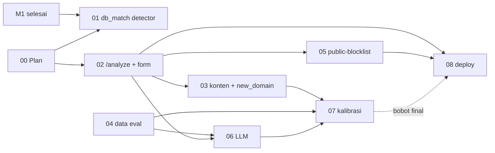

# Plan detail per fase — Shoo · Team AI (Imelda)

> Rencana kerja teknis Imelda untuk Shoo: deteksi scam on-device (`detector/`) dan server (`ai/`).
> Tugas resmi: [`../../docs/mandates/imelda.md`](../../docs/mandates/imelda.md). Kontrak (read-only untuk kita): [`../../contracts/`](../../contracts/).
> Pola plan meniru [`../alief/`](../alief/README.md) (PROGRESS, PROMPT, TODO, DECISIONS, satu file per fase), diringkas karena lingkup Team AI lebih kecil.
> Status M1 dan kerangka M2 (sudah merge, PR #25 dan #26): lihat `git log -- detector ai`.

---

## 1. Cara pakai

0. Pertama kali: jalankan [`VERIFY_PROMPT.md`](VERIFY_PROMPT.md) (read-only) supaya AI menandai celah plan.
1. Buka Claude Code di root clone `Final-CH7`.
2. Ketik satu kalimat:
   `Saya Imelda, Team AI. Kerjakan otomatis sesuai plan/imelda/PROMPT.md (mode auto).`
3. Agent membaca `PROGRESS.md`, memilih fase `[ ]` pertama, mengerjakannya, lalu **berhenti sebelum push/PR** dan bertanya (aturan kerja Imelda: push dan PR hanya setelah dia bilang boleh).
4. Agent berhenti juga untuk LANGKAH MANUAL (key API, deploy, data yang harus dikumpulkan manusia) dan blocker P0.

---

## 2. Struktur folder

```text
plan/imelda/
├── README.md        ← file ini
├── PROMPT.md        ← satu prompt eksekusi
├── PROGRESS.md      ← status fase + requirement mandat + gate
├── TODO.md          ← keputusan, akses/secret, pesan ke Umar (Imelda yang mengirim)
├── ARCHITECTURE.md  ← arsitektur 1 halaman (detector, /analyze, RDAP, LLM, daftar publik)
├── SECURITY.md      ← aturan secret + threat model A1–A13 + privasi Q1–Q5
├── VERIFY_PROMPT.md ← review independen seluruh plan (read-only), jalankan sebelum fase 01
├── fixbug.md        ← tracker perbaikan dari eval (satu temuan = satu test gagal = satu commit)
├── ref/
│   ├── R1-sinyal-bobot-anggaran.md ← tabel sinyal + bobot, anggaran latensi 8 s, gerbang + biaya LLM
│   └── R2-protokol-eval.md         ← komposisi set, pemisahan tuning/uji, cara membaca hasil
├── fase-01 … fase-08
└── log/
    ├── DECISIONS.md ← D-imelda-NN, append-only
    └── fase-XX.md   ← laporan per fase (dibuat agent)
```

---

## 3. Peta fase

M1 sudah selesai (merged), jadi fase dimulai dari sisa mandat. Urutan mengikuti saran handoff: yang kecil dan tanpa dependensi dulu.

| No | Fase | Mandat | Branch | Output utama | Bergantung pada |
|---|---|---|---|---|---|
| 00 | Plan | – | `docs/imelda-plan` | folder `plan/imelda/` | – |
| 01 | Layer 1 sisi detector | M5-B | `feat/AI-M5-detector` | `db_match` lewat `ShooLists.match`, test dengan mock | – |
| 02 | `/analyze` + sinyal form | M3 | `feat/AI-M3-forms` | service Hono, `asks_*`, sampel `lphone-login` | keputusan stack (D-imelda-01) |
| 03 | Sinyal konten + `new_domain` | M3 | `feat/AI-M3-content` | `urgent_language`, `brand_logo_offsite`, RDAP + cache | 02, jawaban Umar soal layer `new_domain` |
| 04 | Data eval set | M2 | `feat/AI-M2-eval-data` | ≥ 50 scam + ≥ 50 legit, tersamarkan | LANGKAH MANUAL (sumber data) |
| 05 | Layer 1 sisi server | M5-A | `feat/AI-M5-server` | `GET /public-blocklist?since=` | 02 (service), pilihan sumber daftar |
| 06 | Reality check LLM | M4 | `feat/AI-M4-reality-check` | prompt + JSON terstruktur → `unreasonable_request` | 02, 04, pilihan model + API key |
| 07 | Kalibrasi bobot | M6 | `feat/AI-M6-calibration` | bobot final + tabel eval sebelum/sesudah | 03, 04, 06 |
| 08 | Deploy | M7 | `feat/AI-M7-deploy` | URL HTTPS publik, rate limit, batas body | 02, 05; kirim URL ke Umar + Alief |

### Model dan skill per fase (usulan)

| Fase | Model | Skill/agent | Review keamanan |
|---|---|---|---|
| 01 | Sonnet 5.5 | `superpowers:test-driven-development`, `ecc:code-reviewer` | – (cek A11) |
| 02 | Opus 5.5 | `ecc:api-design`, `ecc:backend-patterns`, `ecc:typescript-reviewer` | ✓ |
| 03 | Opus 5.5 | `ecc:typescript-reviewer` | ✓ (A2 RDAP) |
| 04 | Sonnet 5.5 | `ecc:code-reviewer` | – (cek A6) |
| 05 | Opus 5.5 | `ecc:api-design`, `ecc:typescript-reviewer` | ✓ (A7, A8) |
| 06 | Opus 5.5 | `ecc:cost-aware-llm-pipeline`, `ecc:typescript-reviewer` | ✓ (A1, A10) |
| 07 | Sonnet 5.5 | `ecc:eval-harness`, `ecc:verification-loop` | – |
| 08 | Opus 5.5 | `ecc:deployment-patterns` | ✓ (A9) |

Semua fase: `superpowers:test-driven-development`, `superpowers:verification-before-completion`, dan cek checklist [`SECURITY.md`](SECURITY.md) §5. Skill yang tidak terpasang dilewati dan dicatat di log fase.

**Gate:** 02 sebelum 03/05/06 · 04 sebelum 06/07 (tanpa data, kalibrasi tidak bermakna) · 08 butuh akun hosting (TODO B).

---

## 4. Grafik dependensi



---

## 5. Aturan emas

1. **Folder = tim.** Hanya `detector/`, `ai/`, `plan/imelda/`, dan `ios/ShooExtension/Resources/detector.js` (hasil sync saja). Selebihnya berhenti dan tanya.
2. **Kontrak dulu.** `contracts/` milik Umar. Sinyal baru atau field baru di `PageSnapshot` = usulan di PR + TODO §C, bukan edit sendiri.
3. **`detector.js` tanpa jaringan.** Data blocklist hanya lewat `ShooLists.match`.
4. **`evidence` layer 3–4 = teks persis dari halaman** (di-stabilo extension). Jangan parafrase atau terjemahkan.
5. **`label` dan `labelSimple` selalu dua bahasa** `{ "en", "id" }`. `labelSimple` tanpa istilah teknis.
6. **Hindari false positive dulu.** Pengguna inti adalah orang tua; extension yang dimatikan = perlindungan nol. Kasus ambigu diberi bobot kecil dan tidak mencapai 30 sendirian.
7. **Server stateless dan tanpa log isi halaman.** Tidak ada URL, teks, atau form di log. Hasil RDAP boleh di-cache per domain.
8. **Test adalah bukti.** TDD; "selesai" hanya dengan keluaran perintah (`node --test ...`).
9. **Tanpa secret di repo.** Key LLM hanya di `.env` (gitignored); commit `.env.example`.
10. **Target tidak diturunkan diam-diam.** Kalau eval tidak mencapai target, laporkan angkanya ke Umar.

---

## 6. Definisi selesai (MVP Imelda)

Dari mandat, diukur di eval set:
1. Semua domain di `brands.json` + 100 situs populer Indonesia mendapat skor **< 30**.
2. ≥ 90% scam skor **≥ 50**, dan ≥ 70% skor **≥ 80**.
3. `analyzeLocal` < 50 ms; `POST /analyze` p95 < 8 detik; layer 3 tetap menjawab saat LLM mati.
4. Setiap sinyal punya `label` + `labelSimple` dalam EN dan ID.
